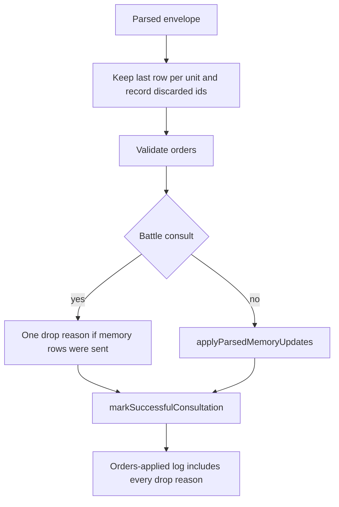

# Commander Envelope Application Plan

> **For agentic workers:** Follow the phases in order. Each phase is verifiable before the next one starts. Do not commit or push. Do not copy phase names, or this plan's title, into code, comments, product docs, or lint messages. If a line number in this plan disagrees with the code, trust the code.

**Goal:** Persist `memoryUpdates` from a strategic order envelope, require content and tier on a write in the response schema, and log a drop reason when an earlier order row for the same unit is discarded in favor of a later one.

**Architecture:** The response schema grows two memory-row branches so a write must name content and tier. A new function applies those rows through the existing `executeMemory` path and returns drop reasons. `applyParsedRequestOrders` calls it once, after order validation and immediately before `markSuccessfulConsultation`, and appends those reasons to the list it already logs. Duplicate rows stay last-wins; a pure helper reports which earlier rows were discarded so the same list can name them. Battle consults do not write memory.

**Tech stack:** TypeScript, Node tests compiled under `dist/main/`, living docs in `doc/`.

## Global Constraints

- Do not commit or push. Leave the worktree for review.
- New and updated fields and methods get orienting comments in the file's existing shape: Purpose, When to use, Expected outcome, Exceptions. Interface fields state the contract.
- Public main-process methods log at debug. A rejected memory row is not an exception: log it by appending a drop reason, which the existing orders-applied debug line already prints. Do not add a new consult-log sentence. The player-facing line stays `N validation note(s)` when the combined drop list is non-empty. Do not put memory content in a log line or a drop reason.
- A memory failure does not fail the consultation, does not roll back orders, and does not change the existing `success: true` return. `executeMemory` already catches and returns `{ status: 'error' }`. Map that status to a drop reason. Do not throw from the new function.
- Tests cover the happy path and the essential failure cases named in each phase. Do not add tests that only lock a comment, a constructor, or an accessor.
- Files under `src/` stay camelCase. Exported functions are camelCase. No `Utils` or `Impl`. No new dependency.
- Keep each changed source file under 1000 lines. Pass an args object when a new function would otherwise take more than six named parameters.
- Update the living docs named in each phase in that same phase. Leave [doc/devleopment-plan-v3.4.md](doc/devleopment-plan-v3.4.md), [doc/poc-analysis.md](doc/poc-analysis.md), [doc/market-research.md](doc/market-research.md), and everything under `.spec/completed/` as they are. Leave captured prompt and response snapshots alone except the one sentence named in Phase 2: [doc/ai-commander-prompts/example-strategic-prompt.md](doc/ai-commander-prompts/example-strategic-prompt.md) and [doc/ai-commander-prompts/example-tactical-prompt.md](doc/ai-commander-prompts/example-tactical-prompt.md) stay as captured text.
- Do not change move, shot, ferry, or embark outcomes. Last row for a unit still wins. Do not reject a destination for being absent from Best Options.
- A write whose `tier` is missing is dropped. Do not store it as `stored`. `executeMemory` defaults a missing tier to `stored`; this path must not use that default.
- Do not change `normalizeMemoryUpdates`. It already keeps a write whose content is `''`, copies a string `value` onto `content`, and leaves `tier` undefined when the model omits it. The new function reads `MemoryUpdateItem` only. It does not look for `value`.
- Compiled tests are under `dist/main/`. `npm test` runs each file with `node <file>`. Do not use `node --test`, and do not look under `dist/openRouter/` or `dist/tools/`.
- Do not call `initDatabase`. That opens the match file `game-baseline-v12.sqlite`. A closed database handle makes `write()` return `status: 'ok'` without inserting a row, because `run()` returns immediately when the handle is null. The happy-path test below opens a temporary file so the read can prove the row was stored.

## Out of scope

Leave these alone. They are not part of this plan:

- A legal `targetUnitId` that names a unit standing on a listed hex.
- Standing orders the model did not replace, a naval destination absent from Best Options, a ferry to the unit's current hex, and an air queue the model left blocked.
- Country labels in an older briefing, including Clipperton.
- Older briefing sentences that tell the model to choose targets itself. Current briefing text already says to copy a listed row.
- Combat resolution, production application, and which row `dedupeByUnitKeepLast` keeps.



## Phase 1: Memory row schema

**Files:**
- Modify: [src/main/openRouter/promptSpec/envelopeJsonSchema.ts](src/main/openRouter/promptSpec/envelopeJsonSchema.ts) (`memoryUpdates` case)
- Modify: [src/main/openRouter/promptSpec/envelopeJsonSchema.test.ts](src/main/openRouter/promptSpec/envelopeJsonSchema.test.ts) (call the new test from `run()`)
- Modify: [src/main/openRouter/promptText.ts](src/main/openRouter/promptText.ts) (`MOVEMENT_INSTRUCTION_MEMORY_SUFFIX`)
- Modify: [src/main/openRouter/promptContracts.test.ts](src/main/openRouter/promptContracts.test.ts) (add the function and a row in the `tests` array that `run()` walks)

**Produces:** `memoryUpdates` items are an `anyOf` of two closed objects, and that items node has no other key. A write requires `action`, `key`, `content`, and `tier`. A delete requires `action` and `key` and does not list `content` or `tier`.

The taught example in [src/main/openRouter/promptContracts.ts](src/main/openRouter/promptContracts.ts) and [src/main/openRouter/promptSpec/envelopeContract.ts](src/main/openRouter/promptSpec/envelopeContract.ts) already includes `content` and `tier` on its write. Do not edit those examples. `testTaughtExamplesFitSchema` must still pass.

`schemaMismatch` honors `anyOf` only when the node has no `properties` key. A sibling `type` or `properties` makes Gemini ignore the branches. Copy the bare-`anyOf` shape of `orderRowSchema` and `airStrikeRowSchema`.

`getMovementOrderInstruction` returns before it concatenates `memorySuffix` when `planningEnabled` is true. Strategic commander consults use planning tools, so they never see this suffix. The JSON example and [doc/ai-commander-prompts/strategic-prompt.md](doc/ai-commander-prompts/strategic-prompt.md) section 3.2 already require content and tier on a write. Still update the suffix: the orders-only and fallback returns append it, and it currently teaches a write with no content. Do not append the suffix on the two planning returns.

- [x] **Write the failing schema test** in `envelopeJsonSchema.test.ts`, using the existing `schemaMismatch` and `envelopeSchema(STRATEGIC_ALL_ON)`. Read `memoryUpdates.items`. Assert `Object.keys(items)` is exactly `['anyOf']`. Assert these rows:

```typescript
{ action: 'write', key: 'turn_objectives', tier: 'persistent', content: 'Hold the coast.' } // fits
{ action: 'write', key: 'turn_objectives', tier: 'persistent' } // missing content, fails
{ action: 'write', key: 'turn_objectives', content: 'Hold the coast.' } // missing tier, fails
{ action: 'delete', key: 'turn_objectives' } // fits
{ action: 'delete', key: 'turn_objectives', content: 'gone' } // content is not on the delete branch, fails
```

Call the new function from `run()`. A fit is `schemaMismatch(...) === undefined`. A failure is a defined string.

- [x] Add `memoryUpdateRowSchemas()` next to `rangedAttackRowSchemas`. The items node passed to `arraySchema` is only `{ anyOf: [...] }`. Each branch is `closedObjectSchema`. The write branch's `action` enum is `['write']` and its required keys are `action`, `key`, `content`, and `tier`. The delete branch's `action` enum is `['delete']` and its required keys are `action` and `key`. Reuse `STRING_SCHEMA` and `enumSchema(MEMORY_TIERS)`. Do not put `type`, `properties`, or `required` on the items node beside `anyOf`.
- [x] In the `memoryUpdates` case, pass that items node to `arraySchema`.
- [x] Replace the suffix with this exact string:

```typescript
const MOVEMENT_INSTRUCTION_MEMORY_SUFFIX =
  ' Include a memoryUpdates entry (e.g. write key "strategy" tier "persistent" content "this turn\'s objectives") in your final JSON to record your plan.';
```

- [x] **Write the prompt test** in `promptContracts.test.ts` and add it to the `tests` array. `getToolFlags(['memory_read'])` has memory on, planning off, and fallback movement on. `getMovementOrderInstruction` of those flags in `'strategic'` mode includes `content`. `getMovementOrderInstruction(getToolFlags(['plan_route', 'memory_read']), 'strategic')` does not include `memoryUpdates entry`. Use `import * as assert from 'assert'`, which that file already uses.
- [x] **Verify:** `npm run build:main`, then `node dist/main/openRouter/promptSpec/envelopeJsonSchema.test.js` and `node dist/main/openRouter/promptContracts.test.js`. Search `doc/` for `write key "strategy"`. No living doc quotes that suffix, so no doc edit in this phase.

## Phase 2: Apply memory rows

**Files:**
- Create: [src/main/openRouter/applyParsedMemoryUpdates.ts](src/main/openRouter/applyParsedMemoryUpdates.ts)
- Create: [src/main/openRouter/applyParsedMemoryUpdates.test.ts](src/main/openRouter/applyParsedMemoryUpdates.test.ts)
- Modify: [src/main/openRouter/requestOrdersApplyParsed.ts](src/main/openRouter/requestOrdersApplyParsed.ts) (immediately before `markSuccessfulConsultation`)
- Modify: [doc/hybrid-ai.md](doc/hybrid-ai.md) (the Writes vs reads section)
- Modify: [doc/ai-commander-prompts/assembly-contract.md](doc/ai-commander-prompts/assembly-contract.md) (section 5.1, rule 6)
- Modify: [doc/ai-commander-prompts/example-strategic-response.md](doc/ai-commander-prompts/example-strategic-response.md) (the sentence above the completion)

**Produces:**

```typescript
export function applyParsedMemoryUpdates(args: {
  seatId: AiSeatId;
  turnNumber: number;
  updates: readonly MemoryUpdateItem[] | undefined;
  tactical: boolean;
}): { appliedCount: number; dropReasons: string[] }
```

`AiSeatId` is the seat type `executeMemory` already takes. `MemoryUpdateItem` comes from [src/main/openRouter/orderResponseParsing.ts](src/main/openRouter/orderResponseParsing.ts).

- [x] **Write the failing test** with `node:test` and `node:assert/strict`, the same entry style as [src/main/openRouter/requestOrdersFlowSupport.test.ts](src/main/openRouter/requestOrdersFlowSupport.test.ts). Use one `test()` so every case shares one temporary database.

Open the database with `fs.mkdtempSync` under `os.tmpdir()`, then `createFreshGameDatabaseAt` from [src/main/gameDb.ts](src/main/gameDb.ts) on a file inside that directory. In `finally`, call `closeGameDatabaseForTests()` and `fs.rmSync` the directory with `{ recursive: true, force: true }`. Do not call `initDatabase`. Do not open `game-baseline-v12.sqlite`.

Use `AI_SEAT_IDS[0]` from [src/shared/seatIds.ts](src/shared/seatIds.ts), turn `1`, and key `envelope_memory_probe`. Pass the unused map arguments the same way [src/main/tools/memory.test.ts](src/main/tools/memory.test.ts) does: an empty `Map` and a resolver that returns `undefined`.

Read back with `executeMemory(seatId, 'memory_read', { key }, { turnNumber: 1 }, emptyMap, noopResolve)`. A stored row has `status: 'ok'` and `memories[0].content` / `memories[0].tier`. A missing row has `status: 'error'`.

Run the cases in this order on that fresh database:

1. `tactical: true` with a valid persistent write returns exactly `memoryUpdates dropped: not accepted in battle`, `appliedCount` 0, and the following read is an error.
2. A write with `content: 'Hold the coast.'` and no `tier` returns a reason containing `write requires tier`, `appliedCount` 0, and the following read is an error.
3. A write with `tier: 'persistent'` and no `content` returns a reason containing `Content cannot be empty`, `appliedCount` 0, and the following read is an error.
4. Happy path: one persistent write with content `Hold the coast.` Then the read returns that content and tier `persistent`, and `appliedCount` is 1.
5. Two writes of the same key in one call, content `Hold the coast.` then `Hold the port.` The read returns `Hold the port.` and `appliedCount` is 2.
6. One call that writes `Hold the coast.` and then deletes that key. `appliedCount` is 2 and the following read is an error.
7. A delete of a key that is not stored returns a reason containing `Memory not found` and `appliedCount` 0.

Do not assert slot-limit or over-length text. [src/main/tools/memory.test.ts](src/main/tools/memory.test.ts) already covers those `executeMemory` errors. Do not trim content in the implementation; a string of spaces is legal for `write()`.

- [x] Implement the function. Debug-log the call with `seatId`, `turnNumber`, `tactical`, and `updateCount`. Do not log row content.
- [x] When `updates` is missing or empty, return `appliedCount: 0` and no reasons, including when `tactical` is true.
- [x] When `tactical` is true and `updates` has any row, return `appliedCount: 0` and one reason: `memoryUpdates dropped: not accepted in battle`. Do not call `executeMemory`.
- [x] Otherwise walk the rows in order. Use this control flow for each row. Check tier before any write call. `executeMemory` would store a missing tier as `stored`.

```typescript
if (update.action === 'delete') {
  result = executeMemory(seatId, 'memory_delete', { key: update.key }, { turnNumber }, emptyMap, noopResolve);
} else if (update.action === 'write') {
  if (update.tier !== 'persistent' && update.tier !== 'stored') {
    dropReasons.push(`Memory ${update.key}: write requires tier`);
    continue;
  }
  const content = typeof update.content === 'string' ? update.content : '';
  result = executeMemory(
    seatId,
    'memory_write',
    { key: update.key, content, tier: update.tier },
    { turnNumber },
    emptyMap,
    noopResolve
  );
} else {
  dropReasons.push(`Memory ${update.key}: unsupported action`);
  continue;
}
```

Passing `''` when content is not a string makes `write()` return `Content cannot be empty`. Passing `undefined` would return `memory_write requires content (string)` instead. The parser already stores `''` for a missing content field; both shapes must produce the empty-content sentence.

- [x] When `result.status` is not `'ok'`, push `Memory ${key}: ${error}` using the result's `error` string, or `memory update failed` when that string is missing. On `'ok'`, increment `appliedCount`. A later write of the same key replaces the earlier note. A delete of a missing key is a drop reason, not a success.
- [x] In `applyParsedRequestOrders`, call this once after ferry and embark validation, and before `markSuccessfulConsultation`:

```typescript
const memoryResult = applyParsedMemoryUpdates({
  seatId,
  turnNumber: state.turnNumber,
  updates: parsed.memoryUpdates,
  tactical: tacticalBattle != null,
});
dropReasons.push(...memoryResult.dropReasons);
```

`markSuccessfulConsultation(parsed.strategy, parsed.message)` still runs when every memory row fails. The orders-applied debug line already prints `dropReasons`. The consult line already appends `; ${dropReasons.length} validation note(s)` when that list is non-empty. Do not add another sentence.

- [x] **Docs, in this phase:**
  - In [doc/hybrid-ai.md](doc/hybrid-ai.md), under Writes vs reads, state that a strategic consult applies `memoryUpdates` through `executeMemory` in `applyParsedMemoryUpdates` after order validation. A rejected row is a drop reason. The consultation still succeeds. A battle consult does not apply the rows.
  - In [doc/ai-commander-prompts/assembly-contract.md](doc/ai-commander-prompts/assembly-contract.md) rule 6, add `memoryUpdates` to the fields whose incomplete rows log a drop reason. Keep the sentence that nothing about a drop reaches the model.
  - In [doc/ai-commander-prompts/example-strategic-response.md](doc/ai-commander-prompts/example-strategic-response.md), keep the captured JSON. Change the introductory sentence so it says the host applies the rows, this sample's write has no content, `write` rejects that, the row is a drop reason, and the rest of the envelope still applies.
- [x] **Verify:** `npm run build:main`, then `node dist/main/openRouter/applyParsedMemoryUpdates.test.js`. Confirm `requestOrdersApplyParsed.ts` calls `applyParsedMemoryUpdates` and that `markSuccessfulConsultation` is still the next step after those reasons are appended. Search `doc/` for the sentence that says the sample row does not store a note and does not call that row a drop reason.

## Phase 3: Log discarded earlier rows

**Files:**
- Modify: [src/main/openRouter/requestOrdersFlowSupport.ts](src/main/openRouter/requestOrdersFlowSupport.ts) (beside `dedupeByUnitKeepLast`)
- Modify: [src/main/openRouter/requestOrdersFlowSupport.test.ts](src/main/openRouter/requestOrdersFlowSupport.test.ts)
- Modify: [src/main/openRouter/requestOrdersApplyParsed.ts](src/main/openRouter/requestOrdersApplyParsed.ts) (the five `dedupeByUnitKeepLast` calls)
- Modify: [doc/ai-commander-prompts/assembly-contract.md](doc/ai-commander-prompts/assembly-contract.md) (section 5.1, rule 6)

**Produces:**

```typescript
export function unitIdsWhoseEarlierRowsWereDiscarded<T extends { unitId: string }>(
  rows: readonly T[]
): string[]
```

Do not change the return type or the kept rows of `dedupeByUnitKeepLast`. Last row for a unit still wins, in the same relative order. Do not mutate `rows`.

The five dedupe calls are on the parsed lists, before standing orders are merged:

```typescript
const llmMovementOrders = dedupeByUnitKeepLast(parsed.movementOrders ?? []);
const llmRangedOrders = dedupeByUnitKeepLast(parsed.rangedAttacks ?? []);
const llmAirStrikes = dedupeByUnitKeepLast(parsed.airStrikes ?? []);
const llmFerryOrders = dedupeByUnitKeepLast(parsed.ferryOrders ?? []);
const llmEmbarkOrders = dedupeByUnitKeepLast(parsed.embarkOrders ?? []);
```

Those parsed lists are already expanded to one unit id per row. Do not expand them again. Pass each of those same input arrays to the new helper. The array `dedupeByUnitKeepLast` returns has already dropped the earlier rows, so passing that result reports nothing. Do not run the helper on `mergedMovement` or on the standing-order lists. An LLM order that replaces a standing order is not a discarded duplicate.

- [x] **Write the failing test** next to the existing tests in `requestOrdersFlowSupport.test.ts`. One list `[{ unitId: 'a' }, { unitId: 'b' }, { unitId: 'a' }]` discards `['a']`. A list with no repeats discards nothing. Three rows for `a` discard `['a', 'a']`. The list `[{ unitId: 'a' }, { unitId: 'b' }, { unitId: 'a' }, { unitId: 'b' }]` discards `['a', 'b']` — the earlier `a`, then the earlier `b`. Also assert `dedupeByUnitKeepLast` on the three-row list still returns one row, the last one, and on the four-row list still returns the last `a` and then the last `b`.
- [x] The helper walks from the end, the same way `dedupeByUnitKeepLast` does, and records a unit id each time an earlier row loses. Reverse that list before returning so the earlier discarded row is the earlier id. Three rows for one unit produce two ids. A single row produces none. An empty list produces none.
- [x] After each of the five dedupe calls, push one reason per discarded id. Use these sentences, with no added period. `aiOrderUnitLabel` is already in scope in `applyParsedRequestOrders`:
  - movement: `Duplicate order for ${aiOrderUnitLabel(unitId)}`
  - ranged: `Duplicate ranged for ${aiOrderUnitLabel(unitId)}`
  - air: `Duplicate air strike for ${aiOrderUnitLabel(unitId)}`
  - ferry: `Duplicate ferry for ${aiOrderUnitLabel(unitId)}`
  - embark: `Duplicate embark for ${aiOrderUnitLabel(unitId)}`
- [x] Leave the later tactical `seenStrike` / `seenFerry` / `seenEmbark` checks, and the `seenUnits` check on `mergedMovement`, in place. They see already-deduped lists. Strategic air has no such check today; the new reasons are how a second strategic strike becomes visible. `buildStrategicOpponentFerryOrders` still adds its own reasons for the kept ferry rows. `dropped` in the orders-applied log is `dropReasons.length`, so the new reasons count.
- [x] **Docs:** In assembly-contract rule 6, state that when one unit has more than one movement, ranged, air, ferry, or embark row, the last row is kept and each discarded earlier row logs a drop reason. Do not change the model-facing "not honoured" bullets in [doc/ai-commander-prompts/strategic-prompt.md](doc/ai-commander-prompts/strategic-prompt.md) or [doc/ai-commander-prompts/tactical-prompt.md](doc/ai-commander-prompts/tactical-prompt.md). The model is still not told about drop reasons.
- [x] **Verify:** `npm run build:main`, then `node dist/main/openRouter/requestOrdersFlowSupport.test.js` and `node dist/main/openRouter/applyParsedMemoryUpdates.test.js`. Then run `npm test` once. The duplicate helper's result must not change which row `dedupeByUnitKeepLast` keeps.
