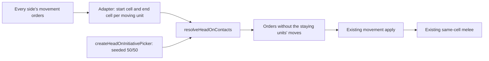

# Head-on contact execution plan

> **For the implementing agent:** Follow this plan from top to bottom, one phase at a time. Finish each phase's verification before you start the next one. When a check fails, stop and report the command, the actual output, and the expected output. Do not make a check pass by weakening a test. Do not commit or push. Do not build anything this plan does not name. Phase names and numbers in this file stay in this file. Never put them in code, comments, tests, `doc/`, or configuration. When a code anchor quoted below does not match the file, stop and report it rather than guessing.

**Goal:** Two units of different owners whose moves would make them trade cells no longer pass through each other. Both resolvers check every side's moves before applying any of them. When two opposing units would trade cells, neither move happens as ordered. A seeded 50/50 initiative roll picks one of the two cells. The units leaving that cell stay in it, the units heading into it arrive, and the existing same-cell melee resolves the fight. This applies to strategic turns and to tactical battle beats.

**Why:** Today each resolver writes every unit's end cell without comparing it with other sides' orders, and melee only looks at who shares a cell after everyone has moved. Two units ordered onto each other's cells therefore swap, never meet, and get the same orders again next turn or beat. In tactical battles this loops indefinitely: an AI-only battle never reaches its idle end, because every beat applies a move.

**Architecture:** One pure rule module in `src/shared/` finds the contacts and decides who stays, given a list of movers and a cell-picking function. One small module in `src/main/` builds the seeded picker. Two thin adapters feed movers into the rule: one for the strategic pipeline (`executeReadyStrategicTurn`) and one for both tactical beat paths (`applyHumanTacticalDraftBeatInStrategicOrder` and `applyAiOnlyTacticalBeat`). Each adapter returns the order lists with the staying units' moves removed. The existing movement code then applies the remaining orders unchanged, so both units end in the held cell, and the existing melee code fights there.



**Tech stack:** TypeScript under `src/`, Node `node:test`, H3 (`h3-js`), SQLite through the existing `gameDb` helpers.

## Locked decisions

These come from the product owner. Do not change them.

- **What counts as trading cells.** Endpoint swaps only. Unit A's start cell is unit B's end cell for this turn or beat, and unit B's start cell is unit A's end cell. On the strategic map the end cell is the order's destination. In a battle it is the cell the unit's first leg actually stops on this beat (the applied stop), not the far destination of a multi-beat march. Paths that cross partway through are not contacts.
- **The roll.** A pure 50/50 between the two cells. It comes from its own seeded stream, built from the match seed, the turn (and in a battle, the battle id and the beat), and the two cells in sorted order. It never draws from the combat RNG, so every existing combat die, and the replay count used by the strategic melee pause, stay exactly as they are today.
- **Symmetric and reproducible.** The roll does not depend on which side is human, on seat order, on order-list order, or on unit ids. The same match seed and the same two cells on the same turn always give the same held cell.
- **Engine only.** No new `ReadyResult` or playback field, no turn-report line, no dice chip, and no change to AI commander prompt text. Playback must still be truthful: a unit whose move was cancelled must not be drawn gliding.
- **Reuse.** The fight is the existing same-cell melee (`runMeleePhase` through the existing callers). Do not write a new melee path.

## Implementation calls

The plan's author made these calls. They are locked for this plan, and the product owner reviews them along with it.

- **Group by cell pair.** Movers are grouped by the unordered pair of their start and end cells. A pair is a contact when at least one mover goes each way and two of those opposite-direction movers have different owners. Every mover between those two cells, in either direction and of any owner, then takes part. Units that are not moving are never "movers". They simply stay where they are, as today.
- **Who stays and who enters.** Movers whose start cell is the held cell are the *holding* units. Their moves are cancelled, so they stay. Movers whose start cell is the other cell are the *entering* units. Their orders are left alone, so they end on their ordered end cell, which is the held cell. This is the "cancel both moves, then one side moves in" rule, expressed with one filter. No unit ever ends anywhere other than its own start cell or its own end cell, so no new legality checks are needed.
- **One pass, no cascade.** Contacts are found once, from the orders as submitted. Cancelling a move never creates a new contact. A ring of three or more cells (A to B, B to C, C to A) is not a contact.
- **Every other owner is an enemy.** Neutral counts as an owner. There are no alliances.
- **Who is a mover.** Strategic: a unit that is still alive when movement starts (after missile, air, and ranged casualties), whose last order's destination differs from its current hex, and whose move the pipeline would not skip as human embarked cargo (`shouldSkipEmbarkedLandIndependentMove`). Cargo that only follows its carrier is not a mover. A non-human embarked land unit with its own order is a mover from the hex it occupies now. If that move is cancelled, `autoDebarkNonHumanLandUnitIfMovingIndependently` never runs, so the unit stays embarked, and water melee already ignores embarked cargo. Tactical: a sub-unit whose own order has an applied stop, from `tacticalComputeMovementOrderOutcomeForPlayer`, that differs from its current cell. The stop is the cell the apply loop writes. It is not the cell cargo sync would copy from a carrier. A duplicate order uses the last applied stop, on a clone updated the same way the apply loop updates it.
- **Seed text.** Strategic: `${gameSeed}|strategic|${turnNumber}|headOn|${lowCell}|${highCell}`. Tactical: `${gameSeed}|tactical|${strategicTurnNumber}|${battleId}|${tacticalTurnNumber}|headOn|${lowCell}|${highCell}`. The text is hashed with `hashStringToUint32` (`src/shared/stableHash.ts`). The hash seeds `createSeededRng` (`src/main/seededRng.ts`), and the first value below 0.5 picks the low cell. This mirrors the existing off-stream seeds in `src/main/gameActions/mercenaryTurnStep.ts`.
- **Low and high.** The two cells are sorted with the plain `<` operator on the H3 strings, never `localeCompare`, so the order does not depend on the machine's locale.
- **Strategic melee intercept.** The held hex is a normal contested hex after movement, so the existing melee-intercept pause can offer Fight or Ignore for it. Nothing new is needed. The pause snapshot already copies `humanMoves` and `aiMoves`, and both are built from the filtered orders, so a cancelled move is not stored there either. Do not add a field to `MeleeInterceptReadyPauseSnapshot` or `ReadyResult`.
- **Control and the consult march flag.** Do not special-case either. Both already read `allOrders`. After the filter, a holding unit did not march and did not traverse the other hex. The vacated hex is empty, and the side that left it is its only traverser, so the existing empty-hex rule in `emptyHexController` applies. A holding seat is absent from `hadStrategicMarchResolutionBySeat` unless another of its units still moved. Melee participation is recorded later by the existing combat path, and `seatHadStrategicResolutionUnitActions` already treats that as activity. Do not put a cancelled unit back into the march flag.
- **AI-only idle streak.** Unchanged. A cancelled holder's order was still a kept order, so a beat with a contact is not idle.
- **Human march continuations.** Unchanged. If a holding human sub-unit had a continuation toward a farther cell, it is still stored. The next beat moves both units out of one shared cell, so they cannot trade cells with each other again.
- **Human tactical playback.** The human playback rows are built from the march plans computed before the beat. The plan adds one guard, so a human sub-unit whose position did not change during movement gets no glide row. This matches `buildSeatPlaybackMoves`, which already compares positions before and after movement. Opponent and AI-only playback, and strategic playback, need no change beyond using the filtered orders.
- **Logging.** Main-process adapters log at debug on entry, with order and mover counts. They also log each contact at debug, with both cells, the held cell, and the holding and entering unit ids. The shared rule module has no logger, like every other `src/shared/` module.

## Global constraints

- Follow `AGENTS.md` and every file in `.cursor/rules/`. Never commit or push.
- No plan, phase, or workflow identifiers in code, comments, tests, `doc/`, or configuration.
- Every new or changed function, type, interface member, and module-level constant gets an orienting comment: Purpose, When to use, Expected outcome, Exceptions. Copy the style of [`src/shared/stableHash.ts`](../src/shared/stableHash.ts) and [`src/main/tacticalBattle/aiOnlyTacticalBeat.ts`](../src/main/tacticalBattle/aiOnlyTacticalBeat.ts). Each new file starts with a short module comment.
- **Logging, main process only.** Public functions log at debug on entry. Caught exceptions log at error with context and the error object. Getters that do not change state log at trace. Use `logDebug`, `logTrace`, and `logError` from `src/main/logger.ts`. `src/shared/` modules have no logger.
- **Tests.** Cover the happy path and the essential failures of each new contract, and nothing more. Do not test constants or a function that only forwards a call. Each test file starts with a comment naming its run command, like [`src/main/gameActions/strategicMarchStacking.test.ts`](../src/main/gameActions/strategicMarchStacking.test.ts).
- **Where tests run.** `npm run build:main` compiles `src/main` and `src/shared`, tests included. One compiled test runs with `node dist/<path>.test.js`. `npm test` runs everything.
- **Shell.** Windows PowerShell at `F:\Projects\Personal\agent-wars-public`. Run one command per line. Do not chain with `&&`.
- **Line endings.** Keep each file's existing line endings.
- **File size.** The desirable limit is 600 lines and the hard limit is 1000. These files are near or over 600, so add only the lines this plan names: `src/main/gameActions/readyStrategicResolutionPipeline.ts` (about 574), `src/main/tacticalBattle/tacticalBattleSession.ts` (about 765). New behavior goes in new files.
- **Arguments.** At most 6 named arguments per function. Use one parameter object when you need more.
- **Immutability.** Use `const` and `readonly` wherever a value does not change. Exported result types use `readonly` members.
- **Naming.** Follow [`doc/naming-conventions-contract-v1.md`](../doc/naming-conventions-contract-v1.md). The new files are `src/shared/headOnContact.ts`, `src/main/headOnInitiative.ts`, `src/main/gameActions/strategicHeadOnContact.ts`, and `src/main/tacticalBattle/tacticalHeadOnContact.ts`, each with a sibling `.test.ts`. Do not use `Utils` or `Impl`.
- **Docs.** Update `doc/` only in the last phase, after the behavior exists.

## Phase 1: The pure contact rule

**Outcome:** A shared, pure function finds head-on contacts and says which units stay. Nothing calls it yet.

### Files

- Create `src/shared/headOnContact.ts`.
- Create `src/shared/headOnContact.test.ts`.

### Steps

1. Create `src/shared/headOnContact.ts`. It has no imports at all, and it must never import from `src/main` or `src/renderer`. Write these exports. Every interface, every field, and every function gets an orienting comment. The contracts below are the content of those comments.

   ```ts
   export interface HeadOnMover {
     readonly unitId: string;
     readonly owner: string;
     readonly fromCell: string;
     readonly toCell: string;
   }

   export type HeadOnHeldCellPicker = (cellA: string, cellB: string) => string;

   export interface HeadOnContact {
     readonly lowCell: string;
     readonly highCell: string;
     readonly heldCell: string;
     readonly holdingUnitIds: readonly string[];
     readonly enteringUnitIds: readonly string[];
   }

   export interface HeadOnResolution {
     readonly contacts: readonly HeadOnContact[];
     readonly cancelledUnitIds: ReadonlySet<string>;
   }

   export function headOnCellPair(cellA: string, cellB: string): readonly [string, string] {
     return cellA < cellB ? [cellA, cellB] : [cellB, cellA];
   }
   ```

   Comment contracts to state:
   - `HeadOnMover`: one entry per moving unit, holding that unit's effective move this turn or beat. Callers pass at most one entry per `unitId`, and only units whose `fromCell` differs from `toCell`. `owner` is a seat id or the Neutral owner id.
   - `HeadOnHeldCellPicker`: given two different cells in either order, returns one of them. It must be deterministic and must not depend on argument order.
   - `HeadOnContact`: `lowCell` and `highCell` are the pair sorted by `headOnCellPair`. `heldCell` is one of them. `holdingUnitIds` are the movers whose start cell is `heldCell`; they stay. `enteringUnitIds` are the movers whose start cell is the other cell; they complete their moves into `heldCell`. Both lists are sorted ascending with `<`.
   - `HeadOnResolution`: `cancelledUnitIds` is the union of every contact's `holdingUnitIds`. Callers drop those units' movement orders and apply the rest unchanged.
   - `headOnCellPair`: sorts with `<` so the result never depends on the locale.

2. In the same file, write `resolveHeadOnContacts(movers, pickHeldCell): HeadOnResolution`. Keep it short and readable. Use small private helpers with orienting comments if a step grows past a few lines. Required behavior:

   - Skip any mover whose `fromCell === toCell`, defensively.
   - Group movers by the key `${lowCell}|${highCell}` from `headOnCellPair(fromCell, toCell)`.
   - For each group, `forward` is the movers whose `fromCell` is `lowCell` and `backward` is the movers whose `fromCell` is `highCell`. The group is a contact only when `forward.some((f) => backward.some((b) => b.owner !== f.owner))`.
   - For each contact, call `pickHeldCell(lowCell, highCell)` exactly once. If the result is neither `lowCell` nor `highCell`, throw `new Error(\`resolveHeadOnContacts: picker returned ${held}, expected ${lowCell} or ${highCell}\`)`. That is a programming error, not a game state.
   - Build the `HeadOnContact`, with both id lists sorted ascending with `(a, b) => (a < b ? -1 : a > b ? 1 : 0)`.
   - Return the contacts sorted by `lowCell`, then `highCell`, using the same comparator, so logs and tests are stable. Return `cancelledUnitIds` as a `Set` built from every contact's `holdingUnitIds`.
   - Use array methods (`filter`, `some`, `flatMap`, `map`) rather than index loops, per the repository's modern-patterns rule. A single `for...of` that fills the grouping `Map` is fine.

   Orienting comment for `resolveHeadOnContacts`: Purpose (opposing units that would trade cells must meet instead of passing), When to use (once per turn or beat, before any movement is applied, with every side's movers), Expected outcome (the contact list and the ids whose moves to drop; a ring of three or more cells, and a trade between units of one owner, are not contacts), Exceptions (throws only when the picker breaks its contract).

3. Create `src/shared/headOnContact.test.ts`. Use `node:test` and `node:assert/strict`. Use plain strings such as `'cell-x'` and `'cell-y'` for cells. They do not need to be H3 ids. Use a recording picker, for example `const calls: string[][] = []; const pick = (held: string): HeadOnHeldCellPicker => (a, b) => { calls.push([a, b]); return held; };`. Write exactly these tests:

   1. `opposing movers that trade cells meet in the picked cell`: one `human` mover `cell-x` to `cell-y`, one `opponent` mover `cell-y` to `cell-x`, and a picker that returns `cell-x`. Expect one contact with `heldCell` `cell-x`, holding the human id, entering the opponent id, `cancelledUnitIds` containing only the human id, and the picker called once with `['cell-x', 'cell-y']`.
   2. `every mover between the two cells joins the contact`: two `human` movers `cell-x` to `cell-y`, one `opponent` mover `cell-y` to `cell-x`, and a picker that returns `cell-y`. Expect holding to be the opponent id, entering to be both human ids in sorted order, and cancelled to be only the opponent id.
   3. `same-owner trades and three-cell rings are not contacts`: first, two `human` movers trading `cell-x` and `cell-y`; then three movers of three different owners on the ring `cell-x` to `cell-y`, `cell-y` to `cell-z`, `cell-z` to `cell-x`. Both calls return no contacts and an empty cancelled set, and the picker is never called.
   4. `a picker that returns neither cell throws`: the trade from test 1 with a picker that returns `'cell-q'`. `assert.throws` with a message matching `/picker returned cell-q/`.

### Verification

```powershell
npm run build:main
node dist/shared/headOnContact.test.js
npm run lint
```

All three must pass, with 4 tests passing.

## Phase 2: The seeded initiative picker

**Outcome:** The main process can build a reproducible 50/50 picker for a strategic turn or a battle beat. Nothing calls it yet.

### Files

- Create `src/main/headOnInitiative.ts`.
- Create `src/main/headOnInitiative.test.ts`.

### Steps

1. Create `src/main/headOnInitiative.ts`:

   ```ts
   import { headOnCellPair, type HeadOnHeldCellPicker } from '../shared/headOnContact';
   import { hashStringToUint32 } from '../shared/stableHash';
   import { logDebug, logTrace } from './logger';
   import { createSeededRng } from './seededRng';

   export type HeadOnInitiativeScope =
     | { readonly kind: 'strategic'; readonly turnNumber: number }
     | {
         readonly kind: 'tactical';
         readonly strategicTurnNumber: number;
         readonly battleId: string;
         readonly tacticalTurnNumber: number;
       };

   function headOnScopeSeedText(scope: HeadOnInitiativeScope): string {
     return scope.kind === 'strategic'
       ? `strategic|${scope.turnNumber}`
       : `tactical|${scope.strategicTurnNumber}|${scope.battleId}|${scope.tacticalTurnNumber}`;
   }

   export function createHeadOnInitiativePicker(gameSeed: number, scope: HeadOnInitiativeScope): HeadOnHeldCellPicker {
     logDebug('createHeadOnInitiativePicker', { gameSeed, scope });
     const scopeText = headOnScopeSeedText(scope);
     return (cellA, cellB) => {
       const [lowCell, highCell] = headOnCellPair(cellA, cellB);
       const roll = createSeededRng(hashStringToUint32(`${gameSeed}|${scopeText}|headOn|${lowCell}|${highCell}`))();
       const heldCell = roll < 0.5 ? lowCell : highCell;
       logTrace('headOnInitiative pick', { scopeText, lowCell, highCell, heldCell });
       return heldCell;
     };
   }
   ```

   Orienting comments:
   - Module: the initiative roll for head-on contact, kept off the combat RNG so combat dice never shift.
   - `HeadOnInitiativeScope`: which resolution the roll belongs to. A battle adds its id and beat, so two battles on one turn, or two beats of one battle, roll independently.
   - `headOnScopeSeedText`: private. Turns the scope into the stable middle part of the seed text.
   - `createHeadOnInitiativePicker`: Purpose (a symmetric, reproducible 50/50 choice between two cells), When to use (once per turn or beat; the strategic caller passes `getGameSeed()` and the turn number, a battle passes its own fields), Expected outcome (the same seed, scope, and cells always give the same cell, in either argument order; it draws nothing from any other stream), Exceptions (none).

2. Create `src/main/headOnInitiative.test.ts` with exactly these tests:

   1. `the held cell is reproducible and ignores argument order`: build a picker with seed `12345` and scope `{ kind: 'strategic', turnNumber: 3 }`. For the cells `'cell-a'` and `'cell-b'`, assert that `pick('cell-a', 'cell-b')` equals `pick('cell-b', 'cell-a')`, that a second picker built with the same arguments gives the same cell, and that the cell is one of the two.
   2. `different pairs reach both cells`: with seed `12345` and scope `{ kind: 'tactical', strategicTurnNumber: 3, battleId: 'battle-1', tacticalTurnNumber: 2 }`, pick for 64 pairs `cell-${i}-a` and `cell-${i}-b`. Assert that at least one pick returned the `-a` cell and at least one returned the `-b` cell. This guards against a picker that always returns the same side.

### Verification

```powershell
npm run build:main
node dist/main/headOnInitiative.test.js
npm run lint
```

All must pass.

## Phase 3: Strategic turns

**Outcome:** In `executeReadyStrategicTurn`, opposing units that would trade hexes end together in the rolled hex and melee there. Playback rows and control traversal use the filtered orders.

### Files

- Create `src/main/gameActions/strategicHeadOnContact.ts`.
- Create `src/main/gameActions/strategicHeadOnContact.test.ts`.
- Modify [`src/main/gameActions/readyStrategicResolutionPipeline.ts`](../src/main/gameActions/readyStrategicResolutionPipeline.ts).

### Steps

1. Create `src/main/gameActions/strategicHeadOnContact.ts` with one exported result type and one exported function:

   ```ts
   export interface StrategicHeadOnOutcome {
     readonly orders: MovementOrder[];
     readonly cancelledUnitIds: ReadonlySet<string>;
     readonly contacts: readonly HeadOnContact[];
   }

   export function withoutStrategicHeadOnHolderMoves(args: {
     readonly orders: readonly MovementOrder[];
     readonly unitsAtMovement: readonly { readonly id: string; readonly player: string; readonly h3Index: string }[];
     readonly turnNumber: number;
     readonly gameSeed: number;
   }): StrategicHeadOnOutcome
   ```

   - `MovementOrder` comes from `../../shared/ipc/ordersTypes`. `orders` is a mutable array type on purpose, because the pipeline passes it to helpers that take `MovementOrder[]`.
   - Implementation:
     1. `logDebug('withoutStrategicHeadOnHolderMoves', { orderCount, unitCount, turnNumber })`.
     2. `const unitById = new Map(args.unitsAtMovement.map((unit) => [unit.id, unit]));`
     3. `const destinationByUnitId = new Map(args.orders.map((order) => [order.unitId, order.toH3Index]));`. A later order for the same unit wins, matching the pipeline's write loop, where the last `UPDATE` wins.
     4. Build movers with `flatMap` over `destinationByUnitId`: skip a unit missing from `unitById` (it died before movement), skip when `unit.h3Index === toCell`, and skip when `shouldSkipEmbarkedLandIndependentMove(unitId, toCell)` is true. Import it from `./sealift`. Otherwise the mover is `{ unitId, owner: unit.player, fromCell: unit.h3Index, toCell }`.
     5. `const resolution = resolveHeadOnContacts(movers, createHeadOnInitiativePicker(args.gameSeed, { kind: 'strategic', turnNumber: args.turnNumber }));`
     6. Log each contact with `logDebug('withoutStrategicHeadOnHolderMoves contact', { ...contact })`.
     7. Return `{ orders: args.orders.filter((order) => !resolution.cancelledUnitIds.has(order.unitId)), cancelledUnitIds: resolution.cancelledUnitIds, contacts: resolution.contacts }`.
   - Orienting comment: Purpose (units of two owners that would trade hexes meet in one of them instead of passing), When to use (once per strategic Ready, after ranged casualties are deleted and before any movement `UPDATE`), Expected outcome (the same orders minus the holding units' moves; entering units' orders are untouched; units missing from `unitsAtMovement` never take part), Exceptions (none expected; the rule throws only on a broken picker).

2. In `readyStrategicResolutionPipeline.ts`, add imports for `withoutStrategicHeadOnHolderMoves` (from `./strategicHeadOnContact`). Then make exactly these edits.

   a. Replace this block, which starts right after the ranged-loss `applyTransportOutcomeForRemovedStrategicUnits` call (about lines 342–353):

   ```ts
     const mergedHuman = new Map<string, string>();
     for (const o of generatedHuman.movementOrders) mergedHuman.set(o.unitId, o.toH3Index);
     for (const o of humanOrders) mergedHuman.set(o.unit_id, o.to_h3_index);
     const humanMoves = Array.from(mergedHuman.entries())
       .map(([unitId, toH3Index]) => {
         const fromH3Index = unitsBeforeMove.find((u) => u.id === unitId)?.h3Index;
         if (!fromH3Index || fromH3Index === toH3Index) return null;
         return { unitId, fromH3Index, toH3Index };
       })
       .filter((m): m is { unitId: string; fromH3Index: string; toH3Index: string } => m !== null);
     const humanMovementOrders = Array.from(mergedHuman.entries()).map(([unitId, toH3Index]) => ({ unitId, toH3Index }));
     const allOrders = listsInResolutionOrder(humanMovementOrders, ordersForOwners, (orders) => orders.movementOrders);
   ```

   with:

   ```ts
     const mergedHuman = new Map<string, string>();
     for (const o of generatedHuman.movementOrders) mergedHuman.set(o.unitId, o.toH3Index);
     for (const o of humanOrders) mergedHuman.set(o.unit_id, o.to_h3_index);
     const humanMovementOrders = Array.from(mergedHuman.entries()).map(([unitId, toH3Index]) => ({ unitId, toH3Index }));
     const unitsAtMovement = listUnitsForSnapshot();
     const headOn = withoutStrategicHeadOnHolderMoves({
       orders: listsInResolutionOrder(humanMovementOrders, ordersForOwners, (orders) => orders.movementOrders),
       unitsAtMovement,
       turnNumber,
       gameSeed,
     });
     const allOrders = headOn.orders;
     const humanMoves = Array.from(mergedHuman.entries())
       .filter(([unitId]) => !headOn.cancelledUnitIds.has(unitId))
       .map(([unitId, toH3Index]) => {
         const fromH3Index = unitsBeforeMove.find((u) => u.id === unitId)?.h3Index;
         if (!fromH3Index || fromH3Index === toH3Index) return null;
         return { unitId, fromH3Index, toH3Index };
       })
       .filter((m): m is { unitId: string; fromH3Index: string; toH3Index: string } => m !== null);
   ```

   `turnNumber` and `gameSeed` are already declared earlier in the function, next to the combat seed. Do not declare them again.

   b. A few lines below, change `const unitsBeforeMovementAfterCombat = listUnitsForSnapshot().map((u) => ({` to `const unitsBeforeMovementAfterCombat = unitsAtMovement.map((u) => ({`. Nothing writes to `units` between the two reads, so this only removes a duplicate query. Leave the rest of that statement as it is.

   c. Change nothing else. `orderDestinationByUnitId`, `movingNavalUnitIds`, `embarkedFollowMoves`, `collectTraversedHexesByPlayer`, `hadStrategicMarchResolutionBySeat`, `aiMoves`, the `UPDATE` loop, and the melee-pause snapshot all read those filtered lists, so they pick up the result. A holding carrier's cargo then stays with it, and a holding unit is not counted as having traversed the other hex. Do not draw the initiative roll from `next` or `rawCombatRng`.

3. Create `src/main/gameActions/strategicHeadOnContact.test.ts` with exactly these tests. Use `withTempGameDb` from `../testSupport/withTempGameDb`. Its default match is the human seat (`HUMAN_SEAT_ID`) against the first AI seat (`AI_SEAT_IDS[0]`).

   1. `a human unit and an AI unit that trade hexes meet in the rolled hex`:
      - Write a private helper `placeAdjacentPair()` with an orienting comment. It selects one human infantry and one first-AI-seat infantry that are not embarked. Copy the `NOT EXISTS (SELECT 1 FROM unit_transport_assignments t WHERE t.land_unit_id = u.id)` filter from `infantryStep` in [`src/main/gameActions/readySeats.test.ts`](../src/main/gameActions/readySeats.test.ts). It then deletes every other unit, every transport assignment, and every standing order, so nothing else can shoot, sail, or march into the pair. `ready()` does not run the tempo sweep (that runs during consult), but Neutral orders and standing orders are generated inside the turn. Find a neighbor of the human hex with `gridDisk(humanHex, 1)`. That neighbor must not be the human hex itself, and it must be in `hexes` with `terrain != 'water'`. Assert that one was found. Move the AI infantry onto that neighbor. Return `{ humanId, humanHex, aiId, aiHex }`.
      - Insert the human order with `dbRun('INSERT INTO pending_orders (unit_id, to_h3_index) VALUES (?, ?)', [humanId, aiHex])`.
      - Read the turn number from `turn_state`, as `turnNumber()` does in `readySeats.test.ts`, and compute `held = createHeadOnInitiativePicker(getGameSeed(), { kind: 'strategic', turnNumber })(humanHex, aiHex)`.
      - Call `ready(new Map([[AI_SEAT_IDS[0], { ...EMPTY_OWNER_TURN_ORDERS, movementOrders: [{ unitId: aiId, toH3Index: humanHex }] }]]))` and assert `success`.
      - Read both units' `h3_index`. A missing row means the unit died in melee. Every unit still present must be on `held`. When `result.awaitingMeleeDecision` is true, both units must still be present, because melee has not run yet. Otherwise `result.meleeCombatHexes` must include `held`.
   2. `a unit destroyed before movement does not make a contact`: inside `withTempGameDb`, call `withoutStrategicHeadOnHolderMoves` with orders `{ unitId: 'unit-a', toH3Index: 'hex-y' }` and `{ unitId: 'unit-b', toH3Index: 'hex-x' }`, and `unitsAtMovement` holding only `{ id: 'unit-a', player: HUMAN_SEAT_ID, h3Index: 'hex-x' }`. Use `turnNumber` 1 and `gameSeed` 1. Expect both orders back unchanged, no contacts, and an empty cancelled set. The temp database is needed only because the embarked-cargo check reads it.

### Verification

```powershell
npm run build:main
node dist/main/gameActions/strategicHeadOnContact.test.js
node dist/main/gameActions/readySeats.test.js
node dist/main/combatResolution.test.js
node dist/main/gameActions/meleeInterceptCandidates.test.js
node dist/main/gameActions/sealift.test.js
node dist/main/gameActions/neutralTurn.test.js
npm run lint
npm run check:circular
```

All must pass. The existing tests prove that ordinary movement, melee, sealift cargo follow-moves, and Neutral sailing are unchanged.

## Phase 4: Tactical beats

**Outcome:** In both tactical beat paths, opposing sub-units whose applied stops would trade cells end together in the rolled cell, and the beat's existing melee fights there. Human playback no longer draws a glide for a cancelled move.

### Files

- Create `src/main/tacticalBattle/tacticalHeadOnContact.ts`.
- Create `src/main/tacticalBattle/tacticalHeadOnContact.test.ts`.
- Modify [`src/main/tacticalBattle/tacticalBattleSession.ts`](../src/main/tacticalBattle/tacticalBattleSession.ts) (`applyHumanTacticalDraftBeatInStrategicOrder`).
- Modify [`src/main/tacticalBattle/aiOnlyTacticalBeat.ts`](../src/main/tacticalBattle/aiOnlyTacticalBeat.ts) (`applyAiOnlyTacticalBeat`).
- Modify [`src/main/gameActions/humanTacticalDraftCommit.ts`](../src/main/gameActions/humanTacticalDraftCommit.ts) (the `humanMoves` playback loop).

### Steps

1. Create `src/main/tacticalBattle/tacticalHeadOnContact.ts`:

   ```ts
   export interface TacticalSeatMarch {
     readonly player: OwnerId;
     readonly orders: readonly MovementOrder[];
   }

   export interface TacticalHeadOnOutcome {
     readonly firstOrders: MovementOrder[];
     readonly secondOrders: MovementOrder[];
     readonly contacts: readonly HeadOnContact[];
   }

   export function withoutTacticalHeadOnHolderMoves(args: {
     readonly battle: TacticalBattleSnapshot;
     readonly first: TacticalSeatMarch;
     readonly second: TacticalSeatMarch;
     readonly gameSeed: number;
   }): TacticalHeadOnOutcome
   ```

   - A private helper `tacticalSeatMovers(battle, seat): HeadOnMover[]`, with an orienting comment. It logs at trace on entry with the battle id, the seat, and the order count, because it does not change the battle. Do not call `projectTacticalSnapshotAfterPlayerMovementOrders`. That function ends with `syncEmbarkedLandToNavalHex`, which would make cargo that only rode a carrier look like a mover and could invent a contact.
     - Return `[]` when `seat.orders` is empty.
     - Clone `battle.subUnits` and index the clone by id, the same way `projectTacticalSnapshotAfterPlayerMovementOrders` does. Walk `seat.orders` in order. For each, call `tacticalComputeMovementOrderOutcomeForPlayer(seat.player, { byId, sub, order, tacticalSet, battle })`. On `ok`, write `appliedToH3Index` onto the clone at `idx` and remember it as that unit's last stop. A failed order is skipped. Writing the clone matters because a later order for the same unit is judged from the updated cell, which is what the apply loop does.
     - Emit one mover per remembered unit whose stop differs from its cell on the original `battle.subUnits`: `{ unitId, owner: seat.player, fromCell: original.h3Index, toCell: stop }`. Skip a unit that is missing from the original list. Cargo with no successful order of its own is not a mover.
   - `withoutTacticalHeadOnHolderMoves`:
     1. `logDebug('withoutTacticalHeadOnHolderMoves', { battleId, tacticalTurnNumber, firstPlayer, firstOrderCount, secondPlayer, secondOrderCount })`.
     2. Movers are `[...tacticalSeatMovers(battle, first), ...tacticalSeatMovers(battle, second)]`. Both are computed from the same `battle`, so seat order cannot change the result.
     3. Resolve with `createHeadOnInitiativePicker(args.gameSeed, { kind: 'tactical', strategicTurnNumber: battle.strategicTurnNumber, battleId: battle.battleId, tacticalTurnNumber: battle.tacticalTurnNumber })`.
     4. Log each contact at debug, as the strategic adapter does.
     5. Return both order lists filtered by `cancelledUnitIds`, plus the contacts.
   - Orienting comment: Purpose (sub-units of the two parties whose applied stops would trade cells meet in one of them instead of passing, which also ends the swap loop), When to use (once per beat, on the snapshot after air and ranged and before either side's movement projection; `battle` must be that snapshot), Expected outcome (each list minus the holding sub-units' orders; entering sub-units' orders unchanged, so the existing projection moves them onto the held cell), Exceptions (none expected).

2. In `applyHumanTacticalDraftBeatInStrategicOrder` (`tacticalBattleSession.ts`), import `withoutTacticalHeadOnHolderMoves` from `./tacticalHeadOnContact`. Replace:

   ```ts
       const bAfterHumanMove =
         args.movementOrders.length > 0
           ? projectTacticalSnapshotAfterHumanMovementOrders(acc.battle, args.movementOrders)
           : acc.battle;
       const oppMarch = holds ? [] : (opp?.movementOrders ?? []);
       const bAfterBothMoves =
         oppMarch.length > 0
           ? projectTacticalSnapshotAfterOpponentMovementOrders(bAfterHumanMove, oppMarch)
           : bAfterHumanMove;
   ```

   with:

   ```ts
       const oppMarch = holds ? [] : (opp?.movementOrders ?? []);
       const headOn = withoutTacticalHeadOnHolderMoves({
         battle: acc.battle,
         first: { player: HUMAN_SEAT_ID, orders: args.movementOrders },
         second: { player: party, orders: oppMarch },
         gameSeed: getGameSeed(),
       });
       const bAfterHumanMove =
         headOn.firstOrders.length > 0
           ? projectTacticalSnapshotAfterHumanMovementOrders(acc.battle, headOn.firstOrders)
           : acc.battle;
       const bAfterBothMoves =
         headOn.secondOrders.length > 0
           ? projectTacticalSnapshotAfterOpponentMovementOrders(bAfterHumanMove, headOn.secondOrders)
           : bAfterHumanMove;
   ```

   `HUMAN_SEAT_ID`, `getGameSeed`, and `party` are already in scope there. `party` comes from `opposingPartyIdOf`, which returns `OwnerId`.

3. In `applyAiOnlyTacticalBeat` (`aiOnlyTacticalBeat.ts`), import `withoutTacticalHeadOnHolderMoves`. Replace:

   ```ts
     const afterLeadMove = leadKept.movement.length > 0
       ? projectTacticalSnapshotAfterPlayerMovementOrders(airAndRanged.battle, leadKept.movement, lead)
       : airAndRanged.battle;
     const afterOpposingMove = opposingKept.movement.length > 0
       ? projectTacticalSnapshotAfterPlayerMovementOrders(afterLeadMove, opposingKept.movement, opposing)
       : afterLeadMove;
   ```

   with:

   ```ts
     const headOn = withoutTacticalHeadOnHolderMoves({
       battle: airAndRanged.battle,
       first: { player: lead, orders: leadKept.movement },
       second: { player: opposing, orders: opposingKept.movement },
       gameSeed: getGameSeed(),
     });
     const afterLeadMove = headOn.firstOrders.length > 0
       ? projectTacticalSnapshotAfterPlayerMovementOrders(airAndRanged.battle, headOn.firstOrders, lead)
       : airAndRanged.battle;
     const afterOpposingMove = headOn.secondOrders.length > 0
       ? projectTacticalSnapshotAfterPlayerMovementOrders(afterLeadMove, headOn.secondOrders, opposing)
       : afterLeadMove;
   ```

   Do not change `const applied = leadKept.applied + opposingKept.applied;`. The idle streak stays as it is today.

4. In `commitHumanTacticalDraftOrders` (`humanTacticalDraftCommit.ts`), in the loop that fills `humanMoves` from `effectiveHumanMarches`, add a guard right after `if (from === o.toH3Index) continue;`:

   ```ts
         if (postMovementBattle.subUnits.find((u) => u.id === o.unitId)?.h3Index === from) continue;
   ```

   `postMovementBattle` is declared just above the loop. The guard skips a glide for a human sub-unit that ended movement on its own start cell, whether a head-on contact cancelled its move or the projection rejected it. Do not change the march-continuation logic above `applyHumanTacticalDraftBeatInStrategicOrder`. Opponent and AI-only playback already compare positions in `buildSeatPlaybackMoves`.

5. Create `src/main/tacticalBattle/tacticalHeadOnContact.test.ts`. Call `tacticalDbFixtureRegisterDefaultAfterEach()` at the top, as `aiOnlyTacticalBeat.test.ts` does. Write one private helper with an orienting comment:

   `placeHeadOnPair(battle, firstPlayer, secondPlayer)`:
   - `const step = legalStep(battle, firstPlayer)` (from `./testSupport/twoAiBattleFixture`). Assert it is not null. Let `firstUnit` be the sub-unit with `step.unitId`, `cellA = firstUnit.h3Index`, and `cellB = step.toH3Index`.
   - Pick a `secondPlayer` sub-unit of type `infantry` or `armor` with no `embarkedOnSubUnitId`, and assert one exists.
   - Build `placed` as a copy of `battle` with that sub-unit's `h3Index` set to `cellB`, then call `setActiveTacticalBattleSnapshotRef(placed)` (from `./activeTacticalBattleRef`).
   - Check the second order `{ unitId: secondUnit.id, toH3Index: cellA }` with `tacticalComputeMovementOrderOutcomeForPlayer(secondPlayer, { byId, sub, order, tacticalSet, battle: placed })`, built the same way `legalStep` builds its arguments. Assert `ok` and `appliedToH3Index === cellA`. Then check the first order against `placed` the same way, and assert its applied stop is `cellB`. If either assert fails on the fixture, stop and report it. Do not search for a different pair silently.
   - Return `{ placed, firstOrder: step, secondOrder, cellA, cellB }`.

   Then write exactly these tests:

   1. `two AI seats that trade cells meet in the rolled cell`: inside `withTwoAiBattle`, place the pair for `leadPartyId` and `opposingPartyId`. Compute `held` with `createHeadOnInitiativePicker(getGameSeed(), { kind: 'tactical', strategicTurnNumber: placed.strategicTurnNumber, battleId: placed.battleId, tacticalTurnNumber: placed.tacticalTurnNumber })(cellA, cellB)`. Call `applyAiOnlyTacticalBeat` with each order in its seat's `movementOrders`, using `emptyPlan()` for the rest. Assert `success`, that both units are on `held` in `beat.battleAfterMovementBeforeFerry.subUnits`, and that `beat.meleePack.meleeCombatHexes` includes `held`.
   2. `a human and the opposing party that trade cells meet in the rolled cell`: inside `tacticalDbFixtureWithTempDbContestedPlanning` (from `./testSupport/tacticalDbFixture`), call `startTacticalBattleForEnclosingHex(targetStrategicH3)` and assert success. Read the battle with `getActiveTacticalBattleSnapshot()`. Place the pair for `HUMAN_SEAT_ID` and `opposingPartyIdOf(battle)` (from `./opposingParty`). Call `applyHumanTacticalDraftBeatInStrategicOrder({ movementOrders: [firstOrder], opponentTacticalDraft: { ...emptyPlan(), movementOrders: [secondOrder] } })`. Make the same three assertions as test 1.

   These tests call the beat functions directly, with no ranged or air rows, so no fire happens before movement and the positions after movement are deterministic.

### Verification

```powershell
npm run build:main
node dist/main/tacticalBattle/tacticalHeadOnContact.test.js
node dist/main/tacticalBattle/aiOnlyTacticalBeat.test.js
node dist/main/tacticalBattle/tacticalMovementApply.test.js
node dist/main/tacticalBattle/tacticalMeleeApply.test.js
node dist/main/tacticalBattle/tacticalPartiesSeats.test.js
node dist/main/tacticalMarchPlaybackPath.test.js
node dist/main/tacticalMarchContinuations.test.js
npm run lint
npm run check:circular
```

All must pass.

## Phase 5: Documentation and the full suite

**Outcome:** The mechanics and the player guide describe the rule, and the whole suite passes.

### Files

- Modify [`doc/combat-rules-v3.md`](../doc/combat-rules-v3.md).
- Modify [`doc/how-to-play.md`](../doc/how-to-play.md).

### Steps

1. In `doc/combat-rules-v3.md`, section **4.3 Apply ground and naval movement**, add this paragraph after the existing one:

   > **Head-on contact.** Before any unit moves, the engine compares every side's moves. When units of two different owners would trade hexes, so that one ends where an enemy started and that enemy ends where the first started, neither move happens as ordered. Every unit moving between those two hexes, of any owner, takes part. A 50/50 roll seeded from the match seed, the turn, and the two hexes (`createHeadOnInitiativePicker` in `src/main/headOnInitiative.ts`) picks one of them. Units moving out of that hex stay in it, and units moving into it complete their moves. The hex then holds both sides and fights in the melee phase (§4.6), which can pause for the melee intercept as usual. Only exact trades count: paths that cross partway, and rings of three or more hexes, still move as ordered. The rule is `resolveHeadOnContacts` in `src/shared/headOnContact.ts`. A unit destroyed before movement does not take part.

2. In section **4.7 Resolution ordering and determinism**, append this sentence to the last paragraph: "The head-on contact roll (§4.3) has its own seed and draws nothing from the combat RNG, so it never changes a combat die."

3. In section **5**, in the numbered block, change step 7 from `7. Apply ground and naval movement orders.` to:

   ```
   7. Head-on contact (§4.3): for each pair of hexes that two owners would
      trade, roll for the held hex and cancel the moves out of it. Then apply
      ground and naval movement orders.
   ```

4. In section **6 Edge cases and clarifications**, add this bullet after the **Stacking** bullet:

   > - **Units that trade hexes:** They do not pass each other. Head-on contact (§4.3) puts both in one of the two hexes, picked by a seeded 50/50 roll, and they melee there. In a battle the comparison uses the cell each sub-unit's first leg stops on this beat.

5. In section **12.6 Tactical turn structure**, change step 5 from `5. **Movement phase** (first-leg truncation as in §12.4).` to:

   > 5. **Movement phase** (first-leg truncation as in §12.4). Head-on contact (§4.3) runs first, comparing each sub-unit's start cell with the cell its first leg stops on this beat, for both sides. The roll's seed also includes the battle id and the beat.

6. In `doc/how-to-play.md`, in the turn-order bullets, add this bullet right after "- Melee happens wherever enemy units share a hex after movement.":

   > - Enemy units ordered into each other's hexes don't slip past each other. A roll picks one of the two hexes. The units there stay put, the units heading in arrive, and they fight in melee. Battles work the same way.

7. Check the other documents. Run:

   ```powershell
   rg -n -i "swap|trade|pass through|enemy-occupied" doc/ai-commander-prompts doc/ux/resolution-playback.md doc/hybrid-ai.md
   ```

   Edit nothing unless a line now states something false about movement. A sentence saying an enemy-occupied cell is a legal move/melee destination is still true. The prompt package describes prompt text, and this change does not alter prompt text. Report what you checked.

### Verification

```powershell
npm test
```

It must pass. It rebuilds, lints, checks naming and renderer types, runs every main and shared test, and checks third-party notices.

## Final report

When every phase passes, report:

- The new files and the changed files.
- The `doc/` files you updated: `doc/combat-rules-v3.md` and `doc/how-to-play.md`. List the other documents you checked and found correct.
- Any anchor that did not match this plan, and what you did about it.
- Anything you could not verify.
