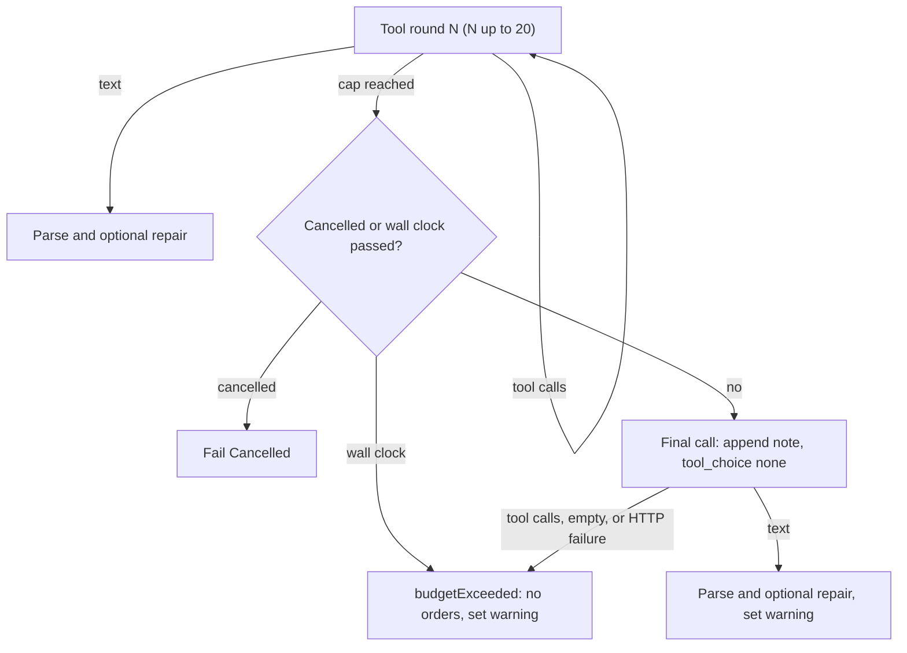

# Tool-Round Cap of 20 With a Final Orders Call

## Settled Decisions (do not re-ask)

- **Cap:** `REQUEST_ORDERS_MAX_TOOL_ROUNDS` = 20.
- **Final call:** when the cap is reached, one extra call is sent with tools withheld. Its text reply goes through the existing parse step and the existing one-time repair call.
- **Tool fields on the final call:**
  - When tools were offered and the model accepts `tool_choice`: keep `tools` and send `tool_choice: 'none'`. Some providers reject a transcript that contains tool calls when the request has no tool definitions, which is why the definitions stay.
  - When the model does not accept `tool_choice`: send neither `tools` nor `tool_choice`.
  - When no tools were offered: send neither.
- **Next-turn warning:** set it whenever the cap is hit, whether or not the final call produced orders. New text:
  `WARNING: Last turn's planning reached the tool-call limit (20 rounds) before you submitted orders. Submit your final orders JSON promptly after gathering the information you need.`
- **The final call is skipped**, and the consultation ends as today with no orders, when either of these is true at the moment it would start:
  - The wall clock (`REQUEST_ORDERS_MAX_WALL_CLOCK_MS`) has already passed. This keeps `AI_CONSULTATION_WAIT_TIMEOUT_MS` (1,320,000 ms) valid, because at most one call still straddles the wall-clock mark, plus the repair call.
  - The consultation was cancelled. In that case it returns `{ kind: 'fail', error: 'Cancelled' }`.
- **A reply to the final call that still has `tool_calls`:** do not execute the tools. Return `budgetExceeded`, which means no orders, as today.
- **An empty reply or a transport failure on the final call:** return `budgetExceeded`. There is no malformed-completion retry on this call.
- **Rules that still apply:**
  - Do not commit or push.
  - Do not put phase numbers, this plan's name, or its filename into source, tests, comments, or `doc/`.
  - Every new or changed function and field gets an orienting comment: Purpose, When to use, Expected outcome, Exceptions.
  - Public functions log debug on entry; caught errors log error.
  - Use `const` and `readonly`.

## Flow After the Change

## Phase 0: Save the Plan

- Copy this plan to `.spec/tool-round-cap-final-orders.md`. Do not copy it into `doc/`.

## Phase 1: Lower the Cap and Reword the Warning

- In [src/main/openRouter/requestOrdersFlowSupport.ts](src/main/openRouter/requestOrdersFlowSupport.ts):
  - Set `REQUEST_ORDERS_MAX_TOOL_ROUNDS = 20`.
  - Change the second sentence of `buildToolBudgetExceededWarning` to the warning text in Settled Decisions. Keep the leading `\n\nWARNING: ` and the trailing `\n`, and interpolate the constant.
  - Update its Purpose comment: it now says the limit was reached before orders were submitted, not that nothing was submitted.
- In [src/main/openRouter/promptSpec/variantConformance.test.ts](src/main/openRouter/promptSpec/variantConformance.test.ts) around line 357, replace `/submitted no explicit orders/i` with `/before you submitted orders/i`.
- Verify:
  1. Run `npm run build:main`.
  2. Run `node dist/main/openRouter/requestOrdersFlowSupport.test.js`.
  3. Run `node dist/main/openRouter/promptSpec/variantConformance.test.js`.
  4. All three pass.

## Phase 2: Shared Usage Accumulator (Refactor, No Behavior Change)

- In [src/main/openRouter/ordersChatCompletion.ts](src/main/openRouter/ordersChatCompletion.ts), add the exported function `addOrdersChatUsageToTotals(totals: RequestOrdersUsageTotals, usage: OrdersChatCompletion['usage']): void`.
  - Move the six accumulation lines from [src/main/openRouter/requestOrdersToolLoop.ts](src/main/openRouter/requestOrdersToolLoop.ts) lines 452-457 into it: cost, prompt tokens, completion tokens, then `cacheTokensFromChatUsage` for cached and cache-write tokens.
  - Import the type `RequestOrdersUsageTotals` with `import type`.
  - Log at trace level.
- Replace those lines in the tool loop with one call to the new function. Leave `requestOrdersRepairExchange.ts` unchanged.
- Verify: run `npm run build:main` and `npx eslint src/main/openRouter/ordersChatCompletion.ts src/main/openRouter/requestOrdersToolLoop.ts`. Both are clean.

## Phase 3: Model-Facing Text

- In [src/main/openRouter/promptSpec/consultationText.ts](src/main/openRouter/promptSpec/consultationText.ts), add `buildFinalOrdersRequestMessage(maxToolRounds: number): string`, placed next to `buildRepairRequestMessage`. It returns exactly:
  `You have used all ${maxToolRounds} tool rounds, and tools are no longer available. Reply now with your final orders as one JSON object in the response format from the system prompt.`
  - It must state no game rule.
  - Add a debug log line.
- In [src/main/openRouter/promptSpec/coachingTextStrategic.ts](src/main/openRouter/promptSpec/coachingTextStrategic.ts) lines 310-319, the current `TOOL_BUDGET_BULLET` is no longer true. Replace it with:
  `- Rounds are limited. After the last round, tools are withdrawn and you get one reply to submit orders; once destinations are chosen, submit.`
  - Update its comment.
- Tests:
  - In [src/main/openRouter/promptSpec/coachingText.test.ts](src/main/openRouter/promptSpec/coachingText.test.ts) line 114, change the regex to `/tools are withdrawn and you get one reply/i`.
  - In [src/main/openRouter/promptSpec/consultationContract.test.ts](src/main/openRouter/promptSpec/consultationContract.test.ts), add one test. It checks that `buildFinalOrdersRequestMessage(20)` contains `20 tool rounds`, contains `no longer available`, and contains none of the lowercase markers in `TACTICAL_AI_PROMPT_STRATEGIC_SECTION_MARKERS`.
- Verify: build, then run `coachingText.test.js` and `consultationContract.test.js` from `dist/main/openRouter/promptSpec/`.

## Phase 4: Final-Call Module (Not Wired Yet)

- In [src/main/openRouter/consultTelemetry.ts](src/main/openRouter/consultTelemetry.ts), add `'finalOrdersRound'` to `ConsultFallbackKind`.
- In [src/main/openRouter/requestOrdersToolLoop.ts](src/main/openRouter/requestOrdersToolLoop.ts), add a required `readonly afterRoundCap: boolean` field to the `finalContent` variant of `RequestOrdersToolLoopResult`, with a full field comment. Set `afterRoundCap: false` on the existing return at line 591.
- Create the new file `src/main/openRouter/requestOrdersFinalOrdersRound.ts` with the following.
- **`FinalOrdersRoundArgs`:**
  - Declare it as `interface FinalOrdersRoundArgs extends Pick<RequestOrdersToolLoopArgs, 'messages' | 'tools' | 'key' | 'modelId' | 'signal' | 'onLog' | 'wallClockStart' | 'usage' | 'postOpenRouterChatWithTimeoutAndRetry' | 'resolveOrderFlowMaxTokens' | 'requestSettings'>`.
  - Add `readonly iteration: number` (rounds already spent) and `readonly responseAiIndex: number` (the opponent number for the response debug file). Give both full field comments.
- **`finalOrdersRoundToolFields(toolsOffered, toolChoiceSupported, tools)`:** an exported pure function. It returns `{ tools, tool_choice: 'none' }` only when tools were offered and `tool_choice` is supported; otherwise `{}`. Log at trace level.
- **`runFinalOrdersRound(args): Promise<RequestOrdersToolLoopResult>`:** exported. Steps, in order:
  1. Log debug on entry.
  2. If `signal?.aborted`, return `{ kind: 'fail', error: 'Cancelled' }`.
  3. If `Date.now() - wallClockStart > REQUEST_ORDERS_MAX_WALL_CLOCK_MS`, log debug and return `{ kind: 'budgetExceeded', iteration }`. Do not call `noteWallClockExceeded`.
  4. Write the activity-log line `Tool-round limit (${REQUEST_ORDERS_MAX_TOOL_ROUNDS}) reached; asking once for final orders with tools withheld.`
  5. Record the telemetry fallback: `requestSettings.telemetry?.recordFallback('finalOrdersRound')`.
  6. Push `{ role: 'user', content: buildFinalOrdersRequestMessage(REQUEST_ORDERS_MAX_TOOL_ROUNDS) }` onto `messages`. It goes on the main transcript, so a later repair copy includes it.
  7. Call `postOrdersChatRequest` with:
     - `baseBody: { model, messages, max_tokens: resolveOrderFlowMaxTokens(), ...finalOrdersRoundToolFields(tools.length > 0, requestSettings.profile.toolChoice, tools) }`
     - `attachResponseFormat: true`
     - `requestLabel: 'requestOrders final'`
  8. If the post fails with `'Cancelled'`, return a `Cancelled` fail. For any other failure, write `Final orders request failed: ${error}` as an error line and return `budgetExceeded`.
  9. Call `logResponsePreview('openRouter requestOrders final: raw response body', bodyText, responseAiIndex)`.
  10. Parse with `parseOrdersChatCompletion`. If that returns null, return `budgetExceeded`.
  11. Call `addOrdersChatUsageToTotals`.
  12. If `finish_reason` is `length` or `native_finish_reason` is `MAX_TOKENS`, log error, the same way the loop does.
  13. If the reply has a non-empty `tool_calls`, write the error line `Model asked for a tool after the tool-round limit; no orders this period.` and return `budgetExceeded`. Do not push the reply and do not execute the tools.
  14. If `content` is a non-empty string, write `Final orders reply received (${content.length} chars); parsing orders…` and return `{ kind: 'finalContent', content, iteration: iteration + 1, afterRoundCap: true }`.
  15. Otherwise, write the error line `Final orders request returned no text; no orders this period.` and return `budgetExceeded`.
- Add the new test file `src/main/openRouter/requestOrdersFinalOrdersRound.test.ts`. Model its fake transport on `fakeTransport` in [src/main/openRouter/ordersChatRequestHelpers.test.ts](src/main/openRouter/ordersChatRequestHelpers.test.ts) lines 65-77, and use `BASELINE_ORDERS_REQUEST_PROFILE`. Four cases:
  1. **Happy path.** A text reply gives `finalContent` with `afterRoundCap: true`. The posted body has `tool_choice: 'none'` and `tools`. The last transcript message is the note.
  2. **Model without `tool_choice` support** (`profile.toolChoice: false`). The body has neither `tools` nor `tool_choice`.
  3. **Reply with `tool_calls`.** Returns `budgetExceeded`, and only one post was made.
  4. **Wall clock already passed** (`wallClockStart = Date.now() - REQUEST_ORDERS_MAX_WALL_CLOCK_MS - 1`). Returns `budgetExceeded`, makes zero posts, and leaves the transcript unchanged.
- Verify: build, run `node dist/main/openRouter/requestOrdersFinalOrdersRound.test.js`, and run eslint on the new and touched files.

## Phase 5: Wire It In

- In [src/main/openRouter/requestOrdersToolLoop.ts](src/main/openRouter/requestOrdersToolLoop.ts) line 593, replace `return { kind: 'budgetExceeded', iteration };` with a call to `runFinalOrdersRound`. List the fields explicitly, plus `iteration` and a `responseAiIndex` computed the way lines 440-441 compute it, falling back to `1`.
  - Update the file header and the function's Expected outcome comment: at the cap, one final call runs with tools withheld.
  - Keep the file under 600 lines.
- In [src/main/openRouter/requestOrdersFlow.ts](src/main/openRouter/requestOrdersFlow.ts), right after the `budgetExceeded` branch (lines 453-473), add:
  `if (loopResult.afterRoundCap) setAiToolLimitExceededLastTurn(seatId);`
  - The branch above it has already narrowed `loopResult` to `finalContent`, so no extra kind check is needed.
  - Telemetry then reaches `finished` through the normal parse path.
- Add an integration test that runs `requestOrders` end to end:
  - Move `installElectronMock` and `buildFixtureState` (and the types they need) from [src/main/openRouter/openRouterMatrix.test.ts](src/main/openRouter/openRouterMatrix.test.ts) into a new exported helper module, `src/main/openRouter/openRouterTestHelpers.ts`. The matrix file imports them from there, which keeps it from growing past its current 748 lines.
  - Create the new file `src/main/openRouter/requestOrdersRoundCap.test.ts`, using the same `run()` pattern as the matrix test.
  - Its transport override returns a tool call to `no_such_tool` for every body whose `tool_choice` is not `'none'`, and an orders JSON (`{"message":"m","strategy":"s","orders":[]}`) for the body that is `'none'`.
  - Assert that `result.success` is true, that exactly `REQUEST_ORDERS_MAX_TOOL_ROUNDS + 1` posts were made, and that the last post's final message equals `buildFinalOrdersRequestMessage(REQUEST_ORDERS_MAX_TOOL_ROUNDS)`.
- Verify:
  1. Run `npm run rebuild:native:node` and `npm run build:main`.
  2. Run `node dist/main/openRouter/requestOrdersRoundCap.test.js`.
  3. Run `node dist/main/openRouter/openRouterMatrix.test.js` (it still passes 256 combinations).
  4. Run eslint on the touched files.

## Phase 6: Docs (Code Is the Authority)

- [doc/ai-commander-prompts/consultation-flow.md](doc/ai-commander-prompts/consultation-flow.md):
  - Intro line 3: add the final orders request.
  - Invariant 2: replace "two recovery cases in sections 4 and 5" with three cases.
  - Invariant 3: say 20 rounds, and that hitting the cap sends one final call with tools withheld. That call is skipped when the wall clock has passed. Its orders go through parse and repair, and the warning is set either way.
  - Add a new section after section 5, "Final orders request after the tool-round cap": trigger, budget of one call, tool fields, the content contract (submit-only, no rule), and the outcomes.
  - Section 6: the "Tool rounds exhausted" row becomes "Final orders request also yields no orders". Line 128 warning wording follows the new text.
- [doc/hybrid-ai.md](doc/hybrid-ai.md):
  - Line 49: change **50** to **20** and describe the final call.
  - Line 51: the final orders call is also one call that can straddle the wall-clock mark.
  - Line 55: add "a final orders call" to the list of `fallbacks` entries.
  - Line 57: hitting the cap now leads to the final call. Only when that call yields nothing is the result a successful-but-empty consult. The warning is set in both cases.
- [doc/ai-commander-prompts/source-inventory.md](doc/ai-commander-prompts/source-inventory.md):
  - Line 151: change (50) to (20).
  - Add a message-kind table row: "Final orders user | `buildFinalOrdersRequestMessage` | at most once, at the cap | `tool_choice: 'none'` with the tool list, or no tools when `tool_choice` is unsupported | no".
  - Line 186: describe the final call.
- [doc/ai-commander-prompts/variants.md](doc/ai-commander-prompts/variants.md) line 260: the warning states the limit was reached before orders were submitted.
- [doc/ai-commander-prompts/information-decision-model.md](doc/ai-commander-prompts/information-decision-model.md) line 189: same wording change for `TOOL_BUDGET_WARNING`.
- Replace the old bullet text with the new strategic bullet in both of these:
  - [doc/ai-commander-prompts/strategic-prompt.md](doc/ai-commander-prompts/strategic-prompt.md) line 348.
  - [doc/ai-commander-prompts/example-strategic-prompt.md](doc/ai-commander-prompts/example-strategic-prompt.md) line 143.
- [doc/ai-commander-prompts/README.md](doc/ai-commander-prompts/README.md) line 19: "Opening, repair, and final orders user messages live in `promptSpec/consultationText.ts`."
- Search `doc/` for `50 rounds`, `(50)`, `**50**`, `submits nothing`, and `nothing was submitted`. Only historical docs may still match.
- Leave these alone: `doc/devleopment-plan-v3.4.md`, `doc/poc-analysis.md`, `doc/market-research.md`, and `.spec/completed/`.

## Phase 7: Final Verification

- Run `npm test`. It must exit 0.
- Run `npm run rebuild:native:electron` so `npm start` works.
- Check line counts: every touched source file stays under 600 lines, including `requestOrdersToolLoop.ts`, `requestOrdersFlow.ts`, and `consultationText.ts`.
- Search `src/` and `doc/` for this plan's filename and phase words. There must be no hits.
- In the summary to the user, name every `doc/` file that was updated.
