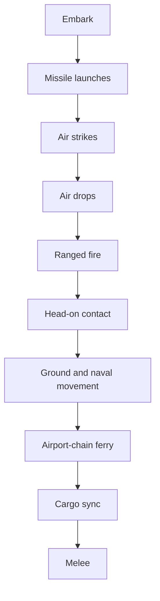

# Airlift and long-range ferry execution plan

> **For the implementing agent:** Follow this plan from top to bottom, one phase at a time. Finish each phase's verification before you start the next one. When a check fails, stop and report the command, the actual output, and the expected output. Do not make a check pass by weakening a test. Do not commit or push. Do not build anything this plan does not name. Phase names and numbers in this file stay in this file. Never put them in code, comments, tests, `doc/`, or configuration. When a code anchor quoted below does not match the file, stop and report it rather than guessing.

**Goal:** An air unit carries one infantry unit the way a ship carries land units, can unload that infantry on the hex where it is resting, and can air-drop it onto another land hex and fly home. Air ferry becomes a chain of controlled airports in one turn. Each hop stays within today's ferry range. Strikes and drops still start from the air unit's current airport and use today's strike range. AI commanders are told how to use airlift, the airport chain, and the existing sealift.

**Why:** Ferry is one hop of at most 4 hexes, so air power cannot reposition across a theater in a turn. Infantry cannot cross that distance by air at all. Ships already carry land units, and the air version should be that same relationship with a smaller load and a different place to board and land.

## Locked decisions

These come from the product owner. Do not change them.

- **One infantry per air unit.** An air unit carries at most one infantry unit. It cannot carry armor. A ship still carries one armor unit or up to two infantry. In a battle the same numbers apply per sub-unit: one infantry sub-unit per air sub-unit, and one armor or two infantry per naval sub-unit.
- **Same cargo relationship as ships.** Boarding writes a row in `unit_transport_assignments`. The human loads and unloads from the stack callout immediately. A commander uses the existing `embark` and `disembark` orders. The carried infantry cannot be selected or given its own move. It is destroyed when its carrier is destroyed. An embarked mercenary cannot be dismissed. Dismissing or deserting the carrier takes the cargo with it. A mercenary riding a carrier that is not itself a mercenary does not desert on its own. Rehire refuses an embarked unit and a loaded carrier.
- **Air cargo never fights.** Infantry assigned to an air unit is left out of ranged fire, melee, air-strike casualties, and anti-air rolls on every terrain, until it debarks or is dropped. Ship cargo keeps today's rule: it can melee on a coast, and on water it is left out of combat.
- **Debark at rest.** During planning, infantry can leave an air unit onto the hex or cell that air unit already occupies. No port and no coastal check. Leaving onto any other hex is an air drop, not a debark.
- **Air drop lands on any land hex in range, including an enemy-occupied one.** Open water is illegal. A drop onto an empty enemy hex captures it by the existing end-of-turn control rule, because the infantry is the hex's occupant. A strategic fortification still blocks the control change, as it does for a ground move. The drop does not roll an attack against the units already there.
- **Return fire.** When the drop hex or cell holds at least one enemy unit, those units shoot at the air unit with the same anti-air rolls as an air strike against units. An empty hex does not shoot. Infrastructure does not shoot. If the air unit is lost, its infantry is destroyed and never arrives.
- **The air unit does not change hex when it drops or strikes.** Playback shows it flying out and, if it survives, flying home. The infantry stays on the target.
- **One air action.** An air unit may plan a strike, a drop, or a ferry, and only one of those. A stored strike wins over a drop and over a ferry. A stored drop wins over a ferry. Log each discarded order.
- **A commander may embark and drop, or embark and ferry, in the same order list.** Embark is applied before the air phase, so the infantry is aboard in time. A drop does not first ferry closer.
- **Ferry range is unchanged, and it applies per hop.** `AIR_FERRY_RANGE_HEXES` is 4. `strategicFerryRangeHexes` in [`src/shared/weatherBonusRules.ts`](../src/shared/weatherBonusRules.ts) still returns 2 for a hop into snow when the unit lacks the snow tag. There is no limit on the number of hops in one turn. A destination past the connected airports waits for another order next turn. There is no dashed later-turn ferry line.
- **Strikes and drops keep today's range, measured from the airport the air unit occupies when that phase runs.** Strategic range is `AIR_STRIKE_RANGE_HEXES` (3). In a battle it is the whole battle footprint, which is already the tactical strike range. Snow does not shorten a strike or a drop.
- **Tactical ferry is not the airport chain.** Inside a battle, ferry stays one hop between intact airport cells in the footprint. Cargo on that air sub-unit moves with it and stays aboard.
- **A tactical drop may land on an enemy cell, and that beat's melee fights there if both sides are still on it.** Planning still does not let a march enter another owner's fortified cell. A drop onto a cell fortified by another owner is illegal, and the blocked notice says `Blocked: Fortified`. Two sides may share a cell only because resolution put them there.
- **Battle start does not copy strategic cargo onto sub-units.** That is how ships already work. Cargo is boarded again inside the battle. Ending the battle restores the strategic cargo rows from the baseline taken when the battle started.
- **Saves.** Add the new pending-drop table when a database is opened. `EXPECTED_USER_VERSION` stays 26. Do not add the new table to `GAME_DB_REQUIRED_TABLES`. An old save has no drop rows, and it must still open.
- **Naval ranged-fire gap.** When ranged fire destroys a naval or air sub-unit in a battle, the cargo embarked on that sub-unit is destroyed with it. Today only an air-strike hit on a ship does this. The shared helper covers ships and air.

## Implementation calls

The plan's author made these calls. They are locked for this plan, and the product owner reviews them along with it.

- **The cargo table stays one table.** `land_unit_id` remains the primary key. The SQL column `naval_unit_id` keeps that name and stores whichever unit is the carrier, ship or air. Do not add a second cargo table.
- **Rename one TypeScript field.** `embarkedOnNavalUnitId` on the unit snapshot becomes `embarkedOnCarrierUnitId`. The SQL column is unchanged; the snapshot query aliases it. The order property and the envelope key stay `navalUnitId`. Prompts say that `navalUnitId` may be a naval unit or an air unit. Do not rename `navalUnitId`, `embarkedOnSubUnitId`, IPC channel strings, or tool names.
- **New symbols say carrier or airlift.** Do not rename existing ship functions whose behavior stays ship-only. Widen a function in place when this plan says the same rule now covers air.
- **The ferry order stays `{ unitId, destinationH3Index }`.** The path is not stored in SQLite. The main process computes it for the hover preview and again at resolution. The renderer draws the path the preview returned. If resolution cannot reach the stored destination, the air unit stays when its current airport is still legal, and it is destroyed when that airport is also gone. It does not stop at an intermediate airport. That is today's stay-or-destroy rule, applied to the chain.
- **Path shape.** The path is the origin airport, each intermediate airport, and the destination. A direct hop is a path of two hexes. Search is breadth-first. Neighbors are sorted with `<` on the H3 string, never `localeCompare`. Equal-length paths therefore always pick the same one. An airport is a node only when it is intact, controlled by the air unit's owner, and not a neutral-border hex.
- **Hop test.** A hop from A to B is legal when the grid distance from A to B is at most the range `strategicFerryRangeHexes` gives for B's weather, that unit's tags, and whether the weather bonus is on. Callers in `src/main` get that number from `strategicFerryRangeOnState`. Do not write a second snow rule.
- **Blocked and slowed notices are the existing order tooltips.** An illegal ferry or drop uses `#order-block-tooltip`. A legal ferry whose path contains a hop shortened to 2 uses `#order-slower-tooltip` and names Snow. Do not add a popup.
- **Drop playback rides the air-strike stage.** The air unit uses the same out-and-back drawing as a strike. The infantry moves from the airport to the target during that stage and does not fly home. If the air unit is lost, the infantry is removed and has no landing move.
- **Ferry playback uses the path it flew.** `FerryAnimationMove` gains `pathH3Indexes`, origin through destination. The renderer already glides a move that has `pathH3Indexes` of length at least 2. Human infantry aboard an air unit gets that path on `humanMoves`. Infantry of any other owner gets it on `aiMoves`. Naval cargo playback stays on the list it uses today.
- **Control.** Do not add a capture rule. A dropped infantry unit is an occupant, and `resolveStrategicControlAfterCombatAndMovement` already gives a solely occupied hex to that occupant unless a fortification remains.
- **Neutral air with cargo.** At the start of strategic resolution, clear that cargo and leave both units on the hex with defend. Air is always somewhere it can debark. Do not ferry it and do not delete it. Neutral ships keep their current unload, sail, or delete behavior.
- **Briefing size.** The Air Operations ferry column lists at most 8 reachable airports, the ones with the smallest grid distance from the unit, ties broken by `<`. The rule text tells the model that any other airport it controls may be legal and that `plan_route` is how to confirm the chain. Best Options stays a short list aimed at the fighting, not the whole network.
- **`plan_route` learns air.** The tool name stays `plan_route`. For an air unit it returns the airport chain, or the same refusal a ferry validation would give. It no longer answers that air units do not move.
- **A queued ferry or drop is the air unit's action.** `generateOrdersForStandingOrders` may still add a defend strike. At resolution, drop that generated strike when the unit has an explicit ferry or an explicit drop and no explicit strike. An explicit strike still wins over both. Today a generated strike silently cancels a queued ferry. That cancel stops. Ship and ground standing orders are unchanged.
- **Ranged fire sees the map after drops.** The pipeline currently feeds ranged fire the unit list taken before air strikes. After drops write the database, rebuild that list with `listUnitsForSnapshot` and leave out ids already removed by missiles, strikes, or a shot-down drop. A unit killed by a strike therefore does not also shoot or get shot in the ranged phase. If an existing test expects the pre-strike list, stop and report it. Do not keep the stale list to satisfy that test.
- **The renderer does not search the airport graph.** Fog hides weather on unexplored hexes, so a renderer-side search would disagree with resolution. The main-process preview returns the path. The renderer stores that path on the pending row and draws it. Resolution searches again from the database.

## Resolution order

Strategic: embark, missile launches, air strikes, air drops, ranged fire, head-on contact, ground and naval movement, ferry, cargo sync, melee.

A tactical beat: embark, air strikes, air drops, ranged fire, head-on contact, movement, ferry, cargo sync, melee.

Air drop therefore happens before ranged fire and movement. A dropped infantry unit can be shot in that same resolution, and an enemy with a move order can leave the hex before melee. Melee still happens when both sides remain. Do not insert a melee pass inside the air phase.



That diagram is the strategic order. A tactical beat has no missile launches. Its order is the sentence above the diagram.

## Global constraints

- Follow `AGENTS.md` and every file in `.cursor/rules/`. Never commit or push.
- No plan, phase, or workflow identifiers in code, comments, tests, `doc/`, or configuration.
- Every new or changed function, type, interface member, and module-level constant gets an orienting comment: purpose, when to use it, what it returns, and what it throws. Copy the style of [`src/shared/weatherBonusRules.ts`](../src/shared/weatherBonusRules.ts) `strategicFerryRangeHexes`. Do not copy the empty "use per team conventions" comments that appear on older declarations.
- **Logging, main process only.** Public functions log at debug on entry. Caught exceptions log at error with context and the error object. Getters that do not change state log at trace. Use `logDebug`, `logTrace`, and `logError` from [`src/main/logger.ts`](../src/main/logger.ts). Modules under `src/shared/` and `src/renderer/` have no logger.
- **Tests.** Cover the happy path and the essential failures of each new contract, and nothing more. Do not test a constant or a function that only forwards a call. Each new test file starts with a comment naming its run command, like [`src/main/gameActions/strategicMarchStacking.test.ts`](../src/main/gameActions/strategicMarchStacking.test.ts).
- **Where tests run.** `npm run build:main` compiles `src/main` and `src/shared`. One compiled test runs with `node dist/<path>.test.js`. Renderer typecheck is `npm run check:renderer-types`. `npm test` runs the full suite and is reserved for the last phase.
- **Shell.** Windows PowerShell at `F:\Projects\Personal\agent-wars-public`. Run one command per call. Do not chain with `&&`.
- **Line endings.** Keep each file's existing line endings.
- **File size.** The desirable limit is 600 lines and the hard limit is 1000. New behavior goes in a new file when the host file is already near 600. These files are already there, so add only the call this plan names: [`src/main/gameActions/readyStrategicResolutionPipeline.ts`](../src/main/gameActions/readyStrategicResolutionPipeline.ts) (about 570), [`src/main/gameActions/sealift.ts`](../src/main/gameActions/sealift.ts) (about 800), [`src/main/gameActions/airStrikeResolution.ts`](../src/main/gameActions/airStrikeResolution.ts) (about 680), [`src/main/tacticalBattle/tacticalStrategicOrderPhases.ts`](../src/main/tacticalBattle/tacticalStrategicOrderPhases.ts) (about 790), [`src/main/tacticalBattle/tacticalBattleSession.ts`](../src/main/tacticalBattle/tacticalBattleSession.ts) (about 750), [`src/main/openRouter/orderResponseParsing.ts`](../src/main/openRouter/orderResponseParsing.ts) (about 680).
- **Arguments.** At most 6 named arguments. Use one parameter object when you need more.
- **Immutability.** Use `const` and `readonly` wherever a value does not change.
- **Naming.** Follow [`doc/naming-conventions-contract-v1.md`](../doc/naming-conventions-contract-v1.md). No `Utils` or `Impl`. No milestone numbers in identifiers.
- **Docs.** Update `doc/` only in the documentation phase, after the behavior exists. Code is the authority for mechanics. The UX sentences in this plan are the behavior the UX documents must then require.

## Do not regress

- Ship capacity, port and coastal checks, coastal melee, and tactical ship embark stay as they are. Air is a branch beside those checks, not a rewrite.
- Tactical ferry stays one hop between intact airport cells. Do not call `findAirportFerryRoute` from `src/main/tacticalBattle/`.
- Strike range stays 3 on the strategic map and the whole footprint in a battle. Snow does not change it.
- `EXPECTED_USER_VERSION` stays 26. The envelope key stays `navalUnitId`. Tool names stay as they are.
- Naval cargo follow-moves stay on the playback list they use today. Do not move them while adding air cargo.
- A direct ferry of 4 hexes, or 2 into snow, still works when no intermediate airport exists. A direct hop longer than that still fails when no chain exists.
- Pending drafts still live in renderer memory until Ready. Do not start writing ferry or drop rows to SQLite when the player clicks the map. `submitOrders` remains the write, as it is for strikes and ferries today.

## Phase 1: The airport route

**Outcome:** A pure function finds a chain of airports or says why none exists. No game rule calls it yet.

### Files

- Create [`src/shared/airportFerryRoute.ts`](../src/shared/airportFerryRoute.ts).
- Create [`src/shared/airportFerryRoute.test.ts`](../src/shared/airportFerryRoute.test.ts).

### Steps

1. `airportFerryRoute.ts` imports nothing from `src/main`, `src/renderer`, or the weather module. Grid distance and hop range are arguments, so the tests do not need a map or a weather pack.

   The sample below is the shape. It omits the orienting comments the global constraints require. Write those comments on every exported type and on `findAirportFerryRoute`.

   ```ts
   export interface AirportFerryNode {
     readonly h3Index: string;
     readonly owner: string;
     readonly intact: boolean;
     readonly neutralBorder: boolean;
   }

   export interface AirportFerryRouteRequest {
     readonly originH3Index: string;
     readonly destinationH3Index: string;
     readonly owner: string;
     readonly nodes: readonly AirportFerryNode[];
     readonly gridDistance: (fromH3Index: string, toH3Index: string) => number | null;
     readonly hopRangeHexes: (destinationH3Index: string) => number;
   }

   export type AirportFerryRouteResult =
     | { readonly reachable: true; readonly pathH3Indexes: readonly string[] }
     | { readonly reachable: false; readonly reason: string };
   ```

2. Export `findAirportFerryRoute(request): AirportFerryRouteResult`. Behavior:

   - Destination equals origin: `{ reachable: false, reason: 'Air unit is already based at that airport' }`. Use that exact sentence. It already exists as `FERRY_REASON_ALREADY_BASED` in [`src/main/gameActions/airValidation.ts`](../src/main/gameActions/airValidation.ts). Do not import it into `src/shared/`. Duplicate the sentence here and, in Phase 2, have the validator return this function's reason.
   - Destination is missing from `nodes`, or its node is not intact, or it is a neutral border: reason `Destination airport is not intact`.
   - Destination node owner is not `owner`: reason `Destination airport must be controlled by unit owner`.
   - Otherwise breadth-first over nodes that are intact, owned by `owner`, and not neutral-border. An edge exists when `gridDistance` returns a number greater than 0 and at most `hopRangeHexes(neighbor)`. Sort candidate neighbors with `<` before enqueueing. A `null` distance means no edge.
   - The successful path includes the origin and the destination. Do not repeat a node.
   - No path: reason `No chain of your airports stays within ferry range.`

3. Tests, with a fake grid distance and a constant hop range of 4 unless the test says otherwise:

   - Origin to a neighbor 4 away is `[origin, destination]`.
   - Origin to a hex 8 away through one intermediate is the three-hex path. A direct distance of 8 is not itself an edge.
   - A nearer illegal node (wrong owner, not intact, or neutral border) is not used. A longer legal chain still counts.
   - Two equal-length paths pick the one whose next node is smaller under `<`.
   - Hop range 2 rejects a hop of 3 and accepts a hop of 2.
   - Destination with no airport, destination owned by someone else, and destination equal to origin return the reasons above.
   - `gridDistance` returning `null` does not throw and is not an edge.

### Verification

Run `npm run build:main`, then `node dist/shared/airportFerryRoute.test.js`. Both must exit 0.

## Phase 2: Strategic ferry flies the chain

**Outcome:** Validation, the hover preview, the planned line, resolution, playback, and the idle-air sweep all use the chain. One-hop ferries behave as they do today. Cargo is unchanged.

### Files

- Create [`src/main/gameActions/airFerryRoute.ts`](../src/main/gameActions/airFerryRoute.ts) and its test.
- Create [`src/main/gameActions/airFerryResolution.ts`](../src/main/gameActions/airFerryResolution.ts) and its test.
- Change [`src/main/gameActions/airValidation.ts`](../src/main/gameActions/airValidation.ts), [`src/main/gameActions/strategicOrderValidation.ts`](../src/main/gameActions/strategicOrderValidation.ts), [`src/main/gameActions/readyStrategicResolutionPipeline.ts`](../src/main/gameActions/readyStrategicResolutionPipeline.ts), [`src/main/gameActions/humanMarchPreview/humanMarchPreviewResolve.ts`](../src/main/gameActions/humanMarchPreview/humanMarchPreviewResolve.ts), [`src/renderer/rendering/orderDrawing.ts`](../src/renderer/rendering/orderDrawing.ts), [`src/renderer/gameplay/tacticalOrders.ts`](../src/renderer/gameplay/tacticalOrders.ts), [`src/renderer/map/mapDoubleClickHandler.ts`](../src/renderer/map/mapDoubleClickHandler.ts), [`src/main/gameIpcHandlers.ts`](../src/main/gameIpcHandlers.ts), and [`src/shared/ipc/ordersTypes.ts`](../src/shared/ipc/ordersTypes.ts) `FerryAnimationMove`.
- Read [`src/main/tools/tempoRuleAirFerry.ts`](../src/main/tools/tempoRuleAirFerry.ts) before editing it. Its candidate list is already every friendly intact airport, and it keeps a candidate only when `validateFerryOrder` accepts it. After this phase that acceptance is the chain. Do not rewrite its scoring.

### Steps

1. `airFerryRoute.ts` builds an `AirportFerryRouteRequest` for one air unit and one destination. Nodes come from `getStrategicInfrastructureForHex`, `getHexController`, and `isNeutralBorderHex`, the same facts `validateFerryOrder` uses now. `hopRangeHexes` calls `strategicFerryRangeOnState` in [`src/main/weather/weatherMatch.ts`](../src/main/weather/weatherMatch.ts) for that hop's destination. Do not reassemble the snow rule. `gridDistance` uses the same H3 distance `isWithinAirFerryGridRange` already uses. Log at debug with the unit id, the two hexes, and whether a path was found. Return the shared result unchanged. Database tests use `withTempGameDb` from [`src/main/testSupport/withTempGameDb.ts`](../src/main/testSupport/withTempGameDb.ts).

2. `validateFerryOrder` keeps its current checks for unit type, map bounds, and an intact origin airport. Replace the single distance check with `findAirportFerryRoute`. On failure, return that result's reason. A path of two or more hexes is valid. Do not require the destination to be inside 4 hexes of the origin.

3. `validateGroupFerryTarget` uses the same route for each selected air unit that is not already at the destination. One unreachable unit fails the group, and no unit in the group is queued. The reason is that unit's route reason. A success returns one path per unit that is actually moving. [`src/renderer/map/mapDoubleClickHandler.ts`](../src/renderer/map/mapDoubleClickHandler.ts) passes those paths to `replacePendingFerryOrdersForSelected`, which stores each path on the renderer row. Add the field to the renderer pending-ferry type, not to the SQL row. `submitOrders` keeps writing only `unit_id` and `destination_h3_index`.

4. Move the ferry loop out of `executeReadyStrategicTurn` into `resolveStrategicFerryOrders` in `airFerryResolution.ts`. The pipeline calls it and keeps the returned `FerryAnimationMove[]`. For each order:

   - Skip a missing unit, a unit that is not air, or a destination equal to the current hex. Log the skip.
   - Compute the route from the unit's hex at ferry time.
   - Unreachable destination, or a destination that is no longer an intact airport of that owner: if the origin is still a legal base, leave the unit there; otherwise delete it. This matches the branch already in the pipeline around the `airportCount` check. Do not move it part of the way.
   - Reachable: write the destination hex, and push a `FerryAnimationMove` whose `fromH3Index` is the origin, `toH3Index` is the destination, and `pathH3Indexes` is the whole path.

5. In the ground-movement loop, skip a unit whose type is air and log the unit id. `transport_move` and `explicit_move` must not relocate an air unit. A ship or land movement order is unchanged. This is a backstop. Phase 8 also drops a `transport_move` whose carrier is not naval.

6. The hover preview for an air unit stops drawing one straight segment. A legal preview has one turn-1 segment whose points are the path in order. `drawHumanMarchStyleRouteSegments` already puts the only arrowhead on the last leg of the last run, so one segment produces one arrow at the destination. An illegal preview uses the route reason as `invalidReason`, which is what `#order-block-tooltip` already displays. When any hop's allowed range is 2, set the existing weather-effect payload so `#order-slower-tooltip` names Snow, including when the destination itself is not snow. Do not invent a second tooltip. The preview runs in the main process, where weather is not hidden by fog.

7. `drawPendingFerryLines` draws the stored path. A row with no path draws the single segment it draws today, so an old in-memory row does not throw. Do not run `findAirportFerryRoute` in the renderer.

8. Playback. `FerryAnimationMove` gains optional `pathH3Indexes`. In [`src/main/gameIpcHandlers.ts`](../src/main/gameIpcHandlers.ts), the maps that build `humanFerryMoves` and `opponentFerryMoves` currently copy only `unitId`, `fromH3Index`, and `toH3Index`. Copy `pathH3Indexes` through those maps. [`src/main/ipc/readyIpcResolutionMapping.ts`](../src/main/ipc/readyIpcResolutionMapping.ts) already forwards `resolvedFerryMoves`; leave that forward in place and do not drop the new field there either.

9. Tempo sweep. Add one test to [`src/main/tools/tempoRuleAirFerry.test.ts`](../src/main/tools/tempoRuleAirFerry.test.ts): the airport closest to the enemy is two hops away, `validateFerryOrder` accepts it, and the sweep orders that destination. Add one failure: that airport exists but no chain reaches it, and the sweep does not order it. Leave the "already in strike range" behavior alone.

### Verification

Run `npm run build:main`, then:

- `node dist/shared/airportFerryRoute.test.js`
- `node dist/main/gameActions/airFerryRoute.test.js`
- `node dist/main/gameActions/airFerryResolution.test.js`
- `node dist/main/gameActions/airValidation.test.js`
- `node dist/main/tools/tempoRuleAirFerry.test.js`

Then `npm run check:renderer-types`. All must exit 0.

The resolution test must show a two-hop order ending on the destination, a `pathH3Indexes` of three hexes, a direct hop of 4 that still moves, a direct hop of 5 with no intermediate that does not move, an unreachable order leaving the unit on a still-legal origin, and an unreachable order deleting the unit when the origin airport is gone.

## Phase 3: An air unit carries one infantry unit

**Outcome:** On the strategic map, an air unit loads and unloads one infantry unit with the ship controls. That infantry cannot fight and dies with the air unit. No air drop yet.

### Files

- Create [`src/shared/carrierCargoRules.ts`](../src/shared/carrierCargoRules.ts) and its test.
- Create [`src/main/gameActions/airlift.ts`](../src/main/gameActions/airlift.ts) and its test.
- Change the snapshot field in [`src/shared/ipc/gameStateTypes.ts`](../src/shared/ipc/gameStateTypes.ts) and [`src/main/gameDb/unitSnapshotRead.ts`](../src/main/gameDb/unitSnapshotRead.ts).
- Make the smallest edits that let air through the existing cargo paths listed in the checklist below. Ship behavior stays as it is.

### Steps

1. `carrierCargoRules.ts` exports:

   - `AIRLIFT_INFANTRY_CAPACITY = 1`.
   - `carrierAcceptsLandUnit(carrierUnitType, landUnitType, embarkedLandUnitTypes): boolean`. Naval accepts one armor when empty, or a second infantry when it already has one and no armor. Air accepts one infantry when it has none. Anything else is false.
   - `landUnitFightsWhileEmbarked(carrierUnitType, terrain): boolean`. Returns false when the carrier is air. Returns the current water rule when the carrier is naval: false on water, true otherwise. This is the predicate callers use instead of copying the air exception.

2. Rename `embarkedOnNavalUnitId` to `embarkedOnCarrierUnitId` everywhere it is read or written. The SQL column stays `naval_unit_id`. The alias in `listUnitsForSnapshotWithGetAll` is the rename. Search the repo for the old name and leave none. The current readers are [`src/shared/ipc/gameStateTypes.ts`](../src/shared/ipc/gameStateTypes.ts), [`src/main/gameDb/unitSnapshotRead.ts`](../src/main/gameDb/unitSnapshotRead.ts), [`src/main/gameActions/sealift.ts`](../src/main/gameActions/sealift.ts), [`src/main/gameActions/sealift.test.ts`](../src/main/gameActions/sealift.test.ts), [`src/main/mercenaryHireRules.ts`](../src/main/mercenaryHireRules.ts), [`src/main/mercenaryHireRules.test.ts`](../src/main/mercenaryHireRules.test.ts), [`src/main/openRouter/promptText.ts`](../src/main/openRouter/promptText.ts), [`src/main/openRouter/briefingSectionsSealift.ts`](../src/main/openRouter/briefingSectionsSealift.ts), [`src/main/openRouter/briefingSectionsSealift.test.ts`](../src/main/openRouter/briefingSectionsSealift.test.ts), [`src/main/tools/combatEstimationTheater.ts`](../src/main/tools/combatEstimationTheater.ts), [`src/main/tools/combatEstimation.test.ts`](../src/main/tools/combatEstimation.test.ts), [`src/renderer/core/selection.ts`](../src/renderer/core/selection.ts), [`src/renderer/core/unitOriginFlags.ts`](../src/renderer/core/unitOriginFlags.ts), [`src/renderer/core/stateSnapshot.ts`](../src/renderer/core/stateSnapshot.ts), [`src/renderer/wiredEntryCallbacks.ts`](../src/renderer/wiredEntryCallbacks.ts), and [`src/renderer/map/stackCalloutSealift.ts`](../src/renderer/map/stackCalloutSealift.ts). A search that finds another file updates that file too. Do not rename `navalUnitId` or `embarkedOnSubUnitId`.

3. `airlift.ts` holds the air-only checks the ship functions call:

   - Embark is legal when both units share a hex, both belong to the player, the land unit is infantry, the carrier is air, and `carrierAcceptsLandUnit` is true. No call to `canEmbarkAtHex`.
   - Debark is legal during planning on whatever hex the air unit occupies. The human button unloads in place and does not add a march. Commander `disembark` keeps today's clear-and-march: it does not gain a port check when the carrier is air, and the infantry's march then uses normal land movement. `autoDebarkNonHumanLandUnitIfMovingIndependently` and the human embarked-move skip stay as they are for every carrier.
   - `applyEmbarkOrdersForPlayer` in [`src/main/gameActions/sealift.ts`](../src/main/gameActions/sealift.ts) currently skips a carrier whose type is not naval. Branch: naval keeps the current body; air uses the airlift check and inserts the same assignment row.

4. Widen the cargo-loss helper so a removed air unit deletes the land unit assigned to it, then deletes the assignment row. Keep the naval behavior. `deleteStrategicParentUnitAndApplyTransportOutcome` must include cargo when the parent is air, not only when it is naval. A ferry resolution that deletes an air unit must call this helper. `destroyBasedAirUnitsAtHex` and `destroyAirUnitsWithInvalidBase` in [`src/main/gameActions/invalidAirBase.ts`](../src/main/gameActions/invalidAirBase.ts) must call it for each deleted air unit. Search for `DELETE FROM units` on an air or naval id and for `unitType === 'naval'` next to cargo, and update each site this phase owns. Tactical sites wait for Phase 7. Do not delete a land unit that shares the hex but has no assignment row.

5. Combat filters. Where `withoutEmbarkedLandOnWater` or `isEmbarkedLandUnitOnWater` removes ship cargo, also remove land units whose carrier is air, on any terrain. Do this for strategic ranged fire, melee, and the air-strike defender and victim lists in `resolveAirStrikeAgainstUnits`. A land unit sharing the hex but not assigned stays in the fight.

6. Mercenaries and neutral units.

   - Dismissal already refuses a land unit that has an assignment row. Leave that. When the dismissed unit is the carrier, include its cargo for an air carrier the same way a ship already does.
   - Payroll already loads every assignment row. Treat an air carrier as the group head the same way it treats a ship: a mercenary air unit plus its mercenary cargo is one group; a mercenary aboard a non-mercenary air unit is a rider and does not desert alone.
   - Rehire already skips a unit that is embarked and a unit that is a carrier. Confirm both with one air test. Do not add a second filter.
   - In `prepareNeutralTransportsForTurn`, after the ship logic, clear assignments whose carrier is a neutral air unit. Set defend on the air unit and on the infantry. Do not delete them.

7. Stack callout. [`src/renderer/map/stackCalloutSealift.ts`](../src/renderer/map/stackCalloutSealift.ts) renders one row per entry in `navalRows`. Reuse [`buildSealiftStackState`](../src/main/gameActions/sealiftSlotAssignment.ts). Do not change its predicate: the section shows when those rows meet land options, or when cargo is already aboard. Add an air row only when an infantry unit on the hex can board it, or it already has cargo. Armor alone does not add an air row. The air row has one infantry selector and the same debark button. No second slot. The selector does not list armor. The existing `updateSealiftSlot` IPC is the write. On the server, slot 2 for an air carrier returns a clear refusal, and an armor id returns a clear refusal. Embarked infantry stays out of the selection toggles, which already hide units named by cargo slots; include the air slot's unit id in that list. For an air carrier, `debarkAllowedAtHex` is true on the hex the air unit occupies. Ships keep the port and coast check.

8. Human march preview already refuses an embarked land unit. That refusal must also apply when the carrier is air. The reason stays the existing debark-first sentence.

### Verification

Run `npm run build:main`, then the new `carrierCargoRules` and `airlift` tests, plus:

- `node dist/main/gameActions/sealift.test.js`
- `node dist/main/gameActions/dismissMercenary.test.js`
- `node dist/main/gameActions/neutralTurn.test.js`
- `node dist/main/mercenaryHireRules.test.js`
- `node dist/main/mercenaryPayroll.test.js`
- `node dist/main/openRouter/briefingSectionsSealift.test.js`
- `node dist/main/tools/combatEstimation.test.js`

Then `npm run check:renderer-types`.

The airlift test must show: one infantry boards and a second is refused; armor is refused; debark on an inland airport hex works; the boarded infantry is absent from melee input; deleting the air unit deletes the infantry; a co-located infantry unit with no assignment survives.

## Phase 4: Carried infantry flies the chain

**Outcome:** Infantry aboard an air unit ends the ferry on the destination airport and is still aboard. Playback moves that infantry along the same airports as the air unit.

### Files

- Change the follow-move construction in [`src/main/gameActions/readyStrategicResolutionPipeline.ts`](../src/main/gameActions/readyStrategicResolutionPipeline.ts) and the playback assembly it feeds. The naval follow query is the block that selects `unit_transport_assignments` for moving naval ids, around the `movingNavalUnitIds` local.
- Extend [`src/main/gameActions/airFerryResolution.test.ts`](../src/main/gameActions/airFerryResolution.test.ts).

### Steps

1. Move the existing `syncEmbarkedLandUnitPositionsWithNaval` call to after `resolveStrategicFerryOrders`. Do not call it twice, and do not write a second sync. The ship has already moved, so naval cargo still ends on the ship's hex. Air cargo ends on the ferry destination. Confirm the copy is not restricted to naval carriers. If it is, remove that restriction. Final positions for a ship and its cargo stay what they are today.

2. Build an air-cargo follow move when the carrier flew a path. `fromH3Index` is the infantry hex before the ferry. `toH3Index` is the destination. `pathH3Indexes` is the carrier's path. Human infantry is appended to `humanMoves`. Every other owner's infantry is appended to `aiMoves`, with that owner's id. Naval follow moves stay on the list they are on today, even if that list is `humanMoves` for a non-human ship. Do not sort them into `aiMoves` in this change.

3. A ferry that does not move the air unit does not move the infantry and does not clear the assignment. `finalizeReadyTurnAfterMelee` and `gameIpcHandlers.ts` must keep `pathH3Indexes` on these moves. The melee-intercept pause snapshot must keep them too, beside the ferry rows it already stores.

### Verification

Run `npm run build:main`, then `node dist/main/gameActions/airFerryResolution.test.js`. The new case is a two-hop ferry with one infantry assigned to the human and one assigned to an AI air unit: both pairs end on their destinations, both assignment rows remain, the human infantry playback row is on `humanMoves` with the three-hex path, and the AI infantry playback row is on `aiMoves` with its path. A naval follow move, if the fixture includes one, stays on the list it used before this phase.

## Phase 5: Strategic air drop

**Outcome:** A stored drop order lands infantry, or loses both units to return fire. Strikes and ferries still exclude it. Humans cannot click it yet; tests insert the row.

### Files

- Create [`src/shared/ipc/airDropTypes.ts`](../src/shared/ipc/airDropTypes.ts) if a type will not fit cleanly in [`src/shared/ipc/ordersTypes.ts`](../src/shared/ipc/ordersTypes.ts). Prefer `ordersTypes.ts` when the addition stays small. The order is `{ unitId: string; targetH3Index: string }`.
- Create [`src/main/gameActions/airDropValidation.ts`](../src/main/gameActions/airDropValidation.ts) and its test.
- Create [`src/main/gameActions/airDropResolution.ts`](../src/main/gameActions/airDropResolution.ts) and its test.
- Create [`src/main/gameActions/airCounterFire.ts`](../src/main/gameActions/airCounterFire.ts). Move the defender loop out of `resolveAirStrikeAgainstUnits` into `rollAntiAirCounterFire` without changing strike results. The strike function and the drop function both call it.
- Add `pending_air_drop_orders (unit_id TEXT PRIMARY KEY, target_h3_index TEXT NOT NULL)` to the DDL in [`src/main/gameDb/schema.ts`](../src/main/gameDb/schema.ts).
- Add `ensurePendingAirDropOrdersTable` next to `ensureSeatAddedColumns`, and call it from every open path that calls `ensureSeatAddedColumns` in [`src/main/gameDb.ts`](../src/main/gameDb.ts). It runs `CREATE TABLE IF NOT EXISTS`. It does not change `user_version`. Extend the comment on `EXPECTED_USER_VERSION` so a table created by `ensurePendingAirDropOrdersTable` is an exception in the same sentence as `ensureSeatAddedColumns`. Do not bump the constant because the DDL gained this table.
- Clear the table where [`src/main/gameDb/resetGame.ts`](../src/main/gameDb/resetGame.ts) clears `pending_ferry_orders`, and wherever a successful Ready clears the other pending tables.
- Add `airDropOrders` to `OwnerTurnOrders` in [`src/main/gameActions/ownerTurnOrders.ts`](../src/main/gameActions/ownerTurnOrders.ts), empty by default.

### Steps

1. `validateAirDropOrder` returns valid only when all of these hold. Otherwise return one reason:

   - The unit is air, owned by the allowed player, and based on an intact airport that is not a neutral border. The reason is `Air unit must be based at an intact airport to drop`.
   - Exactly one infantry unit is assigned to it.
   - The target is on the map, is not the air unit's hex, and is a hex infantry can occupy. Load land-mass data the way strategic march validation loads it, and call `landUnitCanOccupyHex` with that data. Do not pass an empty land-mass map. The reason for water names that the hex is not land.
   - Grid distance from the air unit's hex to the target is at most `AIR_STRIKE_RANGE_HEXES`. Use the existing out-of-range sentence for a strike, with the strike range.
   - An enemy on the target does not make it illegal. Friendly units on the target do not make it illegal. A strategic fortification does not make it illegal.

2. `resolveAirDropPhase` runs from `executeReadyStrategicTurn` immediately after air-strike transport losses and before the ranged-fire list is built. Skip a unit that has an explicit strike this turn, and log it. Before that filter, remove a unit from the generated standing-order strikes when it has an explicit ferry or an explicit drop and no explicit strike. Those two lists are still separate for the human in this pipeline. Opponent strikes are already one list by the time they arrive; Phase 8 keeps a model ferry or drop from being replaced there. A unit that drops loses its ferry: add drop unit ids to the set that already removes ferries, with a separate debug log.

   For each remaining order, re-validate. A failure skips that order. A success:

   - If the target has an eligible enemy defender, call `rollAntiAirCounterFire`. Eligibility matches the strike: a land unit embarked on water is skipped, and a land unit embarked on air is skipped.
   - On a hit, delete the air unit, run the cargo-loss helper, and record an animation move with `returnsToBase: false` and no infantry landing.
   - On a miss or no defender, clear the assignment, set the infantry hex to the target, leave the air unit on its airport, and record `returnsToBase: true` plus an infantry move from the airport to the target.

3. Do not roll a to-hit for the drop. Do not call infrastructure destruction. Do not draw from the combat RNG except inside `rollAntiAirCounterFire`. Those anti-air rolls go into the same dice log as air-strike counter-fire, and they come out on the existing `airStrikeDiceRolls` field. Do not add a second dice channel.

4. After drops have written the database, build the ranged-fire unit list from a fresh `listUnitsForSnapshot()`. Leave out ids removed by the missile phase, the strike phase, or a shot-down drop. Keep the existing origin-bonus, tech-bonus, weather-penalty, and cover wrappers around that list. Only the membership and the hexes change. Then apply the embarked-cargo filters. Do not keep using the list captured before strikes. Melee already reads a later snapshot. Leave that read where it is.

5. Thread `airDropMoves` the same way `airStrikeMoves` is threaded. That means all of the following, and a search for `ferryOrders` and `airStrikeMoves` to catch a copy this list missed:

   - `ReadyResult` in [`src/shared/ipc/readyTypes.ts`](../src/shared/ipc/readyTypes.ts).
   - The melee-intercept pause snapshot in [`src/main/gameActions/meleeInterceptPendingState.ts`](../src/main/gameActions/meleeInterceptPendingState.ts), the copy in [`src/main/gameActions/meleeInterceptStrategicResolve.ts`](../src/main/gameActions/meleeInterceptStrategicResolve.ts), and the Ready result built in [`src/main/gameActions/meleeInterceptReadyFinalize.ts`](../src/main/gameActions/meleeInterceptReadyFinalize.ts). Merge drop removals into the same casualty arrays that already merge strike removals. A drop that pauses for melee must still animate after the player answers.
   - [`src/main/ipc/readyIpcResolutionMapping.ts`](../src/main/ipc/readyIpcResolutionMapping.ts).
   - [`src/main/openRouter/consultationPolicy.ts`](../src/main/openRouter/consultationPolicy.ts): a drop animation counts as resolution activity the same way a strike animation does.
   - Human submit: [`src/main/submitOrdersPayload.ts`](../src/main/submitOrdersPayload.ts), [`src/main/gameActions/submitOrders.ts`](../src/main/gameActions/submitOrders.ts), [`src/main/ipcPayloadGuards.ts`](../src/main/ipcPayloadGuards.ts), and the preload and [`src/shared/ipc/gameApiTypes.ts`](../src/shared/ipc/gameApiTypes.ts) types those guards implement. A duplicate drop unit fails the submit the way a duplicate ferry fails it. A drop for a unit that also has a strike in that payload is dropped with a logged reason, the way a conflicting ferry row is.
   - Commander storage: `decodeAiPendingOrdersExtra` and the empty defaults in [`src/main/gameDb/aiState.ts`](../src/main/gameDb/aiState.ts), `OwnerTurnOrders`, and [`src/main/gameActions/neutralTurn.ts`](../src/main/gameActions/neutralTurn.ts). A missing `airDropOrders` field decodes as an empty array, so a saved commander order from before this change still loads.
   - Clear `pending_air_drop_orders` in `submitOrders` and in `meleeInterceptReadyFinalize`, next to `pending_ferry_orders`.

6. Open-path test: a database at user version 26 with no `pending_air_drop_orders` table passes validation, and the ensure creates the table. A second call does not throw. `validateGameDatabaseOrThrow` still does not require the new table.

### Verification

Run `npm run build:main`, then the new air-drop tests and `node dist/main/gameActions/airStrikeResolution.test.js` if that file exists, otherwise the existing strike test the counter-fire move would break. Search `src/main/gameActions` for `airStrike` test files and run those.

Required cases: infantry lands on an enemy land hex and the air unit stays on the airport; the rebuilt ranged-fire list shows that infantry on the target hex; infantry lands on an empty hex; a defender's hit removes the air unit and the infantry, and the infantry hex never becomes the target; a unit destroyed by a strike is absent from the ranged-fire list; a second infantry is not a legal order; a water target is not legal; an explicit strike cancels a drop; an explicit drop cancels a generated defend strike and cancels a ferry; a water-embarked ship cargo unit still melees on a coast and still sits out combat on water.

## Phase 6: The drop control and the ferry line on screen

**Outcome:** A human can aim a drop, see a chain when aiming a ferry, and watch both during resolution.

### Files

- [`static/index.html`](../static/index.html), the selection-panel actions. Insert `#air-drop-btn` inside `#selection-panel-actions`, immediately before `#ranged-attack-tip-host`.
- [`src/renderer/gameplay/tacticalOrders.ts`](../src/renderer/gameplay/tacticalOrders.ts), [`src/shared/selectionSupportButtonMode.ts`](../src/shared/selectionSupportButtonMode.ts), [`src/shared/mapPlanningGesture.ts`](../src/shared/mapPlanningGesture.ts), [`src/renderer/map/mapDoubleClickHandler.ts`](../src/renderer/map/mapDoubleClickHandler.ts), [`src/renderer/chrome/controlTooltipText.ts`](../src/renderer/chrome/controlTooltipText.ts).
- The Ready playback path in [`src/renderer/gameplay/readyHandler.ts`](../src/renderer/gameplay/readyHandler.ts), beside the air-strike outbound and return moves.
- Pending-order replacement next to `replacePendingAirStrikesForSelected` and `replacePendingFerryOrdersForSelected`.

### Steps

1. The button is a `selection-panel-reticle` with an inline SVG, class `chrome-icon`, viewBox `0 0 16 16`: a canopy arc `M2 7a6 6 0 0 1 12 0` and a short baseline `M8 7v4M5 11h6`. `aria-label` is `Air drop`.

2. Visibility and enablement, checked whenever the strike button's mode is checked:

   - Hide the button unless every selected unit is air and at least one has infantry assigned.
   - Disable it, with reason `Air drop needs every selected air unit to be carrying infantry.`, when any selected air unit has no infantry.
   - Enable it when every selected unit is air and every one of them has infantry.
   - A click arms drop aiming and disarms strike aiming. A click on the strike button disarms drop aiming. Pressing the armed drop button again disarms it, and queued drops stay.

3. Tooltips, in the same voice as `strikeAimTooltipText`:

   - Aiming: `Aim an air drop. Double-click a land hex within strike range. The carried infantry lands there, and the air unit returns to its airport.`
   - Stop: `Stop aiming an air drop. Drops already in the list stay there.`

4. While drop aiming is on, the map shows the strike range disk from each selected air unit's hex, the same disk a strike uses. A double-click validates the whole selection against that hex. One illegal unit queues nothing. Success replaces each selected unit's pending drop, clears that unit's pending strike and pending ferry, turns aiming off, and clears the selection. Failure shows the existing error toast with the validation reason and keeps the selection. Hover uses the blocked tooltip for a hex infantry cannot occupy or a hex outside strike range. An enemy-occupied land hex is legal and shows no blocked notice. A strategic fortification does not block the drop. The battle rule for another owner's fortified cell is Phase 7.

5. Arming a strike clears nothing already queued until the double-click, matching strikes today. Queueing a ferry clears those units' pending drops. Queueing a strike clears those units' pending drops.

6. Playback. In the air-strike stage, draw each `airDropMoves` row's air unit out to the target and back when `returnsToBase` is true. Draw the infantry from the airport to the target in that stage, not in the later movement stage. A lost air unit flies out and does not return, and its infantry draws no landing. Ferry playback glides through `pathH3Indexes` on the moves `gameIpcHandlers.ts` already forwarded. The planned ferry line uses the path stored in Phase 2. Confirm the on-screen line bends through each airport and that only the last leg has an arrowhead. Also clear pending drops where pending ferries are cleared: Ready success, selection dismiss, and the tactical order stash in [`src/renderer/tactical/tacticalStrategicOrderUiStash.ts`](../src/renderer/tactical/tacticalStrategicOrderUiStash.ts) and [`src/renderer/gameplay/selectionPanelDismiss.ts`](../src/renderer/gameplay/selectionPanelDismiss.ts). `handleReadyButtonClick` must include pending drops in `hasPendingDraftOrders` and in the `submitOrders` payload.

7. The Orders list shows a drop next to a strike, in the group strikes already use. Read [`doc/ux/orders-tab.md`](../doc/ux/orders-tab.md) before editing the row builder, and name the row `Air drop`.

### Verification

Run `npm run build:main` and `npm run check:renderer-types`. Then start the app with `npm start` and, with the browser tools, do all of the following on a strategic map. If no browser tool is available, say so and leave this list unchecked.

- Select one air unit with infantry aboard. The drop button is immediately left of the reticle and can be armed. The strike button still arms, and arming one disarms the other.
- Select two air units that both carry infantry. One double-click queues a drop for both.
- Select two air units where only one carries infantry. The drop button is visible and disabled.
- Double-click a chain of your airports farther than 4 hexes. The planned line passes through each airport and the arrowhead is only on the last leg.
- Hover an airport you cannot reach. The blocked notice names the route reason. Hover a legal route that hops into snow. The effects notice names Snow.
- Resolve a turn with a drop onto an enemy hex and a two-hop ferry. The drop's air unit flies out and back, the infantry stays on the target, and the ferrying air unit visits each airport.

## Phase 7: Battles

**Outcome:** In a battle, air sub-units load, carry, and unload infantry the way ships do, and they can drop that infantry onto a cell in the footprint. The airport chain is not used. Cargo dies with a carrier sub-unit whether the carrier is a ship or an air unit.

### Files

- [`src/main/tacticalBattle/tacticalOpponentOrderValidation.ts`](../src/main/tacticalBattle/tacticalOpponentOrderValidation.ts), [`src/main/tacticalBattle/tacticalEmbarkedCargoSync.ts`](../src/main/tacticalBattle/tacticalEmbarkedCargoSync.ts), [`src/main/tacticalBattle/tacticalAirStrikeUnits.ts`](../src/main/tacticalBattle/tacticalAirStrikeUnits.ts), [`src/main/tacticalBattle/tacticalSealiftStackState.ts`](../src/main/tacticalBattle/tacticalSealiftStackState.ts), [`src/main/tacticalBattle/tacticalSealiftSlotUpdate.ts`](../src/main/tacticalBattle/tacticalSealiftSlotUpdate.ts), and the ranged removal path in [`src/main/tacticalBattle/tacticalStrategicOrderPhases.ts`](../src/main/tacticalBattle/tacticalStrategicOrderPhases.ts).
- Create [`src/main/tacticalBattle/tacticalAirDrop.ts`](../src/main/tacticalBattle/tacticalAirDrop.ts) and its test.
- Call it from the air phase in `tacticalStrategicOrderPhases.ts` and from both beat orders in [`src/main/tacticalBattle/tacticalBattleSession.ts`](../src/main/tacticalBattle/tacticalBattleSession.ts) and [`src/main/tacticalBattle/aiOnlyTacticalBeat.ts`](../src/main/tacticalBattle/aiOnlyTacticalBeat.ts). Add the call immediately after air strikes and before ranged fire. Do not grow those files with the drop body.

### Steps

1. Embark validation accepts an air sub-unit as the carrier. The land sub-unit must be infantry, must share the cell, and the air sub-unit must have no infantry yet. Do not call `canPlayerEmbarkFromTacticalHex` for an air carrier. Ships still use that check and still use their current capacity.

2. The tactical stack callout shows one infantry slot and a debark button for a human air sub-unit when an infantry sub-unit is on the cell or that air sub-unit already has cargo. Debark clears `embarkedOnSubUnitId` and leaves the infantry on that cell. No port check. Do not show the row when there is nothing to load and nothing aboard.

3. `syncEmbarkedLandToNavalHex` copies the carrier cell onto cargo when the carrier is air, not only when it is naval. Ferry of an air sub-unit therefore takes its infantry to the new airport cell, still embarked. Do not call `findAirportFerryRoute` from any tactical file.

4. One helper, used by the tactical air-strike removal path and the tactical ranged removal path: given a removed sub-unit id, the snapshot's land rows whose `embarkedOnSubUnitId` is that id are also removed, whether the carrier is naval or air. Melee removals do not use it, because embarked air cargo is not a melee participant and ship cargo in melee is already present as itself.

5. Air cargo is excluded from tactical ranged input and from melee input. Ship cargo keeps its current tactical combat rules.

6. `applyTacticalEmbarkCommittedOrdersToStrategicDb` may write an air parent. It writes at most one infantry parent per air parent. A further infantry parent is skipped and logged. Ships keep their current write.

7. Tactical drop validation:

   - The air sub-unit has exactly one infantry sub-unit embarked.
   - The target cell is inside the battle footprint, infantry can enter it, and it is not fortified by another owner.
   - An enemy on the cell is legal. The air sub-unit's own cell is illegal.
   - There is no 3-hex check and no 4-hex check.

8. Tactical drop resolution uses the Phase 5 outcomes on the snapshot. Return fire uses the tactical air-strike anti-air rule, so infantry on the target cell can shoot. A hit removes the air sub-unit and its infantry. A miss clears the embark link and sets the infantry cell to the target. The air sub-unit stays on its airport cell. Pass that returned snapshot into the ranged phase. Do not let ranged fire read a copy taken before the drop. The beat then continues with movement, ferry, cargo sync, and melee. Do not add a melee call inside the drop. Hover on another owner's fortified cell uses the existing `Blocked: Fortified` notice.

9. A drop and a strike cannot both be stored for one sub-unit. The strike wins. A drop and a ferry cannot both be stored. The drop wins. The human controls from Phase 6 are the same controls in a battle; the range display while aiming a drop is the tactical strike footprint, not a 3-hex disk. While that footprint is showing, a cell fortified by the other side is blocked, and an enemy-occupied land cell is not.

10. Do not link strategic cargo onto sub-units when a battle is created. Do not change `captureTacticalTransportBaselineForParentUnitIds` except that its rows already include whatever `naval_unit_id` points at, including an air unit. Confirm that with one test that starts a battle while an air unit has cargo and restores that row when the battle ends.

11. Search `ferryOrders` under `src/main/tacticalBattle`, `src/main/gameActions`, and `src/shared/ipc`. Every type that already copies strikes and ferries for a beat also gains drops, including [`src/main/gameActions/humanTacticalDraftCommit.ts`](../src/main/gameActions/humanTacticalDraftCommit.ts), [`src/main/gameActions/aiOnlyTacticalCommit.ts`](../src/main/gameActions/aiOnlyTacticalCommit.ts), [`src/main/gameActions/tacticalBeatPlayback.ts`](../src/main/gameActions/tacticalBeatPlayback.ts), [`src/shared/ipc/tacticalOpponentPlanMerge.ts`](../src/shared/ipc/tacticalOpponentPlanMerge.ts), and [`src/renderer/gameplay/readyTacticalCommit.ts`](../src/renderer/gameplay/readyTacticalCommit.ts). A missing array decodes as empty. Tactical playback draws the drop in the air stage of the beat, using the same out-and-back and infantry landing as the strategic playback.

### Verification

Run `npm run build:main`, then the new tactical air-drop test and:

- `node dist/main/tacticalBattle/tacticalEmbarkOrderValidation.test.js`
- `node dist/main/tacticalBattle/tacticalEmbarkedCargoSync.test.js`
- `node dist/main/tacticalBattle/tacticalFerryAirportGuards.test.js`

Required new cases: an air sub-unit boards one infantry sub-unit and refuses a second; ferry moves that infantry's cell and leaves it embarked; ranged fire that destroys the air sub-unit destroys the infantry; ranged fire that destroys a naval sub-unit destroys that ship's cargo; a drop onto an enemy cell leaves both sides there for the later melee; a drop onto another owner's fortified cell is refused; a destroyed carrier's infantry is absent from the snapshot.

## Phase 8: Commander prompts and tools

**Outcome:** A commander can read the rules, see cargo and reachable airports, order the chain and the drop, and is told when airlift is the useful move. Sealift stays available and is described next to airlift.

### Files

Read [`doc/ai-commander-prompts/README.md`](../doc/ai-commander-prompts/README.md) first. The builders under `src/main/openRouter/` are the authority. Update the builder and the prompt document that quotes it in the same phase.

- [`src/main/openRouter/promptSpec/gameRuleText.ts`](../src/main/openRouter/promptSpec/gameRuleText.ts) `buildAirEmploymentRule` and `buildResolutionOrderRule`.
- [`src/main/openRouter/promptSpec/coachingTextStrategic.ts`](../src/main/openRouter/promptSpec/coachingTextStrategic.ts) and [`src/main/openRouter/promptSpec/coachingTextTactical.ts`](../src/main/openRouter/promptSpec/coachingTextTactical.ts).
- [`src/main/openRouter/promptContracts.ts`](../src/main/openRouter/promptContracts.ts), [`src/main/openRouter/promptSpec/envelopeContract.ts`](../src/main/openRouter/promptSpec/envelopeContract.ts), and [`src/main/openRouter/promptSpec/envelopeJsonSchema.ts`](../src/main/openRouter/promptSpec/envelopeJsonSchema.ts).
- [`src/main/openRouter/briefingSectionsAirOps.ts`](../src/main/openRouter/briefingSectionsAirOps.ts) and [`src/main/openRouter/briefingSectionsSealift.ts`](../src/main/openRouter/briefingSectionsSealift.ts).
- A new parser file [`src/main/openRouter/airDropOrderRows.ts`](../src/main/openRouter/airDropOrderRows.ts), called from `parseOrdersResponse`. Do not grow `orderResponseParsing.ts` with the row logic.
- [`src/main/openRouter/envelopeOrderRows.ts`](../src/main/openRouter/envelopeOrderRows.ts). `embark` accepts an air unit id in `navalUnitId`. `transport_move` is dropped when that id is not a naval unit, with a reason that names `ferryOrders` for air. Do not turn a `transport_move` into a movement order for an air unit.
- [`src/main/tools/pathfinding.ts`](../src/main/tools/pathfinding.ts) `executePlanRoute`, and the `plan_route` description in [`src/main/openRouter/openRouterToolCatalog.ts`](../src/main/openRouter/openRouterToolCatalog.ts).
- [`src/main/openRouter/possibleUnitActionsDestinations.ts`](../src/main/openRouter/possibleUnitActionsDestinations.ts) so Best Options ferry targets are reachable airports, still capped. Keep the existing interest ranking; only the legality changes from the disk to the chain.
- [`src/main/openRouter/promptSpec/optionCopyText.ts`](../src/main/openRouter/promptSpec/optionCopyText.ts), [`src/main/tools/tempoRuleAirFerry.ts`](../src/main/tools/tempoRuleAirFerry.ts), [`src/main/tools/tempoRuleAttacks.ts`](../src/main/tools/tempoRuleAttacks.ts) `mergeCommanderAttackOrders`, and its caller [`src/main/openRouter/requestOrdersApplyParsed.ts`](../src/main/openRouter/requestOrdersApplyParsed.ts). A unit with a drop is unavailable for the idle ferry sweep, the same as a unit with a strike. The merge receives the model ferry unit ids and the model drop unit ids. A standing-order strike for one of those units is dropped when the model did not also strike. `alreadyAttackingUnitIds`, and the tactical `alreadyAttackingSubUnitIds`, include those ids so `collectTempoRuleAttacks` and `collectTacticalTempoAttacks` do not add a strike that would cancel the ferry or the drop. [`src/main/openRouter/commanderReadyGather.ts`](../src/main/openRouter/commanderReadyGather.ts) keeps `airDropOrders: []` on the no-model fallback, beside its empty `ferryOrders`. The fallback does not invent drops. Its tempo strikes stay, because that path has no ferry and no drop to protect.

### Steps

1. Strategic air rule text, in the current prompt voice, must say all of the following and no more rules than these:

   - An air unit ferries any distance in one turn by hopping controlled intact airports. Each hop is at most 4 hexes, or 2 into snow when the unit lacks the snow tag.
   - It strikes within 3 hexes of its current airport. It does not strike from the end of a ferry on the same turn.
   - It carries one infantry unit. `embark` with that air unit's id in `navalUnitId` loads infantry on the same hex. `disembark` clears the assignment and then marches the infantry by normal land movement. The destination does not have to be a port or a coast. A destination of the current hex unloads and stays. `ferryOrders` carries the infantry along. While aboard, the infantry cannot fight and is destroyed if the air unit is destroyed.
   - `airDrops` lands that infantry on a land hex within 3 of the current airport, including an enemy hex, and the air unit stays based where it is. Enemy units there may shoot the air unit down; if they do, the infantry is lost. A drop and a strike cannot both be ordered. A drop and a ferry cannot both be ordered.
   - When infantry cannot reach the fight by land this turn, embark it on air and drop it, or ferry it through airports, when a chain exists. Use a ship when no airport chain reaches.

2. The resolution sentence gains air drops immediately after air strikes, in both theaters. Tactical air text says: strikes and drops cover the footprint; ferry is one hop between intact airport cells; an air sub-unit carries one infantry sub-unit; a drop onto a cell fortified by the other side is illegal; a drop onto an enemy cell is fought in melee if both remain.

3. Envelope. `airDrops` is an array of `{ unitId or unitIds, destination }`, same shape as `ferryOrders`. It is omitted when the roster has no air. The schema, the repair notes, and the "missing field is dropped" behavior match ferry. `embark` does not gain a new key. The parser's capacity and type checks stay in the engine, not the parser. A drop row missing a unit or a destination is dropped with a logged reason, the way a ferry row is.

   `legalOrderActionsForMode` in [`src/main/openRouter/promptSpec/envelopeContract.ts`](../src/main/openRouter/promptSpec/envelopeContract.ts) currently removes `embark`, `transport_move`, and `disembark` together when `includeNavalActions` is false. Split that filter. Pass the existing `includeAirActions` flag into it. `buildFinalJsonContractInstruction` already has that flag, and [`src/main/openRouter/consultPromptParts.ts`](../src/main/openRouter/consultPromptParts.ts) already sets it from `hasAir`. `embark` and `disembark` stay when `includeNavalActions` or `includeAirActions` is true. `transport_move` stays only when `includeNavalActions` is true. A roster with neither omits all three. Update the test that expects `includeNavalActions: false` to omit all three: air with no ships keeps `embark` and `disembark` and still omits `transport_move`. The clause in [`src/main/openRouter/promptContracts.ts`](../src/main/openRouter/promptContracts.ts) that describes those three actions follows the same split.

4. Briefing.

   - Air Operations gains an Aboard column: the infantry unit id, or `none`.
   - Ferry Destinations lists at most 8 reachable airports, nearest first.
   - The air rules line above that table replaces "ferry range 4 airport-to-airport" with the chain sentence and names the drop.
   - Naval Transport Status keeps its ship table. Add one sentence: an air unit carries one infantry unit, boarded with `embark`, moved with `ferryOrders`, unloaded with `disembark` or `airDrops`.
   - Tactical Naval Transport Status uses the same sentence, with sub-units and without the chain.

5. `plan_route` for an air unit returns the ordered airport hex codes, the destination, and the hop count. A refusal returns the route reason from Phase 1. The tool description tells the model to use it for air ferry and not to expect a hex-by-hex march. Land and naval results stay as they are.

6. Coaching. Replace the idle-air sentence that says to ferry toward the fighting within 4 hexes. The new sentence says to ferry along owned airports toward the fighting when the unit has no strike and no drop, and to air-drop embarked infantry onto the fight when the target is within 3 and a land march cannot reach it this turn. Keep the existing sealift coaching, and add that airlift is preferred when an airport chain reaches and a ship would take longer.

7. Update the prompt tests that quote the old sentences. The expected text changes. Do not delete a test to make it pass. Run the roster-gating tests too: no air omits `airDrops` and the air coaching; no naval still omits ship embark coaching but does not omit the airlift sentence when air is present.

### Verification

Run `npm run build:main`, then the prompt and tool tests these files already have: `gameRuleText.test.js`, `envelopeContract.test.js`, `envelopeJsonSchema.test.js`, `promptContracts.test.js`, `coachingText.test.js`, `briefingSectionsAirOps.test.js`, `briefingSectionsSealift.test.js`, and `tempoRuleAirFerry.test.js`, all under `dist/main`. Add `airDropOrderRows.test.js` and a pathfinding test that an air unit receives a two-hop chain. All must exit 0.

## Phase 9: Living documents

**Outcome:** `doc/` describes the behavior the code now has. Do not introduce a rule that the code does not implement.

Update these in place. Search each for the old ferry sentence, the old resolution order, and "one armor or two infantry" so a second copy does not survive.

- [`doc/combat-rules-v3.md`](../doc/combat-rules-v3.md). Resolution order in the opening list, §4, §5, and §11. Strategic order puts ferry before cargo sync. §3.4 and §4.5 become the airport chain, with the per-hop range and the snow hop of 2. New air-drop subsection next to air strikes: range, land hexes, enemy hexes legal, return fire, carrier loss, mutual exclusion with strike and ferry. §9 gains airlift: one infantry, debark at rest, cargo never fights, cargo dies with the air unit. §12 beat order gains air drops. Tactical ferry stays one airport-cell hop. Tactical drop uses the footprint and refuses another owner's fortified cell. The ranged-fire cargo loss applies to ships and air. The number 1 is enough in prose. The symbol is `AIRLIFT_INFANTRY_CAPACITY` in `carrierCargoRules.ts`.
- [`doc/README.md`](../doc/README.md). Add `AIRLIFT_INFANTRY_CAPACITY` to the engine-constants table only if that table's instructions say a new cap belongs there. Read the paragraph above the table and follow it. If the table is for values that already appear in the combat rules, add the row.
- [`doc/how-to-play.md`](../doc/how-to-play.md). Air power: ferry through your airports, one hop's range at a time, in a single turn. Airlift: one infantry aboard, loaded from the stack callout, dropped from the button left of the reticle, or unloaded on the airport hex. A shot-down transport loses the infantry.
- [`doc/save-files.md`](../doc/save-files.md). `EXPECTED_USER_VERSION` stays 26. `pending_air_drop_orders` is created on open. Old saves load. Say why the table is not in `GAME_DB_REQUIRED_TABLES`: validation runs before the ensure, and a required table would reject a version-26 save that does not have it yet.
- UX, using the sentences already fixed by Phases 2 and 6: [`doc/ux/selection-panel.md`](../doc/ux/selection-panel.md), [`doc/ux/control-tooltips.md`](../doc/ux/control-tooltips.md), [`doc/ux/order-lifecycle.md`](../doc/ux/order-lifecycle.md), [`doc/ux/orders-tab.md`](../doc/ux/orders-tab.md), [`doc/ux/stack-callout.md`](../doc/ux/stack-callout.md), [`doc/ux/map-overlays.md`](../doc/ux/map-overlays.md), [`doc/ux/hex-tooltips.md`](../doc/ux/hex-tooltips.md), [`doc/ux/resolution-playback.md`](../doc/ux/resolution-playback.md), [`doc/ux/input-map.md`](../doc/ux/input-map.md). The drop button's source anchors name `static/index.html` and `controlTooltipText.ts`.
- Prompt package: [`doc/ai-commander-prompts/strategic-prompt.md`](../doc/ai-commander-prompts/strategic-prompt.md), [`doc/ai-commander-prompts/tactical-prompt.md`](../doc/ai-commander-prompts/tactical-prompt.md), and [`doc/ai-commander-prompts/variants.md`](../doc/ai-commander-prompts/variants.md). Quote the builders. Do not invent a second wording.
- [`doc/ai-tools.md`](../doc/ai-tools.md). `plan_route` accepts an air unit and returns the airport chain.
- [`doc/ux-specification.md`](../doc/ux-specification.md) only if its cross-cutting list still says the reticle is the only air attack control. The drop button is a second control, described by the selection-panel document.

Do not edit [`doc/devleopment-plan-v3.4.md`](../doc/devleopment-plan-v3.4.md), [`doc/poc-analysis.md`](../doc/poc-analysis.md), or [`doc/market-research.md`](../doc/market-research.md). Do not bump the app version and do not add a release note.

### Verification

Search `doc/` for `ferry range 4 airport-to-airport`, `Ferries 4 hexes`, and `cargo sync → ferry`. The first two are gone. Strategic resolution puts ferry before cargo sync. Both theaters name air drops immediately after air strikes. `npm run build:main` still exits 0. No new test is required for prose.

## Phase 10: The whole suite

**Outcome:** The branch this work is on passes the suite the repository already runs, and the strategic and battle click paths match this plan.

### Steps

1. Run `npm test` from `F:\Projects\Personal\agent-wars-public`. This compiles, lints, checks names, typechecks the renderer, runs every node test, and checks third-party notices. It must exit 0. Do not weaken a lint rule or a test to get there.

2. With the app running, repeat the Phase 6 browser list if it was not done then. Then, in a battle on a coastal or airport hex:

   - Load one infantry sub-unit onto an air sub-unit from the stack callout and debark it onto that cell.
   - Arm the drop button and double-click an enemy cell that is not fortified. Resolve the beat. The infantry is on that cell. If an enemy sub-unit remained there, the melee log includes that cell.
   - Destroy the air sub-unit's carrier by a ranged shot in a test or a scripted beat, and confirm the infantry is gone. The browser pass may skip this bullet when a shot cannot be forced; the Phase 7 test covers it. Say which one you relied on.

3. Stop when a check fails. Report the command, the output, and the phase. Do not start a follow-up feature.

## Done

The work is done when Phase 10 exits 0 and the browser list has been run or explicitly reported as not run. The cargo table is still `unit_transport_assignments`. The save version is still 26. An air unit carries one infantry unit, ferries it through a chain of airports, and drops it only from the airport it occupies, within strike range.
