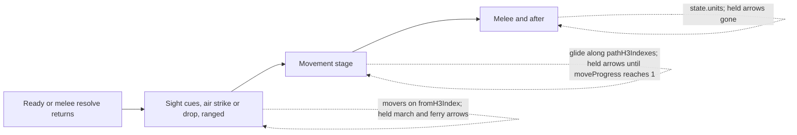

# Fix Resolution Playback for Ferries and Pre-Movement Positions

## Required Outcome

1. Until the Movement stage, every unit that moves this turn is drawn on the hex it started from. Air units flying a strike or drop are the exception; their own flights draw them.
2. During Movement, each mover glides along its resolved path. A ferry follows the airports it flew, and its cargo rides along the same path.
3. The player's queued ferry line keeps its arrowhead until Movement ends, exactly like a queued march, and is then removed.
4. The rules above hold on a normal Ready turn and on a turn that paused for the melee-intercept dialog (Fight or Ignore).
5. Opponent infantry carried by an opponent ferry glides with its air unit.

## Diagnosis (confirmed; no work needed)

Evidence from `debug.log`, turn 10:
- The human ferry `h1-a1` and its cargo `h1-i1` resolve correctly in main. Both log `rememberStrategicHexBeforeMove` from `8212d7fffffffff` to `8229a7fffffffff`, and `airCargoFollowMoves` adds the infantry glide.
- The same turn had three opponent air strikes (`resolveAirStrikePhase {"orderCount":3}`), so playback had air-strike stages before Movement.

**Defect 1: movers appear on their destination before Movement.**
- `getUnitsForDrawWithMovingIds` in `src/renderer/map/drawInteraction.ts` draws `state.units` in these branches: `inAirStrikeOutbound`, the `inAirStrikeLightning`/`inAirStrikeCasualty` branch (`staticUnits`), and `inAirStrikeReturn`. `state.units` is the post-resolution snapshot, where every mover is already on its destination.
- The ranged branch (the inline `.map`) and the final fallback branch already move movers back to `fromH3Index`.
- The result: on any turn with an air strike or drop, every mover of every type sits on its destination until Movement. At Movement its static icon is hidden and it glides from the origin. That is the "snap back, then animate" the user saw.
- The tactical draw path calls the same function, so battles get the same fix.

**Defect 2: no arrowhead on the ferry line.**
- Per `doc/ux/map-overlays.md`, a move played back for the player has no arrowhead. Instead, a queued march keeps its arrowed line until Movement ends. That is done by `ordersHeldUntilMovementEnds` in `src/shared/ordersHeldForPlayback.ts`, drawn in the strategic branch of `src/renderer/rendering/gameScene.ts` (the `marchArrowsUntilMovementEnds` block, about lines 607–624).
- Ferries have no held copy. `drawPendingFerryLines` skips a row whose unit is already on its destination, and the snapshot after Ready shows it there. `prepareStrategicPlanningUiBeforeTacticalAutoStart` in `readyHandler.ts` also clears `S.pendingFerryOrders` right after playback starts.

**Defect 3: the melee-intercept path drops moves.**
- `handleResolveMeleeIntercept` in `src/main/ipc/meleeInterceptResolveIpc.ts` returns `humanMoves: resolveResult.humanMoves` and no `aiMoves`.
- The renderer then replaces the first Ready result with this one (`readyResult = resolveResult` in `readyHandler.ts`). On such a turn, the player's ferry and every opponent move never glide; the units just appear on their destinations.

**Defect 4: opponent air cargo never glides on a normal Ready.**
- `handleGameReady` in `src/main/gameIpcHandlers.ts` rebuilds opponent moves from planning orders (`buildDistinctAiMovesFromPlanningOrders`) and ignores `readyResult.aiMoves`.
- `readyResult.aiMoves` holds the pipeline's rows. The pipeline in `readyStrategicResolutionPipeline.ts` builds them from the orders left after `withoutStrategicHeadOnHolderMoves`, skips air units and units already on the destination, and then appends `airCargoFollowMoves(...).aiMoves`.
- The planning-order rows also keep moves that head-on contact cancelled, which contradicts the invariant in `doc/ux/resolution-playback.md`.



## Ground Rules for the Implementer

- Do not commit or push.
- Put pure renderer logic in `src/shared` so `node:test` can cover it. `tsconfig.main.json` compiles `src/` to `dist/` (`rootDir: src`, `outDir: dist`). So `src/shared/foo.test.ts` runs from `dist/shared/foo.test.js`, and `src/main/ipc/foo.test.ts` runs from `dist/main/ipc/foo.test.js`. `scripts/run-main-node-tests.cjs` discovers every `*.test.js` under `dist/main` and `dist/shared`, so new tests need no registration.
- Shared helpers do not log, matching `ordersHeldForPlayback.ts` and `resolutionCasualtyDraw.ts`. New public main-process functions log once at debug level with `logDebug` from `src/main/logger`, giving input and output counts.
- Give every new function, interface, and member an orienting comment in the house style: Purpose, When to use, Expected outcome, Exceptions. Members use Contract, When to use, Expected outcome, Exceptions. Copy the style of `src/shared/ordersHeldForPlayback.ts`.
- Mark new parameters, interface members, and locals `readonly`/`const` where they are not reassigned.
- No plan or phase labels in code, comments, or docs.
- Test only the contracts listed in each phase. Do not add renderer source-text tests.
- These source-text tests read the files this plan edits. They must keep passing, so do not rename or remove the strings they look for:
  - `src/main/rendererProductionAirConsolidation.test.ts` needs `drawPendingFerryLines(ctx, S.pendingFerryOrders, unitsForOrderLines, hexList);` in `orderOverlayStages.ts`, plus `function drawPendingFerryLines(` and `drawHumanMarchStyleRouteSegments` in `orderDrawing.ts`.
  - `src/main/rendererDrawConsolidation.test.ts` needs the `drawGameScene` strings it asserts, among them `const shouldDrawCommittedPaths = shouldDrawCommittedOrderPaths();`, `drawUnits(ctx, unitsToDraw, effectiveMovingIdsStrategic);`, and `if (anim && hexList && !hideStrategicUnits)`. It also checks that no file contains `S.hideCommittedOrderLinesAfterReady = true;`.
- File sizes: `gameScene.ts` is 818 lines, above the 600-line target. Add at most about 6 lines there and put the drawing logic in `orderDrawing.ts` (435 lines). `readyIpcResolutionMapping.ts` is 664 lines, so do not add to it; Phase 1 creates a new file.

## Phase 1: One Playback-Move Builder for Both Ready Handlers (main process)

Create `src/main/ipc/readyPlaybackMoves.ts`:

```ts
type PlaybackHumanMove = NonNullable<ReadyResult['humanMoves']>[number];
type PlaybackAiMove = NonNullable<ReadyResult['aiMoves']>[number];

export interface ReadyPlaybackMoveSource {
  readonly humanMoves?: readonly PlaybackHumanMove[];
  readonly aiMoves?: readonly PlaybackAiMove[];
  readonly resolvedFerryMoves?: readonly FerryAnimationMove[];
}

export interface ReadyPlaybackMoves {
  readonly humanMoves: PlaybackHumanMove[];
  readonly aiMoves: PlaybackAiMove[];
}

export function buildReadyPlaybackMoves(source: ReadyPlaybackMoveSource): ReadyPlaybackMoves
```

Imports: take `ReadyResult` and `FerryAnimationMove` from the same module `gameIpcHandlers.ts` uses for its types, and `HUMAN_SEAT_ID` and `isAiSeatId` from `../../shared/seatIds`.

Contract:
- `humanMoves` is `source.humanMoves`, in order, followed by one row per resolved ferry whose `player === HUMAN_SEAT_ID`.
- `aiMoves` is `source.aiMoves`, in order, followed by one row per resolved ferry whose `isAiSeatId(player)` is true.
- A ferry row is `{ unitId, fromH3Index, toH3Index, pathH3Indexes }` copied from the `FerryAnimationMove`, so `player` is dropped, matching today's rows.
- Missing inputs count as empty. Inputs are never mutated; return new arrays.
- Log `logDebug('buildReadyPlaybackMoves', { humanCount, aiCount, ferryCount })`.

Wire it in:
1. `handleGameReady` in `src/main/gameIpcHandlers.ts`:
   - Delete `const aiMoves = buildDistinctAiMovesFromPlanningOrders(state, aiOrders);` (about line 230).
   - Delete the `resolvedFerryMoves`/`humanFerryMoves`/`opponentFerryMoves`/`allAiMoves`/`allHumanMoves` block (about lines 269–287).
   - Add `const playbackMoves = buildReadyPlaybackMoves(readyResult);`.
   - In the return, set `aiMoves: playbackMoves.aiMoves.length > 0 ? playbackMoves.aiMoves : undefined` and the same for `humanMoves`.
   - Leave the `awaitingMeleeDecision` branch and its `aiMovesAwait` unchanged. It still uses `buildDistinctAiMovesFromPlanningOrders`.
   - Remove `HUMAN_SEAT_ID` and `isAiSeatId` from the `../shared/seatIds` import if nothing else uses them, or lint fails.
2. `handleResolveMeleeIntercept` in `src/main/ipc/meleeInterceptResolveIpc.ts`:
   - Add `const playbackMoves = buildReadyPlaybackMoves(resolveResult);`.
   - Replace `humanMoves: resolveResult.humanMoves,` with the same `humanMoves` and `aiMoves` lines as above.
   - Keep `...pickReadyResolutionIpcMirrorFields(resolveResult)` where it is.

Intended visible changes on a normal Ready, all from switching the opponent rows to the resolution source:
- Opponent cargo glides with its ferry.
- Moves cancelled by head-on contact no longer glide.
- An air-unit march order no longer glides, since air units never march.
- Neutral units that move now glide. `buildNeutralTurnOrders` orders are part of the resolution rows.

Nothing else changes.

Tests:
- Add `src/main/ipc/readyPlaybackMoves.test.ts` (`node:test`, `node:assert/strict`). Mark its hex and unit ids as test data in a header comment.
  - Happy path. The source has one human march, one opponent march, one opponent cargo row with a path, a human ferry, and an opponent ferry, each with a path. Expect `humanMoves` to be [march, human ferry] and `aiMoves` to be [opponent march, opponent cargo, opponent ferry], with the ferry paths kept.
  - Empty source `{}` gives two empty arrays.
- In `src/main/gameIpcHandlers.test.ts`, add `testHandleResolveMeleeInterceptForwardsPlaybackMoves` and register it in the `tests` list at the bottom of the file.
  - The fake `resolveMeleeIntercept` returns `{ ...minimalResolvedReady, aiMoves: [one opponent march], resolvedFerryMoves: [one human ferry, one ferry for AI_SEAT_IDS[0]] }`.
  - Assert that `result.humanMoves` holds the human ferry with its path, and that `result.aiMoves` holds the opponent march and the opponent ferry.
  - Import `HUMAN_SEAT_ID` beside `AI_SEAT_IDS`.

**Verify:** run `npm run build:main`, then `node dist/main/ipc/readyPlaybackMoves.test.js` and `node dist/main/gameIpcHandlers.test.js`, then `npm run lint`.

## Phase 2: Pure Helper for Pre-Movement Positions

Create `src/shared/resolutionPlaybackPositions.ts`:

```ts
export function unitsAtPlaybackOrigins<T extends { readonly id: string; readonly h3Index: string }>(
  units: readonly T[],
  moves: readonly { readonly unitId: string; readonly fromH3Index: string }[],
  flyingUnitIds: ReadonlySet<string>
): T[]
```

Contract:
- Returns new rows, in input order.
- A unit with a move gets the `fromH3Index` of the first matching move, unless its id is in `flyingUnitIds`. First-match matches the ranged branch it replaces and the "first march for an id" rule in `resolutionCasualtyDraw.ts`.
- Every other unit is returned unchanged.
- Inputs are never mutated.

Add `src/shared/resolutionPlaybackPositions.test.ts` (`node:test`, `node:assert/strict`) with these cases:
- A mover is placed on its origin.
- A unit with no move is unchanged.
- A flying id is unchanged even when it also has a move.
- With duplicate moves for one id, the first move wins.

**Verify:** `npm run build:main`, `node dist/shared/resolutionPlaybackPositions.test.js`, `npm run lint`.

## Phase 3: Use the Helper in the Draw Branches

In `getUnitsForDrawWithMovingIds` (`src/renderer/map/drawInteraction.ts`, about lines 115–193):

1. Inside `if (anim)`, after `rangedRemovedIds`, compute once:
   - `const flyingIds = new Set([...(anim.airStrikeOutboundMoves ?? []), ...(anim.airStrikeReturnMoves ?? [])].map((move) => move.unitId));`
   - `const preMoveUnits = unitsAtPlaybackOrigins(state.units, anim.moves, flyingIds);`
2. Replace `state.units` with `preMoveUnits` in:
   - the `inAirStrikeOutbound` branch;
   - the `staticUnits` filter of the lightning and casualty branch, keeping `strikeUnitsAtTarget` exactly as it is;
   - the `inAirStrikeReturn` branch.
3. In the ranged branch, replace the `preMoveSurvivors` chain with `preMoveUnits.filter((u) => !rangedRemovedIds.has(u.id))`.
4. Replace the body of the fallback branch (`anim.moves.length > 0 && moveProgress < 1`) with `unitsToDraw = preMoveUnits; movingIds = undefined;`. Keep its condition and comment. This branch covers sight cues and turns without air stages.
5. Do not change the `inMovement` branch, the melee branch, or the `unitsDrawnAtCasualtyTiming` call after the branches.
6. Update the function's orienting comment. Before Movement, every mover is drawn on its origin, except strike and drop fliers.

Why this is safe:
- `unitsDrawnAtCasualtyTiming` still runs last, so removed units keep their timing.
- The tactical wrapper in `src/renderer/wiredEntryCallbacks.ts` passes merged sub-units whose ids match the tactical `anim.moves`, so battles get the same placement.
- Drop infantry appears in `airStrikeOutboundMoves`, so it counts as flying and keeps its drop rendering.

**Verify:**
- `npm run lint`, `npm run check:renderer-types`, `npm run build:renderer`, then the full `npm test`.
- Manual check by the user: see Final Check, scenarios A and D.

## Phase 4: Pure Helper for Held Ferry Lines

Extend `src/shared/ordersHeldForPlayback.ts` (134 lines):

```ts
export interface HeldFerryLine {
  readonly unitId: string;
  readonly pathH3Indexes: readonly string[];
}

export interface PlaybackFerryHoldMove {
  readonly unitId: string;
  readonly fromH3Index: string;
  readonly toH3Index: string;
  readonly pathH3Indexes?: readonly string[];
}

export function ferriesHeldUntilMovementEnds(
  ferryOrders: readonly {
    readonly unitId: string;
    readonly destinationH3Index: string;
    readonly pathH3Indexes?: readonly string[];
  }[],
  moves: readonly PlaybackFerryHoldMove[]
): HeldFerryLine[]
```

Rules:
- Hold a ferry only when the first move for that unit has `fromH3Index !== toH3Index` and `toH3Index === destinationH3Index`. A failed ferry has no such move and is not held.
- Choose the path in this order:
  1. the move's `pathH3Indexes`, when it has 2 or more entries (the airports actually flown);
  2. the order's `pathH3Indexes`, when it has 2 or more entries;
  3. `[fromH3Index, toH3Index]`.
- Return copied arrays, in ferry-order order.

Add these cases to `src/shared/ordersHeldForPlayback.test.ts`:
- A ferry that succeeded is held with the move's path.
- A ferry with no move is skipped.
- A move that ended somewhere other than the destination is skipped.
- When the move has no path, the order's path is used; when neither has one, the two-hex line is used.

**Verify:** `npm run build:main`, `node dist/shared/ordersHeldForPlayback.test.js`, `npm run lint`.

## Phase 5: Draw the Held Ferry Line

1. In `src/renderer/rendering/orderDrawing.ts`:
   - Extract the per-row drawing of `drawPendingFerryLines` into `export function drawFerryRouteLine(ctx: CanvasRenderingContext2D, pathH3Indexes: readonly string[]): void`. It converts the hexes with `cellToLatLng` and calls `drawHumanMarchStyleRouteSegments(ctx, [{ turn: 1, hexes: points }])`, which draws the solid line and arrowhead. `drawPendingFerryLines` keeps its signature and skip rules and calls it with the same path it builds today, so the pending line looks exactly as before.
   - Add `export function drawHeldFerryLines(ctx: CanvasRenderingContext2D, lines: readonly HeldFerryLine[]): void`. It calls `drawFerryRouteLine` once per line.
2. In `src/renderer/core/resolutionMoveAnimationTypes.ts`, add `ferryArrowsUntilMovementEnds?: readonly HeldFerryLine[]` next to `marchArrowsUntilMovementEnds`, with an orienting comment in the same style.
3. In `src/renderer/core/types.ts`, the `ResolutionMove.pathH3Indexes` comment says the path is "Omitted for strategic Ready". That is already false. Change it to say that strategic Ready sets it for ferries and their cargo, and tactical commits set it for marches.
4. In `src/renderer/gameplay/readyHandler.ts`:
   - Add `const submittedFerryOrders = [...S.pendingFerryOrders];` right after `const turnReportTag = currentConsoleReportTag();` (about line 130). It must come before `hasPendingDraftOrders`, `submitOrders`, both Ready calls, and every snapshot apply, so later clearing or pruning of the live list cannot affect it.
   - Next to `const marchArrowsUntilMovementEnds = ...` (about line 356), add `const ferryArrowsUntilMovementEnds = ferriesHeldUntilMovementEnds(submittedFerryOrders, humanMoves);`.
   - In the `S.resolutionMoveAnimation` object, add `...(ferryArrowsUntilMovementEnds.length > 0 ? { ferryArrowsUntilMovementEnds } : {}),` beside the march entry.
   - `humanMoves` is read after the melee-intercept replacement. With Phase 1 it carries ferry rows on both paths.
5. In the strategic branch of `src/renderer/rendering/gameScene.ts`, directly after the held-march block:

   ```ts
   const ferryArrowsUntilMovementEnds = anim?.ferryArrowsUntilMovementEnds;
   if (shouldDrawCommittedPaths && !S.hideCommittedOrderLinesAfterReady && moveProgress < 1 && ferryArrowsUntilMovementEnds) {
     drawHeldFerryLines(ctx, ferryArrowsUntilMovementEnds);
   }
   ```

   Add a one-line comment in the style of the march comment above it: the live ferry list is cleared once playback starts, so this copy keeps the arrowhead until Movement ends. The gate is the same one the held march uses, so Shift hides both. Import `drawHeldFerryLines` through the existing `./orderDrawing` import.
6. Leave the tactical branch alone. Tactical ferry playback is out of scope.

**Verify:**
- `npm run lint`, `npm run check:renderer-types`, `npm run build:renderer`, then the full `npm test`.
- Manual check by the user: see Final Check, scenarios A, B, and C.

## Phase 6: Documentation

`doc/ux/resolution-playback.md`:
- Under Invariants, add a bullet. Until the Movement stage, every unit that moves this turn is drawn on the hex it started from, except an air unit flying a strike or drop, which its flight draws. During Movement, every resolved march, ferry, and carried unit of every side, Neutral included, glides along its path. This holds on the world map, after a melee-intercept choice, and in battles.
- Under Code Entry Points, add:
  - `src/shared/resolutionPlaybackPositions.ts` (`unitsAtPlaybackOrigins`)
  - `src/main/ipc/readyPlaybackMoves.ts` (`buildReadyPlaybackMoves`)
  - `src/shared/ordersHeldForPlayback.ts` (`ordersHeldUntilMovementEnds`, `ferriesHeldUntilMovementEnds`)

`doc/ux/map-overlays.md`, line-styling paragraph:
- Change "A queued march stays, arrowhead included, through the movement animation (`ordersHeldUntilMovementEnds` ...)" so it covers marches and ferries. Name `ferriesHeldUntilMovementEnds` beside `ordersHeldUntilMovementEnds`.
- State that a ferry that failed is not held.
- Keep "A move played back for the player has no arrowhead, except an air strike's flight".

Also:
- Search `doc/` for `drawPendingFerryLines`, `ordersHeldForPlayback`, `buildDistinctAiMovesFromPlanningOrders`, and `humanFerryMoves`, and update any sentence those changes made wrong.
- Leave the historical documents listed in `AGENTS.md` alone.

**Verify:** reread every edited paragraph against the code. Each symbol and path named must exist with that spelling.

## Final Check

- `npm test` passes. It covers build, lint, naming, renderer types, unit tests, and notices.
- The user runs these on the world map:
  - **A.** Queue a human ferry carrying infantry and a ground march, on a turn with any air strike or drop from either side. Both stacks stay on their origins through the air and ranged stages, then glide once during Movement: the ferry and its infantry along the airport path, the march along its route. The ferry line keeps its arrowhead from the first frame until Movement ends, then disappears. A striking air unit still flies out and back.
  - **B.** Observe a match where an opponent ferries infantry. The air unit and its infantry glide together along the airport path.
  - **C.** On a turn that opens the melee-intercept dialog, choose Ignore. Opponent marches, the human ferry, and its cargo glide during Movement, and the held ferry arrow behaves as in A.
  - **D.** In a battle beat with an air strike, sub-units that move stay on their start cells until Movement.
- The final summary names the updated documents, says that tactical held ferry lines are unchanged, and lists the intended visible changes from Phase 1.
