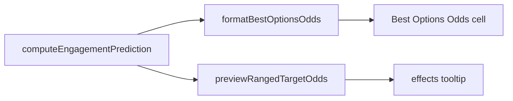

# Hurt odds line

Hurt is the chance the attackers score at least one hit. A hit that only strips a fortification still counts. Fortification soak is not subtracted. Kill stays the wipe chance (`probabilityDefenderEliminated`). Loss stays the chance the attackers lose at least one unit (`probabilityAttackerLosesUnit`). Rounding stays `Math.round(p * 100)`. A printed `0` is kept. Kill and Hurt are both printed when they are the same number. If any of the three probabilities is missing, not finite, or the estimate is uncontested or not `ok`, the Odds cell is an em dash and the tooltip prints none of the three.

The Odds cell and the tooltip use the same words: `Kill: 62%, Hurt: 80%, Loss: 19%`. On the tooltip the three labels are bold and the three numbers share one line, with a comma and a space between them. Air strikes, air drops, approaches, ferries, and missile launches stay an em dash in the table and do not gain this line on the tooltip. The coaching skip rule does not change its thresholds and does not mention Hurt. It changes words only: skip a listed row when Kill is below 50% and Loss is at least 50%. An em dash is still not that case. Assessment categories stay based on wipe and loss only. `estimate_combat` reasoning text stays as it is. The new field appears in the tool JSON only because the prediction object is already spread into that result.

Before the first code edit, save this plan unchanged as [`.spec/hurt-odds-execution-plan.md`](.spec/hurt-odds-execution-plan.md) with CRLF line endings. Do not revise that copy while coding. Do not put phase labels into code, comments, tests, lint, or `doc/`. Do not commit or push. Do not edit `.spec/completed/` or [`.spec/ranged-target-tooltip-execution-plan.md`](.spec/ranged-target-tooltip-execution-plan.md). Do not hand-edit `static/renderer.js`. Do not start `npm run ui:smoke`. Do not add a log line. The public functions already log on entry. Finish each phase and run its checks before the next phase. `npx tsx` does not typecheck, so a forgotten field can pass a test that never builds that object. The compile in the last phase is what catches those returns.

## Phase 1 — The probability

In [`src/main/tools/combatEstimation.ts`](src/main/tools/combatEstimation.ts), add `probabilityAtLeastOneHit` to `EngagementPrediction`, with an orienting comment: it is the probability the attackers score at least one hit, it is in `[0, 1]`, fortification soak does not reduce it, and a hit that only strips a fortification still counts. Callers round it for the Hurt percentage.

Inside the attacker-hit loop of `computeEngagementPrediction`, add the probability mass for every `k >= 1`. Use that same loop. Do not write a second formula. Do not add this sum in the defender-hit loop. That loop is Loss. Do not use `defenderSoak`, `defenderCount`, or `defenderLossesExpected` for this sum. An empty attacker list stays 0, because that distribution is only `k = 0`. Extend the function's expected-outcome comment so the next reader sees that this probability is attacker-hit mass for `k >= 1` and that soak is not applied.

Thread the field through:

- `averagePredictions`, as `mean('probabilityAtLeastOneHit')`. Melee Hurt is that half-and-half mean.
- `summarizeRoleCase`, so each melee role outcome includes it.
- `UNCONTESTED_PREDICTION`, as `0`. Uncontested rows still render an em dash later. The zero keeps the tool payload the same shape.

`estimate_combat` already spreads `prediction` into its result, so the tool JSON gains this field with no new tool. Do not change `getAssessmentCategory` or the reasoning sentences. Do not change the existing wipe and loss expectations in [`src/main/tools/combatEstimation.test.ts`](src/main/tools/combatEstimation.test.ts) or [`src/main/tools/combatEstimationTactical.test.ts`](src/main/tools/combatEstimationTactical.test.ts).

Checks, in [`src/main/tools/combatEstimationFortification.test.ts`](src/main/tools/combatEstimationFortification.test.ts):

- The existing soak case, two sure hits against one defender with soak 2, still has wipe 0 and expected defender losses 0, and `probabilityAtLeastOneHit` is 1.
- `computeEngagementPrediction([0.5], [], 1, 2, 0)` has `probabilityAtLeastOneHit` 0.5 and `probabilityDefenderEliminated` 0. One die cannot wipe two units.

In the existing melee case in [`src/main/tools/combatEstimation.test.ts`](src/main/tools/combatEstimation.test.ts), assert the averaged prediction equals the mean of the two role outcomes for this field, within the file's existing epsilon. Extend that file's role type so the assertion compiles.

Run:

- `npx tsx --test src/main/tools/combatEstimationFortification.test.ts`
- `npx tsx src/main/tools/combatEstimation.test.ts`

## Phase 2 — The Odds cell and the skip sentence

In [`src/main/briefing/map/bestOptionsOdds.ts`](src/main/briefing/map/bestOptionsOdds.ts), add `probabilityAtLeastOneHit` to `BestOptionsOddsPrediction` with an orienting comment that it is the Hurt fraction. `formatBestOptionsOdds` returns an em dash unless all three probabilities are finite numbers. `typeof value === 'number'` is not enough: `NaN` is a number. Use `Number.isFinite` on each one. Otherwise it returns exactly `Kill: ${kill}%, Hurt: ${hurt}%, Loss: ${loss}%`, with a comma and a space between the parts. Update the file header and the function comment that still say `wipe N%, lose M%`. `resolveBestOptionsOdds` stays limited to `ranged` and `move/melee`.

In [`src/main/briefing/map/bestOptionsOdds.test.ts`](src/main/briefing/map/bestOptionsOdds.test.ts), keep the new assertions inside the two existing functions:

- `0.62`, `0.80`, and `0.19` format as `Kill: 62%, Hurt: 80%, Loss: 19%`.
- The cached ranged prediction injects `probabilityAtLeastOneHit: 0.4` beside `0.5` and `0.1`, and both calls expect `Kill: 50%, Hurt: 40%, Loss: 10%`. The call count stays 1. Air strike stays `—` and still makes 0 calls.
- Null and `assessment: 'uncontested'` stay `—`.
- A prediction that has wipe and loss but no `probabilityAtLeastOneHit` stays `—`.
- A prediction whose Hurt value is `Number.NaN` stays `—`.

Replace `BEST_OPTIONS_ODDS_LINE` in [`src/main/briefing/map/briefingTables.ts`](src/main/briefing/map/briefingTables.ts) with this sentence, and put that same sentence in the `BEST_OPTIONS_ODDS` row of [`doc/ai-commander-prompts/information-decision-model.md`](doc/ai-commander-prompts/information-decision-model.md):

`Odds is Kill, Hurt, and Loss for every listed unit taking part. Kill is the chance the defenders are wiped out. Hurt is the chance at least one hit lands, including a hit that only removes a fortification. Loss is the chance you lose a unit. An em dash is not a fight, or it could not be estimated.`

In both [`src/main/openRouter/promptSpec/coachingTextStrategic.ts`](src/main/openRouter/promptSpec/coachingTextStrategic.ts) and [`src/main/openRouter/promptSpec/coachingTextTactical.ts`](src/main/openRouter/promptSpec/coachingTextTactical.ts), change only the odds words in the returned sentence and in the comment above it. The rest of this sentence stays identical, including the leading `- ${listed} `:

`unless its Odds show Kill below 50% and Loss at least 50%. An em dash is not that case. A shot resolves before movement and does not use the move. Do not invent a target.`

Do not add Hurt to that rule. In [`src/main/openRouter/promptSpec/coachingText.test.ts`](src/main/openRouter/promptSpec/coachingText.test.ts), match `Kill below 50%` and `Loss at least 50%` on both the strategic and tactical gate text, and do not match `wipe below 50%`.

Update the living prompt sentences that quote the old cell or the old skip rule. Leave [`doc/ai-commander-prompts/example-strategic-prompt.md`](doc/ai-commander-prompts/example-strategic-prompt.md) and [`doc/ai-commander-prompts/source-inventory.md`](doc/ai-commander-prompts/source-inventory.md) alone. They do not state the cell words or the skip rule. Leave [`doc/ai-commander-prompts/README.md`](doc/ai-commander-prompts/README.md) alone for the same reason.

- [`doc/ai-commander-prompts/tactical-prompt.md`](doc/ai-commander-prompts/tactical-prompt.md): the Odds column is `Kill: N%, Hurt: N%, Loss: N%` for a ranged or move/melee row, from `probabilityDefenderEliminated`, `probabilityAtLeastOneHit`, and `probabilityAttackerLosesUnit`. The fire-every-beat item uses Kill below 50% and Loss at least 50%.
- [`doc/ai-commander-prompts/strategic-prompt.md`](doc/ai-commander-prompts/strategic-prompt.md): the fire-before-moving item uses those same words.
- [`doc/ai-commander-prompts/assembly-contract.md`](doc/ai-commander-prompts/assembly-contract.md): the period-start item uses those same words.
- [`doc/ai-commander-prompts/information-decision-model.md`](doc/ai-commander-prompts/information-decision-model.md): the `TEMPO_RANGED_SHOT` row uses those same words.
- [`doc/ai-commander-prompts/example-tactical-prompt.md`](doc/ai-commander-prompts/example-tactical-prompt.md): the copied skip bullet uses those same words.

Run:

- `npx tsx src/main/briefing/map/bestOptionsOdds.test.ts`
- `npx tsx --test src/main/openRouter/promptSpec/coachingText.test.ts`

## Phase 3 — The tooltip line

`readRangedTargetOdds` in [`src/main/tools/rangedTargetOdds.ts`](src/main/tools/rangedTargetOdds.ts) reads `probabilityAtLeastOneHit` with the same `typeof` and `Number.isFinite` checks as the other two. All three percents are rounded numbers, or all three are null. `countedDefenderIds` is unchanged when the percents are null. Both object literals that return null percents must include `hurtPercent: null`: the one inside `readRangedTargetOdds`, and the missing-coordinate return in `previewRangedTargetOdds`. The success return includes the rounded `hurtPercent`.

Add `hurtPercent` to:

- the result type in [`src/main/tools/rangedTargetOdds.ts`](src/main/tools/rangedTargetOdds.ts)
- `RangedTargetOddsPreview` in [`src/shared/ipc/gameApiTypes.ts`](src/shared/ipc/gameApiTypes.ts)
- the `previewRangedTargetOdds` contract comment on `GameApi` in that same file
- the preload comment on `previewRangedTargetOdds` in [`src/main/preload.ts`](src/main/preload.ts)
- `HoverRangedTargetOdds` in [`src/renderer/core/types.ts`](src/renderer/core/types.ts)
- the private `LegalRangedTargetOdds` interface in [`src/renderer/gameplay/hoverRoutePreviewRefresh.ts`](src/renderer/gameplay/hoverRoutePreviewRefresh.ts)

Each new field gets an orienting comment: it is the Hurt percent, `Math.round(probabilityAtLeastOneHit * 100)`, or null when Kill or Loss is null. Update the comments that still say the tooltip prints two percents or two lines.

In [`src/renderer/gameplay/hoverRoutePreviewRefresh.ts`](src/renderer/gameplay/hoverRoutePreviewRefresh.ts), copy `hurtPercent` in both places: the object stored from the odds result, and the object passed to `composeRangedTargetTooltipHtml`. No new IPC channel. A thrown odds call still publishes the attack line.

In [`src/shared/rangedTargetTooltip.ts`](src/shared/rangedTargetTooltip.ts), replace the two odds lines with one block, and only when all three percents are non-null:

`<strong>Kill:</strong> N%, <strong>Hurt:</strong> N%, <strong>Loss:</strong> N%`

Roster, then effects, then that one line. The section gap still separates those blocks. It does not appear inside the odds line. Null on any percent omits the whole line. `0` is kept. Do not drop Hurt when it equals Kill.

In [`src/shared/rangedTargetTooltip.test.ts`](src/shared/rangedTargetTooltip.test.ts), add `hurtPercent: 25` to every odds fixture that already uses kill 40 and loss 10, and expect this one line:

`<strong>Kill:</strong> 40%, <strong>Hurt:</strong> 25%, <strong>Loss:</strong> 10%`

That covers the order fixture, the fixture with no effects line, and the fixture with an empty opponent list. Extend the existing "either percent is null" case with `hurtPercent: null` beside kill 40 and loss 10, still expecting the roster only. The zero fixture is `Kill: 0%, Hurt: 0%, Loss: 0%` on one line. The all-absent fixture passes `hurtPercent: null` and still returns null. Do not add tests for the roster builder.

In [`src/main/tools/rangedTargetOdds.test.ts`](src/main/tools/rangedTargetOdds.test.ts):

- The strategic estimate assertion also checks `hurtPercent === Math.round(prediction.probabilityAtLeastOneHit * 100)`.
- The injected prediction adds `probabilityAtLeastOneHit: 0.8`. The `deepEqual` result is `{ killPercent: 50, hurtPercent: 80, lossPercent: 25, countedDefenderIds: ['inf-1'] }`.
- One injected prediction with `probabilityAtLeastOneHit: Number.NaN` and finite wipe and loss returns null for all three percents and still returns the counted defender ids. Do not add separate cases for a non-finite Kill or Loss. Those guards already exist.

Search `doc/` for `Kill and Loss`, `wipe N%`, `wipe below 50%`, and `lose at least 50%`. Update every living hit so a ranged aim ends with one line, `Kill: N%, Hurt: N%, Loss: N%`, labels bold. Hurt is the chance at least one hit lands, including a hit that only strips a fortification. All three show, or none do. The files that contain those phrases today are:

- [`doc/ux/hex-tooltips.md`](doc/ux/hex-tooltips.md)
- [`doc/ux/notifications-and-feedback.md`](doc/ux/notifications-and-feedback.md)
- [`doc/ux-specification.md`](doc/ux-specification.md)
- [`doc/how-to-play.md`](doc/how-to-play.md)
- [`doc/combat-rules-v3.md`](doc/combat-rules-v3.md)

Leave historical documents alone, including [`doc/devleopment-plan-v3.4.md`](doc/devleopment-plan-v3.4.md), [`doc/poc-analysis.md`](doc/poc-analysis.md), and [`doc/market-research.md`](doc/market-research.md). `probabilityAtLeastOneHit` is not an engine-constants-table symbol. Do not add it to [`doc/README.md`](doc/README.md).

Run:

- `npx tsx --test src/shared/rangedTargetTooltip.test.ts src/main/tools/rangedTargetOdds.test.ts`
- `npx tsx src/main/rendererStackPopoverContracts.test.ts`
- `npx tsc -p tsconfig.main.json`
- `npm run build:renderer`

Renderer typecheck already fails in unrelated files. Do not treat those as a regression. Restart the app after the main compile and the renderer build before checking a shot in game.
