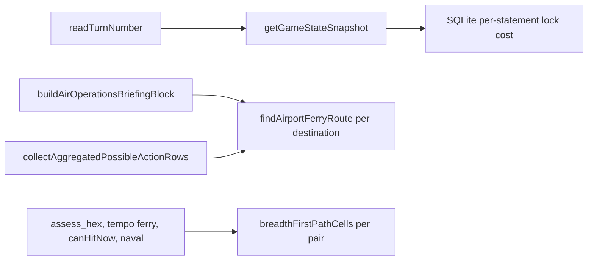

# Main-Thread Performance Execution Plan

This file is the plan. Do not revise it while coding.

## Rules for the Implementing Agent

- Never commit or push.
- Do not put phase numbers, baseline labels, or other plan identifiers into code, comments, tests, lint messages, or `doc/`.
- Do not hand-edit `static/renderer.js`, and do not start `npm run ui:smoke`.
- Do not split a file that is already over 600 lines. This work must not push any file over 1000 lines. `commanderPool.ts` (about 646) and `gameDb.test.ts` (about 825) stay as they are apart from the edits named below. `main.ts` is about 597 lines; the new lock handler lives in its own module so `main.ts` gains only the call.
- Every new or changed function, field, and constant gets an orienting comment in the file's existing style (Purpose, When to use, Expected outcome, Exceptions).
- Use `const` and `readonly` for bindings that are not reassigned. Arrays and maps that grow stay mutable.
- Logging: new public main-process functions log at debug on entry. Getter-style functions log at trace. Caught exceptions log at error. `src/shared/airportFerryRoute.ts` and `src/shared/h3GridRangePure.ts` do not import the logger. Keep it that way, including their new test-reset function.
- Test contracts, not cache internals. Use the file's existing runner. `h3GridRangePure.test.ts` and `airportFerryRoute.test.ts` use a `tests` array and a `run()` function, not `node:test`.
- Finish each phase, run its checks, and fix failures before the next phase.
- Behavior stays the same. Distances, ferry paths, reachable airports, row order, and the turn number the commander pool uses stay the same. Only the work shrinks.

## Baseline

Five minutes of play, one strategic turn plus battle beats, debug logging on. Busy main-thread time was 94.4 s.

| Work | Inclusive time |
| --- | --- |
| SQLite helpers `getOne`, `getAll`, and `run` in `dbConnection.ts` | 32.1 s |
| `getGameStateSnapshot`, of which `readTurnNumber` was 3.9 s | 17.2 s |
| `findAirportFerryRoute` (9.0 s briefing, 10.8 s ferry destination lists) | 20.2 s |
| `breadthFirstPathCells` through `computeGridDistanceWithPathFallbackPure` | 17.3 s |
| `collectAggregatedPossibleActionRows`, overlapping the ferry time | 16.7 s |



## Phase 1: Read the Turn Number Without Building a Snapshot

`readTurnNumber` in [`src/main/openRouter/commanderPool.ts`](src/main/openRouter/commanderPool.ts) is the only caller of `getGameState` in that file. It exists so `startStrategicPlanning`, `startTacticalPlanning`, and `launchCommanderConsult` can read the turn. Today it builds a full snapshot.

Replace the body. Match `getGameStateSnapshot` in [`src/main/gameDb/fogState.ts`](src/main/gameDb/fogState.ts) (the early returns around lines 201–207, then `turn_number` for `turn_state` id 1):

- `hasDbHandle()` false: return `1`. Import `hasDbHandle` from `../gameDb/dbConnection`. It is not re-exported from `gameDb.ts`.
- `gameMapLoadError()` non-null: return `1`. Import it from `../gameMap/loadGameMap`. Do not log. The snapshot logs an error here; this reader must not, or a closed map would log once per seat.
- Otherwise `readTurnStateRow(dbGetOne)?.turn_number ?? 1`. `readTurnStateRow` is in `../gameDb/turnStateReads`. Add `dbGetOne` to the existing `../gameDb` import and remove `getGameState` from it.
- Keep the `try`/`catch`. It logs `commanderPool could not read the match turn` and returns `null`.

`mergeActiveTacticalSessionIntoGameStateSnapshot` does not change `turnNumber`, so skipping `getGameState` does not change the number. Update the orienting comment: the function reads the turn row and uses the snapshot's defaults.

Checks:

- `npm run build:main`
- `node dist/main/openRouter/commanderPool.test.js`

That test opens a real database and compares `timedOutTurn` with `getGameState().turnNumber`. A wrong turn fails it.

## Phase 2: Exclusive SQLite Locking and a Single-Instance Lock

On Windows, better-sqlite3 in the default locking mode takes and releases a file lock and re-reads the file header on every autocommit statement. That overhead was about 0.2 ms per statement. The game database is opened once, by `applyGameDbPragmas`, and nothing else opens that file while the handle is held. Saves copy it with `VACUUM INTO` on the same connection.

### Exclusive locking

In `applyGameDbPragmas` in [`src/main/gameDb/databaseValidation.ts`](src/main/gameDb/databaseValidation.ts):

- Call `database.pragma('locking_mode = EXCLUSIVE')` before the other four pragmas. Do not change those four, and do not switch the journal to WAL.
- Add `lockingMode: 'EXCLUSIVE'` to the existing debug payload.
- Extend the comment: the connection keeps the file lock until it closes, so another program cannot open the live match file while the game is running. The measured effect on a real match was 842 reads from about 150 ms to about 2 ms, and 842 writes from about 230 ms to about 35 ms.

### The one test that opens the file twice

In [`src/main/gameDb.test.ts`](src/main/gameDb.test.ts), `testFreshFileUserVersion` calls `createFreshGameDatabaseAt` and then `new sqliteDatabaseCtor(p)` while that handle is still open. After this change the second open fails with `SQLITE_BUSY`. Call `gameDb.closeGameDatabaseForTests()` after `createFreshGameDatabaseAt` and before `new sqliteDatabaseCtor(p)`. The `finally` close stays.

`testPersistenceTwoOpens` and `testWrongUserVersionRecovers` already close the process handle before opening the file again. Leave them.

Add one assertion to `testFreshFileUserVersion`, on the second connection, after `applyGameDbPragmas(d)`:

```ts
assert.strictEqual(d.pragma('locking_mode', { simple: true }), 'exclusive');
```

Assert on `d`, not on a process handle. `getDbHandle` is not exported from `gameDb.ts`. Do not export it for this test.

### Single-instance lock

Exclusive locking makes a second copy fail when it opens the match database. The second copy should leave before that.

Create [`src/main/singleInstanceLock.ts`](src/main/singleInstanceLock.ts). Import `type { App, BrowserWindow }` from `electron`, and `logDebug` and `logInfo` from `./logger`.

```ts
export function claimSingleInstanceLock(
  electronApp: App,
  getMainWindow: () => BrowserWindow | null
): boolean
```

- Call `electronApp.requestSingleInstanceLock()`.
- On failure, log at info that another copy is already running, and return `false`.
- On success, register a named `second-instance` handler and return `true`. The handler logs at debug, reads the window getter, and does nothing when that is null (the window may not exist yet). Otherwise, if `isMinimized()` then `restore()`, if `isVisible()` is false then `show()`, then `focus()`.
- Comment: Electron keys this lock by the user-data directory, so the call has to follow `applyUserDataDirOverride`. UI smoke sets its own user-data directory and does not collide with a running game. A second launch of the same directory quits and brings the open window forward.

In [`src/main/main.ts`](src/main/main.ts), immediately after `applyUserDataDirOverride(app);`:

```ts
const isPrimaryInstance = claimSingleInstanceLock(app, () => mainWindow);
if (!isPrimaryInstance) {
  app.quit();
} else {
  app.whenReady().then(async () => {
    // the existing body, unchanged
  });
}
```

Move the existing `app.whenReady().then(...)` into that `else`. Do not copy it. Leave the `uncaughtException`, `unhandledRejection`, `window-all-closed`, and `activate` handlers where they are. Do not call `process.exit`. No test imports `main.ts`, so the lock does not run under `npm test`.

### Docs

- [`doc/save-files.md`](doc/save-files.md): after "What a save is", add "The open match database". The live file (`GAME_DB_FILE_NAME`) is opened with `locking_mode = EXCLUSIVE` by `applyGameDbPragmas`. While the game is running, no other program can open that file. A save still works because `VACUUM INTO` uses the same connection. `claimSingleInstanceLock` allows one process per user-data directory, and a second launch brings the open window forward.
- [`README.md`](README.md), in the Notes list: one bullet. Only one copy of Agent Wars runs at a time. Launching it again brings the open window to the front.
- The routing table in [`doc/ux-specification.md`](doc/ux-specification.md) has no element document for launching the app. Do not add one.

### Checks

- `npm test`. This rebuilds the native module, builds, lints, and runs every test. `saveFileInspect.test.ts` copies the open database with `fs.copyFileSync`. That copies bytes and does not take a SQLite lock, so it should still pass. If it fails, stop and report it. Do not drop the pragma and do not close the handle inside that test to hide the failure.
- Then ask the user to do this, with no other Agent Wars process running:
  1. `npm start` from the repository root.
  2. In a second terminal, from the same root: `.\node_modules\electron\dist\electron.exe .`
  3. The second process exits and the first window comes forward.
  4. Save, load, and an autosave still work. Autosave runs when a turn or battle beat starts.

## Phase 3: One Airport Search per Air Unit

`findAirportFerryRoute` in [`src/shared/airportFerryRoute.ts`](src/shared/airportFerryRoute.ts) searches once per destination. Two callers only need the reachable set:

- `collectLegalFerryDestinationHexes` in [`src/main/openRouter/possibleUnitActionsDestinations.ts`](src/main/openRouter/possibleUnitActionsDestinations.ts)
- `nearestFerryAirportCodes` in [`src/main/openRouter/briefingSectionsAirOps.ts`](src/main/openRouter/briefingSectionsAirOps.ts)

`resolveStrategicAirportFerry` still needs the path. Do not change it, and do not change `findAirportFerryRoute`.

### The shared search

1. Change `hopAllowed`'s first parameter to `Pick<AirportFerryRouteRequest, 'gridDistance' | 'unmeasuredHopWithinRange' | 'hopRangeHexes'>`. The body stays the same.
2. Add `export type AirportFerryReachRequest = Omit<AirportFerryRouteRequest, 'destinationH3Index'>`, with an orienting comment.
3. Add:

```ts
export function findReachableAirportFerryDestinations(
  request: AirportFerryReachRequest
): ReadonlySet<string>
```

- Build `usable` the same way `findAirportFerryRoute` does: intact, owned by `request.owner`, not a neutral border.
- Breadth-first from `request.originH3Index`. A neighbor is a usable hex other than the current hex, not yet seen, that passes `hopAllowed`.
- Do not sort neighbors. Reachability on this graph does not depend on order. Sorting is what makes the path stable, and this function does not return a path.
- Return every reached hex except the origin.
- Contract, in the comment: for any hex `d` other than the origin, `d` is in the set exactly when `findAirportFerryRoute({ ...request, destinationH3Index: d }).reachable` is true. The origin is never in the set. A foreign, wrecked, or neutral-border airport is never in the set. A hop range that depends on the destination is honored, because each hop asks `hopRangeHexes` for that arrival hex.

### Callers

`collectLegalFerryDestinationHexes`:

- Build `nodes` as today.
- Call `findReachableAirportFerryDestinations` once, with the same `originH3Index`, `owner`, `nodes`, `gridDistance`, `unmeasuredHopWithinRange`, and `hopRangeHexes`.
- Keep the loop and its order. Skip the unit's own hex and any node whose owner is not the unit's player. Replace `findAirportFerryRoute` with `reachable.has(node.h3Index)`. Keep `logHexControllerParityMismatch` on each kept node.
- Remove unused imports.

`nearestFerryAirportCodes`:

- One `findReachableAirportFerryDestinations` call, same request fields as today's per-airport search.
- Keep the loop over `airports`, skip the unit's own hex, and keep airports that are in the set.
- Sorting, the grid-distance tie break, and the cap of 8 stay as they are.
- Remove unused imports.

### Tests

Add cases to [`src/shared/airportFerryRoute.test.ts`](src/shared/airportFerryRoute.test.ts), reusing its helpers:

- For each existing fixture (direct hop, intermediate stop, wrong owner, wrecked, neutral border, range 2 against range 3, null distance, accepted unmeasured hop): for every node other than the origin, set membership equals `findAirportFerryRoute(...).reachable`.
- The origin is never in the set.
- One new graph where `hopRangeHexes` depends on the destination: one airport is reachable at range 2 and another, the same distance away, is not. The set contains only the first. This catches a search that samples the range once.

### Checks

- `npm run build:main`
- `node dist/shared/airportFerryRoute.test.js`
- `node dist/main/openRouter/possibleUnitActionsStrategicBestOptions.test.js`
- `node dist/main/openRouter/possibleUnitActionsTacticalInfraApproach.test.js`
- `node dist/main/openRouter/briefingSectionsAirOps.test.js`
- `node dist/main/openRouter/tacticalPromptSectionParity.test.js`
- `node dist/main/gameActions/airFerryRoute.test.js`

## Phase 4: Share Ferry Destinations Across One Consult

A strategic consult calls `collectAggregatedPossibleActionRows` two or three times with the same `planState` object. Each call rebuilds strategic ferry destinations in a local map (`ferryDestByKey` in [`src/main/openRouter/possibleUnitActions.ts`](src/main/openRouter/possibleUnitActions.ts)). The calls pass different coordinate maps, and those maps change row order, so do not cache the rows.

`requestOrdersFlow` builds `planState` once and does not mutate it before those calls. `indexedState`, when passed, is `buildPossibleActionsIndexedState` of that same object. When it is omitted, `collectAggregatedPossibleActionRows` builds it from `args.state`. Control, airports, weather, and the unit's tags all come from that snapshot.

In [`src/main/openRouter/possibleUnitActionsDestinations.ts`](src/main/openRouter/possibleUnitActionsDestinations.ts), follow `destCacheByState` in [`src/main/oneStepMoveDestinations.ts`](src/main/oneStepMoveDestinations.ts):

- A module-private `WeakMap<GameStateSnapshot, { generation: number; byKey: Map<string, string[]> }>` and a generation counter.
- `export function collectLegalFerryDestinationHexesCached(unit, indexed, state): string[]` with the same parameter types as `collectLegalFerryDestinationHexes`.
  - Key: `` `${unit.h3Index}|${unit.player}|${unit.weatherTags?.join(',') ?? ''}` ``. Do not add `indexed` to the key.
  - On a miss, call `collectLegalFerryDestinationHexes`, store a copy, and return another copy: `stored = [...computed]` and `return [...stored]`.
  - On a hit, return a new copy of the stored array.
  - Log at trace for a hit and for a miss, as `getValidDestinations` does.
- `export function resetLegalFerryDestinationCacheForTests(): void` bumps the generation and logs at debug. A caller that mutates a snapshot in place, or that passes an `indexedState` which disagrees with that snapshot, calls this first. Say that in the comment. Also say that a normal `getGameState()` or a new `planState` is a new object and misses on its own.

In `possibleUnitActions.ts`, the strategic air branch calls `collectLegalFerryDestinationHexesCached(unit, indexed, args.state)` directly. Keep `rememberComputedHexList` and `ferryDestByKey` for the tactical branch only.

### Tests

In [`src/main/openRouter/possibleUnitActionsStrategicBestOptions.test.ts`](src/main/openRouter/possibleUnitActionsStrategicBestOptions.test.ts), in that file's style, one case:

- Two `collectAggregatedPossibleActionRows` calls with the same snapshot return deep-equal rows.
- Mutating the array returned by `collectLegalFerryDestinationHexesCached` does not change the next call's result.

If an existing test fails because it mutates a snapshot and reuses the object, or because it passes a second `indexedState` for that object, call `resetLegalFerryDestinationCacheForTests()` at the start of that test. Do not remove the cache and do not key it on `indexed`.

### Checks

- `npm run build:main`
- Every `dist/main/openRouter/possibleUnitActions*.test.js`
- `node dist/main/briefingOrderlessMission.test.js`

## Phase 5: Resumable Per-Origin Search for Face-Crossing Distances

`computeGridDistanceWithPathFallbackPure` in [`src/shared/h3GridRangePure.ts`](src/shared/h3GridRangePure.ts) returns `computeGridDistancePure` when that is non-null. Only a null falls through to a breadth-first search, capped at `PATH_FALLBACK_MAX_DEPTH` (64). The profiled callers need the number, not the cells. Keep `computeGridPathCellsPure`, `breadthFirstPathCells`, `pathFallbackMemo`, and `isWithinGridRangePure` unchanged. Line of sight, move validation, and capture still need cells. Do not change `PATH_FALLBACK_MAX_DEPTH`.

Replace `distanceFallbackMemo`. A distance query must no longer call `computeGridPathCellsPure`, so it no longer fills the path memo. Path callers still fill it themselves. Update the comments that describe the distance memo.

### State

```ts
type FallbackDistanceSearch = {
  readonly depthByCell: Map<string, number>;
  readonly queue: string[];
  nextIndex: number;
  exhausted: boolean;
};

const fallbackSearchByOrigin = new Map<string, FallbackDistanceSearch>();
let fallbackSearchCellCount = 0;
const FALLBACK_SEARCH_ORIGIN_CAPACITY = 256;
const FALLBACK_SEARCH_CELL_BUDGET = 200_000;
```

`depthByCell` holds the origin at 0. `queue` is appended to. `nextIndex` is the next cell to expand. `exhausted` is true once the queue ends or a dequeued cell is at the depth cap.

Count every recorded cell, including the origin. Eviction subtracts `depthByCell.size`. Those two rules are what keep `fallbackSearchCellCount` equal to the sum of the stored map sizes.

`searchFor(origin)` returns the existing search. Otherwise it evicts, then creates one:

- Evict the oldest map entry while the map is non-empty and either the origin count is at capacity or `fallbackSearchCellCount` exceeds the budget. Subtract the evicted map's size, then delete it. Stop when the map is empty. One search is at most about 12,500 cells (`3 * 64 * 65 + 1`), which is under the budget, so eviction cannot loop forever on a single search.
- Create `depthByCell` with the origin at 0, add 1 to the cell count, `queue = [origin]`, `nextIndex = 0`, `exhausted = false`, and insert it.

Eviction only drops a cached search. The next query for that origin searches again and returns the same distances.

### `fallbackDistanceFrom`

```ts
function fallbackDistanceFrom(origin: string, destination: string): number | null {
  const search = searchFor(origin);
  const known = search.depthByCell.get(destination);
  if (known !== undefined) return known;
  if (search.exhausted) return null;
  while (search.nextIndex < search.queue.length) {
    const current = search.queue[search.nextIndex]!;
    const depth = search.depthByCell.get(current)!;
    if (depth >= PATH_FALLBACK_MAX_DEPTH) {
      search.exhausted = true;
      return null;
    }
    search.nextIndex += 1;
    let ring: string[];
    try {
      ring = gridDisk(current, 1);
    } catch {
      continue;
    }
    for (const neighbor of ring) {
      if (search.depthByCell.has(neighbor)) continue;
      search.depthByCell.set(neighbor, depth + 1);
      search.queue.push(neighbor);
      fallbackSearchCellCount += 1;
    }
    const found = search.depthByCell.get(destination);
    if (found !== undefined) return found;
  }
  search.exhausted = true;
  return null;
}
```

Finish the current ring before returning. Today's per-pair search stops in the middle of that ring. The extra work is at most the rest of one ring, and the destination's depth is the same either way. Returning mid-ring would leave `nextIndex` past the current cell, and a later query would never record the skipped neighbors.

Why the depths match, in the comment:

- First-visit depth on unit-weight edges equals `breadthFirstPathCells`'s `path.length - 1`.
- Neighbors already recorded are skipped, `gridDisk` throws are skipped, and cells at depth 64 are recorded but not expanded. That is the same cap as line 132 of `breadthFirstPathCells`.
- Key by the origin only. Do not reuse a search for the reversed pair. `gridDisk` can throw, so the two directions are not proven equal.
- A missing cell after the search is exhausted is today's `null`. A measured `computeGridDistancePure` result, including one above 64, is returned unchanged and never comes from this search.
- The same cell is distance 0 from `computeGridDistancePure` and never reaches this function.

`computeGridDistanceWithPathFallbackPure` becomes: return `computeGridDistancePure` when it is non-null, otherwise `fallbackDistanceFrom`.

`export function clearGridFallbackSearchesForTests(): void` clears the map and sets the cell count to 0. It does not log.

### Tests

Add them to the `tests` array in [`src/main/h3GridRangePure.test.ts`](src/main/h3GridRangePure.test.ts).

- A helper, shaped like `tacticalPairWhereGridPathCellsThrows`, finds one resolution-1 origin with at least five destinations where `computeGridDistancePure` returns null. Use `getRes0Cells` and `cellToChildren(..., 1)`. Stop at the first such origin. For each origin, stop after 200 destinations. `assert.fail` if none exists.
- Oracle, computed first and kept: for each of those destinations, `computeGridPathCellsPure(origin, d)` is non-null and its length minus 1 is the expected distance. If a path is null, the expected distance is null too. Resolution 1 should not produce a null path.
- Call `clearGridFallbackSearchesForTests()`. Query nearest-first, by that expected distance, and record `computeGridDistanceWithPathFallbackPure`. Clear again, query farthest-first, and record. Both lists equal the oracle.
- The existing face-crossing test stays and still passes. Its second `computeGridPathCellsPure` call still hits `pathFallbackMemo`.

### Checks

- `npm run build:main`
- `node dist/main/h3GridRangePure.test.js`
- `node dist/main/tools/assessUnitProximity.test.js`
- `node dist/main/tacticalBattle/tacticalTerrainCombatModifiers.test.js`
- `node dist/main/openRouter/possibleUnitActions.test.js`

## Phase 6: Full Verification and a Profile Comparison

1. `npm test` and `npm run build` both pass.
2. Docs:
   - Search `doc/` for `findAirportFerryRoute`, `computeGridDistanceWithPathFallbackPure`, `readTurnNumber`, and `distanceFallbackMemo`. Update a sentence that names a removed symbol. A sentence that still describes the same behavior stays.
   - [`doc/combat-rules-v3.md`](doc/combat-rules-v3.md) describes the ferry path rule (around the airport-chain paragraph). The path function did not change. Confirm the paragraph and leave it.
   - Do not edit `.spec/completed/`. The face-crossing note describes the geometry, not this cache. Leave it.
3. Profile one played turn. The agent does not play. Ask the user to. Keep scripts in `%TEMP%`, never in the repository. Copy `debug.log` and `debug-last-*.txt` to `%TEMP%\aw-log-backup` if they exist, and copy them back when the profile is saved. Do not delete them.
   1. With `AGENT_WARS_LOG_LEVEL=debug`, `Start-Process` `.\node_modules\electron\dist\electron.exe` with arguments `--inspect-brk=9229` and `.`, working directory the repository root.
   2. Run `node %TEMP%\aw-prof.mjs 9229 300 %TEMP%\aw-after.cpuprofile` in the background. The script uses Node's global `fetch` and `WebSocket`:
      - Poll `http://127.0.0.1:9229/json/list` until it returns a target. Open `webSocketDebuggerUrl`.
      - Send `Profiler.enable`, `Profiler.setSamplingInterval` with `{ interval: 1000 }`, `Profiler.start`, and `Runtime.runIfWaitingForDebugger`.
      - Wait 300 seconds, send `Profiler.stop`, and write `result.profile` as JSON.
      - If the socket closes early, print that and exit non-zero. Do not hide it.
   3. Tell the user the recording ends five minutes after it starts. Ask them to play one strategic turn through planning and resolution, plus one battle beat, and to leave the app open until then.
   4. Sum `timeDeltas` (microseconds, divide by 1000 for milliseconds). Skip samples whose function is `(idle)`. Self time is the sample's own node. Inclusive time walks parents. Report busy time and inclusive time for `getGameStateSnapshot`, `readTurnNumber`, `findAirportFerryRoute`, `findReachableAirportFerryDestinations`, `breadthFirstPathCells`, `fallbackDistanceFrom`, and `collectAggregatedPossibleActionRows`, plus self time of `getOne`, `getAll`, and `run` in `dbConnection.js`.
   5. Write the comparison to `.spec/main-thread-performance-results.md`. Use the function names, not phase numbers. Count consults in `debug.log` (`openRouter requestOrders`) for both runs. For a similar consult count, expect SQLite helper self time under 10 s, ferry search under 2 s, face-crossing distance search under 3 s, and no snapshot built just to read the turn. Busy time for a similar turn should be roughly half of 94 s. If a number misses that, say so in the results file and do not retune the code to chase it.
4. In the final summary, name every `doc/` file this work changed.
