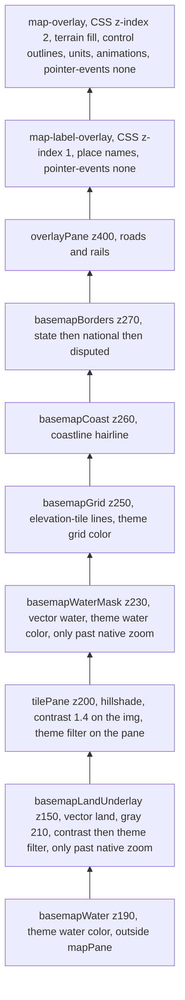

# Map Themes, Coastlines, Borders, and Place Labels

> For agentic workers: implement this plan phase by phase. Steps use checkbox (`- [ ]`) syntax. Do not start a phase until the previous phase's gate passes. If a gate fails and the fix is not obvious, stop and report what you saw. Do not invent a different design.

**Goal:** Replace the four terrain styles with four map themes that color land and water separately. Draw a vector hairline on every coastline and lake shore, draw national and state borders in distinct line styles at the same zoom gates as the matching place names, and draw continent, country, and state names on their own layer.

**Architecture:** The hillshade tiles stay as they are: gray land, transparent water, with `contrast(1.4)` on the tile images. A theme sets the water color directly and colors the land with an SVG `feComponentTransfer` filter on the Leaflet tile pane. A Python step in `scripts/basemap_pipeline/` writes four small zipped JSON documents to `data/generated/basemap/vectors/`. The main process serves each one as text over one IPC channel. The renderer draws coastlines, the coast edge mask, and borders in their own Leaflet canvas panes, under the place names. Place names are a canvas under the hex canvas. The hex canvas draws the terrain fill, control outlines, units, and animations, so those graphics cover a name where they overlap. Neither map prints an attribution line.

**Tech stack:** TypeScript (Electron main and renderer, esbuild), vendored Leaflet 1.9.4 (global `L`), `node:test` with `node:assert`, Python 3.13 with shapely 2.1, fiona, and pyproj, `unittest`, and fflate (already a dependency). No new npm runtime dependency.

## Decisions Already Made

These were settled with the product owner. Do not reopen them.

- **Themes.** Four, in this order. `standard` is the default: near-white land, soft reference-map blue water. Then `topographic`, `nautical`, and `night`. The old ids `default`, `atlas`, `wargame`, and `scientific`, and their CSS filter strings, are removed.
- **Hex colors are reused.** `standard`, `topographic`, and `nautical` use today's Default hex palette, legend chips, and hex stroke. `night` uses today's Wargame palette, chips, and hex stroke. Do not invent new hex colors.
- **Land shading.** Keep `contrast(1.4)` on the tile images in `static/shellChrome.css`, so flat land stays near white, and put the theme color filter on the tile pane above that. Do not regenerate tiles. Do not edit `scripts/basemap_pipeline/basemap_settings.py`. Its values feed the pack settings hash, so a change there makes the next pack run look stale.
- **Coast edge.** A hairline on every coastline and lake shore, at every zoom. Past the tiles' native zoom (7 on the global map, 9 on a regional map), two more layers keep that edge sharp: a vector land underlay under the tiles, filled with flat-land gray 210 and given the same filters as the tiles, and a vector water fill above the tiles. The hairline is above both.
- **Place-name anchors are adaptive.** The pipeline stores the Natural Earth label point plus extra interior anchors. At runtime each visible feature gets one label, at an anchor inside the view, and keeps that anchor while it stays usable.
- **Fonts.** Bundle Noto Sans and Noto Serif (SIL OFL 1.1) as WOFF2, weights 400 and 600, Latin and Latin Extended. Standard and Night use the sans. Topographic and Nautical use the serif.
- **What each zoom shows.** These gates are shared by names and borders. `visibleLabelKinds` in `src/shared/mapLabelRules.ts` is the only place that decides them.
  - Below Leaflet zoom 4, and not in a tactical view: continent names only. No country names, no state names, no borders.
  - At Leaflet zoom 4 or higher, and not in a tactical view: country names and national borders. No state names and no state borders.
  - In a tactical view (`shouldRenderTacticalHexes()` in `src/renderer/map/terrainView.ts`, which is also true during a battle): country names, state and province names, national borders, and state borders. No continent names.
- **Borders are land borders only.** National borders come from Natural Earth `ne_10m_admin_0_boundary_lines_land`. State and province borders come from `ne_10m_admin_1_states_provinces_lines`. Do not use the country or state polygons, `ne_10m_land`, or the maritime boundary file. A polygon outline retraces the coastline, and the hairline already draws that.
- **Disputed and indefinite borders** are the same weight as their level, drawn dashed (`1 3`) instead of the level's normal style. A `featurecla` containing `Disputed` or `Indefinite` (case-insensitive) selects that style. Every other line uses the level's normal style.
- **Line styles.** Screen pixels, constant across zoom. Coastline 1.5 px, solid, round caps. National border 1.25 px, solid. State border 1 px, dash `4 3`. Disputed at either level: that level's width, dash `1 3`. Colors come from the theme and are listed in Phase 1. Borders are a different color from the coastline of the same theme.
- **The minimap** draws the coastline at the coarsest level of detail, at 1 px. It draws no edge mask, no borders, and no labels. Its own zoom never exceeds 2, which is the continent band.
- **Theme choice is not saved.** It lives in memory and starts at `standard`, as the current style does.
- **Place names are under the game graphics.** `#map-label-overlay` is CSS z-index 1. `#map-overlay` is CSS z-index 2 and draws the terrain fill, control outlines, units, and animations. `#main-map` is CSS z-index 0, so the hillshade, coastline, borders, and roads stay under both canvases. Both canvases take no pointer input. Map chrome (the minimap panel, the legend, the selection panel) stays at z-index 6200 and above.
- **The map prints no credit.** `attributionControl` is false on the main map and the minimap. `attributionHtml` on the hillshade entry stays an empty string. The elevation and Natural Earth credits stay in `THIRD-PARTY-NOTICES.md` and the README. Do not put a GMTED or USGS sentence on the map.
- **Nothing is downloaded if it is already in `F:\Data`.** The coastline inputs are already there. The two boundary-line shapefiles are not; Phase 4 downloads those from Natural Earth into `F:\Data`.

## Global Constraints

- Follow `.cursor/rules/` and `AGENTS.md`. In particular: never commit or push; keep new files under 600 lines and never cross 1000; prefer 6 named arguments and never exceed 10 (use a parameter object); mark immutability with `readonly`, `as const`, and `@dataclass(frozen=True)`.
- Give every new or changed field and function an orienting comment. TypeScript uses the Purpose / When to use / Expected outcome / Exceptions shape already in `src/renderer/map/basemapLayer.ts`. Python uses the Why this exists / When to use / What to expect / Exceptions shape already in `scripts/basemap_pipeline/`.
- Main-process public functions log with `logDebug`, getters with `logTrace`, and caught errors with `logError`, from `src/main/logger`. Python uses `LOGGER.debug` and `TRACE_LEVEL`. Renderer failures use `console.error('[agent-wars] ...')`.
- Follow `doc/naming-conventions-contract-v1.md`. camelCase TypeScript files. No `Utils` or `Impl`. No new role suffix.
- Never put a phase number, a task number, or any other `.spec` identifier into code, comments, tests, configuration, or `doc/`.
- Tests cover happy paths and essential failures only. Test the contract, not the internals. Delete a test that a change makes obsolete.
- Update `doc/` in the same phase as the behavior it describes. The last phase lists every document.
- IPC channel strings are frozen. Use exactly the names given here.
- Do not edit `doc/devleopment-plan-v3.4.md`, `doc/poc-analysis.md`, or `doc/market-research.md`.
- Size budget: the four vector zips together at most 20 MB. The font files together at most 300 KB. Stop and report the measured sizes if either is exceeded.
- `src/renderer/rendering/gameScene.ts` is already over 600 lines. Add only the call lines this plan names. Do not move code out of it and do not add logic to it.

## Review Focus

These are the failures most likely to ship. Each one has a test or a check in the phase named.

1. **A false coastline along 180 degrees and along the Mercator frame.** `ne_10m_ocean` is cut at ±180 and clipped near ±85 degrees, so its raw boundary contains straight seams that are not coasts. Phase 4, `test_frame_edges_are_not_coastline`.
2. **A national border retracing the coast.** Using the country polygons would draw a second line around every shoreline. Phase 4, `test_borders_come_from_land_boundary_lines`.
3. **A battle drawn across 180 degrees, shifted onto one copy of the world.** The camera bounds are already in that shifted frame (`drawReferenceLng` in `src/shared/mapExtent.ts` is what the camera was fit with). Cell lookup normalizes longitude back into ±180 and the path is drawn with a ±360 offset. Do not also add `drawReferenceLng` to those points; adding both shifts them twice. Phase 3, the `visibleCellRefs` test. Labels align to the view center instead, Phase 8.
4. **Borders and names using different zoom gates.** Both must call `visibleLabelKinds`. A world view that shows a state border, or a tactical view with no state border, is a failure. Phase 6, `adminBorderGroupsForView`.
5. **Vector files missing or corrupt**, for example a checkout that never ran the pipeline. The app still starts. The map draws with no coast, no borders, and no labels, and logs one error. Phase 5 and the parse-rejection tests in Phase 3.
6. **Labels jumping while the map pans.** A feature keeps its previous anchor while that anchor stays usable. Phase 8.
7. **The edge mask stuck on the previous map's native zoom** after the new-game preview swaps global (7) and regional (9). Phase 6 wires the mask to `onBasemapNativeZoomChanged`, and the smoke scenes check both zooms.
8. **The smoke run left on Night, zoomed to Gibraltar.** Later scenes would then fail or lie. Phase 2 restores the theme, the center, and the zoom in a `finally`. The legend rebuilds its select on every change, so each step has to query the select again.
9. **A cell seam that grows with zoom.** An overlap measured in degrees is a hairline at zoom 8 and dozens of pixels at zoom 14. Mask cells partition the cell exactly. A 1 px stroke, in screen pixels, covers the antialiased crack.
10. **Python and JavaScript rounding a half in different directions.** Python `round` uses banker's rounding and `Math.round` rounds toward positive infinity, so a negative half quantizes differently. Both sides use the half-away-from-zero helper in Phase 3. A test includes a negative half so the wrong round cannot pass.

## Layer Stack (bottom to top)

Pane z-indexes are compared with each other inside Leaflet's map pane. The water pane is a child of the map container, outside that pane, so every pane above paints over it. `#main-map` is CSS z-index 0, so both canvases paint over every pane. The minimap gets `basemapCoast` only.

CSS filters run left to right. `contrast(1.4) url(#map-theme-land-standard)` contrasts first and recolors second. That is the order `themedLandRgb` reproduces. Do not reverse it.

## File Map

Created:

- `src/shared/mapThemes.ts`, `src/shared/mapThemes.test.ts`
- `src/shared/mapLabelRules.ts` (Phase 6), `src/shared/adminBorderRules.ts`, `src/shared/adminBorderRules.test.ts`
- `src/shared/vectorPackTypes.ts`, `src/shared/vectorPackDecode.ts`, `src/shared/vectorPackDecode.test.ts`
- `src/shared/mapLabelPack.ts`, `src/shared/mapLabelPlacement.ts`, `src/shared/mapLabelPlacement.test.ts` (Phase 8)
- `src/renderer/map/activeMapTheme.ts`, `mapThemeFilters.ts`, `mapThemeApply.ts`
- `src/renderer/rendering/terrainHexPalettes.ts`
- `src/renderer/map/bucketedVectorLayer.ts`, `coastlineLayers.ts`, `adminBorderLayers.ts`, `mapLabelLayer.ts`
- `src/main/basemap/basemapVectorRead.ts`, `src/main/basemap/basemapVectorRead.test.ts`
- `scripts/basemap_pipeline/vector_settings.py`, `vector_encoding.py`, `vector_grid.py`, `coastline_vectors.py`, `coast_edge_mask.py`, `admin_borders.py`, `label_anchors.py`, `vector_cli.py`
- `scripts/basemap_pipeline/tests/test_vector_encoding.py`, `test_coastline_vectors.py`, `test_coast_edge_mask.py`, `test_admin_borders.py`, `test_label_anchors.py`
- `scripts/basemap_pipeline/tests/fixtures/vector_encoding_golden.json` (synthetic; the file says so)
- `scripts/ui-smoke/ui-smoke-map-theme-scenes.cjs`
- `static/mapFonts.css`, `static/fonts/*.woff2`
- `data/generated/basemap/vectors/coastlines.json.zip`, `coast_edge_mask.json.zip`, `admin_borders.json.zip`, `map_labels.json.zip`

Modified: `src/renderer/rendering/terrainVisualStyles.ts`, `terrainLegendUrban.ts`, `terrainLegendRubble.ts`, `src/renderer/map/basemapLayer.ts`, `worldLeafletMap.ts`, `initCore.ts`, `src/renderer/rendering/gameScene.ts` (call lines only), `src/renderer/chrome/controlTooltipText.ts`, `src/shared/ipc/channels.ts`, `src/shared/ipc/gameApiTypes.ts`, `src/main/preload.ts`, `src/main/basemap/basemapIpc.ts`, `src/main/basemapRasterCatalog.test.ts`, `static/index.html`, `static/shellChrome.css`, `scripts/generated-data-pack-assert.cjs`, `scripts/thirdPartyNotices/noticeCheck.cjs`, `scripts/basemap_pipeline/README.md`, `THIRD-PARTY-NOTICES.md`, `README.md`, `doc/README.md`, `doc/terrain-pipeline.md`, `doc/ui-style-guide.md`, `doc/ux/terrain-legend.md`, `doc/ux/map-surface.md`, `doc/ux/minimap.md`, `doc/ux/control-tooltips.md`.

Deleted after Phase 2: `src/shared/basemapStyleLogic.ts` and `src/shared/basemapStyleLogic.test.ts`.

---

## Phase 0: Preflight

- [ ] Read `doc/README.md`, `doc/ux-specification.md`, `doc/ux/map-surface.md`, `doc/ux/terrain-legend.md`, `doc/ux/minimap.md`, the Hillshade bullet in `doc/ui-style-guide.md`, `doc/terrain-pipeline.md`, and `scripts/basemap_pipeline/README.md`.
- [ ] Confirm the coastline inputs: `foreach ($f in 'ne_10m_ocean','ne_10m_lakes','ne_10m_admin_0_countries','ne_10m_admin_1_states_provinces','ne_10m_geography_regions_polys') { Test-Path "F:/Data/$f.shp" }`. Expected: five `True` lines. The two `*_lines*` shapefiles are allowed to be missing; Phase 4 fetches them.
- [ ] Run `npm test` and `npm run basemap:test`. Both pass before any edit. Stop if either already fails.
- [ ] Record the total bytes of `static/` and of `data/generated/basemap/` (`Get-ChildItem -Recurse | Measure-Object Length -Sum`).

**Gate:** both suites pass and the five shapefiles exist.

---

## Phase 1: Theme Model

**Files:** create `src/shared/mapThemes.ts` and `src/shared/mapThemes.test.ts`.

**Produces:**

- `export type MapThemeId = 'standard' | 'topographic' | 'nautical' | 'night'`
- `export type HexPaletteId = 'default' | 'wargame'`
- `export type MapLabelFontId = 'sans' | 'serif'`
- `export interface MapThemeLabelColors { readonly continent: string; readonly country: string; readonly state: string; readonly halo: string }`
- `export interface MapTheme` with `readonly` fields: `id`, `label`, `waterColor`, `landShadowRgb`, `landHighlightRgb` (each a `readonly [number, number, number]`), `coastlineColor`, `countryBorderColor`, `stateBorderColor`, `gridLineColor`, `hexPaletteId`, `labelFont`, `labelColors`.
- `export const MAP_THEMES: readonly MapTheme[]`, in this order, these exact values:
  - **standard**, "Standard". Water `rgb(163, 199, 223)`. Shadow `[92, 90, 85]`, highlight `[251, 250, 247]`. Coast `#6d8ea6`. Country border `#4e6273`. State border `rgba(78, 98, 115, 0.7)`. Grid `rgba(48, 56, 64, 0.15)`. Palette `default`. Font `sans`. Labels: continent `rgba(70, 74, 82, 0.55)`, country `#3b3f46`, state `#686d76`, halo `rgba(255, 255, 255, 0.85)`.
  - **topographic**, "Topographic". Water `rgb(166, 217, 239)`. Shadow `[107, 85, 54]`, highlight `[251, 246, 228]`. Coast `#3f8fc0`. Country border `#6e5340`. State border `rgba(110, 83, 64, 0.65)`. Grid `rgba(48, 56, 64, 0.15)`. Palette `default`. Font `serif`. Labels: continent `rgba(92, 70, 44, 0.55)`, country `#4a3a28`, state `#6e5a43`, halo `rgba(251, 246, 228, 0.9)`.
  - **nautical**, "Nautical". Water `rgb(227, 241, 248)`. Shadow `[122, 100, 51]`, highlight `[251, 231, 166]`. Coast `#2f3a40`. Country border `#1e4d78`. State border `rgba(30, 77, 120, 0.55)`. Grid `rgba(48, 56, 64, 0.15)`. Palette `default`. Font `serif`. Labels: continent `rgba(40, 50, 60, 0.5)`, country `#2b2f33`, state `#4f565c`, halo `rgba(251, 236, 180, 0.9)`.
  - **night**, "Night". Water `rgb(15, 26, 38)`. Shadow `[16, 19, 23]`, highlight `[74, 82, 92]`. Coast `#7d97ad`. Country border `#9eb4c8`. State border `rgba(158, 180, 200, 0.6)`. Grid `rgba(210, 216, 228, 0.12)`. Palette `wargame`. Font `sans`. Labels: continent `rgba(215, 221, 229, 0.45)`, country `#d7dde5`, state `#a9b3bf`, halo `rgba(10, 14, 20, 0.85)`.
- `export const DEFAULT_MAP_THEME_ID: MapThemeId = 'standard'`
- `export const LAND_TILE_CONTRAST = 1.4`
- `export const FLAT_LAND_GRAY = 210`. The pack stores this byte for flat land.
- `export function mapThemeById(id: string): MapTheme`. Unknown or empty returns `standard`.
- `export interface LinearTransfer { readonly slope: number; readonly intercept: number }`
- `export function landTransferFunctions(theme: MapTheme): { readonly r: LinearTransfer; readonly g: LinearTransfer; readonly b: LinearTransfer }`. Per channel, `slope = (highlight - shadow) / 255` and `intercept = shadow / 255`.
- `export function themedLandRgb(theme: MapTheme, storedGray: number): [number, number, number]`. Contrast first: `c = clamp01((storedGray / 255 - 0.5) * LAND_TILE_CONTRAST + 0.5)`, then `round((slope * c + intercept) * 255)` per channel. This is what the screen shows. It is the contract the SVG filter must match.

Steps:

- [ ] Write the tests, then run `npm run build:main` and `node dist/shared/mapThemes.test.js`. Expected: FAIL, module missing.
  - Ids, in order, `['standard','topographic','nautical','night']`. Labels `['Standard','Topographic','Nautical','Night']`.
  - `mapThemeById('nope').id` and `mapThemeById('').id` are `standard`.
  - Every channel of `themedLandRgb(standard, FLAT_LAND_GRAY)` is at least 235.
  - Every channel of `themedLandRgb(night, FLAT_LAND_GRAY)` is at most 100.
  - `themedLandRgb(theme, 0)` equals `landShadowRgb` for every theme. Contrast clamps gray 0 to 0.
  - `landTransferFunctions(standard).r` is slope `159/255` and intercept `92/255`, within 1e-9.
  - Only `night` has `hexPaletteId === 'wargame'`.
  - For every theme, `countryBorderColor`, `stateBorderColor`, and `coastlineColor` are three different strings.
- [ ] Implement `mapThemes.ts` and rerun. Expected: PASS.

**Gate:** `npm test` passes.

---

## Phase 2: Themes on the Map

**Files:**

- Create `src/renderer/map/activeMapTheme.ts`, `mapThemeFilters.ts`, `mapThemeApply.ts`, and `src/renderer/rendering/terrainHexPalettes.ts`.
- Create `scripts/ui-smoke/ui-smoke-map-theme-scenes.cjs` and call it from the first session of `scripts/ui-smoke/ui-smoke.cjs`, immediately after the strategic scene is recorded.
- Modify `terrainVisualStyles.ts`, `terrainLegendUrban.ts`, `terrainLegendRubble.ts`, `basemapLayer.ts`, `worldLeafletMap.ts`, `initCore.ts`, `controlTooltipText.ts`, and `src/main/basemapRasterCatalog.test.ts`.
- Delete `src/shared/basemapStyleLogic.ts` and its test once nothing imports them.

**Interfaces:**

- `activeMapTheme.ts`: `getActiveMapTheme(): MapTheme` and `setActiveMapThemeId(id: string): boolean`. The boolean is true when the theme changed. Unknown ids go through `mapThemeById`.
- `mapThemeFilters.ts`:
  - `ensureMapThemeSvgFilters(): void`. Idempotent. Appends one hidden `<svg aria-hidden="true" width="0" height="0" style="position:absolute">` to `document.body`, containing one `<filter id="map-theme-land-<id>" color-interpolation-filters="sRGB">` per theme. Each filter is `<feComponentTransfer>` with `feFuncR`, `feFuncG`, and `feFuncB` of `type="linear"`, slope and intercept from `landTransferFunctions`. There is no `feFuncA`, so transparent water stays transparent. `sRGB` is required; without it Chromium filters in linearRGB and the colors drift.
  - `landTileFilterCss(theme: MapTheme): string` returns `url(#map-theme-land-<id>)`.
  - `landUnderlayFilterCss(theme: MapTheme): string` returns `` `contrast(${LAND_TILE_CONTRAST}) ${landTileFilterCss(theme)}` ``. Contrast is first because CSS filters run left to right. The underlay is not a tile image, so the stylesheet rule does not reach it.
- `basemapLayer.ts` replaces `filterOfflineBasemapPanes` with `applyBasemapTheme(theme: MapTheme): void`:
  - water pane `background` becomes `theme.waterColor` on both maps
  - both tile panes get `filter = landTileFilterCss(theme)`, and every child `.leaflet-layer, .leaflet-tile` gets `style.filter = ''` so the stylesheet `contrast(1.4)` survives. Setting `none` would remove it.
  - the grid pane's filter is cleared
  - every grid polyline, kept from `ensureSourceGrid`, gets `setStyle({ color: theme.gridLineColor })`
  - Remove the `WATER_COLOR` and `GRID_COLOR` constants. The initial water color is `mapThemeById(DEFAULT_MAP_THEME_ID).waterColor`.
- `worldLeafletMap.ts`: delete `setMainBasemapFilter`, `applyTilePaneFilter`, `setMainBasemapByProviderId`, and both `mounted*BasemapProviderId` bindings. A theme change never remounts tiles.
- `mapThemeApply.ts`: `applyActiveMapTheme(): void` calls `ensureMapThemeSvgFilters()` and then `applyBasemapTheme(getActiveMapTheme())`. Later phases add one call each, in this order: coastlines, borders, labels.
- `terrainHexPalettes.ts`: move the Default and Wargame preset objects here, drop `atlas` and `scientific`, and drop the `label` and `basemapId` fields. Export `TERRAIN_HEX_PALETTES`, `TERRAIN_SWATCH_COLORS` keyed by `HexPaletteId`, and `hexStrokeStyleFor(paletteId: HexPaletteId): { color: string; width: number }`. `wargame` keeps today's `WARGAME_HEX_STROKE_COLOR` and width. `default` keeps today's defaults.
- `terrainVisualStyles.ts`: remove `TerrainVisualStyleId`, `activeTerrainStyleId`, `getActiveTerrainStyleId`, `getActiveTerrainStyleBasemapId`, `setActiveTerrainStyle`, and `getTerrainStyleOptions`. Read the palette with `getActiveMapTheme().hexPaletteId`. The pattern cache key includes that palette id. A key that does not include it keeps the light theme's hex patterns after a switch to Night. `getActiveHexStrokeStyle` returns `hexStrokeStyleFor(getActiveMapTheme().hexPaletteId)`. Every `urbanSwatchColor` and `applyRubbleSwatchPaint` call in this file, including the swatch refresh near the tooltip chips, passes `getActiveMapTheme().hexPaletteId`.
- `renderTerrainLegend`: the select is built from `MAP_THEMES` (`value` is `id`, text is `label`), with no blank option, and its value is set to `getActiveMapTheme().id`. `aria-label="Map theme"`. The change listener calls `setActiveMapThemeId(styleSelect.value)`, then `options.onThemeChanged?.()`, then `renderTerrainLegend(container, options)` again so the chips match the new palette. Rename `onStyleChanged` to `onThemeChanged: () => void`. The listener keeps that call order, because the chips are painted from the active theme during the rebuild.
- `terrainLegendUrban.ts` and `terrainLegendRubble.ts`: key the urban chip table by `HexPaletteId` only (`default` and `wargame`; delete the `atlas` and `scientific` entries), and take `paletteId: HexPaletteId`. An unknown id falls back to `default`, which is what `urbanSwatchColor` already does for an unknown string.
- `initCore.ts`: `initWorldLeafletMaps('main-map', 'minimap', () => deps.requestRedraw(), OFFLINE_HILLSHADE_ID)`, then `applyActiveMapTheme()`. The legend callback calls `applyActiveMapTheme()` and then `deps.requestRedraw()`.
- `controlTooltipText.ts`: replace `terrainStyleTooltipText` with `mapThemeTooltipText = 'Pick the map colors for land, water, coastlines, borders, and place names. The choices are Standard, Topographic, Nautical, and Night.'` Update its one importer and the tip's orienting comment.

Steps:

- [ ] Make the edits. Run `npm run build:renderer`, `npm run check:renderer-types`, and `npm run check:circular`. Expected: no new type errors and no new import cycle. `mapThemeApply.ts` may import the layer modules. They must not import it.
- [ ] Update `src/main/basemapRasterCatalog.test.ts`:
  - Delete "every terrain style preset assigns the offline hillshade" and "style switches skip remount...". The code they describe is gone.
  - In the water-pane test, replace the `WATER_COLOR` assertion with `layerSource.includes('theme.waterColor')`.
  - In the elevation-grid test, replace the `GRID_COLOR` and `filterOfflineBasemapPanes` assertions with `getFunctionSource(layerSource, 'applyBasemapTheme').includes('gridLineColor')`.
  - Add a test that `initCore.ts` contains `applyActiveMapTheme()`, that `worldLeafletMap.ts` contains no `style.filter =`, and that `getActiveHexStrokeStyle` in `terrainVisualStyles.ts` contains `hexStrokeStyleFor`.
  - Keep the `contrast(1.4)` assertion and the no-remote-host assertion.
- [ ] Confirm `rg "basemapStyleLogic|basemapCssFilterForStyle|TerrainVisualStyleId" src` prints nothing.
- [ ] Add the smoke scenes. `runMapThemeScenes(page)` uses `captureMainMap` from `ui-smoke-map.cjs`. There is no helper that pans to a latitude, so move the map with `page.evaluate` on the handle `window.__uiSmokeMainMap`: `getCenter()` and `getZoom()` to save the view, and `setView([lat, lng], zoom, { animate: false })` to move it. `setZoom` alone keeps the old center. Wrap the body in `try/finally`. The `finally` queries `#terrain-legend select` again, selects `standard`, dispatches `change`, closes the legend if this function opened it, `setView`s the saved center and zoom, and waits the usual settle time. Query the select on every step. `renderTerrainLegend` replaces the select on each change, and a handle from the previous step points at a detached element.
  - For each option: open the legend if it is closed, select the option, wait, and write `theme-<id>-world.png`, then `setView([36.0, -5.6], 6)` (Strait of Gibraltar) and write `theme-<id>-z6.png`, then `setView([36.0, -5.6], 10)` and write `theme-<id>-z10.png`.
  - Checks, each a PASS/FAIL line like the other smoke checks:
    - `map theme options`: the option texts are `Standard`, `Topographic`, `Nautical`, `Night`.
    - `theme keeps tiles mounted`: after every switch, `#main-map img.leaflet-tile` with `complete === true` is more than 0.
    - `water pane follows theme`: the computed background of `.leaflet-basemapWater-pane` equals that theme's `waterColor`.
- [ ] Run `npm test`, then `npm run ui:smoke -- --label themes`. Expected: all PASS, including the scenes that run after the theme scenes. A failure there means the `finally` did not restore the map.
- [ ] Look at the 12 screenshots in `.test/ui-smoke/themes/`:
  - Standard land is near white and the relief is still visible. Topographic is cream with brown relief. Nautical is buff. Night is dark slate.
  - Water is one flat color. Hexes and unit markers are not recolored by the theme filter.
  - Switching theme does not reload tiles.
- [ ] With `npm start`, on Night at zoom 5, drag the map for about 3 seconds and watch the frame time in the Performance panel (Ctrl+Shift+I). Frames should mostly stay under 20 ms. If panning is clearly worse than it was, stop and report. Do not replace the SVG filter with `sepia` or `hue-rotate`.
- [ ] Update `doc/ux/terrain-legend.md` (choices, "Map theme", palette reuse, the SVG filter, Code Entry Points), `doc/ux/control-tooltips.md` (the new sentence and its source), `doc/ux/map-surface.md` and `doc/ux/minimap.md` (water color and grid color come from the theme; the grid is no longer filtered), `doc/ui-style-guide.md` (the Hillshade bullet), and `doc/README.md` (the paragraph that names `basemapCssFilterForStyle` now names `MAP_THEMES` and `mapThemeById` in `src/shared/mapThemes.ts`). In `scripts/basemap_pipeline/README.md`, say that `PREVIEW_WATER_RGB` is only the pipeline preview color.

**Gate:** `npm test` and the theme smoke run pass, the screenshots match, and the search in the third step is empty.

---

## Phase 3: Vector Encoding

**Encoding, exact:**

- Coordinates are quantized at `quantum_deg = 0.00001`.
- Quantize with half away from zero, not `Math.round` and not Python `round`. Both of those send a negative half the other way. The helper, in both languages, is the sign of the value times the floor of its absolute value plus one half: `copysign(floor(abs(x) + 0.5), x)`, and `0` stays `0`.
- A part is a flat integer array `[lat0, lng0, dLat1, dLng1, ...]`. The first pair is that helper applied to `degrees / quantum`. Each later pair is the difference from the previous quantized point. A point equal to the previous quantized point is dropped. A part with fewer than 2 points after that is dropped. Rings are not closed: the last point is not repeated.
- A cell key is `"<row>:<col>"`. First fold longitude with the same half-away-from-zero helper: subtract `360` times that helper applied to `lng / 360`, then if the result is exactly 180, use -180. The dateline belongs to the first column, on both the Python and the TypeScript side. Then `col = floor((lng + 180) / cellDeg)` and `row = floor((lat + 90) / cellDeg)`. Clamp `row` into `0 .. floor(180 / cellDeg) - 1`, so latitude 90 stays in the last real row and does not open an extra one. `floor` is toward negative infinity on both sides, which is `math.floor` and `Math.floor`.
- Each zip holds one member, `<name>.json`, compact UTF-8 JSON, with a fixed zip timestamp so the bytes do not change between runs.
- Documents use `"schema_version": "1.0.0"`:
  - `coastlines`: `{ kind: "coastlines", quantum_deg, lods: [{ min_zoom, max_zoom, cell_deg, cells: { "<key>": [part, ...] } }] }`. The last level has `max_zoom: null`.
  - `coast_edge_mask`: `{ kind: "coast_edge_mask", quantum_deg, cell_deg: 2, cells: { "<key>": { water: [[ring, ...], ...], land: [[ring, ...], ...] } } }`. A polygon is an outer ring followed by its holes.
  - `admin_borders`: `{ kind: "admin_borders", quantum_deg, groups: [{ id, lods }] }`. `id` is `country`, `country_disputed`, `state`, or `state_disputed`. A group's `lods` use the coastline lod shape.
  - `map_labels`: `{ kind: "map_labels", features: [{ id, kind, name, rank, min_zoom, anchors: [[lat, lng, radius_m]] }] }`. `kind` is `continent`, `country`, or `state`. `anchors[0]` is the primary anchor. Latitude and longitude are rounded to 4 decimals. `radius_m` is an integer.

**`visibleCellRefs(view, cellDeg, maxCells)`**, in `vectorPackDecode.ts`. This is the antimeridian rule. Get it from this description, not from a rereading of the camera code.

- Clamp the view's latitudes to `±WEB_MERCATOR_MAX_ABS_LAT`.
- Split the longitude span at -180 and 180. The piece inside [-180, 180] has offset 0. The piece inside (180, 540] has offset +360. The piece inside [-540, -180) has offset -360. Ignore a piece whose high end is not greater than its low end.
- For a piece with offset `d`, look up cells using longitude `lng - d`, which is back inside ±180. Draw those parts with `lng + d` (`decodePart`'s `lngOffset`).
- Return at most `maxCells` refs. Callers pass 800. A caller that receives exactly 800 logs one `console.error` and still draws those refs. The levels of detail below are chosen so a normal view stays far under 800.

**Files and interfaces:**

- `scripts/basemap_pipeline/vector_settings.py` holds the constants Phase 4 lists.
- `scripts/basemap_pipeline/vector_encoding.py`: `quantize_part(points_lonlat) -> list[int]`, `cell_key(lat, lng, cell_deg) -> str`, `cell_bounds(key, cell_deg) -> (west, south, east, north)`, `write_vector_document(path, name, document) -> int` (the zip size).
- `src/shared/vectorPackTypes.ts`: `BASEMAP_VECTOR_NAMES = ['coastlines', 'coast_edge_mask', 'admin_borders', 'map_labels'] as const`, `BasemapVectorName`, `EncodedPart`, `VectorLod`, `CoastlinePack`, `CoastEdgeMaskCell`, `CoastEdgeMaskPack`, `AdminBorderGroupId`, `AdminBorderPack`, `VectorViewBounds`, `VectorCellRef`.
- `src/shared/vectorPackDecode.ts`: `parseCoastlinePack`, `parseCoastEdgeMaskPack`, `parseAdminBorderPack` (each throws `Error` naming the bad field when `schema_version !== '1.0.0'` or `kind` is wrong), `decodePart(part, quantumDeg, lngOffset) -> Array<[number, number]>`, `vectorCellKey`, `coastlineLodForZoom(pack, zoom)` (the band where `minZoom <= zoom` and (`maxZoom` is null or `zoom < maxZoom`)), `visibleCellRefs`. `parseAdminBorderPack` treats a missing group id as an empty group. An empty disputed group is normal. An id other than the four names throws.
- The golden fixture `vector_encoding_golden.json` has `"note": "Test fixture for the vector encoding contract; values are synthetic."`, three parts (one of them with a repeated point), and six `[lat, lng, cellDeg, key]` rows covering lng 180, lat -90, lat 90, and a negative longitude.

Steps:

- [ ] Python tests: the fixture parts and keys, and `test_write_is_deterministic` (two writes, identical bytes).
- [ ] TypeScript tests, reading the fixture from `scripts/basemap_pipeline/tests/fixtures/vector_encoding_golden.json`:
  - `decodePart` and `vectorCellKey` match the fixture.
  - Quantizing `-0.000005` degrees (the quotient is `-0.5`) returns `-1`, not `0`. This is the case where `Math.round` and Python `round` disagree.
  - `parseCoastlinePack` throws on `schema_version` `"2.0.0"` and on `kind` `"map_labels"`. `parseAdminBorderPack` throws on a group id `"coast"`. A document whose groups are only `country` and `state` parses, and its disputed groups are empty.
  - `coastlineLodForZoom` picks the band for 2.9 and for 3.0, and the open-ended last band for 15.
  - `visibleCellRefs({ west: 170, south: 0, east: 190, north: 1 }, 10, 100)` contains `{ key: vectorCellKey(0, 175, 10), lngOffset: 0 }` and `{ key: vectorCellKey(0, -175, 10), lngOffset: 360 }`.
- [ ] Run both suites, watch them fail, implement, and rerun.

**Gate:** `npm run basemap:test` and `npm test` pass.

---

## Phase 4: Coastlines, Edge Mask, and Borders

**Constants in `vector_settings.py`:**

- `VECTOR_SCHEMA_VERSION = "1.0.0"`, `QUANTUM_DEG = 1e-5`, `MERCATOR_MAX_LAT = 85.0511287798066`, `WORLD_HALF_EXTENT_M = 20037508.342789244`, `METERS_PER_PIXEL_Z0 = 156543.03392804097`.
- `@dataclass(frozen=True) class CoastLod` with `min_zoom: float`, `max_zoom: float | None`, `cell_deg: float`, `simplify_zoom: int | None`.
- `COAST_LODS = (CoastLod(0, 3, 360, 3), CoastLod(3, 5, 30, 5), CoastLod(5, 7, 10, 7), CoastLod(7, None, 2, None))`.
- `COUNTRY_BORDER_LODS = (CoastLod(4, 7, 10, 6), CoastLod(7, None, 2, None))`.
- `STATE_BORDER_LODS = (CoastLod(0, 9, 5, 8), CoastLod(9, None, 1, None))`. State borders are only shown in a tactical view, but that view can sit below zoom 9, so the first band starts at 0.
- `SIMPLIFY_TOLERANCE_PX = 0.25`, `MIN_PART_EXTENT_PX = 1.0`, `MASK_CELL_DEG = 2.0`, `COARSE_SPLIT_DEG = 10.0`. There is no cell overlap. A degree of overlap would be a few pixels at zoom 8 and a wide band at zoom 14.
- `VECTOR_OUTPUT_DIR = Path("data/generated/basemap/vectors")`, `VECTOR_WORK_DIR = Path(".test/basemap/vectors/work")`.
- Label constants are added in Phase 7.

**Interfaces:**

- `vector_grid.py`: `split_by_grid(geometry, cell_deg) -> dict[str, BaseGeometry]`. Clip to `COARSE_SPLIT_DEG` blocks with `shapely.clip_by_rect`, then to cells. Do not clip the whole geometry once per cell. `cell_deg >= 360` returns one key, `"0:0"`. `meters_per_pixel(zoom) -> float`. `encode_lods(lines_3857, lods)` is the simplify, drop, inverse-project, split, and quantize path shared by coastlines and borders.
- `coastline_vectors.py`:
  - `load_world_water_lonlat(data_root, work_dir)` calls the existing `load_water_geometry_3857(data_root, LonLatBox(-180, -MERCATOR_MAX_LAT, 180, MERCATOR_MAX_LAT), OutputPaths(work_dir, "water"))` and inverse-projects. The tiles and the hairline then come from the same water.
  - `coast_lines_3857(water_3857)` takes the boundary and subtracts `box(-W, -Y, W, Y).exterior.buffer(1.0)`, where `Y` is the Mercator y of `MERCATOR_MAX_LAT`. That removes the antimeridian seams and the frame.
  - `build_coastline_document(lines_3857)` calls `encode_lods`. That helper simplifies in EPSG:3857 with `simplify(SIMPLIFY_TOLERANCE_PX * meters_per_pixel(simplify_zoom), preserve_topology=False)`, drops parts smaller than `MIN_PART_EXTENT_PX` at that zoom (not on the last level), inverse-projects, splits by grid, and quantizes.
- `coast_edge_mask.py`: `build_coast_edge_mask_document(water_lonlat)`. Per 2-degree cell, clip water to the exact cell rectangle. Skip the cell when the piece is empty or covers more than 99.9999% of the rectangle. Otherwise `land = rect.difference(water_part)`, which stays inside the same rectangle. Encode both as polygon lists, outer ring first. Adjacent cells meet on the shared edge and do not overlap. The renderer covers the antialiased crack; the geometry does not.
- `admin_borders.py`:
  - `BORDER_SOURCES = { "country": "ne_10m_admin_0_boundary_lines_land.shp", "state": "ne_10m_admin_1_states_provinces_lines.shp" }`.
  - `load_border_lines(path) -> tuple[list[LineString], list[LineString]]`, returning `(normal, disputed)`. Read with fiona. Reject the file if any feature has geometry type `Polygon` or `MultiPolygon` (`ValueError` naming the file). A `featurecla` containing `disputed` or `indefinite`, compared in lower case, is disputed. Anything else, including a missing `featurecla`, is normal.
  - `build_admin_border_document(data_root)` builds the four groups. `country_disputed` and `state_disputed` may be empty, and a missing group is read as empty. Each group is projected to EPSG:3857, simplified there, inverse-projected, split, and quantized by one shared helper, `encode_lods(lines_3857, lods)`, used by the coastline builder too. The helper does not subtract the Mercator frame. That subtraction stays in `coast_lines_3857`. Before simplifying, drop a part whose longitudes all lie within 0.01 degrees of 180 or of -180. Those are cuts where the shapefile was split, not borders. Do not call `load_world_water_lonlat` from this module.
- `vector_cli.py`: `python -m scripts.basemap_pipeline.vector_cli {coast|mask|borders|labels|all} --data-root F:/Data --output data/generated/basemap/vectors --work .test/basemap/vectors/work [--verbose]`. `all` runs coast, mask, borders, labels, and stops at the first failure. `labels` is added in Phase 7; until then `all` skips it with a printed line, and `labels` prints "not built yet" and returns 0. Do not leave that skip in place after Phase 7.
  - The command prints part, ring, and vertex counts and the zip size, and writes `.test/basemap/vectors/work/report.json`.

**Downloading the two line shapefiles** (only when the `.shp` is absent):

- [ ] `ne_10m_admin_0_boundary_lines_land.zip` and `ne_10m_admin_1_states_provinces_lines.zip` from `https://naciscdn.org/naturalearth/10m/cultural/<name>.zip`. Extract every sidecar (`.shp`, `.dbf`, `.shx`, `.prj`, `.cpg`, `.VERSION.txt`) into `F:\Data`. Delete the zip after a successful extract. If the VERSION file does not contain `5.1`, stop and report it; the country polygons already in `F:\Data` are 5.1.1, and the lines have to match them.
- [ ] Print the `featurecla` counts for both files and copy them into the phase notes you leave in the final summary.

Steps:

- [ ] Tests, all on synthetic geometry, none reading `F:\Data`:
  - `test_frame_edges_are_not_coastline`: water that touches `x = ±WORLD_HALF_EXTENT_M` leaves no line within 1 m of those edges.
  - `test_island_ring_becomes_coastline`: a square island produces one 4-corner coastline in the last level.
  - `test_small_part_dropped_at_coarse_lod`: a 100 m island is absent from the first level and present in the last.
  - `test_split_by_grid_keys`: a line from longitude 1 to 5 at latitude 1, `cell_deg` 2, has the keys for columns 90, 91, and 92 of row 45.
  - `test_mask_cell_partitions_area`: in a half-water cell, water area plus land area equals the exact cell area within 1e-9, and neither polygon extends past the cell rectangle.
  - `test_dateline_cut_is_not_a_border`: a line at longitude 180 is dropped, and a line from longitude 179 to 179.5 is kept.
  - `test_mask_skips_uniform_cells`: an all-water cell and an all-land cell are absent.
  - `test_borders_come_from_land_boundary_lines`: `BORDER_SOURCES["country"]` is `ne_10m_admin_0_boundary_lines_land.shp` and `BORDER_SOURCES["state"]` is `ne_10m_admin_1_states_provinces_lines.shp`.
  - `test_polygon_input_is_rejected`: a polygon feature raises `ValueError`.
  - `test_disputed_featurecla_is_split`: `featurecla` `"Disputed (please verify)"` and `"Indefinite boundary"` go to the disputed list; `"International boundary (verify)"` stays normal.
- [ ] Run `npm run basemap:test`. Fail, implement, pass.
- [ ] Run `coast`, then `mask`, then `borders`, with `--data-root F:/Data`. Expected: three zips. Record their sizes. The three together must be at most 18 MB, leaving room for labels.
- [ ] In `report.json`, the last coastline level should have between 500,000 and 700,000 vertices (the shapefiles hold about 610,000). The country group should be far smaller than the coastline. If either is far outside, stop and report. Do not "fix" a big country group by switching to the country polygons.
- [ ] Add a "Vector documents" section to `scripts/basemap_pipeline/README.md`: the commands, the inputs, the outputs, the levels of detail, the land-boundary sources, and the statement that these commands never regenerate tiles.

**Gate:** `npm run basemap:test` passes, the three zips exist inside the budget, and the vertex check holds.

---

## Phase 5: Reading, IPC, and the Pack Check

**Interfaces:**

- `src/main/basemap/basemapVectorRead.ts`: `readBasemapVectorText(name: BasemapVectorName, root?: string | null): string | null`. It uses `resolveBasemapRoot()` when `root` is omitted, reads `<root>/vectors/<name>.json.zip`, and returns the member `<name>.json` as UTF-8, through `unzipMember` in `basemapPackRead.ts`. Cache the text per name. A missing file returns `null` and logs `logInfo` once per name. An unreadable zip returns `null` and logs `logError`. Log the call with `logDebug`.
- `src/shared/ipc/channels.ts`: `basemapVectorDocument: 'game:basemapVectorDocument'`.
- `src/shared/ipc/gameApiTypes.ts`: `basemapVectorDocument: (name: BasemapVectorName) => Promise<string | null>`, with an orienting comment.
- `src/main/preload.ts`: expose it the same way `basemapNativeZoom` is exposed.
- `src/main/basemap/basemapIpc.ts`: handle it in `registerBasemapIpc`. A payload that is not one of `BASEMAP_VECTOR_NAMES` returns `null` and reads nothing.
- `scripts/generated-data-pack-assert.cjs`:
  - `assertBasemapVectorDocuments()` runs in the pre-pack check after `assertBasemapPacks()`. For each of the four names, the zip exists, is non-empty, the member parses, `schema_version` is `1.0.0`, and `kind` equals that name.
  - `assertPackagedBasemapVectors(packagedDirs, releaseDir)` runs post-pack. A packaged directory is the parent of `basemap/`, the same directories `assertPackagedBasemapPacks` searches. Each zip is `path.join(dir, 'basemap', 'vectors', name + '.json.zip')`. Do not look inside `basemap/global`.
  - The electron-builder globs in `scripts/electronBuilderGeneratedFiles.cjs` already match `data/generated/basemap/**/*.zip`. Confirm that. Do not edit them.
- `map_labels.json.zip` does not exist yet. Running the pre-pack check in this phase must fail, and the message must name `map_labels`. That failure is expected. Do not weaken the check, and do not build a package until Phase 7.

Steps:

- [ ] `basemapVectorRead.test.ts`: a temporary root with no `vectors` folder returns `null`; a zip written with fflate `zipSync` containing `coastlines.json` returns that text.
- [ ] Fail, implement, pass (`npm test`).
- [ ] Run `node scripts/generated-data-pack-assert.cjs pre-pack`. Expected: exit 1, and the message names `map_labels`.
- [ ] Update `doc/terrain-pipeline.md` ("What the app loads") with `data/generated/basemap/vectors/`, the four documents, `readBasemapVectorText`, and `game:basemapVectorDocument`.

**Gate:** `npm test` passes, and the pre-pack check fails only on `map_labels`.

---

## Phase 6: Coast, Mask, and Border Layers

**Shared zoom policy**, created here and extended in Phase 8. Do not redefine it later.

- `src/shared/mapLabelRules.ts`:
  - `export const COUNTRY_LABEL_MIN_ZOOM = 4`
  - `export const LABEL_MIN_ZOOM_SLACK = 1.5`
  - `export type MapLabelKind = 'continent' | 'country' | 'state'`
  - `export function visibleLabelKinds(zoom: number, tacticalView: boolean): readonly MapLabelKind[]`
    - `tacticalView` returns `['country', 'state']`
    - `zoom < COUNTRY_LABEL_MIN_ZOOM` returns `['continent']`
    - otherwise `['country']`
- `src/shared/adminBorderRules.ts`:
  - `export function adminBorderGroupsForView(zoom: number, tacticalView: boolean): readonly AdminBorderGroupId[]`
  - It calls `visibleLabelKinds`. `country` adds `country` and `country_disputed`. `state` adds `state` and `state_disputed`. `continent` adds nothing.

**Renderer:**

- `src/renderer/map/bucketedVectorLayer.ts`. One layer type, used for the coast, the mask, and the borders.
  - `BucketedVectorLayerOptions`: `map`, `leaflet`, `paneName`, `paneZIndex`, `shape: 'line' | 'polygon'`, `maxCells` (always 800), `smoothFactor`.
  - `VectorHostMap` and `VectorLeaflet` are narrow structural types in the style of `OfflineBasemapMap` in `basemapLayer.ts`. The map needs `createPane`, `getPane`, `getZoom`, `getBounds`, and `on`. Leaflet needs `canvas`, `polyline`, and `polygon`.
  - `VectorPathStyle`: `color`, `weight`, `dashArray: string | null`, `seamWeightPx: number | null`. Line layers ignore `seamWeightPx`. Polygon layers ignore `weight` and `dashArray`.
  - `VectorCellSource = (view, zoom) => ReadonlyArray<{ cacheKey: string; build: () => ... }>`. A line build returns `Array<Array<[number, number]>>`. A polygon build returns `Array<Array<Array<[number, number]>>>` (polygons, each a list of rings).
  - `createBucketedVectorLayer(options)` returns `{ setSource(source | null), setStyle(style), setEnabled(enabled), sync() }`.
  - The pane has `pointerEvents = 'none'` and its own `leaflet.canvas({ pane, padding: 0.5 })`.
  - `sync` asks the source for the cells in the current view, adds a path for a new cache key, and removes a path whose key is gone. `setEnabled(false)` drops every path. `setStyle` restyles the paths that are live.
  - Line options: `{ renderer, color, weight, opacity: 1, dashArray, lineCap: 'round', lineJoin: 'round', interactive: false, smoothFactor }`. `smoothFactor` comes from the layer options. Omit `dashArray` when it is null. Coastlines pass `0`, so Leaflet does not pull the hairline off the baked edge. Borders pass `0.5`.
  - Polygon options: `{ renderer, fill: true, fillColor: color, fillOpacity: 1, interactive: false, smoothFactor: 0 }`. `seamWeightPx` null means `stroke: false`. A number means `stroke: true`, `color` equal to the fill, and that weight. The land underlay and the water mask pass `1`, so the crack between cells stays about one screen pixel at every zoom.
- `coastlineLayers.ts`:
  - `bindCoastlineLayers(leaflet, main, mini)` creates the land underlay (polygons, pane `basemapLandUnderlay`, z 150), the water mask (polygons, `basemapWaterMask`, z 230), and the coastline (lines, `basemapCoast`, z 260) on the main map, plus a coastline on the minimap at z 260 that always uses the first level of detail.
  - Load `coastlines` at bind time and `coast_edge_mask` the first time the mask is enabled, through `window.gameApi.basemapVectorDocument` and the Phase 3 parsers. `null` or a parse error leaves that layer empty and logs one `console.error`.
  - Subscribe to `moveend` and `zoomend` on both maps and call `sync`.
  - Cache keys are `<lodIndex>|<cellKey>|<lngOffset>` for the coast and `mask|<cellKey>|<lngOffset>` for the mask. `decodePart` receives that `lngOffset` and nothing else. Do not call `alignLngToDrawReference` here.
  - `applyCoastlineTheme(theme)`: coast `{ color: theme.coastlineColor, weight: 1.5, dashArray: null, seamWeightPx: null }` on the main map and weight 1 on the minimap; mask `{ color: theme.waterColor, weight: 0, dashArray: null, seamWeightPx: 1 }`; underlay `{ color: 'rgb(210, 210, 210)', weight: 0, dashArray: null, seamWeightPx: 1 }` from `FLAT_LAND_GRAY`. Set the underlay pane's `style.filter` to `landUnderlayFilterCss(theme)`.
  - `setCoastEdgeMaskNativeZoom(nativeZoom)` enables the underlay and the mask only while the main map's zoom is greater than `nativeZoom`, rechecked on `zoomend`.
- `adminBorderLayers.ts`:
  - `bindAdminBorderLayers(leaflet, main)` creates four line layers on the main map only, all in pane `basemapBorders` at z 270, in this order: `state`, `state_disputed`, `country`, `country_disputed`. One layer cannot restyle them, because the weights and dashes differ. Create the pane once. Adding state first and country last makes the national line win where they meet. The minimap does not get these layers.
  - Load `admin_borders` once at bind time, with the same one-error behavior, and give each layer the source for its own group. Subscribe to `moveend` and `zoomend` and call `sync` on each layer. The redraw calls below cover the tactical flag changing without a zoom change; the map events cover a pan that did not redraw.
  - A layer is enabled only when its group id is in `adminBorderGroupsForView(zoom, shouldRenderTacticalHexes())`. An empty group stays enabled and draws nothing. Within a group, use the lod whose band contains the zoom.
  - Styles, each with `seamWeightPx: null`: `country` weight 1.25, `dashArray` null, `theme.countryBorderColor`. `state` weight 1, dash `4 3`, `theme.stateBorderColor`. Both disputed groups use their level's weight and color with dash `1 3`.
  - `applyAdminBorderTheme(theme)` restyles all four. `syncAdminBorderLayers()` syncs all four. The tactical flag can change in the middle of a pan, so this has to run from the redraw path and not only from `moveend`.
- `basemapLayer.ts`: `onBasemapNativeZoomChanged(listener: (nativeZoom: number) => void)` and `getBasemapNativeZoom(): number` (7 until the first answer). Fire the listener whenever `applyGameMap` settles a zoom, including the first time.
- `worldLeafletMap.ts` `initWorldLeafletMaps`: after `bindOfflineBasemap`, call `bindCoastlineLayers`, `bindAdminBorderLayers`, and `onBasemapNativeZoomChanged(setCoastEdgeMaskNativeZoom)`. `coastlineLayers.ts` and `adminBorderLayers.ts` must not import `basemapLayer.ts`.
- `mapThemeApply.ts`: also call `applyCoastlineTheme` and `applyAdminBorderTheme`.
- `gameScene.ts`: next to each of the two existing `syncTacticalTransportVectorLeafletLayer()` calls (one in `drawGameScene`, one in `paintMapFrame`), add `syncAdminBorderLayers()`. No other edit in this file during this phase.
- The new-game and game-over overlay keeps the coastline, the mask, and the borders, because they are part of the basemap. Roads stay suppressed. Do not add a suppression flag for these layers.

Steps:

- [ ] Tests in `adminBorderRules.test.ts`: zoom 3 not tactical returns `[]`; zoom 5 not tactical returns `['country', 'country_disputed']`; zoom 3 tactical returns all four ids. A source test reads `src/renderer/map/adminBorderLayers.ts` and asserts it contains `adminBorderGroupsForView` and does not contain `COUNTRY_LABEL_MIN_ZOOM`, so the zoom gate cannot be reimplemented in the layer.
- [ ] Implement. Run `npm run build:renderer`, `npm run check:renderer-types`, `npm run check:circular`, and `npm test`.
- [ ] Extend the theme smoke scenes:
  - At zoom 6 and zoom 10 the `basemapCoast` pane contains a `canvas`.
  - At zoom 6 (global native zoom is 7) the `basemapWaterMask` pane has no `canvas`. At zoom 10 it has one. Leaflet adds the canvas when the first path is added.
  - At the world view the `basemapBorders` pane has no `canvas` (continent band). At zoom 6 it has one (country band). The zoom 6 shot is not a tactical view; confirm `shouldRenderTacticalHexes` is false there before asserting this. If it is true at that window size, use zoom 5 instead and say so in the summary.
  - One more pair per theme at Lake Geneva, `[46.43, 6.55]`, zoom 10: `theme-<id>-lake-z10.png`. The `finally` block from Phase 2 still restores the map.
- [ ] Run `npm run ui:smoke -- --label coast` and look at the shots:
  - At zoom 6 a thin line follows every coast and lake shore, with no gap between the line and the land. National borders are visible and do not outline the continents. State borders are absent.
  - At zoom 10 the coast is sharp: no blurred strip on either side of the line, and lake interiors are flat water. If the zoom 10 view is a tactical view, state borders appear, dashed and lighter than the national borders.
  - The world shot has no line along 180 degrees and none along the top or bottom edge.
  - No faint grid of lines appears along the 2-degree cell edges in the water.
  - If a gap shows between the hairline and the land at zoom 6, raise the main coastline weight by 0.25, up to 2. Stop and report if 2 still leaves a gap.
- [ ] With `npm start` on a global match, zoom from the world view to zoom 10 and back, then pan for 3 seconds at zoom 10. A zoom ending should not stall for more than about 150 ms, and panning should stay smooth. Record what you saw.
- [ ] Update `doc/ux/map-surface.md` (the hairline, its width and pane, the underlay and mask past native zoom, national and state borders, their styles, the zoom gates, the stacking order, and the antimeridian offset), `doc/ux/minimap.md` (1 px coastline, no mask, no borders, no labels), and `doc/ui-style-guide.md`.

**Gate:** `npm test` and the coast smoke run pass, and the screenshots match the list above.

---

## Phase 7: Label Anchors

**Add to `vector_settings.py`:**

- `COUNTRY_ANCHOR_CELL_DEG = 4.0`, `STATE_ANCHOR_CELL_DEG = 1.0`
- `COUNTRY_MIN_FRAGMENT_RADIUS_M = 20000`, `STATE_MIN_FRAGMENT_RADIUS_M = 5000`
- `POLYLABEL_TOLERANCE_M = 1000`, `STATE_NEVER_LABEL_MIN_ZOOM = 18`
- `CONTINENT_LABEL_ANCHORS`, keyed by the Natural Earth `NAME`, as `(lat, lng)`: North America `(48.0, -102.0)`, South America `(-14.0, -60.0)`, Europe `(52.0, 18.0)`, Africa `(6.0, 20.0)`, Asia `(48.0, 92.0)`, Australia `(-25.0, 134.0)`, Antarctica `(-80.0, 30.0)`. An inscribed-circle point for a whole continent lands in the wrong place, so these are fixed.

**`label_anchors.py`:**

- `load_continent_features(data_root)`. `FEATURECLA == "Continent"` from `ne_10m_geography_regions_polys.shp`. `id` is `continent:<NAME>`, `rank` 0, `min_zoom` 0, one anchor from the table. A continent with no table entry raises `ValueError`.
- `load_country_features(data_root)`. `id` `adm0:<ADM0_A3>`, `name` `NAME`, `rank` `LABELRANK`, `min_zoom` `MIN_LABEL`, primary anchor `(LABEL_Y, LABEL_X)`. Skip an empty `NAME` or a null `MIN_LABEL`.
- `load_state_features(data_root)`. `id` `adm1:<adm1_code>`, `name` `name_en` falling back to `name`, `rank` `labelrank`, `min_zoom` `min_label`, primary anchor `(latitude, longitude)`. Skip `min_label >= 18`.
- `fragment_anchors(geometry, cell_deg, min_radius_m)`. For each piece from `split_by_grid`, take the largest polygon, project to EPSG:3857, `shapely.ops.polylabel(poly, POLYLABEL_TOLERANCE_M)`, and `radius = poly.boundary.distance(point)`. Drop a radius below `min_radius_m`. Return lat and lng rounded to 4 decimals and an integer radius, sorted by cell key.
- `build_label_document(data_root)`. Anchors are the primary anchor (its radius measured against the feature polygon) followed by the fragment anchors. Clamp latitude to `MERCATOR_MAX_LAT`.
- `vector_cli.py labels` writes `map_labels.json.zip`. Remove the skip from `all`.

Steps:

- [ ] Tests: an L-shaped polygon spanning two 1-degree cells gives 2 fragment anchors, each inside the polygon; a piece 0.01 degrees wide is dropped at 5000 m; a missing continent table entry raises.
- [ ] Fail, implement, pass. Run `labels` with `--data-root F:/Data`.
- [ ] Expect 7 continents, about 250 countries, and about 4,500 states. France (`adm0:FRA`) has primary anchor latitude 46.6961, longitude 2.5523, and it is first. The zip is at most 2 MB. The four zips together stay at most 20 MB.
- [ ] Run `node scripts/generated-data-pack-assert.cjs pre-pack`. Expected: it passes.
- [ ] Update the README's vector section and `doc/terrain-pipeline.md` for `map_labels`.

**Gate:** `npm run basemap:test` passes, the pre-pack check passes, and the counts match.

---

## Phase 8: Fonts and Label Placement

**Fonts:**

- [ ] `npm view @fontsource/noto-sans version` and the same for `noto-serif`. Record both versions.
- [ ] Download into `static/fonts/` from `https://cdn.jsdelivr.net/npm/@fontsource/<pkg>@<version>/files/<pkg>-<subset>-<weight>-normal.woff2`, for both packages, subsets `latin` and `latin-ext`, weights 400 and 600. Keep those file names. Copy each subset's `unicode-range` from `https://cdn.jsdelivr.net/npm/@fontsource/<pkg>@<version>/<weight>.css`.
- [ ] `static/mapFonts.css`: 8 `@font-face` rules, families `"Agent Wars Map Sans"` and `"Agent Wars Map Serif"`, `font-display: swap`, and the copied `unicode-range`. Link it from `static/index.html` after `shellChrome.css`. The page CSP already allows `font-src 'self'`.
- [ ] Add a "Noto Sans and Noto Serif" section to `THIRD-PARTY-NOTICES.md` with the versions, the file names, the copyright line copied from the package `LICENSE`, and the SIL OFL 1.1 text. Add `{ heading: 'Noto Sans and Noto Serif', snippets: ['<that copyright line>'] }` to `fixedRequirements` in `scripts/thirdPartyNotices/noticeCheck.cjs`.
- [ ] The 8 files together are at most 300 KB. Stop and report if they are not.

**Placement.** `mapLabelRules.ts` already exists. Extend it; do not replace `visibleLabelKinds`.

- Add `MAX_LABELS_PER_FRAME = 150`, `LABEL_COLLISION_PADDING_PX = 4`, `LABEL_VIEW_INSET_PX = 24`.
- `MAP_LABEL_KIND_STYLES`: continent `{ sizePx: 18, weight: 600, letterSpacingEm: 0.35, uppercase: true }`, country `{ 13, 600, 0.12, true }`, state `{ 11, 400, 0.04, false }`.
- `labelDisplayText(feature)` uses `toLocaleUpperCase('en')` when the kind says uppercase.
- `mercatorMetersPerPixel(zoom)` returns `METERS_PER_PIXEL_Z0 / 2 ** zoom`. Duplicate the constant here as `156543.03392804097`; do not import Python.
- `src/shared/mapLabelPack.ts`: `MapLabelAnchor`, `MapLabelFeature` (with `bounds` computed at parse time from the anchors), `parseMapLabelPack(text)` which throws on a bad schema or a bad kind.
- `src/shared/mapLabelPlacement.ts`: `placeMapLabels(input: LabelPlacementInput): PlacedMapLabel[]`.
  - Input: `features`, `kinds`, `zoom`, `viewSize: { width, height }`, `project(lat, lng) -> { x, y }`, `measure(feature) -> { width, height }`, `previousAnchors: ReadonlyMap<string, number>`.
  - Output: `featureId`, `kind`, `text`, `x`, `y`, `width`, `height`, `anchorIndex`.
  - `project` already returns the on-screen point, including any antimeridian shift. This function does not know about longitude.
  - Steps, in order:
    1. Keep features whose kind is in `kinds` and whose `minZoom <= zoom + LABEL_MIN_ZOOM_SLACK`. Continents skip the min-zoom test.
    2. An anchor is usable when its projected point lies inside the view inset by `LABEL_VIEW_INSET_PX`. A non-primary anchor also needs `radiusM / mercatorMetersPerPixel(zoom) >= measured height`.
    3. Choose the previous index if it is still usable, else index 0 if it is usable, else the usable anchor nearest the view center. No usable anchor means no label.
    4. Sort by kind (continent, country, state), then `rank` ascending, then `minZoom` ascending, then `id`.
    5. Place greedily. Skip a box that, padded by `LABEL_COLLISION_PADDING_PX`, overlaps a placed box. Stop at `MAX_LABELS_PER_FRAME`.

Steps:

- [ ] Tests in `mapLabelPlacement.test.ts`, with a linear `project` and a fixed `measure`:
  - `visibleLabelKinds`: zoom 3 not tactical is continent; zoom 5 not tactical is country; zoom 3 tactical is country and state.
  - A feature whose primary anchor is off screen uses a fragment anchor that is on screen.
  - The previous anchor is kept while it stays usable, even when another anchor is closer to the center.
  - A state that overlaps a country is dropped.
  - A fragment thinner than the text is rejected.
  - `parseMapLabelPack` throws on kind `"city"`.
- [ ] Fail, implement, pass (`npm test`, which includes `notices:check`).

**Gate:** `npm test` passes and the fonts are within 300 KB.

---

## Phase 9: Labels on the Map

- `static/index.html`: `<canvas id="map-label-overlay" aria-hidden="true"></canvas>` immediately after `#map-overlay`.
- `static/shellChrome.css`: `#map-label-overlay { position: absolute; inset: 0; width: 100%; height: 100%; z-index: 3; display: block; pointer-events: none; }`.
- `src/renderer/map/mapLabelLayer.ts`:
  - `bindMapLabelLayer(requestRedraw: () => void)`. Loads `map_labels`, parses it, and calls `document.fonts.load` for `600 13px "Agent Wars Map Sans"`, `400 13px "Agent Wars Map Sans"`, and the same two weights of `"Agent Wars Map Serif"`. When they settle, call `requestRedraw()`. A failure logs one `console.error` and the layer stays empty.
  - `resizeMapLabelCanvas(metrics: { w, h, dpr })`. Same backing-store sizing as the hex canvas.
  - `setMapLabelTheme(theme)`.
  - `drawMapLabels()`. If the canvas width or height is 0, return. Otherwise `ctx.setTransform(dpr, 0, 0, dpr, 0, 0)` with the same `dpr` as `S.canvasMetrics`, which is what the hex canvas does in `resizeAndRedraw` and `redraw`. `project` returns CSS pixels, and the font size is in CSS pixels. Without that scale, text is the wrong size and in the wrong place whenever `devicePixelRatio` is not 1. Then clear the CSS-pixel rectangle, and read zoom, bounds, and center from `getMainLeafletMap()`. `tacticalView` is `shouldRenderTacticalHexes()`. Drop features whose anchor bounds miss the view, treating longitude as wrapping at ±360. `project` aligns the longitude to the view center with `alignLongitudeToReference` from `src/shared/webMercator.ts`, clamps the latitude, and calls `latLngToContainerPoint`. Do not also add `drawReferenceLng`; the view center is already in that frame. `LatLng` does not wrap in its constructor, and this projection uses the longitude it is given. Do not call `wrap()`. `measure` uses `ctx.measureText` and caches by theme, kind, and text. Call `placeMapLabels`, then remember `featureId -> anchorIndex`. Forget a feature that was not a candidate this frame.
  - Draw the halo first (`strokeText`, `lineWidth` 3, `lineJoin` `'round'`, `theme.labelColors.halo`) and the fill second (`fillText`, the kind's color). Font `` `${weight} ${sizePx}px "${family}", ${fallback}` ``, `ctx.letterSpacing = `${letterSpacingEm * sizePx}px``, `textAlign = 'center'`, `textBaseline = 'middle'`. The sans fallback is `system-ui, sans-serif`. The serif fallback is `Georgia, serif`. If `letterSpacing` is missing from the renderer type baseline, set it through a one-line local interface in this file. Do not use a directive comment to silence the compiler.
- `gameScene.ts`: in `resizeAndRedraw`, after `S.canvasMetrics` is set, call `resizeMapLabelCanvas(S.canvasMetrics)`. At the end of both `resizeAndRedraw` and `redraw`, call `drawMapLabels()`. These are the only edits in this phase.
- `initCore.ts`: `bindMapLabelLayer(() => deps.requestRedraw())` after the maps exist.
- `mapThemeApply.ts`: also call `setMapLabelTheme`.
- Labels stay visible during the new-game preview and the game-over overlay. They describe the map, not the match. The hex canvas still clears and draws the preview; the label canvas is separate and is not cleared by that path except through `drawMapLabels`.

Steps:

- [ ] Implement. Run `npm run build:renderer`, `npm run check:renderer-types`, `npm run check:circular`, and `npm test`.
- [ ] Extend the smoke scenes:
  - `#map-label-overlay` has a backing-store width and height equal to the map container times `devicePixelRatio`.
  - In the world view, the center third of that canvas has at least one non-transparent pixel (`getImageData`).
  - The second session already records a battle. That shot is part of the inspection below.
- [ ] Run `npm run ui:smoke -- --label labels` and look:
  - The world shot shows continent names only, in letter-spaced capitals. No country names and no borders.
  - The Gibraltar shot at the zoom the border check used (zoom 6, or zoom 5 if Phase 6 had to step down) shows country names (Spain, Morocco, Portugal, in the theme's case) and national borders, and no state names.
  - The battle shot shows country and state names, solid national borders, and dashed state borders.
  - Topographic and Nautical are serif. Standard and Night are sans.
  - Text is readable on every theme, including Night, and labels do not overlap each other.
  - If country names appear in the world shot, or none appear at zoom 6, change only `COUNTRY_LABEL_MIN_ZOOM` and report the value. Borders follow it automatically because they share `visibleLabelKinds`.
- [ ] Update `doc/ux/map-surface.md` (a "Place names" subsection: the three kinds, the zoom gates, anchor choice and hysteresis, collision priority, `MAX_LABELS_PER_FRAME`, the label canvas under the hex canvas, pointer input off, the theme fonts, and the Code Entry Points), `doc/ui-style-guide.md` (label typography), and `doc/ux/minimap.md` (no labels). Also say in `doc/ux/map-surface.md` that the new-game preview keeps the coastline, borders, and place names, and still hides roads, rails, and the other match chrome.

**Gate:** `npm test` and the label smoke run pass, and the screenshots match.

---

## Phase 10: Notices and the Last Pass

- [ ] In `THIRD-PARTY-NOTICES.md`, under Natural Earth, add that the app ships data derived from the 1:10m ocean, lakes, admin 0 countries, admin 0 land boundaries, admin 1 states and provinces, admin 1 boundary lines, and geography regions. Keep the sentence `Made with Natural Earth.`
- [ ] In the root `README.md` data table, add rows for coastlines and lake shores, for national and state borders, and for place names, each crediting Natural Earth 1:10m. Mention the bundled Noto fonts where the README credits third-party assets.
- [ ] Do not print a credit on the map. `attributionControl` stays false, and `attributionHtml` on the hillshade entry stays `''`. The elevation and Natural Earth credits stay in `THIRD-PARTY-NOTICES.md`. Update every maintained document that says the map shows that sentence. Search `doc/` for `Water: Made with Natural Earth`.
- [ ] Search `doc/` and `README.md` for `Atlas`, `Scientific`, `Wargame` used as a style name, `basemapCssFilterForStyle`, `rgb(113, 148, 177)`, `filterOfflineBasemapPanes`, and `setMainBasemapFilter`. Fix each hit in a maintained document. Leave the three historical documents alone.
- [ ] File sizes. No file created by this work may exceed 600 lines. No file modified by this work may cross 1000. `gameScene.ts` and `terrainVisualStyles.ts` are the two to recheck.
- [ ] Run, in order: `npm test`, `npm run basemap:test`, `npm run check:circular`, `node scripts/generated-data-pack-assert.cjs pre-pack`, and `npm run ui:smoke -- --label final`. All of them pass.
- [ ] Measure `static/fonts/` and `data/generated/basemap/vectors/` and compare them with the Phase 0 totals.
- [ ] Write the summary for the reviewer: every document changed, the measured sizes, the final coastline weight and `COUNTRY_LABEL_MIN_ZOOM`, the `featurecla` counts from Phase 4, what the pan and zoom felt like, and any check that could not be run. Do not commit.

## Notes for the Implementer

- The tile water and the coastline come from the same `ne_10m_ocean` plus `ne_10m_lakes` union, through `load_water_geometry_3857`. That is what makes the hairline sit on the tile edge. Do not substitute `ne_10m_coastline`, the 50m or 110m layers, or `ne_10m_land`.
- Borders come from the two land-boundary line files. Do not derive them from the polygons, even where that looks shorter.
- Leaflet repaints its canvas panes on `moveend` and `zoomend`. The hex canvas and the label canvas repaint on every `move`. A short lag in the vector lines during a wheel zoom matches the roads, and it is acceptable. `zoomAnimation` is already off.
- Do not draw labels, coasts, or borders into `#map-overlay`. Each layer has its own surface, so a theme change does not have to know how hexes are painted.
- `visibleLabelKinds` is the one zoom policy. Names, national borders, and state borders all read it. A change to a gate belongs in that function and nowhere else.
