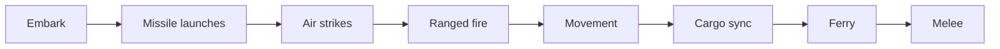

# Ballistic missiles

Audience: a lower-quality coding agent. Implement one phase at a time. Stop after each phase and report files touched, test results, and any doc updated. Wait for the human before the next phase. If a phase fails, revert that phase. If a line in this plan disagrees with the code, trust the code, stop, and report the discrepancy. Do not guess.

## Goal

Add a fifth strategic unit type, the ballistic missile (`'missile'`), on the global map and on every regional map.

- A missile is built in a hex whose current urban-cell count is at least the map's Advanced threshold. It costs 10 times the map's infantry cost (200 on the global map).
- It never moves. It stays on the hex where it was built.
- It never rolls dice: no ranged fire, no return fire, no melee rolls, no anti-air. In a hex's casualty order it is always hit last, after every other unit there.
- Its only action is a launch, ordered like an air strike: select it, turn on the reticle, double-click a target. The target can be any hex this side has explored, within the map's missile range. The range is 12 hexes on the global map and a per-map value on regional maps.
- A launch always hits. It resolves at the start of the air-strike step, before any air strike. Every urban, airport, and seaport flag in the target hex's cells rolls one d20 and survives only on a 20. Every air unit based at the target hex is destroyed when at least one airport flag there was destroyed. Every other unit in the hex is untouched.
- The missile is spent at launch. It flies to the target during playback and disappears after the strike mark.
- In a tactical battle a missile is one sub-unit (no multiplication), placed on its birth cell. It never moves or fires. When it is destroyed there, the strategic missile is destroyed.

## Background

These facts were read from the code at `a198358` (engine 2.9.0). Re-check each one where a phase uses it.

- **Unit types.** The canonical union is `UnitType` in [`src/main/combatConstants.ts`](../src/main/combatConstants.ts). Production uses `ALL_BUILD_UNIT_TYPES`, `BuildUnitType`, and `isBuildUnitType` in [`src/shared/ipc/productionTypes.ts`](../src/shared/ipc/productionTypes.ts). Snapshot and IPC `unitType` fields are plain `string`, so most branches on unit type are not checked by the compiler. Many lookups silently fall back for an unknown type: movement `?? 1`, range `?? 0`, attack and defense read as infantry, the map label `?`, the icon `mixed.svg`, the keep-building flag reads as off, and `computeVisibleHexesForSide` throws.
- **Production** is per hex. A hex earns one point per intact urban cell per turn (`applyProduction` in [`src/shared/productionConfig.ts`](../src/shared/productionConfig.ts)). `getAvailableBuildUnitTypes` in [`src/main/productionRules.ts`](../src/main/productionRules.ts) filters `ALL_BUILD_UNIT_TYPES` by `buildMinimumUrbanCells` and prerequisites. Build popups, build templates, and the AI's `set_build_queue` tool all filter through it. Units spawn in `spawnProducedUnitsForHex` in [`src/main/gameActions/controlAndProduction.ts`](../src/main/gameActions/controlAndProduction.ts).
- **Map rules.** `GameRules` is in [`src/shared/gameMapTypes.ts`](../src/shared/gameMapTypes.ts). The global values are `GLOBAL_GAME_MAP` in [`src/shared/activeGameMap.ts`](../src/shared/activeGameMap.ts). Regional values come from each map's `region_manifest.json` economy block, read by `parseEconomy` in [`src/main/gameMap/regionManifestRead.ts`](../src/main/gameMap/regionManifestRead.ts), which reads only the keys it names. The manifests are written by the Python regional pipeline (`npm run regional:economy`, [`scripts/regional_pipeline/economy_assignment.py`](../scripts/regional_pipeline/economy_assignment.py)). They are stored zipped in git under `data/generated/regions/<id>/`; extracted JSON there is git-ignored. When a region's `region_manifest.json` exists in that folder, the app reads that folder directly (`regionPackDirectory` in [`src/main/gameMap/regionPackExtract.ts`](../src/main/gameMap/regionPackExtract.ts)) and expects every other pack file beside it. A user-data extract is re-made whenever the zipped manifest text changes.
- **Casualty order** is lowest printed defense first, then `casualtyPriorityIndex`. It is sorted in five functions (listed in Phase 2).
- **Standing orders.** Types are `defend`, `march`, `pursue`, `patrol`, `hold_fire` (`STANDING_ORDER_TYPES` in [`src/main/tools/standingOrdersShared.ts`](../src/main/tools/standingOrdersShared.ts)). `hold_fire` stores status `holding`, is skipped by standing-order generation, and suppresses every automatic engagement and the air ferry sweep. The `unordered_unit` mandatory callback (`evaluateMandatoryOverrides` in [`src/main/callbackEvaluation.ts`](../src/main/callbackEvaluation.ts)) fires for every AI unit with no `standing_orders` row, which forces a consultation. Production assigns no orders today. Only production and knockout create units or give them a new owner.
- **Air strikes.** `resolveAirStrikePhase` and `applyInfrastructureDestructionEffects` in [`src/main/gameActions/airStrikeResolution.ts`](../src/main/gameActions/airStrikeResolution.ts). Infrastructure lives per tactical cell in `res_t_feature_overrides` (`is_urban`, `is_airport`, `is_seaport`, `is_rubble`). Strategic counts in `res_s_infrastructure` are derived from those flags by triggers, so clearing a flag lowers the count. `destroyBasedAirUnitsAtHex` and `pruneBuildQueueForInfrastructureState` are exported from that module. Inbound ferries need no code: the ferry step re-reads the destination's airport count after every earlier step.
- **Resolution.** `executeReadyStrategicTurn` in [`src/main/gameActions/readyStrategicResolutionPipeline.ts`](../src/main/gameActions/readyStrategicResolutionPipeline.ts) builds one seeded RNG wrapper `next` that counts draws in `rngInvocationsBeforeMelee`. The melee-intercept resume replays that count and reuses the stored phase results, so every pre-melee draw must go through `next`. The ranged phase picks its targets from a unit list read once, before the air strikes (`listUnitsForSnapshot()`). Results reach the renderer through `finalizeReadyTurnAfterMelee` in [`src/main/gameActions/meleeInterceptReadyFinalize.ts`](../src/main/gameActions/meleeInterceptReadyFinalize.ts) and `pickReadyResolutionIpcMirrorFields` in [`src/main/ipc/readyIpcResolutionMapping.ts`](../src/main/ipc/readyIpcResolutionMapping.ts).
- **H3 distance at missile range fails.** `gridDistance` throws for about 31% of res1 pairs 2,000–3,000 km apart, 75% at 3,000–4,000 km, and nearly all pairs beyond that. `gridPathCells` fails the same way. `gridDisk` works at every range, including across pentagons. Missile range is therefore measured only as membership in `gridDisk(origin, range)`.
- **Long arrows.** `traceRun` in [`src/renderer/rendering/orderLineStroke.ts`](../src/renderer/rendering/orderLineStroke.ts) skips a segment whose screen length is more than half the canvas width, treating it as an antimeridian wrap. A missile arrow is often that long, so missile lines must opt out. The arrow target is already placed the short way round by `hexCenterPxRelativeTo`.
- **Saves.** A save loads only when its SQLite `user_version` equals `EXPECTED_USER_VERSION` (23) in [`src/main/gameDb.ts`](../src/main/gameDb.ts). This plan bumps it to 24. Every earlier save stops loading, and the first launch after the bump shows the "Database problem" box once, then starts with a fresh database (`recoverCorruptDatabaseUi`). That is accepted.
- **Import cycles.** `npm run check:circular` already fails at `a198358`. Against an empty baseline (`scripts/circular-deps-baseline.json` is `[]`) it reports four existing runtime cycles:
  - `tools/productionTools.ts` → `gameActions.ts` → … → `openRouter/orderResponseParsing.ts` → `tools/productionTools.ts`
  - `tools/standingOrders.ts` → … → `openRouter/orderResponseParsing.ts` → `openRouter/envelopeOrderRows.ts` → `tools/standingOrders.ts`
  - renderer `openRouter/openRouterUiHelpers.ts` → … → `rendering/unitDrawing.ts` → `map/mapHelpers.ts` → `map/worldLeafletMap.ts` → `openRouter/openRouterUiHelpers.ts`
  - renderer `map/terrainTooltipStrategicState.ts` → `core/selection.ts` → … → `chrome/controlTooltip.ts` → `map/terrainTooltipStrategicState.ts`

  This work must not add a cycle or change these four.

## Locked decisions

These came from the human. Do not reopen them.

- **Unit type.** `'missile'` is a full unit type with a token, caps, and a tactical sub-unit.
- **Caps per side.** Small 2, Medium 4, Large 6 (`MAX_UNITS_PER_TYPE.missile = 2`; the game-size multiplier does the rest).
- **Cost.** 10 times the map's infantry cost: 200 on the global map. Regional maps store it in the manifest.
- **Build gate.** The hex's current urban-cell count must be at least the map's Advanced threshold (`advancedTechMinUrbanCells()`: 21 on the global map). That is the same live count the other build minimums use. A hex knocked below it stops building missiles, and its queued missiles are dropped. A side with no Advanced hex cannot build missiles.
- **Movement and vision.** Missiles never move. Vision covers their own hex only (radius 0).
- **Never rolls.** No attack, ranged, return-fire, counter-fire, anti-air, or melee roll, on the world map or in a battle.
- **Casualty order.** A missile is hit last in its hex or cell, after every other unit, whatever their defense.
- **Standing order.** Every missile has a `hold_fire` standing order, written when it spawns and again when its side is knocked out. Missiles refuse every other standing-order type, and their order cannot be cancelled. No new order type is added.
- **Launch targets.** Any hex the launching side has explored, within range. That includes the side's own hexes and Neutral hexes. The AI's target list shows only hexes held by another seat.
- **Range.** Hex steps measured by `gridDisk`. Global 12 (about 10,000 km, an ICBM). Regional: the per-map values in the range table below, chosen so a missile covers about the same share of the map's land as the global ICBM (55.3% on average from an Advanced hex) and checked against real missile classes. Several missiles may hit the same hex in one turn. Each rolls against what the one before left.
- **Hit and survival.** A launch always hits. Per cell and per feature, each set urban, airport, and seaport flag rolls one d20 and survives only on a 20 (`MISSILE_INFRASTRUCTURE_SURVIVAL_FACE`). Air units based at the target hex are destroyed when at least one airport flag was destroyed. All other units survive. Queued builds that the remaining infrastructure no longer supports are dropped, as after an air strike.
- **Timing.** Launches resolve first in the air-strike step, before air strikes, ranged fire, and movement. A missile destroyed later that turn has already launched. A launched missile is removed at launch.
- **Losses.** A launched missile is not a loss. It never appears under Losses and never counts as a destroyed unit for AI callbacks. Air units destroyed on the ground by a missile are losses, under a new cause, Missile strike.
- **Feedback.** No dice chips for missile strikes. Each strike the viewer can see adds one line to the turn report's Updates section, for example `Missile strike on Osaka: 276 of 290 city cells and 2 of 2 airports destroyed; 1 squadron lost.`
- **Playback.** The missile token flies from its hex to the target in the air-strike outbound step, sits at the target under the strike mark, and is gone from the next step on. No return trip.
- **Planning graphics.** Reuse the ranged and air-strike planning arrows, in crimson `#B91C1C`. No range perimeter. Arrows are straight screen lines, drawn the short way round the antimeridian, never great-circle arcs.
- **Icon.** The silo icon given in Phase 4. Map letter `M`, name `Missile`.
- **Tactical battles.** One sub-unit per missile, placed on its birth cell (an urban cell when built; it stays valid after it becomes rubble). It cannot move or fire. Existing battle-start, annihilation, and exit rules apply unchanged, so a battle may start when a missile is the only defender. An AI side whose only sub-units in a battle are missiles is not consulted.
- **Win conditions** are unchanged. Do not add a rule that keeps one urban cell alive.
- **Database version bump is accepted.**

## Out of scope

Missile interception or air defense. Moving, capturing, or rebuilding missiles. Launching during a tactical battle. A range perimeter. Great-circle drawing. Dice chips for missile strikes. Changes to win conditions. A new standing-order type. AI coaching beyond the rule text and the Missile Forces block. Turn replay. Saves from earlier versions. Fortresses and currency. Release notes. The icon source archive `static/agent_wars_icons.zip` (leave it alone).

## Working rules

- Read every `.mdc` file in `.cursor/rules/` and [`AGENTS.md`](../AGENTS.md) before the first phase, and follow them. The rules below restate the ones that matter most here. Where they differ, the rule files win.
- Shell is Windows PowerShell at `F:\Projects\Personal\agent-wars-public`. Run one command at a time. Do not chain with `&&`.
- Keep each file's existing line endings. New files use CRLF.
- Code blocks in this plan are the contract. They omit orienting comments and log calls. Add both, in the shape of the file you are editing.
- **Orienting comments** on every new or changed function, field, constant, module-level variable, interface, and interface member, exported or not: Purpose, When to use, Expected outcome, Exceptions. Interface members describe the contract. Implementations describe the approach. Python follows the `Why this exists / When to use / What to expect / Exceptions` docstring shape already in [`scripts/regional_pipeline/`](../scripts/regional_pipeline/). Write sentences that say what the code does and why. Never write filler such as "Supports maintainability". When you change an existing declaration whose comment is filler, replace its comment with a real one.
- **Logging:** `logDebug` at the start of each new or changed public main-process function, `logError` on every caught exception, `logTrace` on getters that do not change state. Python uses `LOGGER.debug` the same way. Log ids, hex indexes, counts, and turn numbers.
- **Errors:** every caught error either becomes a message in a result object (a player-facing reason or a model-facing drop reason) or is logged and rethrown. A catch that turns an error into a result also logs it with `logError`. Never swallow an error silently.
- **Player-facing and model-facing text** is full sentences ending with a period, except the selection-bar hints, which follow the existing hint style. Each string is a named exported constant, or a named function for a string with values in it, listed in the text table below. Tests and docs point at those names.
- **Immutability:** `const` for bindings that are not reassigned, `readonly` on interface members and array types that are not mutated, `ReadonlyMap` and `ReadonlySet` where callers must not mutate. Python uses `Final` and frozen dataclasses as the pipeline does. Where a `readonly` array meets an existing mutable field such as a `ReadyResult` array, copy it with `[...array]`.
- **File size:** desirable 600 lines, hard limit 1000. These files are already near or past 600 and may change only as stated. Measure each before and after you edit it, and report every file that crosses 600.

  | File | Lines now | Allowed change |
  | --- | --- | --- |
  | `src/main/gameActions/humanMarchPreview/humanMarchPreviewResolve.ts` | 967 | none |
  | `src/renderer/map/mainMapInteractions.ts` | 959 | at most 2 lines (the targeting check) |
  | `src/main/briefingFormatter.ts` | 941 | at most 6 lines |
  | `src/main/gameDb/controlInfrastructure.ts` | 929 | the keep-building check only; the file must shrink |
  | `src/main/tools/pathfinding.ts` | 914 | at most 6 lines |
  | `src/renderer/core/state.ts` | 905 | the two state fields in Phase 7 only, at most 20 lines with comments |
  | `src/main/gameDb.ts` | 825 | the `EXPECTED_USER_VERSION` value only |
  | `src/main/openRouter/orderResponseParsing.ts` | 812 | must shrink (Phase 8 moves helpers out) |
  | `src/shared/ipc/readyTypes.ts` | 779 | at most 30 lines |
  | `src/renderer/renderer.ts` | 770 | none |
  | `src/main/combatResolution.ts` | 766 | at most 10 lines |
  | `src/main/preload.ts` | 753 | at most 15 lines |
  | `src/main/tacticalBattle/tacticalBattleSession.ts` | 716 | at most 3 lines (the case, its return, and the import) |
  | `src/shared/ipc/gameApiTypes.ts` | 669 | at most 12 lines |
  | `src/main/tools/assessment.ts` | 661 | at most 3 lines |
  | `src/renderer/map/initCore.ts` | 658 | at most 20 lines |
  | `src/main/gameActions/airStrikeResolution.ts` | 643 | the casualty-sort edit only |
  | `src/main/openRouter/afterResolution.ts` | 640 | the `setAiPendingOrders` call rewrite only, at most 4 more lines |
  | `src/main/callbackEvaluation.ts` | 632 | at most 3 lines |
  | `src/main/ipc/readyIpcResolutionMapping.ts` | 618 | at most 6 lines |
  | `src/main/main.ts` | 609 | at most 3 lines |
  | `src/main/tacticalBattle/computeTacticalBattleSnapshot.ts` | 606 | at most 25 lines |
  | `src/main/openRouter/promptSpec/gameRuleText.ts` | 606 | at most 15 lines |
  | `src/main/openRouter/openRouter.ts` | 606 | at most 3 lines |
  | `src/main/tacticalBattle/tacticalSnapshotGuards.ts`, `src/main/gameDb/fogState.ts`, `src/main/openRouter/possibleUnitActions.ts`, `src/main/openRouter/requestOrdersFlow.ts`, `src/main/openRouter/requestOrdersApplyParsed.ts` | 557–579 | must stay at or under 600 |

  New logic goes in the new files this plan names.
- **Arguments:** at most 6 per function. Use an options object above that.
- **Imports:** `src/shared/` imports nothing from `src/main/` or `src/renderer/`. No non-test module under `src/main/gameDb/` imports from `src/main/openRouter/` or `src/main/gameActions/`. A type-only import uses `import type`.
- **Naming:** follow [`doc/naming-conventions-contract-v1.md`](../doc/naming-conventions-contract-v1.md). The file names in this plan already pass `npm run naming:check`. Do not rename frozen string values.
- **Tests:** happy paths and essential failure contracts only, not implementation details. Do not test constants or IPC registration. `npm test` is the gate. It builds, lints, checks names and renderer types, and runs `dist/**/*.test.js`. A new `*.test.ts` under `src/main` or `src/shared` is picked up automatically. Do not edit `package.json` to register a test. Python tests live in `scripts/regional_pipeline/tests/` and run with `npm run regional:test`. Where this plan names an existing test that changes, change only what it says.
- Tests that touch a database use the helpers in [`src/main/testSupport/`](../src/main/testSupport/) and temp directories from `fs.mkdtempSync(path.join(os.tmpdir(), ...))`, removed in `finally`. Never touch the real `userData` database.
- Before the first phase, run `node scripts/check-circular-deps.cjs` once and keep its full output as the reference; include it in the Phase 1 report. When a phase adds a module, also run `npm run check:circular`. It fails today because of the four cycles listed in Background. For this work it counts as passing when its output is identical to the reference. If the output differs in any way, stop and report it. Do not fix the four existing cycles, do not refresh `scripts/circular-deps-baseline.json`, and do not grow `scripts/renderer-typecheck-baseline.json`.
- When a phase edits `src/renderer`, `src/shared`, or `static/`, also run `npm run build:renderer`, because `src/shared` is bundled into the renderer. Leave `static/renderer.js` changed.
- **Exhaustiveness:** when you add `'missile'` to a union or a `Record<...>`, let the compiler list every place that needs a value, and give each one. Then also search the whole repository (code and tests) for `'infantry', 'armor', 'naval', 'air'`, `infantry|armor|naval|air`, `=== 'air'`, and `!== 'air'`, and decide each hit against the rules in this plan. List every hit you changed and every hit you left alone, with one reason each, in your phase report.
- Never commit or push. Do not put phase numbers, or words from this plan's headings, into code, comments, tests, configuration, or `doc/`.
- `doc/` is updated only in the documentation phase. Every other phase ends with no `doc/` edits.

## Names and constants

Spell these exactly. Later phases refer to them.

| Name | Value | Lives in |
| --- | --- | --- |
| unit type literal | `'missile'` | `UnitType` in `src/main/combatConstants.ts`; `ALL_BUILD_UNIT_TYPES` (last, after `'air'`) in `src/shared/ipc/productionTypes.ts` |
| `MISSILE_UNIT_TYPE` | `'missile'` (as const) | new `src/shared/missileRules.ts` |
| `isMissileUnitType(unitType: string): boolean` | `unitType === MISSILE_UNIT_TYPE` | same |
| `MISSILE_INFRASTRUCTURE_SURVIVAL_FACE` | `20` | same |
| `MISSILE_COST_MULTIPLIER` | `10` | same (TypeScript) and `scripts/regional_pipeline/missile_reach.py` (Python) |
| `missileRangeHexes(): number` | `activeGameMap().rules.missileRangeHexes` | `src/shared/gameRules.ts` |
| `GameRules.missileCost`, `GameRules.missileRangeHexes` | global 200 and 12 | `src/shared/gameMapTypes.ts`, `GLOBAL_GAME_MAP` in `src/shared/activeGameMap.ts` |
| manifest keys | `missile_cost`, `missile_range_hexes` | each manifest's `economy` block |
| `MAX_UNITS_PER_TYPE.missile` | `2` | `src/shared/productionConfig.ts` |
| `UNIT_TYPE_ID_CODES.missile` | `'m'` (ids like `h1-m1`, `a2-m3`) | `src/shared/unitIds.ts` |
| `UNIT_TYPE_NOUN_BY_TYPE.missile` | `'Missile'` | `src/shared/unitDisplayNames.ts` |
| `UNIT_TYPE_DISPLAY_NAME.missile` | `'Missile'` | `src/shared/gameSize.ts` |
| `UNIT_TYPE_LABELS.missile` | `'M'` | `src/renderer/core/constants.ts` |
| `VISION_RANGE_BY_UNIT_TYPE.missile` | `0` | `src/main/visibility.ts` |
| `STRATEGIC_MOVEMENT_HEXES.missile` | `0` | `src/shared/weatherBonusRules.ts` |
| strategic ranged range | `missile: 0` | `strategicRangedRangeHexesForUnitType` in `src/shared/rangePerimeterModel.ts` |
| `MOVEMENT_RANGE_BY_UNIT_TYPE.missile`, `RANGED_RANGE_BY_UNIT_TYPE.missile` | `0`, `0` | `src/shared/tacticalRanges.ts` |
| `ATTACK.missile`, `DEFENSE.missile` | `0`, `0` | `src/main/combatConstants.ts` |
| `unitTypeRollsInCombat`, `compareCasualtyOrder` | see Phase 2 | `src/main/combatConstants.ts` |
| tactical sub-units per missile | `1` | `tacticalSubUnitCountForStrategicUnitType` |
| table | `pending_missile_launches(unit_id TEXT PRIMARY KEY, target_h3_index TEXT NOT NULL)` | `src/main/gameDb/schema.ts` |
| `EXPECTED_USER_VERSION` | `24` | `src/main/gameDb.ts` |
| IPC channel `validateGroupMissileLaunchTarget` | `'game:validateGroupMissileLaunchTarget'` | `IPC_GAME` in `src/shared/ipc/channels.ts` and its copy in `src/main/preload.ts` |
| `RANGE_PERIMETER_MISSILE_COLOR` | `'#B91C1C'` | `src/renderer/core/constants.ts` |
| CSS token `--order-missile` | `#B91C1C` | `static/shellChrome.css` |
| support mode, `data-aim` value, order group | `'launch'` | `selectionSupportButtonMode.ts`, `selectionBar.ts`, `QueuedOrderGroup` |
| support kind for hover and lines | `'missile'` | `renderAsSupportTargeting`, `strokeSupportOrderLines` |
| Orders tab group | heading `Missile launches`; ids `missile-launches-list`, `missile-launches-count` | `static/index.html` |
| envelope field | `missileLaunches` | `ENVELOPE_FIELD_ORDER` in `src/main/openRouter/promptSpec/envelopeContract.ts` |
| envelope gate | `includeMissileActions?: boolean` (omitted means false) | `EnvelopeGates`, same file |
| `SECTION_TITLE_MISSILE_FORCES` | `'Missile Forces'` | `src/main/openRouter/promptSpec/sectionHeadings.ts` |
| `MISSILE_BRIEFING_TARGET_LIMIT` | `8` | new `src/main/openRouter/briefingSectionsMissiles.ts` |
| `AiPendingOrderSet` | see Phase 8 | `src/main/gameDb/aiState.ts` |
| loss cause | key `missileStrike`, label `Missile strike` | `CAUSE_SPECS` in `src/shared/lossSummary.ts` |
| Python constants | `GLOBAL_MISSILE_RANGE_HEXES = 12`, `GLOBAL_MISSILE_COVERAGE_SHARE = 0.553`, `MAX_MISSILE_RANGE_HEXES = 40` | new `scripts/regional_pipeline/missile_reach.py` |
| `METHOD_VERSION` | `2` (from 1) | `scripts/regional_pipeline/regional_economy.py` |

## Player-facing and model-facing text

All in new [`src/shared/missileRules.ts`](../src/shared/missileRules.ts) unless the row says otherwise.

| Name | Text |
| --- | --- |
| `MISSILE_CANNOT_MOVE_REASON` | `Missiles cannot move.` |
| `MISSILES_CANNOT_FIRE_IN_BATTLE_REASON` | `Missiles cannot fire or launch during a battle.` |
| `missileStandingOrderRejectionReason(orderType)` | ``Missiles cannot take a ${orderType} standing order. A missile always holds; launch it with a missileLaunches entry.`` |
| `MISSILE_HOLD_CANNOT_BE_CANCELLED_REASON` | `A missile always holds, so its order cannot be cancelled.` |
| `ONLY_MISSILES_CAN_LAUNCH_REASON` | `Only missiles can launch.` |
| `MISSILE_TARGET_OFF_MAP_REASON` | `That target is not on the map.` |
| `MISSILE_TARGET_UNEXPLORED_REASON` | `A missile can only target a hex its side has explored.` |
| `missileTargetOutOfRangeReason(rangeHexes)` | ``That target is more than ${rangeHexes} hexes from the missile.`` |
| `LAUNCH_NEEDS_MISSILES_ONLY_REASON` | `A launch needs a selection of missiles only.` |
| `MISSILE_MIXED_MOVE_MESSAGE` | `Missiles cannot move. Deselect them to plan a march.` |
| `MISSILE_LAUNCH_REJECTED_DEFAULT_MESSAGE` | `The selected missiles cannot launch at that target.` |
| `NO_SELECTED_MISSILES_REASON` | `Select one or more missiles before aiming a launch.` |
| `INVALID_MISSILE_LAUNCH_PAYLOAD_REASON` | `The missile launch request could not be read.` |
| `missileLaunchDuplicateReason(unitLabel)` | ``Duplicate missile launch for ${unitLabel}.`` |
| `ONLY_MISSILES_REMAIN_IN_BATTLE_MESSAGE` | `Only missiles remain in this battle; they cannot act.` |
| `airStandingOrderRejectionReason(orderType)` (in `src/main/tools/standingOrdersShared.ts`) | the existing air sentence from `assignOrder`, moved unchanged |
| `SELECTION_HINT_MISSILE` (in `src/shared/selectionBarText.ts`) | `Missiles can't move · right-click to deselect` |
| `SELECTION_HINT_MISSILE_MIXED` (same file) | `Missiles can't move with other units` |
| `launchAimTooltipText` (in `src/renderer/chrome/controlTooltipText.ts`) | `Aim a missile launch. Turn this on, then double-click any explored hex in range. Each missile launches once.` |
| `launchStopTooltipText` (same file) | `Stop aiming a missile launch. Launches already in the list stay there.` |
| `MISSILE_STRIKE_UNNAMED_PLACE` (in new `src/shared/missileStrikeReport.ts`) | `an unnamed hex` |
| `formatMissileStrikeLine(args)` (same file) | see Phase 7 |
| `MISSILE_LAUNCH_ENTRY_NOT_OBJECT_REASON` (in new `src/main/openRouter/missileLaunchOrderParsing.ts`) | `missileLaunches entry dropped: expected object.` |
| `MISSILE_LAUNCH_ENTRY_INVALID_REASON` (same file) | `missileLaunches entry dropped: requires unitId and a valid targetHexCode.` |
| `MISSILE_LAUNCH_IN_BATTLE_DROP_REASON` (same file) | `missileLaunches dropped: missiles cannot launch during a battle.` |
| `buildMissileEmploymentRule(gates)` (in new `src/main/openRouter/promptSpec/gameRuleMissileText.ts`) | see Phase 8 |
| `MISSILE_CASUALTY_ORDER_SENTENCE` (same file) | `Missiles are always hit last.` |
| `missileForcesRulesLine(rangeHexes)` (in new `src/main/openRouter/briefingSectionsMissiles.ts`) | ``Missile rules: launch range ${rangeHexes} cells from the missile's hex; one launch per missile, then it is gone.`` |
| `MISSILE_TARGETS_TABLE_INTRO` (same file) | `Best missile targets are explored enemy hexes that at least one of your missiles can reach.` |
| `NO_MISSILE_TARGETS_LINE` (same file) | `No explored enemy hex with infrastructure is in range of your missiles.` |
| `MISSILE_ENVELOPE_CLAUSE` (in `src/main/openRouter/promptContracts.ts`) | `Optional top-level missile launches: missileLaunches[] entries use { "unitId" or "unitIds", "targetHexCode" }; each missile launches once and is spent. ` (with the trailing space, like the air clause) |
| `MISSILE_INVALID_OUTPUT_RULE` (in `src/main/openRouter/promptSpec/envelopeContract.ts`) | `Missiles cannot be given march, patrol, pursue, defend, or ranged orders; use missileLaunches.` |

## Shared types

Create [`src/shared/ipc/missileTypes.ts`](../src/shared/ipc/missileTypes.ts) in Phase 6 and export it from [`src/shared/ipc/index.ts`](../src/shared/ipc/index.ts):

```ts
export interface MissileLaunchOrder {
  readonly unitId: string;
  readonly targetH3Index: string;
}

export interface MissileLaunchRecord {
  readonly unitId: string;
  readonly player: string;               // the launching seat
  readonly fromH3Index: string;
  readonly targetH3Index: string;
  readonly targetControllerId: string | null; // controller of the target hex at launch
  readonly urbanBefore: number;
  readonly urbanDestroyed: number;
  readonly airportsBefore: number;
  readonly airportsDestroyed: number;
  readonly seaportsBefore: number;
  readonly seaportsDestroyed: number;
  readonly destroyedAirUnitIds: readonly string[];
}
```

`urbanBefore` counts the urban flags in the target hex's cells before this launch, and `urbanDestroyed` the ones this launch cleared. The airport and seaport pairs work the same way.

## Range table

Phase 1 must produce exactly these costs and ranges. The kilometre and class columns are for reading only. Classes: SRBM up to 1,000 km, MRBM up to 3,000 km, IRBM up to 5,500 km, ICBM beyond.

| Map | Strategic res | Missile cost | Range (hexes) | About | Class |
| --- | --- | --- | --- | --- | --- |
| global (not in the pipeline) | 1 | 200 | 12 | 10,100 km | ICBM |
| western_europe | 3 | 600 | 5 | 580 km | SRBM |
| southern_europe | 3 | 400 | 9 | 1,110 km | MRBM |
| northern_europe | 3 | 250 | 12 | 1,250 km | MRBM |
| eastern_europe | 2 | 170 | 14 | 4,540 km | IRBM |
| northern_america | 2 | 200 | 8 | 2,550 km | MRBM |
| central_america | 3 | 110 | 11 | 1,380 km | MRBM |
| caribbean | 3 | 120 | 10 | 1,080 km | MRBM |
| south_america | 2 | 100 | 10 | 3,270 km | IRBM |
| maghreb | 3 | 190 | 10 | 1,230 km | MRBM |
| libya_egypt_sudan | 3 | 140 | 12 | 1,550 km | MRBM |
| west_africa_coast | 3 | 160 | 10 | 1,130 km | MRBM |
| middle_africa_north | 3 | 90 | 9 | 1,090 km | MRBM |
| middle_africa_south | 3 | 80 | 10 | 1,240 km | MRBM |
| horn_and_great_lakes | 3 | 110 | 10 | 1,160 km | MRBM |
| southern_east_africa | 3 | 100 | 8 | 1,030 km | MRBM |
| southern_africa | 3 | 170 | 8 | 990 km | SRBM |
| western_asia_north | 3 | 200 | 8 | 980 km | SRBM |
| central_asia | 3 | 180 | 9 | 1,170 km | MRBM |
| southern_asia_west | 3 | 350 | 11 | 1,340 km | MRBM |
| southern_asia_east | 3 | 200 | 10 | 1,220 km | MRBM |
| eastern_asia | 2 | 300 | 7 | 2,120 km | MRBM |
| south_eastern_asia | 2 | 90 | 7 | 2,310 km | MRBM |
| australia_new_zealand | 2 | 100 | 8 | 2,490 km | MRBM |

## Turn flow after this change



Missile launches draw their dice from the same `next` wrapper as air strikes and ranged fire. The ranged phase's unit list is read after the launches, so spent missiles and the air units they destroyed are never ranged targets.

## Phase 1: Regional manifests carry missile cost and range

**Goal.** Every regional manifest's `economy` block gains `missile_cost` and `missile_range_hexes`, written by the pipeline and covered by its pack check. Nothing in TypeScript reads them yet, and `parseEconomy` ignores keys it does not name, so the app is unchanged.

**Create** [`scripts/regional_pipeline/missile_reach.py`](../scripts/regional_pipeline/missile_reach.py):

```python
GLOBAL_MISSILE_RANGE_HEXES: Final = 12
GLOBAL_MISSILE_COVERAGE_SHARE: Final = 0.553
MAX_MISSILE_RANGE_HEXES: Final = 40
MISSILE_COST_MULTIPLIER: Final = 10

def missile_coverage_share(launch_hexes: Sequence[str], land_hexes: Collection[str], range_hexes: int) -> float: ...
def compute_missile_range_hexes(
    land_hexes: Sequence[str],
    urban_by_hex: Mapping[str, int],
    advanced_min_urban_cells: int,
    target_share: float = GLOBAL_MISSILE_COVERAGE_SHARE,
) -> int: ...
```

- The module docstring says the global ICBM range of 12 hexes covers 0.5532 of the global map's land on average from an Advanced hex. That was measured on 29 October 2026 on the res1 hexes whose metadata has `all_water` false (450 hexes), from the 70 hexes with at least 21 urban res4 cells at urban scalerank 5 or less. `GLOBAL_MISSILE_COVERAGE_SHARE` is that value rounded to 3 decimals. It is frozen like `GLOBAL_ECONOMY_BASELINE`, and nothing recomputes it.
- `missile_coverage_share`: build `land_set = frozenset(land_hexes)` once. Return the mean, over `launch_hexes`, of `len(set(h3.grid_disk(hex, range_hexes)) & land_set) / len(land_set)`. Use `statistics.mean`. Raise `ValueError("missile coverage needs at least one launch hex and one land hex.")` when either input is empty.
- `compute_missile_range_hexes`:
  1. `land = list(land_hexes)`. `launch = sorted(hex for hex in land if urban_by_hex.get(hex, 0) >= advanced_min_urban_cells)`.
  2. When `land` or `launch` is empty, return `1`. Say why in a comment: such a map cannot build missiles, and the manifest still needs a positive integer.
  3. For `r` from 1 to `MAX_MISSILE_RANGE_HEXES` inclusive: compute the share. Keep `r` when `abs(share - target_share)` is strictly smaller than the best so far, so a tie keeps the smaller range. Stop after the first `r` whose share is at least `0.999`.
  4. Return the kept `r`.

**Change** [`scripts/regional_pipeline/regional_economy.py`](../scripts/regional_pipeline/regional_economy.py):

- `METHOD_VERSION` becomes `2`. Update its comment to say that version 2 added missile cost and range.
- `RegionalEconomy` gains `missile_cost: int` (declare it right after `air_cost`) and, as the last field, `missile_range_hexes: int | None = None`. The comment says the range is measured from geometry in `measure_region_economy`, so `compute_regional_economy` leaves it unset.
- `compute_regional_economy` sets `missile_cost=MISSILE_COST_MULTIPLIER * infantry`. Import the constant from `missile_reach`.
- `economy_to_json` raises `ValueError("economy.missile_range_hexes must be measured before it is written.")` when `economy.missile_range_hexes` is `None`, and its docstring's Exceptions line says so. It writes `"missile_cost"` right after `"air_cost"` and `"missile_range_hexes"` right after `"strategic_strike_urban_cells"`.

**Change** [`scripts/regional_pipeline/economy_assignment.py`](../scripts/regional_pipeline/economy_assignment.py):

- Add `import dataclasses`.
- In `measure_region_economy`, collect `land_hexes` (the `h3_index` of every `role == "land"` entry, in manifest order) in the loop that already walks the hexes. After `compute_regional_economy`, call `compute_missile_range_hexes(land_hexes, urban_by_hex, economy.advanced_min_urban_cells)` and `economy = dataclasses.replace(economy, missile_range_hexes=range_hexes)`.
- `format_economy_line` adds `missile={economy.missile_cost} range={economy.missile_range_hexes}` after `air=`.
- `format_economy_markdown` prints the header `| Map | Infantry | Armor | Naval | Air | Missile | Minimums | Advanced | Strike | Range | Scale |` and an 11-column separator row, with `missile_cost` after air and `missile_range_hexes` after strike.

`pack_checks.py` needs no change: it rebuilds the block with `economy_to_json` and compares.

**Change** [`scripts/extract-regional-data.cjs`](../scripts/extract-regional-data.cjs) and [`scripts/zip-regional-data.cjs`](../scripts/zip-regional-data.cjs): accept optional file names as command-line arguments (`process.argv.slice(2)`). With no arguments, both behave as today. With arguments, each argument must be a member of `REGIONAL_JSON_FILES`, or the script throws `` `${scriptName}: unknown regional file ${name}` `` before touching anything. Only the named files are extracted or zipped. Update each module's comment. This keeps the rezip to the 23 manifests, so git does not see every regional zip change.

**Tests** (Python, in `scripts/regional_pipeline/tests/`):

- New `test_missile_reach.py`:
  - A synthetic map: `land = h3.grid_disk(h3.latlng_to_cell(48.8, 2.3, 3), 6)` (127 hexes), one launch hex at the center with an urban count at the threshold, every other hex below it. The expected range is `4`, because the share is 61/127 = 0.480 at range 4 and 91/127 = 0.717 at range 5.
  - No hex reaches the threshold: the range is `1`.
- In `test_regional_economy.py`:
  - Add `import dataclasses`.
  - Each golden row also asserts `missile_cost == 10 * infantry_cost`.
  - `test_economy_json_uses_the_manifest_keys` builds the economy with `dataclasses.replace(..., missile_range_hexes=5)`, expects the two new keys, and its `method_version` assertion becomes `self.assertEqual(2, document["method_version"])`.
  - Add one case: `economy_to_json` on an economy with no range raises `ValueError`.
- `test_economy_assignment.py` must still pass unchanged. If it fails, stop and report; do not loosen it.

**Regenerate the manifests.** Run these one at a time from the repository root:

1. `Test-Path data/generated/regions/western_europe/region_manifest.json`. Write down whether it printed `True` or `False`.
2. `npm run regional:test`
3. `node scripts/extract-regional-data.cjs region_manifest.json terrain_res_t_metadata.json` (about 1.2 GB of JSON, which git ignores)
4. `npm run regional:economy -- --markdown`. Paste both printed tables into your phase report; the documentation phase copies the economy table from there and must not rerun this command.
5. Compare the printed lines with the range table above. Every map's `missile=` and `range=` must match. Every other value on each line, and the printed balance table, must match [`doc/region-summary-1.md`](../doc/region-summary-1.md) as it stands today. If any value differs, stop and report it.
6. `node scripts/zip-regional-data.cjs region_manifest.json`
7. If step 1 printed `False`, remove the partial extracts, because the app and the pack tests treat a folder with a `region_manifest.json` as a complete pack: `Remove-Item data/generated/regions/*/region_manifest.json`, then `Remove-Item data/generated/regions/*/terrain_res_t_metadata.json`. If step 1 printed `True`, leave the files in place.
8. `git status --short`: the only changed data files are the 23 `data/generated/regions/*/region_manifest.json.zip`.

**Verify:** `npm run regional:test`. `npm test`. No `doc/` edits.

## Phase 2: The missile unit type and its rules

**Goal.** The engine knows `'missile'` everywhere a unit type matters: costs, gates, caps, ids, names, vision, movement, range, combat values, casualty order, the never-rolls rule, map rules, the manifest reader, keep-building, and the schema. Missiles are not yet buildable. The `getAvailableBuildUnitTypes` change below keeps them out until Phase 3. The only visible change is the top bar's Forces cap, which becomes `/36` on Small.

**Create** [`src/shared/missileRules.ts`](../src/shared/missileRules.ts): `MISSILE_UNIT_TYPE`, `isMissileUnitType`, `MISSILE_INFRASTRUCTURE_SURVIVAL_FACE`, `MISSILE_COST_MULTIPLIER`, and every string in the text table that lives here. No other logic.

**Types and guards.**

- `UnitType` in `combatConstants.ts`: add `'missile'`. `ATTACK.missile = 0`, `DEFENSE.missile = 0`. Leave `CASUALTY_PRIORITY_ORDER` as it is; the comparator below handles missiles.
- `ALL_BUILD_UNIT_TYPES`: append `'missile'`. `isBuildUnitType`: return `(ALL_BUILD_UNIT_TYPES as readonly string[]).includes(value)` when `typeof value === 'string'`, so the guard can never drift from the list again.
- Replace each re-declared four-type union or chain with the canonical type or guard:
  - `BuildQueueUnitType` in `src/main/ipcPayloadGuards.ts`, and its literal checks in `parseBuildQueueUpdatePayload` and `parseBuildQueueTemplatePayload` (use `isBuildUnitType`)
  - the inline payload type in `src/main/ipc/buildQueueSealiftIpcHandler.ts`
  - `getKeepBuildingForHex` in `src/main/gameDb/controlInfrastructure.ts`: replace the four `unitType !== '...'` checks with `if (!isBuildUnitType(unitType))`. Without this, a keep-building flag armed for a missile silently reads as off.
  - the three SQL `CHECK` lists in `src/main/gameDb/schema.ts`: `units.unit_type`, `res_s_build_queue.unit_type`, and `res_s_build_progress.keep_building_unit_type`
  - Leave the land-only unions (sealift, `isLandUnitType`, `MovementUnitType`, `tacticalMarchDestinationBlock`) alone. A missile is not cargo and does not march.
- The compiler then flags every `Record<BuildUnitType, ...>`, exhaustive switch, and indexed access. Give each a missile value:
  - `unitCostFor`: `rules.missileCost`.
  - `buildMinimumUrbanCells`: `rules.advancedMinUrbanCells`.
  - `UNIT_COST_BY_TYPE.missile`: `GLOBAL_GAME_MAP.rules.missileCost`.
  - `MAX_UNITS_PER_TYPE.missile`: `2`.
  - `BUILD_PREREQUISITES_BY_TYPE.missile`: `{ minUrbanHexes: GLOBAL_GAME_MAP.rules.advancedMinUrbanCells, minSeaports: 0 }`.
  - `UNIT_TYPE_DISPLAY_NAME.missile`: `'Missile'`.
  - `getMaxUnitsPerType`: add `missile`.
  - `getPlayerUnitCountsByType`: `missile: 0`.
  - `UNIT_TYPE_ID_CODES.missile`: `'m'`. `UNIT_TYPE_FROM_ID_CODE` is derived from it and needs no change.
  - `summarizePlanCounts` in `src/main/gameDb/seeding/regionScenarioSeeding.ts`: `missile: 0`.
  - `DeployedUnitsByType` in `controlAndProduction.ts`: add `missile?: number`, so `deployedForController[unitType]` still compiles. Do not mark it `readonly`: `processProductionAfterControlResolution` writes it.
  - `resolveFlexUnitPlacement` in `src/main/gameDb/seeding/initialFlexAirSlot.ts`: type `capRoom`'s parameter as `Exclude<BuildUnitType, 'missile'>`. No match starts with a missile, and this keeps `initialFlexAirSlot.test.ts` unchanged.
  - `GameMapListCosts` in `src/shared/gameMapList.ts` gains `missile`. `costsFromRules` in `src/main/gameMap/listGameMaps.ts` fills it, and its parameter type gains `missileCost`.
  - Any other flagged spot: the value that matches this plan's rules. List each in your report.
- Add `missileRangeHexes()` to `src/shared/gameRules.ts`, beside `advancedTechMinUrbanCells`.

**Silent tables.** Add a missile row to each:

- `VISION_RANGE_BY_UNIT_TYPE` (`0`)
- `STRATEGIC_MOVEMENT_HEXES` (`0`)
- `strategicRangedRangeHexesForUnitType` (`missile: 0`)
- `MOVEMENT_RANGE_BY_UNIT_TYPE` and `RANGED_RANGE_BY_UNIT_TYPE` (`0`)
- `UNIT_TYPE_NOUN_BY_TYPE` (`'Missile'`)
- `STRATEGIC_UNIT_ID_PATTERN` in `unitIds.ts`: `[itna]` becomes `[itnam]`.

**Combat.** In `combatConstants.ts` add:

```ts
export function unitTypeRollsInCombat(unitType: string): boolean   // false only for missiles
export function compareCasualtyOrder(leftUnitType: string, rightUnitType: string): number
```

`compareCasualtyOrder` puts every missile after every non-missile (`Number(isMissileUnitType(left)) - Number(isMissileUnitType(right))`), then compares `getDefense` ascending, then `casualtyPriorityIndex`. It is a pure comparator for `Array.prototype.sort`, which is stable. Replace the inline comparator in each of these five functions with it (seven sort calls in all), and change nothing else there:

- `resolveOneMeleeEngagement`, both sorts, in `src/main/combatResolution.ts`
- `resolveOneRangedEngagement`, both sorts, in the same file
- `unitsInCasualtyOrder` in `src/main/multiSideMelee.ts`
- the victim pick in `resolveTacticalAirStrikeAgainstUnitsOnSubUnits` in `src/main/tacticalBattle/tacticalAirStrikeUnits.ts`
- the victim pick in `resolveAirStrikeAgainstUnits` in `src/main/gameActions/airStrikeResolution.ts` (map rows to `unit_type`)

In `src/main/combatHitThresholds.ts`, `attackHitThreshold` and `defenseHitThreshold` return `0` before any other math when `unitTypeRollsInCombat(unit.unitType)` is false. A d20 face is never at or below 0, so estimates and any stray roll treat a missile as never hitting.

In `resolveOneMeleeEngagement` and in the multi-side melee loop in `multiSideMelee.ts`, skip a unit before rolling when `unitTypeRollsInCombat` is false (`continue`). No die is drawn and no dice chip is recorded for it. This changes the RNG stream only in a melee with a missile in it. Tactical melee goes through the same functions.

In `buildCombatStatsLine` in `src/main/openRouter/promptSpec/gameRuleText.ts`, leave missiles out of `types` (filter with `!isMissileUnitType(unitType)`). A missile's zeros would mislead the AI; its own rule arrives in Phase 8. The prompt text stays byte-identical.

**Map rules and the manifest.**

- `GameRules` gains `readonly missileCost: number` and `readonly missileRangeHexes: number`. `GLOBAL_GAME_MAP.rules` gets `missileCost: 200, missileRangeHexes: 12`.
- `parseEconomy` reads `missile_cost` and `missile_range_hexes` with `positiveInteger`. It fails with `` `${label}: economy.missile_cost must be 10 × infantry_cost` `` when `missileCost !== infantryCost * MISSILE_COST_MULTIPLIER`.
- Fix every test fixture that builds a `GameRules` or a manifest economy block by hand (the compiler and the failing tests will show them). Use 10 × infantry for the cost, and a positive range.

**Schema.**

- The three CHECK lists gain `'missile'`.
- Add the table `pending_missile_launches` right after `pending_air_orders`.
- Add `'pending_missile_launches'` to `GAME_DB_REQUIRED_TABLES` in `src/main/gameDb/databaseValidation.ts`, after `'pending_air_orders'`.
- Add `run('DELETE FROM pending_missile_launches')` after the `pending_air_orders` delete in `resetGame.ts`, and `dbRun('DELETE FROM pending_missile_launches')` after the `pending_air_orders` delete in `finalizeReadyTurnAfterMelee`.
- `EXPECTED_USER_VERSION` becomes `24`.

**Keep missiles unbuildable for now.** In `getAvailableBuildUnitTypes`, add `if (isMissileUnitType(unitType)) return false;` beside the air line. Its comment says a missile is not offered here until spawning gives it its hold order. Phase 3 removes this line.

**Existing tests that change** (the new type changes the values they assert):

- `src/shared/topBarStats.test.ts`: `unitCap` 34 becomes 36 (two places); `fieldedByType` gains `missile: 0`; `forcesCap` becomes `'/36'`; the breakdown string ends `, missile 0 of 2`.
- `src/shared/gameSize.test.ts`: medium gains `missile: 4`, large `missile: 6`, and the small preview rows gain a fifth row `{ unitType: 'missile', displayName: 'Missile', cap: 2 }`.
- `src/main/productionRules.test.ts` `testSmallUnitCapsMatchBaseline`: the small record gains `missile: 2`, medium `missile: 4`, and large `missile: 6`.
- `src/shared/unitIds.test.ts`: the per-type expected record gains `missile: 'h1-m1'`.
- `src/shared/gameRules.test.ts`: the western_europe profile's rules gain `missileCost: 600, missileRangeHexes: 5`. Inside its `withGameMap` block, add `unitCostFor('missile') === 600`, `missileRangeHexes() === 5`, and `buildMinimumUrbanCells('missile') === 59`.
- `scripts/ui-smoke/ui-smoke-checks.cjs`: the Forces cap check `'/34'` becomes `'/36'`. The smoke test first runs in Phase 4.

**New tests.**

- [`src/main/missileCombatRules.test.ts`](../src/main/missileCombatRules.test.ts):
  - Sorting `['missile', 'air', 'infantry', 'naval', 'armor']` with `compareCasualtyOrder` gives `air` first and `missile` last.
  - `resolveOneMeleeEngagement` with one infantry attacker and defenders `[missile, infantry]`, `rollDie` always 1, and an `onRoll` sink: exactly two rolls are recorded, and the defender infantry is removed before the missile.
  - `defenseHitThreshold` and `attackHitThreshold` for a missile with `originHitBonus: 4` are `0`.
- `src/shared/unitIds.test.ts`: `formatStrategicUnitId({ player: HUMAN_SEAT_ID, unitType: 'missile', ordinal: 3 })` is `h1-m3` and parses back.
- `src/main/gameMap/regionManifestRead.test.ts`: an economy block with the two missile keys parses into `missileCost` and `missileRangeHexes`. A `missile_cost` not equal to 10 × infantry throws.
- [`src/main/missileSchema.test.ts`](../src/main/missileSchema.test.ts): a fresh temp database accepts `INSERT INTO units` with `unit_type 'missile'` and has the `pending_missile_launches` table.

**Verify:** `npm test`. `npm run check:circular`. `npm run build:renderer`. Then `npm start`: the "Database problem" box appears once because of the version bump; accept it. Start a global match and confirm that the top bar's Forces cap reads `/36`, that no build list offers a missile, and that two turns play normally. No `doc/` edits.

## Phase 3: Building missiles and their standing order

**Goal.** Missiles can be queued and built at Advanced hexes. Each one gets a `hold_fire` standing order the moment it spawns, refuses every other standing order, and keeps holding when its side is knocked out. It holds its hex for control like any other unit.

**Building.** Remove the temporary line from `getAvailableBuildUnitTypes`. The urban minimum already gates missiles through `buildMinimumUrbanCells`. Re-read the function and confirm a hex with fewer urban cells than `advancedTechMinUrbanCells()` gets no missile, and a hex with that many does.

**Create** [`src/main/tools/missileHoldOrder.ts`](../src/main/tools/missileHoldOrder.ts):

```ts
export function insertMissileHoldOrder(args: {
  readonly playerId: string;
  readonly unitId: string;
  readonly h3Index: string;
  readonly createdTurn: number;
}): void
```

It writes, with `INSERT OR REPLACE INTO standing_orders (player_id, unit_id, order_type, params, computed_route, status, created_turn, origin_hex)`, the values `'hold_fire'`, `JSON.stringify({ type: 'hold_fire' })`, `null`, `'holding'`, `createdTurn`, and `JSON.stringify(roundLatLng(...cellToLatLng(h3Index)))`. Those are the same columns and values `assignOrder` in `standingOrdersCore.ts` writes for `hold_fire` (check them there). `roundLatLng` is in `src/main/mapData.ts`. The module comment says this is the only way a missile gets an order: missiles always hold and only launch on an explicit order.

**Wire it in:**

- `spawnProducedUnitsForHex` in `controlAndProduction.ts`: right after `insertUnitRow`, when `isMissileUnitType(unitType)`, call `insertMissileHoldOrder({ playerId: owner, unitId, h3Index, createdTurn: turnNumber })`.
- `applyKnockout` in `src/main/gameActions/knockoutConsequences.ts`: select `unit_type AS unitType` too. For a missile, call `insertMissileHoldOrder({ playerId: NEUTRAL_OWNER_ID, unitId: unit.id, h3Index: unit.h3Index, createdTurn: snapshot.turnNumber })` instead of assigning `defend` (`snapshot` is the `getGameState()` result already in that function). Neutral never launches, because nothing ever writes a launch order for Neutral.

**Refuse other orders.** In `standingOrdersShared.ts`, replace `canAssignStandingOrderType(unitType, orderType): boolean` with:

```ts
export function standingOrderTypeRejectionReason(unitType: string, orderType: string): string | null
```

It returns `airStandingOrderRejectionReason(orderType)` for air with a movement order type, `missileStandingOrderRejectionReason(orderType)` for a missile with any type except `hold_fire`, and null otherwise. `airStandingOrderRejectionReason(orderType: string): string` is a new function in `standingOrdersShared.ts` that returns the air sentence now built inline in `assignOrder` in `standingOrdersCore.ts`, with the text unchanged. In `assignOrder`, return `{ status: 'error', error: reason }` when the reason is not null. Update the other caller, `orderlessUnitSuggestions.ts`, to test `standingOrderTypeRejectionReason(unit.unitType, 'march') !== null` where it now tests `!canAssignStandingOrderType(unit.unitType, 'march')`.

**Refuse cancel.** In `cancelOrder` in `standingOrdersCore.ts`, before deleting, read `SELECT unit_type FROM units WHERE id = ?`. When the unit is a missile, return `{ status: 'error', error: MISSILE_HOLD_CANNOT_BE_CANCELLED_REASON }`.

**A missile holds its hex.**

- Add `'missile'` to the SQL list in `resolveStrategicControlAfterCombatAndMovement` in `controlAndProduction.ts`, so a hex with only a missile stays under its owner and a hex shared with an enemy is contested.
- Add it to `hexHasMultiPlayerCombatPresence` in `src/main/gameActions/invalidAirBase.ts`.
- Leave `CONTROL_UNIT_TYPES` and `traversalOwner` alone. They are about capture by moving through a hex, and missiles never move.
- Leave `seedInitialHexControlFromUnitOccupancy` in `resetGame.ts` alone. No match starts with a missile.

**Deployed and capped lines** (`src/shared/consolidatedTurnUpdateToast.ts`):

- The `deployedUnitsByType` shape in `readyTypes.ts` and the deployed formatter's parameter type gain `missile`.
- Add one exported helper, `joinWithSerialComma(parts: readonly string[]): string`: `a`, `a and b`, `a, b, and c`, and so on for any count.
- `formatDeployedUnitsLine` iterates a new local `DEPLOYED_LINE_TYPE_ORDER = ['armor', 'infantry', 'naval', 'air', 'missile'] as const` (today's order with missile appended), sums every type for the noun, and joins with `joinWithSerialComma`.
- `formatDeploymentCapReachedLine` keeps iterating `ALL_BUILD_UNIT_TYPES` and joins with `joinWithSerialComma`.
- The output for one to four types must be byte-identical to today.
- `formatMeleeUnitCategorySummary` in `src/main/gameActions/meleeInterceptCandidates.ts`: add `missile` to `UNIT_CATEGORY_ORDER` (last) and to the counts.

**Tests.**

- [`src/main/missileProduction.test.ts`](../src/main/missileProduction.test.ts), using the database test helpers and the setup pattern in `src/main/gameActionsProduction.test.ts` (do not edit that file; it is past the size limit):
  - `getAvailableBuildUnitTypes(20, 0, 0)` has no missile, and `getAvailableBuildUnitTypes(21, 0, 0)` has one, on the global map.
  - A hex with at least 21 urban cells, a queue of one missile, and enough stored points spawns a missile whose `standing_orders` row is `hold_fire` with status `holding`.
- `src/main/tools/standingOrders.test.ts` (it uses a `run()` list, not `node:test`; add each new function to that list):
  - A missile refuses `march` with `missileStandingOrderRejectionReason('march')` and accepts `hold_fire`.
  - `cancel_order` on a missile returns `MISSILE_HOLD_CANNOT_BE_CANCELLED_REASON`, and the row is still there. Insert the missile into the test database's `units` table first, because `cancelOrder` reads the type from there.
  - The existing air test still passes unchanged.
- `src/main/gameActions/knockoutConsequences.test.ts`: a knocked-out seat's missile becomes Neutral with a `hold_fire` row, not `defend`.
- `src/shared/consolidatedTurnUpdateToast.test.ts`:
  - `joinWithSerialComma` for one, two, and three parts.
  - Through the exported `buildOtherTurnUpdatePrimaryLines`, `deployedUnitsByType` `{ armor: 1, missile: 1 }` gives `1 armor and 1 missile units deployed`, and `{ missile: 1 }` gives `1 missile unit deployed`.
  - The existing deployed and cap tests still pass unchanged.

**Verify:** `npm test`. `npm run check:circular`. `npm run build:renderer`. No manual check yet; the token is drawn as `?` until Phase 4. No `doc/` edits.

## Phase 4: Missile tokens, icon, and labels

**Goal.** A missile looks like a missile everywhere a unit type is shown: map tokens, moving tokens, the selection panel, loss lines, and the new-game Forces row.

**Create** `static/units/missile.svg` with exactly this content and a trailing CRLF:

```xml
<svg xmlns="http://www.w3.org/2000/svg" viewBox="-2 -2 52 52" width="48" height="48"><path fill="#ffffff" fill-rule="nonzero" d="M21.97 37.55L20.42 37.55 20.42 37.18 18.92 37.18 18.92 42.07 8.00 42.07 8.00 38.68 8.32 38.68 8.05 38.27 14.91 33.64 16.28 35.67 11.82 38.68 16.28 38.68 16.28 35.67 17.98 35.67 17.98 34.73 20.42 31.44 20.42 15.81 20.48 14.58 20.58 13.75 20.73 12.93 21.04 11.69 21.32 10.87 21.82 9.64 22.22 8.81 22.67 7.99 23.43 6.75 24.00 5.93 24.57 6.75 25.33 7.99 25.78 8.81 26.18 9.64 26.68 10.87 26.96 11.69 27.27 12.93 27.42 13.75 27.52 14.58 27.58 15.81 27.58 31.44 30.02 34.73 30.02 35.67 31.72 35.67 31.72 38.68 40.00 38.68 40.00 42.07 29.08 42.07 29.08 37.18 27.58 37.18 27.58 37.55 26.03 37.55 26.41 38.68 21.59 38.68ZM21.36 24.40L26.64 24.40 26.64 23.70 21.36 23.70ZM21.36 16.61L26.64 16.61 26.64 15.91 21.36 15.91Z"/></svg>
```

It is a white silhouette of a missile standing in an open silo, in the same style and viewBox as the four existing icons.

**Renderer.**

- `src/renderer/core/constants.ts`: `UNIT_TYPE_LABELS.missile = 'M'`.
- `src/renderer/rendering/unitDrawing.ts`:
  - `UnitIconType` gains `'missile'`, and `UNIT_ICON_FILE_BY_TYPE.missile` is `'missile.svg'`.
  - `drawUnitTypeGlyph` accepts `'missile'`. Replace its equality chain with a check against the keys of `UNIT_ICON_FILE_BY_TYPE` that excludes `'mixed'`.
  - `drawOneUnitMarker` gains `(label === UNIT_TYPE_LABELS.missile && drawUnitSvgIcon(ctx, x, y, 'missile', unitPlayer))` before the mixed branch.
- `static/index.html`: add a fifth `<li class="new-game-unit">` to `.new-game-units`, copying the air row, with `units/missile.svg`, alt `Missile`, ids `new-game-size-cap-missile` (text `2`) and `new-game-cost-missile` (text `$200`). Check in the running app that five entries fit on one line in the new-game panel. If they wrap, report it with a screenshot and do not change the CSS.
- `src/renderer/gameplay/newGameMapUi.ts` `applyVisibleCosts`: `setCost('new-game-cost-missile', entry.costs.missile)`. The cap preview (`syncGameSizeCapPreview`) already iterates every type.

**Losses** (shared, used by the toast, Reports, and AI turn notes):

- `src/shared/lossSummary.ts`:
  - `LostUnitType` becomes `BuildUnitType`.
  - `GROUP_LABEL_BY_TYPE.missile = 'Missile'`, and `GROUP_ORDER` appends `'missile'`.
  - `isKnownLossType` uses `isBuildUnitType`.
  - Both count literals add `missile: 0`.
- `src/shared/lossSummaryFromResolution.ts` `normalizeUnitType`: use `isBuildUnitType`.
- `src/shared/lossToastUnitSegments.ts`: `GROUP_TYPE_BY_LABEL.Missile = 'missile'`, and `GROUP_TOKEN` becomes `/^(\d+)x (Naval|Air|Armored|Infantry|Missile)$/`.
- `src/shared/terrainEffectsForTooltip.ts` and `src/shared/orderPreviewSlowTerrainTooltip.ts`: no missile rows. A missile never plans a move, so those tooltips never see one. Confirm that and say so in your report.

**UI smoke test.**

- `scripts/ui-smoke/ui-smoke-new-game-checks.cjs`: `UNIT_ICONS` gains the Missile alt, and the Forces-row check expects five entries instead of four.
- Search `scripts/ui-smoke/` for other four-type lists and report each hit you changed or left.

**Tests.** `src/main/lossSummary.test.ts`: `formatLossEntries` with four infantry and four missile entries gives `4x Infantry, 4x Missile`. A type is grouped only above three units (`LOSS_TYPE_NAME_LIST_MAX`), so the test needs four of each.

**Verify:** `npm test`. `npm run build:renderer`. `npm run ui:smoke`. Then with `npm start`:

1. The new-game Forces row shows five units. The missile row reads `2` and `$200` on Global. On the Regional tab with Eastern Asia selected, it reads `$300`.
2. In a global match, open the build popup on a hex with fewer urban cells than the Advanced threshold: there is no Missile option. On a hex at or above it: Missile is listed.
3. Queue a missile on your home hex with the most city cells, so it spawns within a turn or two. The token shows the silo icon and the `M` label where labels are drawn.

No `doc/` edits.

## Phase 5: Missiles in tactical battles

**Goal.** A missile in a battle hex is one sub-unit on its birth cell. It cannot move, fire, or be ordered to. A battle may start with a missile as the only defender. An AI side whose only sub-units are missiles is not consulted.

**Sub-unit count.** `tacticalSubUnitCountForStrategicUnitType('missile')` returns `1`.

**Placement.** Create [`src/main/tacticalBattle/tacticalMissilePlacement.ts`](../src/main/tacticalBattle/tacticalMissilePlacement.ts):

```ts
export function missilePlacementCellOrder(args: {
  readonly birthTacticalH3Index: string | null | undefined;
  readonly coreSet: ReadonlySet<string>;
  readonly orderedCells: readonly string[];
}): string[]

export function missilePlacementPassable(args: {
  readonly cell: string;
  readonly isUrbanOrRubble: (cell: string) => boolean;
}): boolean
```

- `missilePlacementCellOrder` returns the birth cell first when it is in `coreSet`, followed by `orderedCells` without it. Otherwise it returns a copy of `orderedCells`.
- `missilePlacementPassable` is `isUrbanOrRubble(cell)`.

In `computeTacticalBattleSnapshot.ts`:

1. Loop over `[...inHex.filter((p) => isMissileUnitType(p.unitType)), ...inHex.filter((p) => !isMissileUnitType(p.unitType))]` instead of `inHex`, so a missile claims its birth cell before the other side can. For a battle with no missile, that order is identical to today. Sub-unit ids are per parent, so they do not change.
2. For a missile parent:
   - The ordered list is `missilePlacementCellOrder({ birthTacticalH3Index: parent.origin?.birthTacticalH3Index, coreSet, orderedCells: orderedForParent })`.
   - The passable test is `missilePlacementPassable` with `isUrbanOrRubble = (cell) => placementTerrain.isUrbanTactical(cell) || placementTerrain.isRubbleTactical(cell)`.
   - When `takeNextOpeningCell` returns null for that test, try once more with the existing generic passable test, so a row without a birth cell is still placed.
   - Keep the file within its 25-line budget by putting the two calls in one small local function.

The birth cell of a missile is always inside the battle core, because the missile never leaves its birth hex.

**No movement.** Wherever tactical code treats air as "does not march", treat missiles the same, with their own reason:

- `tacticalComputeMovementOrderOutcomeForPlayer` in `src/main/tacticalBattle/tacticalSnapshotGuards.ts`: before the pathfinding move type is computed, when the sub-unit is a missile, return `{ ok: false, reason: 'missile_no_march', context: { unitId: args.order.unitId } }`. Add `'missile_no_march'` to its reason union. In `tacticalBattleSession.ts`, map it to `MISSILE_CANNOT_MOVE_REASON` beside the `air_no_march` case.
- `effectiveTacticalMovementPointBudgetForMarchLeg` in `src/shared/tacticalTerrainCombatModifiers.ts`: the line that turns a 0 budget into 1 also exempts missiles.
- `src/shared/collectTacticalLegalMoveDestinationHexes.ts`: return `[]` for a missile in both `collectTacticalLegalMoveDestinationHexes` and its twin `collectTacticalLegalMoveDestinationHexesBruteForceForTests`, as both do for air, so their parity test stays valid.
- `tacticalMarchHoverPreview.ts`: a missile gets an invalid preview with `MISSILE_CANNOT_MOVE_REASON`, as air does with its sentence.
- `tools/tacticalPathfinding.ts` (`plan_route` and `check_distance` in battle) and `tools/tacticalMarchEstimate.ts`: a missile gets the same treatment as air, with the missile sentence.

**No firing.** `RANGED_RANGE_BY_UNIT_TYPE.missile = 0` already stops ranged fire, return fire, anti-air, and the tempo sweep, and Phase 2 already stops melee rolls. Confirm with the test below; change no code for them.

**AI consultation.** In `src/main/openRouter/requestOrdersFlow.ts`, the empty-roster check counts only actionable units in a battle: pass `tacticalBattle ? opponentUnits.filter((u) => !isMissileUnitType(u.unitType)).length : opponentUnits.length` to `emptyRosterAbsenceReason`. When that count is 0 but `opponentUnits` is not empty, log `ONLY_MISSILES_REMAIN_IN_BATTLE_MESSAGE` through `onLog` instead of the existing `No units remain in this battle.` The absence reason stays `no_units_in_battle`.

**Human selection in a battle.** Handled in Phase 7 (`selectionSupportAction`).

**Tests.**

- `src/main/tacticalBattle/computeTacticalBattleSnapshot.test.ts`: `tacticalSubUnitCountForStrategicUnitType('missile') === 1`.
- [`src/main/tacticalBattle/tacticalMissilePlacement.test.ts`](../src/main/tacticalBattle/tacticalMissilePlacement.test.ts): the birth cell comes first when it is in the core, and is ignored when it is not.
- `src/main/tacticalBattle/computeTacticalBattleSnapshotDb.test.ts`, using its contested-planning fixture: convert the human unit to a missile born in the contested hex. Pick a cell with `SELECT h3_index FROM res_t_feature_overrides WHERE parent_h3_index = ? AND is_urban = 1 LIMIT 1`. If none exists, stop and report; do not invent a cell. Then `UPDATE units SET unit_type = 'missile', birth_h3_index = ?, birth_res_t_h3_index = ? WHERE id = ?`. The snapshot places exactly one sub-unit for it, on that cell.
- `src/main/tacticalBattle/tacticalMovementApply.test.ts`: a march for a missile sub-unit through `tacticalComputeMovementOrderOutcome` returns reason `missile_no_march`, and the sub-unit does not move.
- `src/main/tacticalBattle/tacticalTerrainCombatModifiers.test.ts`, beside the existing air budget case: `effectiveTacticalMovementPointBudgetForMarchLeg` gives `0` for a missile.
- `src/main/tacticalBattle/tacticalRangedTargetResolve.test.ts`: a missile sub-unit has no legal ranged targets.
- `src/main/openRouter/requestOrdersSeats.test.ts`: a tactical consult whose own sub-units are all missiles returns `absenceReason: 'no_units_in_battle'` without calling the model. Supply a seat key and model id as the other tests in that file do, stub the transport, and assert it was not called.

**Verify:** `npm test`. `npm run check:circular`. `npm run build:renderer`. Then with `npm start`, in a regional match, build a missile on a hex near the front line. From Phase 3 on, the AI may already queue missiles, because its build tools take every type in `ALL_BUILD_UNIT_TYPES`; if an AI missile appears, confirm it holds and never launches. The checks below rely on an AI attack on your missile:

1. Move your other units out so the missile is alone, and end turns until an AI force enters the hex and a battle is offered. Confirm the battle starts with the missile as the only defender, on an urban or rubble cell, and that losing it removes the strategic missile. If no AI force attacks within 10 turns, say so; the database test above covers placement.
2. When a battle includes your missile and other units: the missile cannot be moved (the main process refuses and shows `Missiles cannot move.`), and no reticle action is offered for it. Exit the battle while it lives: the missile survives.

No `doc/` edits.

## Phase 6: Launch orders and their resolution

**Goal.** The main process accepts, validates, stores, and resolves missile launches from the human, and resolves AI launches handed to it in `OwnerTurnOrders`. Results reach the renderer in `ReadyResult`. The human UI comes in Phase 7 and the AI in Phase 8, so this phase is verified by tests.

**Types.** Create `src/shared/ipc/missileTypes.ts` as in Shared types.

- `SubmitOrdersPayload` in `ordersTypes.ts` gains `missileLaunches?: MissileLaunchOrder[]`.
- `ReadyResult` in `readyTypes.ts` gains `missileLaunches?: MissileLaunchRecord[]` and `missileStrikeRemovedUnits?: RemovedUnitSnapshot[]`.
- `OwnerTurnOrders` in `src/main/gameActions/ownerTurnOrders.ts` gains a required `readonly missileLaunchOrders: readonly MissileLaunchOrder[]`. Update `EMPTY_OWNER_TURN_ORDERS` and `keepOrdersOfOwnedUnits` (list name `'missile'`). Give every other constructor the compiler finds `missileLaunchOrders: []` for now (`buildUnconsultedCommanderOrders`, `takePending`, `buildNeutralTurnOrders`, and test literals).

**Reach.** Create [`src/main/gameActions/missileReach.ts`](../src/main/gameActions/missileReach.ts):

```ts
export function missileReachSet(originH3Index: string): ReadonlySet<string>
export function isWithinMissileRange(originH3Index: string, targetH3Index: string): boolean
```

`missileReachSet` is `new Set(gridDisk(originH3Index, missileRangeHexes()))`. Memoize it with `getBoundedMemo` and `DEFAULT_BOUNDED_MEMO_CAPACITY` (see `gridRange.ts`), keyed by `` `${originH3Index}|${missileRangeHexes()}` ``. When `gridDisk` throws, log with `logError` and return an empty set. The module comment says why `gridDistance` is not used: it fails for nearly every pair farther apart than about 4,000 km on the global map.

**Explored.** In `src/main/gameDb/fogState.ts`, export:

```ts
export function isHexExploredForPlayer(ops: FogDbOps, playerId: string, h3Index: string): boolean
```

It returns true when fog of war is off (`isFogOfWarEnabled`). Otherwise it returns true when `SELECT 1 AS one FROM player_hex_intel WHERE player_id = ? AND h3_index = ?` finds a row. The fog refresh writes the side's forced-visible home hexes into that table, so a side's own home counts as explored. `FogDbOps` is already used by an exported function; do not change its export status.

**Validation.** Create [`src/main/gameActions/missileValidation.ts`](../src/main/gameActions/missileValidation.ts):

```ts
export function validateMissileLaunchOrder(
  unitId: string,
  targetH3Index: string,
  options?: { readonly allowedPlayer?: string; readonly displayLabelForUnit?: (id: string) => string }
): ValidationResult
```

`ValidationResult` is the type from `airValidation.ts`. Checks, in order:

1. `loadOwnedStrategicUnit` (as `validateAirStrikeOrder` does).
2. Not a missile: `ONLY_MISSILES_CAN_LAUNCH_REASON`.
3. `getMapHexSet()` does not have the target: `MISSILE_TARGET_OFF_MAP_REASON`.
4. `!isWithinMissileRange(unit.h3_index, targetH3Index)`: `missileTargetOutOfRangeReason(missileRangeHexes())`.
5. `!isHexExploredForPlayer(gameDbOps, unit.player, targetH3Index)`: `MISSILE_TARGET_UNEXPLORED_REASON`. `gameDbOps` is in `src/main/gameDb/dbConnection.ts`.
6. Otherwise valid.

In `strategicOrderValidation.ts` add `validateGroupMissileLaunchTarget(unitIds, targetH3Index): SubmitOrdersResult`, built on `validateGroupTarget` like `validateGroupAirStrikeTarget`. `validateTactical` returns `{ success: false, reason: MISSILES_CANNOT_FIRE_IN_BATTLE_REASON }`, and `emptySelectionReason` is `NO_SELECTED_MISSILES_REASON`.

In `orderPlanSanitize.ts` add `strategicMissileLaunchDuplicateReason(rows, displayLabelForUnit): string | null`, built like `strategicAirStrikeDuplicateReason`, returning `missileLaunchDuplicateReason(displayLabelForUnit(unitId))` for the first duplicate.

**IPC.**

- `IPC_GAME.validateGroupMissileLaunchTarget` and its copy in `preload.ts`.
- The `gameApi` entry in `src/shared/ipc/gameApiTypes.ts` and `preload.ts`: `validateGroupMissileLaunchTarget(payload: { unitIds: string[]; targetH3Index: string }): Promise<{ success: boolean; reason?: string }>`.
- Create [`src/main/ipc/missileLaunchIpcHandler.ts`](../src/main/ipc/missileLaunchIpcHandler.ts) with `registerMissileLaunchIpcHandler(ipcMain)`, in the shape of `endMatchIpcHandler.ts`. It parses the payload with `parseGroupedTargetPayload` (the ranged one) and returns `{ success: false, reason: INVALID_MISSILE_LAUNCH_PAYLOAD_REASON }` when that returns null. Otherwise it returns `validateGroupMissileLaunchTarget(...)`. Call it from `registerIpcHandlers` in `main.ts`, next to `registerEndMatchIpcHandler`.

**Submit.**

- `normalizeSubmitOrdersPayload` in `src/main/submitOrdersPayload.ts` copies `missileLaunches` through. It is a whitelist, so a missing line here would silently drop every human launch.
- `executeSubmitOrders` in `submitOrders.ts`, after the ferry block:
  - Reject duplicates with `strategicMissileLaunchDuplicateReason`.
  - Validate each row with `validateMissileLaunchOrder(row.unitId, row.targetH3Index, { allowedPlayer: deps.humanPlayerId, displayLabelForUnit: deps.displayLabelForUnit })`, dropping invalid rows the way invalid air strikes are dropped, with sanitize label `'missileLaunch'`.
  - Add the kept count to `logOrderPlanSanitizeSummary`.
  - Then `DELETE FROM pending_missile_launches` and insert the kept rows.

**Resolution.** Create [`src/main/gameActions/missileLaunchResolution.ts`](../src/main/gameActions/missileLaunchResolution.ts):

```ts
type RemovedStrategicUnit = AirStrikePhaseResult['removedUnits'][number];

export interface MissileLaunchPhaseResult {
  readonly launches: readonly MissileLaunchRecord[];
  readonly removedUnits: readonly RemovedStrategicUnit[]; // air destroyed on the ground; h3Index = target
  readonly removedUnitIds: readonly string[];
  readonly infrastructureDestroyedEvents: readonly InfrastructureDestroyedEvent[];
}
export function resolveMissileLaunchPhase(orders: readonly MissileLaunchOrder[], next: () => number): MissileLaunchPhaseResult
```

`resolveMissileLaunchPhase`:

1. Read each order's unit with `SELECT player, h3_index FROM units WHERE id = ?`. Drop an order whose unit is missing, after logging it. Sort the rest by the launching unit's hex, then by `unitId`, both with `localeCompare`.
2. `const rollDie = createCombatDieRoller(next)`. All randomness goes through it (one `next()` draw per roll), so `rngInvocationsBeforeMelee` stays exact.
3. For each order: re-run `validateMissileLaunchOrder(order.unitId, order.targetH3Index, { allowedPlayer: unit.player })`. When it is not valid, log the reason and skip the order. The missile is not spent.
4. Read the target's controller (`getHexController`). Then read the target hex's feature rows: `listTacticalFeatureOverridesForGame().filter((row) => row.parentH3Index === target)`, which is already sorted by `h3Index`. Count `urbanBefore`, `airportsBefore`, and `seaportsBefore` from the `isUrban`, `isAirport`, and `isSeaport` flags.
5. For each row, in that order, and for each set flag in the order urban, airport, seaport: `const face = rollDie()`. When `face < MISSILE_INFRASTRUCTURE_SURVIVAL_FACE`, the flag is destroyed. After a row's rolls, when any of its flags was destroyed, call `updateTacticalFeatureOverrideRow(row.h3Index, { isRubble: true, isUrban, isAirport, isSeaport })` with the destroyed flags cleared and the surviving ones kept. Count each destroyed flag. Rolls happen only for flags that are set, so an empty cell never rolls.
6. When `airportsDestroyed > 0`, call `destroyBasedAirUnitsAtHex(target)`. Map each returned row to `{ id: row.id, player: row.player, unitType: row.unit_type, h3Index: target, displayOrder: row.display_order ?? undefined }`, the shape `recordRemovedUnit` builds in `airStrikeResolution.ts`. Push it to `removedUnits`, and its id to `removedUnitIds` and to the record's `destroyedAirUnitIds`. No transport step is needed: only air units are removed, and air units never carry cargo.
7. Call `pruneBuildQueueForInfrastructureState(target)` when anything was destroyed.
8. Push one `InfrastructureDestroyedEvent` per kind whose destroyed count is above 0, with `targetType` `'urban'`, `'airport'`, or `'seaport'` and `changedRubbleCount` set to that kind's destroyed count. Only the airport event carries `destroyedAirUnitsCount`; the others carry 0.
9. Spend the missile: `DELETE FROM units WHERE id = ?`, `DELETE FROM standing_orders WHERE unit_id = ?`, and `DELETE FROM pending_missile_launches WHERE unit_id = ?`.
10. Push the `MissileLaunchRecord`.

The module comment states the rules from Locked decisions, and that a spent missile is not a removed unit, so it never reaches loss reports or AI destroyed-unit callbacks. Inbound ferries need no code here: the ferry step re-reads the destination's airport count after this phase, as it does after an air strike.

**Pipeline.** In `executeReadyStrategicTurn`:

- After the human pending air strikes are read, read `SELECT unit_id, target_h3_index FROM pending_missile_launches ORDER BY unit_id` and map each row to `{ unitId: row.unit_id, targetH3Index: row.target_h3_index }` as `humanMissileLaunches`.
- `allMissileLaunches = listsInResolutionOrder(humanMissileLaunches, ordersForOwners, (orders) => orders.missileLaunchOrders)`.
- Call `const missileLaunchResult = resolveMissileLaunchPhase(allMissileLaunches, next);` immediately after the line `logDebug('ready: combat resolution', { turnNumber, gameSeed, combatSeed: seed });` and before `const originHitBonusAt = buildStrategicOriginHitBonusLookupFromDb();`. Nothing between those lines draws from `next`, so the RNG order of every later phase is unchanged. Every later step, including the ranged phase's unit list (`listUnitsForSnapshot()`), then sees the world after the launches, so a spent missile or a destroyed air unit can never be shot again or fire back.
- Pass `missileLaunchResult` into the melee pause snapshot (`MeleeInterceptReadyPauseSnapshot` in `meleeInterceptPendingState.ts`), into `finalizeReadyTurnAfterMelee`'s args, and through the resume path in `meleeInterceptStrategicResolve.ts`. The compiler will show each spot once the field is required on the args interface.

**Finalize.** In `finalizeReadyTurnAfterMelee`:

- `missileLaunchResult.removedUnits` and `removedUnitIds` join `allRemovedUnits` and `allRemovedIds`, before the air-strike ones.
- Its `infrastructureDestroyedEvents` come before the air-strike events in `ReadyResult.infrastructureDestroyedEvents` and in the list that feeds callbacks.
- `ReadyResult` gets `missileLaunches: launches.length > 0 ? [...launches] : undefined` and `missileStrikeRemovedUnits: removedUnits.length > 0 ? stampLossFlags([...removedUnits]) : undefined`.
- Add both fields to the field union and the copy in `pickReadyResolutionIpcMirrorFields`.
- Pass `missileStrikeRemovedUnits` to `captureTurnLossNoteFromResolution` (see Losses).

**Losses.**

- `PlayerLossSummary` gains `missileStrike: LostUnit[]`. Add `missileStrike: []` to every `PlayerLossSummary` literal the compiler flags, including the three in `src/main/lossSummary.test.ts`.
- `emptyPlayerLossSummary`, `mergePlayerLossSummaries`, `playerHasAnyLoss`, and the stored-note normalizer's `readBucket` list in `parsePlayerLossSummaryJson` gain it. A stored note without the key reads as an empty bucket.
- `CAUSE_SPECS` gains `{ key: 'missileStrike', label: 'Missile strike' }` right after `airStrike`. `LOSS_CAUSE_KEYS` and the labels derive from it.
- `BuildTurnLossSummaryArgs` and `buildTurnLossSummaryFromReadyShape` gain `missileStrikeRemovedUnits?: readonly RemovedUnitSnapshot[]`. `allRemovedSnapshots` includes them. `buildTurnLossSummary` assigns them to `missileStrike` right after the kill-edge assignments and before the `airStrikeRemovedUnits` loop, so a unit in both lists is filed as a missile loss.
- `captureTurnLossNote.ts` passes them through.

**Consultation.** In `consultationPolicy.ts`:

- Add `'missileLaunches'` to `ReadyResultWithParticipants`, `StrategicResolutionOpponentActivitySlice`, and `StrategicResolutionHumanActivitySlice`.
- `seatHadStrategicResolutionUnitActions` returns true when a launch's `player` is the seat.
- `enemyHadStrategicResolutionObservableActions` returns true when a launch's `player` is another seat and the launch's `targetControllerId` is this seat.

**Tests.**

- [`src/main/gameActions/missileLaunchResolution.test.ts`](../src/main/gameActions/missileLaunchResolution.test.ts), using `withSeatedTempGameDb`:
  - Setup: pick the target with `SELECT h3_index AS h3Index FROM res_s_infrastructure WHERE urban_hex_count > 0 AND airport_count > 0 ORDER BY urban_hex_count DESC, h3_index LIMIT 1`. Launch from `gridDisk(target, 1).find((h) => h !== target)`. Insert the missile `INSERT INTO units (id, player, unit_type, h3_index, display_order) VALUES ('h1-m1', 'human', 'missile', ?, 1)` and an enemy air unit owned by `aiSeatIdForIndex(1)` at the target.
  - With `{ fogOfWarEnabled: false }` and `next = () => 0` (every face is 1): every flag in the target hex is cleared, those cells are rubble, the target's `res_s_infrastructure` counts are 0, the air unit is gone and listed in `removedUnits`, the missile and its standing order are gone, and the record's before and destroyed counts are equal.
  - With `{ fogOfWarEnabled: false }` and `next = () => 0.999` (every face is 20): no flag changes, the air unit survives, the missile is still spent, and the record shows 0 destroyed.
  - With `{ fogOfWarEnabled: false }`, a target out of range: the first hex of `gridDisk(launch, 13)` that is on the map (`getMapHexSet()`) and not in `gridDisk(launch, 12)`. Nothing changes, and the missile remains.
  - With fog on (`{}`), a target the human has not explored: a hex next to the launch hex with no `player_hex_intel` row for `'human'`. Nothing changes, and the missile remains.
- `src/main/gameActions/missileValidation.test.ts`: each of the five reasons, one case each, plus a valid case. Use fog off except for the unexplored case.
- `src/main/gameActions/readySeats.test.ts`, using its `ready(...)` harness. Each new case calls `withSeatedTempGameDb` with `{ gameMapId: map.id, fogOfWarEnabled: false, seats: threeSeats(map.sideGroupIds) }` (one human and two AI seats); leave the existing cases unchanged. Insert the missile, owned by the seat each case names, with `INSERT INTO units (id, player, unit_type, h3_index, display_order)` on a hex from the `hexes` table that holds no other unit. Its target is the first `gridDisk(missileHex, 1)` neighbor that is in the `hexes` table, as `infantryStep` finds a neighbor.
  - An AI seat's (`AI_SEAT_IDS[1]`) `missileLaunchOrders` with that one launch gives `result.missileLaunches.length === 1`, and the missile row is gone.
  - For a human missile (`HUMAN_SEAT_ID`), a row inserted into `pending_missile_launches` is resolved once, and the table is empty after Ready.
  - Insert an armor unit of another seat on a neighbor of the missile's hex (strategic armor range is 1), and give that seat `rangedOrders: [{ unitId: <armor id>, targetH3Index: missileHex }]` beside the missile's launch. After Ready, `result.removedUnits ?? []` contains neither the missile nor any other unit.
- `src/main/lossSummaryFromResolution.test.ts`: a removed air unit listed in both `missileStrikeRemovedUnits` and `airStrikeRemovedUnits` is filed under `missileStrike`.
- `src/main/submitOrdersPayload.test.ts`: `missileLaunches` survives normalization.
- `src/main/callbackEvaluation.test.ts`: a spent missile does not raise `unit_destroyed`.

**Verify:** `npm test`. `npm run check:circular`. `npm run build:renderer`. No manual check yet. No `doc/` edits.

## Phase 7: Aiming launches and playing them back

**Goal.** The human selects missiles, turns on the reticle, sees a crimson hover line, double-clicks a target, sees the planned launch in the Orders tab and as a crimson arrow, and on Ready watches the missile fly, strike, and vanish, followed by a summary line in the turn report.

**Shared logic.**

- `src/shared/selectionSupportButtonMode.ts`:
  - `SelectionSupportButtonMode` gains `'launch'`, and `SelectionSupportAction.kind` gains `'launch'`.
  - `selectionSupportButtonMode` returns `'launch'` when every unit is a missile and no battle is active.
  - `selectionSupportAction` returns `{ kind: 'launch', enabled: true, reason: null }` in that case. When any missile is selected in a battle, it returns `{ kind: 'launch', enabled: false, reason: MISSILES_CANNOT_FIRE_IN_BATTLE_REASON }`. When missiles are mixed with other types outside a battle, it returns `{ kind: 'launch', enabled: false, reason: LAUNCH_NEEDS_MISSILES_ONLY_REASON }`.
  - Put the missile checks before the existing air and infantry checks.
  - The `'ranged'` branch must keep excluding missiles. Their range is 0, so `unitHasDirectRangedPlanning` already does.
- `src/shared/mapPlanningGesture.ts`:
  - `mapSelectionComposition` returns `'missileOnly'` when every unit is a missile, and `'mixedMissile'` when any missile is mixed with another type. Check these before the air checks.
  - In `resolveMapDoubleClickAction`, the targeting branch stays first. Insert the two missile checks directly before `if (input.composition === 'mixed')`, after the already-at-destination check: `'mixedMissile'` gives `{ kind: 'rejectMissileMixed' }`, and `'missileOnly'` gives `{ kind: input.iconHit ? 'ignore' : 'deselect' }`.
  - Add the new kinds to their unions.
- `src/shared/selectionBarText.ts` `selectionBarHint`: all missiles gives `SELECTION_HINT_MISSILE`; any missile with others gives `SELECTION_HINT_MISSILE_MIXED`. Check both before the air checks.
- Create [`src/shared/missileStrikeReport.ts`](../src/shared/missileStrikeReport.ts):

```ts
export function missileLaunchVisibleToViewer(
  record: MissileLaunchRecord,
  viewerSeatId: string | null,
  visibleHexes: ReadonlySet<string>
): boolean
export function formatMissileStrikeLine(args: { readonly placeName: string; readonly record: MissileLaunchRecord }): string
export function buildMissilePlaybackMoves(records: readonly MissileLaunchRecord[]): AirStrikeAnimationMove[]
```

- `missileLaunchVisibleToViewer` is true when `viewerSeatId` is null (watching every side), the viewer launched it, the viewer controlled the target, or the target hex is in `visibleHexes`.
- `formatMissileStrikeLine`:
  - Parts, in this order, only for kinds whose `before` is above 0: `${urbanDestroyed} of ${urbanBefore} city cells`, `${airportsDestroyed} of ${airportsBefore} airports`, `${seaportsDestroyed} of ${seaportsBefore} seaports`. Use the singular `city cell`, `airport`, or `seaport` when `before` is 1.
  - With no parts, return `Missile strike on ${placeName}: nothing there to destroy.`
  - Otherwise, `Missile strike on ${placeName}: ${joinWithSerialComma(parts)} destroyed`. Then, when `destroyedAirUnitIds.length > 0`, add `; ${n} squadron lost` or `; ${n} squadrons lost`. End with a period.
  - Example: `Missile strike on Osaka: 276 of 290 city cells and 2 of 2 airports destroyed; 1 squadron lost.`
- `buildMissilePlaybackMoves` maps each record to `{ unitId, player, unitType: 'missile', fromH3Index, targetH3Index, returnsToBase: false }`.

**Renderer state** (`src/renderer/core/state.ts`, the only growth allowed there): `pendingMissileLaunches: [] as MissileLaunchOrder[]` and `missileLaunchModeActive: false`, each with an orienting comment.

**Aiming flag sites.** Search the renderer for `airStrikeModeActive` and `pendingAirStrikes`, and handle every hit. The known ones:

- Turn missile aiming off wherever air aiming is turned off: `clearPendingTacticalOrders` (also empties `pendingMissileLaunches`), `stashStrategicOrderDraftsForTacticalSession` (also stash and clear `pendingMissileLaunches`), `restoreStrategicOrderDraftsAfterTacticalSession` (also restore it for living units), `readyTacticalCommit.ts`, and `core/selection.ts` (empty selection).
- Add `S.missileLaunchModeActive` to the "is any targeting on" checks: `mainMapInteractions.ts` (single clicks swallowed while aiming; at most 2 lines) and `mapDoubleClickHandler.ts` (`targetingModeActive`).
- Do not add it to `isRangePerimeterModeActive` or `computeSelectedRangeHexSetFromState` in `src/renderer/rendering/rangePerimeterOverlay.ts`. Missiles get no perimeter. Add one comment there saying so.

**Reticle** (`initCore.ts`):

- `beginHoverSupportTargetingMode` takes `'ranged' | 'air' | 'missile'` and sets the three flags from it.
- The click handler's mode `'launch'` begins `'missile'`.
- The toggle-off condition becomes `S.airStrikeModeActive || S.rangedModeActive || S.missileLaunchModeActive`, and the branch clears all three flags. Without the condition change, a second click would start aiming again instead of stopping.

**Sidebar** (`tacticalOrders.ts`):

- `SUPPORT_BUTTON_NAMES.launch = 'Missile launch'`.
- `replacePendingMissileLaunchesForSelected(selectedIds, targetH3Index)` and `cancelMissileLaunchForUnit(unitId, deps)`, built like their air-strike siblings.
- `updateRangedSidebar`:
  - Renders group `'launch'` from `S.pendingMissileLaunches`, with `formatPendingMissileLaunchSidebarLabel` (in `orderLabelFormatting.ts`: `formatUnitToTargetDetail(..., 'Missile')`).
  - Handles mode `'launch'`: set `aria-pressed` from `missileLaunchModeActive`, set the tooltip from `supportButtonTooltipText('launch', ...)`, hide the strike-type select, and clear the other two flags.
  - Clears `missileLaunchModeActive` in the other branches, and counts it in `targetingModeCleared`.
- `src/renderer/chrome/controlTooltipText.ts`: `supportButtonTooltipText(kind: 'ranged' | 'strike' | 'launch', aiming)` returns `launchStopTooltipText` or `launchAimTooltipText` for `'launch'`.

**Orders tab.**

- `QueuedOrderGroup` gains `'launch'`, and the group loop in `queuedOrderRows.ts` lists it after `'strike'`.
- `ORDER_GROUP_ELEMENT_IDS.launch` is `{ listId: 'missile-launches-list', countId: 'missile-launches-count' }`.
- `static/index.html` gets a fourth `.console-order-group` after Air strikes, copying its markup, with heading `Missile launches`.

**Selection bar** (`selectionBar.ts`): `aim` is `'launch'` when `missileLaunchModeActive`.

**CSS.**

- `static/shellChrome.css` gets `--order-missile: #B91C1C;` beside `--order-strike`, and its comment names `RANGE_PERIMETER_MISSILE_COLOR`.
- `static/selectionChrome.css` adds `[data-aim="launch"]` rules that copy the two `strike` rules, using `var(--order-missile)`.

**Hover preview** (`hoverRoutePreviewRefresh.ts`):

- `src/renderer/gameplay/gameApiHumanOrderPreview.ts` gains `getValidateGroupMissileLaunchTarget()`, beside `getValidateGroupAirStrikeTarget`, returning the API method or null.
- `publishHoverRoutePreview` takes one reason instead of two: `(deps, preview, supportValidationReason: string | null, allowBlockingOrderTooltip)`. Every call that passes `null, null` now passes `null`. `publishGroupedSupportTargetingPreview` passes its `reason`.
- `resolveOrderBlockHexTooltipMessage` in `orderBlockHexTooltip.ts` becomes `(hoveredH3, data, support: { readonly kind: 'ranged' | 'air' | 'missile'; readonly reason: string | null } | null)`. `publishHoverRoutePreview` passes `preview.renderAsSupportTargeting ? { kind: preview.renderAsSupportTargeting, reason: supportValidationReason } : null`. With a reason, `'ranged'` returns `blockingHoverMessageFromRangedReason(reason)`, `'air'` returns `blockingHoverMessageFromAirStrikeReason(reason)`, and `'missile'` returns the reason unchanged. Every other path, including a support kind with no reason, falls through to the march check exactly as today. Ranged and air behavior must stay identical.
- Add a strategic branch for `S.missileLaunchModeActive`, after the air branch and built like it. It calls `getValidateGroupMissileLaunchTarget()`, publishes null when that is null, otherwise validates `{ unitIds, targetH3Index: hoveredH3 }` and calls `publishGroupedSupportTargetingPreview` with `supportKind: 'missile'`. Missile aiming can never be on in a battle, so add no tactical branch.
- In the strategic path without aiming, before `getPreviewHumanMarchOrders()`: when any selected unit is a missile (look it up in `gs.units`), call `publishHoverRoutePreview(deps, null, null, allowBlockingOrderTooltip)` and return. A missile never plans a march, so it gets no march preview.
- Widen `supportKind` and `renderAsSupportTargeting` (in `core/types.ts`) to `'ranged' | 'air' | 'missile'`.
- `effectsKind` in `orderPreviewEffectsContext.ts` returns a new `'missileLaunch'` kind for `'missile'`. Add it to `OrderPreviewEffectsKind`, and `resolveOrderPreviewEffectsTooltipHtml` returns null for it.
- `src/main/hoverRoutePreviewSourceContracts.test.ts`: the expected count of `publishGroupedSupportTargetingPreview(` changes from 5 to 6.

**Lines.**

- `src/renderer/core/constants.ts`: `RANGE_PERIMETER_MISSILE_COLOR = '#B91C1C'`.
- `rangePerimeterStaticLineStyle`, `strokeSupportOrderLines`, and `buildRangeOverlayDashArray` take `'ranged' | 'airStrike' | 'missile'`. Missile uses its own color and the air-strike dash constants.
- `strokeSupportOrderLines` passes `{ continuous: true }` for `'missile'` (see below).
- `hoverPreview.ts` maps `'missile'` to `'missile'`.
- Add `drawMissileLaunchLines` to `orderDrawing.ts`, with the same parameters as `drawAirStrikeLines`, reading launch rows instead of strike rows. Call it from `drawPendingSupportOrderOverlays` in `orderOverlayStages.ts` when `S.pendingMissileLaunches` is not empty.
- In `orderLineStroke.ts`: `OrderLineRun` gains `readonly continuous?: boolean`, and `traceRun` always uses `lineTo` for a continuous run. `straightOrderLineShape` takes an optional fifth argument `options?: { readonly continuous?: boolean }` and copies it onto the run. Comment why: the target point is already placed the short way round, and a missile arrow is often wider than half the canvas, which the wrap test would otherwise drop.
- In `drawResolutionMoveLines` (`pathDrawing.ts`), a move whose `unitType` is a missile uses a continuous run in both its branches.

**Double-click.**

- In `mapDoubleClickHandler.ts`, add `case 'rejectMissileMixed'`: a breadcrumb `'mixed_missile_selection'` and the error toast `MISSILE_MIXED_MOVE_MESSAGE`.
- In `planSupportTarget`, before the air branch: `if (S.missileLaunchModeActive) { await planMissileLaunchFromDoubleClick({ deps, clickHit, idsAtStart, acceptedDetails }); return; }`.
- Create [`src/renderer/map/missileLaunchDoubleClick.ts`](../src/renderer/map/missileLaunchDoubleClick.ts) with `planMissileLaunchFromDoubleClick(args)`. It imports `replacePendingMissileLaunchesForSelected` directly from `../gameplay/tacticalOrders` (as `tacticalUiOrchestration.ts` imports `clearPendingTacticalOrders`), so `mainMapInteractions.ts` and `renderer.ts` do not grow. It mirrors the air branch:
  - Validate with `getValidateGroupMissileLaunchTarget()`; when that is null, leave a `'support_target_api_missing'` breadcrumb and return.
  - Stop with a `'targeting_changed_during_validation'` breadcrumb if missile aiming was turned off or the selection changed while waiting.
  - On failure, show the toast through `deps.formatTargetingValidationReason(reason, MISSILE_LAUNCH_REJECTED_DEFAULT_MESSAGE)`, then refresh the sidebar and redraw.
  - On success, call `replacePendingMissileLaunchesForSelected`, turn missile aiming off, then clear selection and refresh exactly as the air branch does.
  - If `npm run check:circular` output differs from the reference, stop and report it.

**Ready** (`readyHandler.ts`):

- `hasPendingDraftOrders` includes `S.pendingMissileLaunches.length > 0`, and `submitOrders` gets `missileLaunches: S.pendingMissileLaunches`.
- Move `const visibleHexes = deps.getVisibleHexSet(state);` up to just before `const airStrikeOutboundMoves = ...`. Using it earlier without moving it is a temporal-dead-zone error.
- `const visibleMissileLaunches = (readyResult.missileLaunches ?? []).filter((record) => missileLaunchVisibleToViewer(record, reportViewerSeatId(), new Set([...visibleHexesBeforeTurn, ...visibleHexes])))`.
- `const strikeMoves = [...(readyResult.airStrikeMoves ?? []), ...buildMissilePlaybackMoves(visibleMissileLaunches)]`. Build the outbound and return moves from `strikeMoves`. The return builder keeps only moves with `returnsToBase`, so a missile never flies back. Do not write into `readyResult.airStrikeMoves`: a `returnsToBase: false` move there is read as an attacker loss by `airStrikeAttackerLossUnitIdsFromMoves`.
- The visible missile victims are the units in `readyResult.missileStrikeRemovedUnits` whose id appears in some `visibleMissileLaunches[i].destroyedAirUnitIds`. Merge them into the playback's `airStrikeRemovedUnits`, and their hexes into `airStrikeCasualtyHexes`. Merge the visible launches' target hexes into `airStrikeCombatHexes` (without duplicates), so the strike mark shows. Victims of strikes the viewer cannot see are never drawn.
- `hasAirStrikeResolution` is also true when `visibleMissileLaunches` is not empty.
- The missile disappears after the air casualty step because the post-turn snapshot no longer has it.
- Pass `missileLaunches: visibleMissileLaunches` to `announceResolutionTurnUpdate`.

**Turn report.**

- `ConsolidatedTurnUpdateToastArgs` gains `missileStrikeLines?: readonly string[]`. In `buildConsolidatedTurnUpdateToastMessage`, append them to `otherLines` immediately before the unknown-battle line is appended, after the fallback decision.
- `announceResolutionTurnUpdate` gains `missileLaunches?: readonly MissileLaunchRecord[]` in its args and builds lines only from that list. For each record, get the place name with `const caption = await window.gameApi?.getHexNamingTooltipLine?.({ h3Index: record.targetH3Index, resolution: 1 })` inside `try`/`catch` (log the error), then `const placeName = caption?.text.trim() || MISSILE_STRIKE_UNNAMED_PLACE`. Build the lines with `formatMissileStrikeLine` and pass them as `missileStrikeLines`.
- `buildPopupTurnLossSummary` passes `missileStrikeRemovedUnits: readySlice.missileStrikeRemovedUnits` to `buildTurnLossSummaryFromReadyShape`. The victims are already in `readySlice.removedUnits`, so the name lookup finds them.
- In `deriveCombatVisibilityClassification`, add every id in `destroyedAirUnitIds` of each `readyResult.missileLaunches` record whose `player` is the viewer to `knownVictimIds`, so a viewer's own strike victims are listed even under fog.
- Include `readySlice.missileStrikeRemovedUnits` in the `rememberUnitOrigins` list.

**Tests.**

- `src/shared/selectionSupportButtonMode.test.ts`: all missiles on the world map gives `launch` enabled. Missiles in a battle give `launch` disabled with `MISSILES_CANNOT_FIRE_IN_BATTLE_REASON`. Missile plus infantry gives `launch` disabled with `LAUNCH_NEEDS_MISSILES_ONLY_REASON`.
- `src/shared/mapPlanningGesture.test.ts`: `missileOnly` gives `deselect` or `ignore`, `mixedMissile` gives `rejectMissileMixed`, and targeting still wins.
- [`src/shared/missileStrikeReport.test.ts`](../src/shared/missileStrikeReport.test.ts): the example line exactly; the nothing-to-destroy line; one-of-one singulars; plural squadrons; and the four visibility cases.
- `src/shared/consolidatedTurnUpdateToast.test.ts`: missile lines appear in Updates, before the unknown-battle line.
- `src/main/hoverRoutePreviewSourceContracts.test.ts`: the count change above.
- `src/renderer` has no unit-test harness for canvas drawing; check the drawing by hand below.

**UI smoke test.** No match starts with a missile, so do not add a launch flow to the smoke test. Run it to prove nothing else changed.

**Verify:** `npm test`. `npm run build:renderer`. `npm run check:circular`. `npm run ui:smoke`. Then with `npm start`, in a global match (Small) with Fog of war unchecked, build a missile at your home hex with the most city cells, and report each check:

1. Selecting the missile shows the hint `Missiles can't move · right-click to deselect`. The reticle is enabled, named Missile launch. Turning it on gives the panel a crimson border and no range perimeter. Clicking the reticle again turns aiming off. Hovering the map with aiming off shows no march preview.
2. Hovering an explored hex beyond 12 shows the out-of-range sentence. Hovering a legal hex shows a crimson cased arrow.
3. Double-click a legal target. The Orders tab lists it under Missile launches. A crimson arrow stays on the map, and it stays drawn when you zoom in until the arrow is wider than the window.
4. Pick a target across the antimeridian (for example, from East Asia to Alaska). The arrow goes the short way across the Pacific.
5. Ready. The missile flies to the target, a strike mark shows there, and the token is gone afterwards. The target's city cells are mostly rubble. The Updates section has the missile strike line.
6. Selecting the missile together with an infantry unit and double-clicking a hex shows `MISSILE_MIXED_MOVE_MESSAGE`.
7. Start a regional match on Eastern Asia (range 7) with fog on and repeat check 5. Also hover an unexplored hex and confirm the blocking tip shows `MISSILE_TARGET_UNEXPLORED_REASON`.

No `doc/` edits.

## Phase 8: AI commander

**Goal.** The AI knows what missiles are, sees its own missiles and the best enemy targets in range, can order launches in its response, and has those launches validated, stored, and resolved. It never tries to move or fire a missile, and is never consulted just because a missile has no orders.

**Rule text.** Create [`src/main/openRouter/promptSpec/gameRuleMissileText.ts`](../src/main/openRouter/promptSpec/gameRuleMissileText.ts) with `import type { GameRuleTextGates } from './gameRuleText'` (a value import would be a runtime cycle; `gameRuleTechText.ts` is the precedent) and:

```ts
export function buildMissileEmploymentRule(gates: GameRuleTextGates): string
```

- It returns `''` unless `gates.hasMissileUnits === true`.
- Strategic text: ``A missile never moves and is spent when it launches. Launch it with a missileLaunches entry at any hex you have explored within ${missileRangeHexes()} cells. Launches resolve before air strikes and always hit: each city, airport, and seaport cell in the target hex is destroyed unless its own d20 roll is a 20, and every air unit based there is destroyed when an airport cell is destroyed. Other units in the hex are unharmed. A missile keeps its hold_fire order and takes no other standing order.``
- Tactical text: `Missile sub-units never move or fire.`

In `gameRuleText.ts` (within its 15-line budget):

- `GameRuleTextGates` gains `readonly hasMissileUnits?: boolean`, documented as "omitted means false", so the existing test helpers that build full gate objects still compile.
- `buildCombatRulesParagraph` appends `buildMissileEmploymentRule(gates)` when it is not empty.
- `buildCasualtySortRule` appends a space and `MISSILE_CASUALTY_ORDER_SENTENCE` (imported from `gameRuleMissileText.ts`).
- `buildResolutionOrderRule` (strategic only) becomes `This turn resolves as embark, then missile launches, then air strikes, then ranged fire, then movement, then cargo sync, then ferry, then melee.`
- `buildProductionCostRulesLine` needs no change: from Phase 2 it already prints `missile cost 200 (min urban 21)` on the global map.

In `src/main/openRouter/promptSpec/coachingTextStrategic.ts`, `RESOLUTION_ORDER_BULLET` gets the same ` then missile launches,` insertion after `embark,`. In `coachingText.test.ts`, the regex `/embark, then air strikes/i` becomes `/missile launches, then air strikes/i`.

**Production text.**

- In `buildProductionBriefingBlock` (`briefingSections.ts`), build the caps line and the current-counts line from `ALL_BUILD_UNIT_TYPES` instead of four hard-coded types. Keep the same wording and order, with `missile` appended.
- `buildProductionSubmitClause` in `src/main/openRouter/promptText.ts` and the `set_build_queue` rejection message in `src/main/tools/productionTools.ts` build the type list with `ALL_BUILD_UNIT_TYPES.join('|')`. Without this, the model is told it cannot queue missiles.

**Missile Forces block.** Create [`src/main/openRouter/briefingSectionsMissiles.ts`](../src/main/openRouter/briefingSectionsMissiles.ts):

```ts
export const MISSILE_BRIEFING_TARGET_LIMIT = 8;
export function buildMissileForcesBriefingBlock(state: GameStateSnapshot, format: (h3: string) => string, mode: 'strategic' | 'tactical'): string
```

It returns `''` in tactical mode or when the commanding side (`briefingOwnSeatId(state)`) has no missile. Otherwise, in this order:

1. `topLevelHeading(SECTION_TITLE_MISSILE_FORCES)` and a blank line.
2. `missileForcesRulesLine(missileRangeHexes())`.
3. A table `| Unit ID | Hex |` of own missiles, sorted by id.
4. When targets exist, the line `MISSILE_TARGETS_TABLE_INTRO` and a table `| Target | Owner | City Cells | Airports | Seaports | Enemy Air Based | In Range Of |`. Otherwise the line `NO_MISSILE_TARGETS_LINE`.

Build the tables the way `buildAirOperationsBriefingBlock` does. Targets:

- Rows of `state.strategicInfrastructure ?? []` (`{ h3Index, urbanHexCount, airportCount, seaportCount }`) with any count above 0.
- The controller comes from `const controllerByHex = new Map((state.strategicControl ?? []).map((row) => [row.h3Index, row.controllerPlayerId]))` and `const controller = controllerByHex.get(row.h3Index) ?? null`. A target needs `controller !== null && isSeatId(controller) && controller !== ownSeat`. Neutral is excluded.
- In `state.exploredHexes`, or every hex when that list is absent.
- In `missileReachSet(missile.h3Index)` of at least one own missile.
- Sorted by `urbanHexCount`, then `airportCount`, then `seaportCount` (each descending), then `h3Index` ascending, and cut to `MISSILE_BRIEFING_TARGET_LIMIT`.
- Owner is that seat's `homeRegion` from `state.seats`, or the seat id when it has none.
- Enemy Air Based counts the target's air units in `state.units` that are not the commander's.
- In Range Of lists the missile ids that reach it, comma-separated.

**System prompt** (`openRouterBuildSystemPrompt.ts`):

- Compute `const hasMissile = opponentUnits.some((u) => isMissileUnitType(u.unitType));` next to `hasAir`, and `const missileActionsLegal = hasMissile && coordinateContext.mode !== 'tactical';`.
- `buildMissileForcesBriefingBlock(state, format, coordinateContext.mode)` produces a block placed right after `airOpsBlock` in both branches of `mainBlock`.
- Pass `includeMissileActions: missileActionsLegal` to both `buildFinalJsonContractInstruction` and `getFinalJsonOrdersExampleBlock`, and `hasMissileUnits: hasMissile` to `buildCombatRulesParagraph`.

**Envelope.**

- `EnvelopeGates` gains `readonly includeMissileActions?: boolean`, documented as "omitted means false".
- `ENVELOPE_FIELD_ORDER` inserts `'missileLaunches'` after `'ferryOrders'`. `envelopeFieldsForGates` keeps it when `gates.coordinateMode !== 'tactical' && gates.includeMissileActions === true`.
- `envelopeFieldSchema` (`envelopeJsonSchema.ts`) case `'missileLaunches'`: `arraySchema(closedObjectSchema({ unitId: STRING_SCHEMA, unitIds: STRING_ARRAY_SCHEMA, targetHexCode: STRING_SCHEMA }, ['targetHexCode']))`.
- `buildRepairSchemaText` (`envelopeContract.ts`): `else if (field === 'missileLaunches') example.missileLaunches = [{ unitId: 'a1-m1', targetHexCode: 'CK' }];`.
- `buildInvalidOutputRulesClause`, strategic branch: when `gates.includeMissileActions === true`, add `MISSILE_INVALID_OUTPUT_RULE`.
- `promptContracts.ts`:
  - Both `buildFinalJsonContractInstruction`'s args and `FinalJsonExampleFlags` gain `includeMissileActions?: boolean`, defaulting to false, and pass it into their `EnvelopeGates`.
  - `headerSlots.missileLaunches = '"missileLaunches": [ ... ]'`.
  - After `airClause`, add `missileClause`: `MISSILE_ENVELOPE_CLAUSE` when missile actions are included, otherwise `''`.
  - In the example, `values.missileLaunches = [{ unitId: 'a1-m1', targetHexCode: 'CK' }]`.
- Opening message (`src/main/openRouter/promptSpec/consultationText.ts`): `OpeningMessageGates` gains `readonly hasMissileUnits?: boolean`, documented as "omitted means false", and `envelopeGatesFromOpening` sets `includeMissileActions: gates.hasMissileUnits === true && !tactical`. `getInitialUserMessage` in `promptText.ts` gains `readonly hasMissileUnits?: boolean` in its `roster` argument and passes `hasMissileUnits: roster.hasMissileUnits === true`.
- `requestOrdersFlow.ts`:
  - The `getInitialUserMessage` roster gets `hasMissileUnits: !tacticalBattle && opponentUnits.some((u) => isMissileUnitType(u.unitType))`.
  - The `envelopeGates` object gets `includeMissileActions: !tacticalBattle && planState.units.some((u) => u.player === seatId && isMissileUnitType(u.unitType))`.

**Parsing.**

- Create [`src/main/openRouter/orderEntryNormalization.ts`](../src/main/openRouter/orderEntryNormalization.ts). Move `actorIdsFromOrderRaw`, `expandGroupedActorEntries`, and `normalizeOrderEntries` into it unchanged and export them, and replace their filler comments with real ones. `orderResponseParsing.ts` imports them from there. This keeps `missileLaunchOrderParsing.ts` from importing `orderResponseParsing.ts`, which would be a runtime cycle, and shrinks that file.
- Create [`src/main/openRouter/missileLaunchOrderParsing.ts`](../src/main/openRouter/missileLaunchOrderParsing.ts) with:

```ts
export function normalizeMissileLaunchOrders(
  expandedEntries: readonly unknown[],
  context: CoordinateContext
): { readonly missileLaunches: MissileLaunchOrder[]; readonly dropReasons: string[] }

export function applyParsedMissileLaunches(args: {
  readonly parsed: readonly MissileLaunchOrder[];
  readonly seatId: string;
  readonly tactical: boolean;
  readonly aiOrderUnitLabel: (unitId: string) => string;
}): { readonly missileLaunches: MissileLaunchOrder[]; readonly dropReasons: string[] }
```

- `normalizeMissileLaunchOrders` takes entries that are already expanded and uses `normalizeOrderEntries`. A row needs a non-empty string `unitId` and a `targetHexCode` matching `HEX_CODE_PATTERN`, translated with `codeToH3`. When `codeToH3` throws, log it with `logError` and drop the row. The drop reasons are `MISSILE_LAUNCH_ENTRY_NOT_OBJECT_REASON` and `MISSILE_LAUNCH_ENTRY_INVALID_REASON`.
- `applyParsedMissileLaunches`:
  - In a tactical consult with any rows, it returns no launches and the drop reason `MISSILE_LAUNCH_IN_BATTLE_DROP_REASON`.
  - Otherwise, for each id from `unitIdsWhoseEarlierRowsWereDiscarded(args.parsed)`, it pushes `missileLaunchDuplicateReason(args.aiOrderUnitLabel(unitId))`, then keeps the last row per unit with `dedupeByUnitKeepLast([...args.parsed])`. Both helpers are in `requestOrdersFlowSupport.ts`, which imports nothing that leads back here.
  - It validates each kept row with `validateMissileLaunchOrder(order.unitId, order.targetH3Index, { allowedPlayer: args.seatId, displayLabelForUnit: args.aiOrderUnitLabel })`, and pushes ``${args.aiOrderUnitLabel(order.unitId)}: ${reason}`` for each invalid one.
- In `parseOrdersResponse`: `const expandedMissileLaunches = expandGroupedActorEntries(obj.missileLaunches);`, then `normalizeMissileLaunchOrders(expandedMissileLaunches, context)`. Add `missileLaunches` to the result and its drop reasons to the drop list, add `expandedMissileLaunches.length` to `expandedActorRowCount`, and include it in `everyActorRowDropped`.
- Add `missileLaunches?: MissileLaunchOrder[]` to the parsed type, to `RequestOrdersSuccess` in `requestOrdersFlowTypes.ts`, and to `RequestAiOrdersResult` in `src/shared/ipc/openRouterTypes.ts`, wherever `airStrikes` is declared.

**Apply** (`requestOrdersApplyParsed.ts`, which must stay at or under 600 lines): call `applyParsedMissileLaunches({ parsed: parsed.missileLaunches ?? [], seatId, tactical: tacticalBattle != null, aiOrderUnitLabel })` (the label function the apply step already receives), push its drop reasons, return `missileLaunches` (omitted when empty), and add `${n} missile launch(es)` to the strategic log line.

**Storage.**

- Declare and export `AiPendingOrderSet` in `src/main/gameDb/aiState.ts`; `aiStateAccess.ts` imports it:

```ts
export interface AiPendingOrderSet {
  readonly movementOrders: readonly MovementOrder[];
  readonly rangedOrders: readonly RangedAttackOrder[];
  readonly airStrikeOrders: readonly AirStrikeOrder[];
  readonly ferryOrders: readonly FerryOrder[];
  readonly embarkOrders: readonly EmbarkOrder[];
  readonly missileLaunchOrders: readonly MissileLaunchOrder[];
}
```

- Replace the positional order arguments of both `setAiPendingOrders` functions (`aiState.ts` and `aiStateAccess.ts`) with one `orders: AiPendingOrderSet` argument, and have both `getAiPendingOrders` return that type.
- The extra-payload encoder and decoder carry `missileLaunchOrders`. A missing array decodes as `[]`.
- Update every caller (search for `setAiPendingOrders(`): `afterResolution.ts` passes `missileLaunchOrders: result.missileLaunches ?? []`; `commanderPoolSettle.ts` passes `[...outcome.missileLaunchOrders]`; tests pass `[]` unless they test missiles.
- `CommanderConsultOutcome` in `commanderPoolSupport.ts` gains `readonly missileLaunchOrders: readonly MissileLaunchOrder[]`. `emptyConsultOutcome` sets `[]`. `commanderPoolConsult.ts` maps `missileLaunchOrders: value.missileLaunches ?? []`. Without this, pool consults would never launch.
- `takePending` in `commanderReadyGather.ts` passes `pending.missileLaunchOrders` into `OwnerTurnOrders`. `buildUnconsultedCommanderOrders` keeps `missileLaunchOrders: []`, because a missile never launches without a consultation.

**Units the AI must not touch.**

- `collectAggregatedPossibleActionRows` (`possibleUnitActions.ts`): skip missiles entirely (`continue`), so Best Options never lists a move, melee, or ranged row for one.
- `needsAction` (`briefingFormatter.ts`): return false for a missile. Its launch choices live in the Missile Forces block.
- `executeAssessUnit` (`tools/assessment.ts`): a missile's `canAttackThisTurn` is `[]`.
- `canHitNow` (`callbackEvaluation.ts`): false for a missile.
- `validateAiOrder` (`openRouter.ts`): reject a missile with `MISSILE_CANNOT_MOVE_REASON` before any distance check.
- `executePathfinding` and `plan_route` (`tools/pathfinding.ts`): refuse a missile with `MISSILE_CANNOT_MOVE_REASON`, as air is refused.
- `tacticalCanAttackRows` (`tacticalBriefingAssessments.ts`): a missile sub-unit gets no attack rows.
- Leave the `check_distance` enum in `openRouterToolCatalog.ts` without missile. It measures movement, and missiles never move.

**Tests.**

- `src/main/openRouter/promptSpec/envelopeContract.test.ts`: the canonical field list gains `'missileLaunches'` after `'ferryOrders'`; `strategicAll` sets `includeMissileActions: true`; `allGateCombinations` also loops over `includeMissileActions`. Add: `missileLaunches` is present only when `includeMissileActions` is true in strategic mode, and never in tactical mode.
- `src/main/openRouter/promptSpec/envelopeJsonSchema.test.ts`: the schema for strategic gates with `includeMissileActions: true` has a `missileLaunches` property.
- [`src/main/openRouter/missileLaunchOrderParsing.test.ts`](../src/main/openRouter/missileLaunchOrderParsing.test.ts): a valid row; a bad hex code dropped with `MISSILE_LAUNCH_ENTRY_INVALID_REASON`; a tactical consult dropped with `MISSILE_LAUNCH_IN_BATTLE_DROP_REASON` (pass `aiOrderUnitLabel: (id) => id`). Through `parseOrdersResponse`, a grouped `unitIds` row expands into one launch per missile.
- [`src/main/openRouter/briefingSectionsMissiles.test.ts`](../src/main/openRouter/briefingSectionsMissiles.test.ts): no block without missiles; with one missile, the table lists it, and the targets table excludes own, Neutral, unexplored, and out-of-range hexes and orders by city cells.
- `src/main/openRouter/requestOrdersSeats.test.ts`: an out-of-range launch in the model's reply is dropped with its reason, and a valid one is returned in `missileLaunches`.
- `src/main/gameDb/aiStateSeats.test.ts`: pending orders round-trip `missileLaunchOrders`.
- `src/main/openRouter/promptSpec/gameRuleText.test.ts`: the strategic resolution order names missile launches before air strikes; the casualty rule ends with `MISSILE_CASUALTY_ORDER_SENTENCE`; the missile rule appears only when `hasMissileUnits` is true.
- `src/main/openRouter/promptSpec/coachingText.test.ts`: the regex change above.

**Verify:** `npm test`. `npm run check:circular`. Then with `npm start` and a working model key:

1. Start a global match in Observe only, with two AI sides at Small, and run about 15 turns. When an AI side has a missile, open its consult log and check that the briefing has a Missile Forces block, that the prompt explains missiles, and that the JSON contract lists `missileLaunches`.
2. If an AI launches, check that the launch resolves and that the side is not consulted every turn because of its missile. If no AI builds or launches within the turns you run, say so in the report; do not change prompts to force it.
3. In a battle where the AI's only units are missiles, the commander status shows no consultation.

No `doc/` edits.

## Phase 9: Documentation

**Goal.** `doc/` describes what shipped. Follow [`AGENTS.md`](../AGENTS.md) "Keep `doc/` Current". Read each document before editing it, and match its voice, headings, and table layout. Take numbers and names from the code, and name the symbol. Keep this plan's phase names and numbers out of every document. No document here is generated; edit only the lines that changed, and make quoted prompt text match the builders' output exactly.

**Update in place:**

- [`doc/combat-rules-v3.md`](../doc/combat-rules-v3.md):
  - §2: the caps table, and the roster table with a Missile row (move 0, attack and defense —, range: launch, cost 200, prerequisite Advanced hex). Add a paragraph on building, spawning with `hold_fire`, and the build gate.
  - §3: a new last subsection, Missile.
  - §4.1: launches come first in the air-strike step.
  - §4.7: the ordering sentence names missile launches before air strikes.
  - §4.9: missiles never roll and are hit last.
  - §5: the high-level flow line, and a new numbered step for missile launches before the air-strike step.
  - §6: edge cases: a missile alone in a contested hex; several missiles on one hex.
  - §7: the attack capabilities summary.
  - §8: a new §8.6 on missile strikes, with the survival roll, based air, queue pruning, the explored-hex rule, range by `gridDisk`, and the per-map range from the manifest.
  - §10: remove "Additional unit types" from later extensions.
  - §11: the summary.
  - §12.2: the multiplication table with Missile 1. Add a paragraph on placement on the birth cell, no movement or fire, and the consult skip.
  - §13.1: the missile flight in the air-strike outbound stage and its disappearance.
  - §14.1: a knocked-out side's missiles hold and never launch.
- [`doc/how-to-play.md`](../doc/how-to-play.md): the build table, the per-type table, the ranged-versus-strike table (add Missile launch), turn order, loss order, and a short "Aiming a missile launch" subsection in the targeting section.
- [`doc/game-size-unit-caps.md`](../doc/game-size-unit-caps.md): the caps table.
- [`doc/region-summary-1.md`](../doc/region-summary-1.md): Table 2. Copy the economy table from the Phase 1 report, keeping the global row (add Missile 200 and Range 12) and the surrounding prose. Add one sentence on how the range is chosen, naming `compute_missile_range_hexes` and `GLOBAL_MISSILE_COVERAGE_SHARE`, and one sentence on the class check (SRBM, MRBM, IRBM, ICBM by kilometre range, as in this plan's range table). Do not rerun `npm run regional:economy`.
- [`doc/save-files.md`](../doc/save-files.md): `EXPECTED_USER_VERSION` is 24.
- [`doc/README.md`](../doc/README.md): add an engine constants row, "Missile range, survival roll, and launch timing": `missileRangeHexes` in `src/shared/gameRules.ts`, `MISSILE_INFRASTRUCTURE_SURVIVAL_FACE` in `src/shared/missileRules.ts`, `resolveMissileLaunchPhase`. Extend the unit-costs row to name the manifest's `missile_cost` and `missile_range_hexes`.
- [`doc/ui-style-guide.md`](../doc/ui-style-guide.md): the order color tokens (add `--order-missile`), and the unit glyph list (add `missile.svg`).
- [`doc/ux-specification.md`](../doc/ux-specification.md): the targeting modes (add Launch), the order kinds, and four Orders groups.
- `doc/ux/`, each document's relevant sections, including Code Entry Points and Source Anchors:
  - `map-surface.md` (glyphs)
  - `selection-panel.md` and `selection-model.md` (missile selection, the reticle in launch mode, hints)
  - `console.md` and `console-command-bar.md`
  - `control-tooltips.md` (the launch tips, the new reasons, Source Anchors)
  - `order-lifecycle.md` (a Missile launch section beside Air strike)
  - `orders-tab.md` (four groups)
  - `map-overlays.md` (crimson missile lines, no perimeter, continuous long lines)
  - `resolution-playback.md` (the missile flight and removal)
  - `build-popup.md` and `multi-hex-build-popup.md` (the Missile option and its gate)
  - `new-game-dialog.md` (five unit types)
  - `notifications-and-feedback.md` and `reports-tab.md` (the missile strike line, the Missile strike loss cause)
  - `hex-tooltips.md` (the blocking reasons while aiming a launch)
  - `top-bar.md` (the Forces cap total and its tip)
  - `stack-callout.md`, `input-map.md`, and `modes-and-transitions.md` only where they list unit types or aiming modes
- `doc/ai-commander-prompts/`: `strategic-prompt.md`, `tactical-prompt.md`, `example-strategic-prompt.md`, `example-tactical-prompt.md`, `example-strategic-response.md`, `consultation-flow.md` (the repair trigger and the envelope gating table), `crosswalk.md`, `source-inventory.md`, `information-decision-model.md`, and `assembly-contract.md`, wherever they mirror a builder this plan changed: rule text, the coaching resolution bullet, the Missile Forces block, the envelope field, the production lines and submit clause, the casualty rule, and the resolution order.
- [`doc/hybrid-ai.md`](../doc/hybrid-ai.md) and [`doc/ai-tools.md`](../doc/ai-tools.md): missiles always hold, and missile launches go only in the response.
- [`doc/game-vision-v2.md`](../doc/game-vision-v2.md): only a roster sentence that is now wrong.
- [`README.md`](../README.md): only a feature list that names unit types.

**Search** `doc/` and `README.md` for `four unit types`, `infantry, armor, naval, air`, `infantry, armor, naval, and air`, `then air strikes`, `Air strike`, `EXPECTED_USER_VERSION`, and `user_version`, and fix every maintained document that is now wrong. Check [`doc/project-instructions.md`](../doc/project-instructions.md) and [`doc/coding-prompts-1.md`](../doc/coding-prompts-1.md) for any fact this work made wrong, and change only that fact.

**Leave alone:** [`doc/devleopment-plan-v3.4.md`](../doc/devleopment-plan-v3.4.md), [`doc/poc-analysis.md`](../doc/poc-analysis.md), [`doc/market-research.md`](../doc/market-research.md), and `doc/release-notes/`.

**Verify:** `npm test`, to confirm the tree is still clean. Report every document you edited, and any disagreement between `doc/` and code that you could not settle.

## Risks to watch

- **A silent fallback for an unknown type.** Many lookups default instead of failing: movement `?? 1`, range `?? 0`, attack and defense as infantry, the label `?`, `mixed.svg`, keep-building read as off, and dropped loss entries. The exhaustiveness search in the working rules and the manual checks in Phases 4, 5, and 7 are there to catch one. A missile that moves, fires, rolls in melee, or shows `?` is this bug.
- **RNG drift.** Every pre-melee draw must go through `next`. A draw from another source makes a resumed melee intercept replay the wrong dice. Missile survival rolls use `createCombatDieRoller(next)` only.
- **Phantom targets.** The missile phase must run before `listUnitsForSnapshot()` builds the ranged list. If it runs later, a spent missile can be shot and reported as a loss, and destroyed air can still return fire. The `readySeats.test.ts` case catches this.
- **Casualty order.** Sorting by defense alone puts a missile (defense 0) first. Every sort site must use `compareCasualtyOrder`.
- **Distance at range.** Never use `gridDistance`, `gridPathCells`, or `computeGridDistancePure` to decide whether a missile can reach a hex. Only `missileReachSet` decides that. Labels may still show a distance from the ring-probe fallback in `orderLabelFormatting.ts`.
- **Long lines.** A missile arrow that disappears at high zoom means a run was not marked continuous.
- **Consult storms.** An AI missile with no `standing_orders` row raises `unordered_unit` every turn. Spawning and knockout both write the hold order, and cancelling it is refused. If the AI is consulted every turn after building a missile, look here first.
- **Lost AI launches.** An AI launch travels parse → apply → `setAiPendingOrders` (from `afterResolution.ts` or the commander pool) → `takePending` → `OwnerTurnOrders`. A missing field at any step drops it silently.
- **Fog leaks.** Playback and the turn report use only launches the viewer can see. A missile victim drawn at a hex the viewer cannot see is this bug.
- **Regenerated data.** Phase 1 must change only the missile keys and `method_version` in each manifest. Any other changed value means the local packs differ from the committed ones. Stop and report it. A leftover partial extract makes every later `npm test` fail in the regional pack tests.
- **Old saves.** The version bump makes every earlier save unloadable. That is accepted. Do not add a migration.
