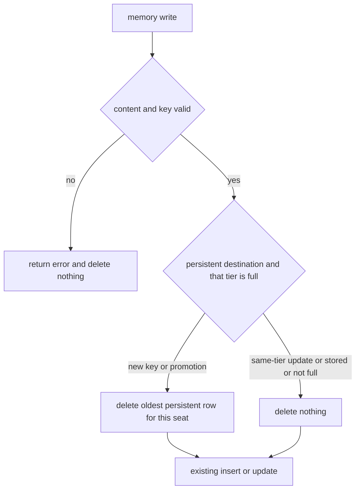
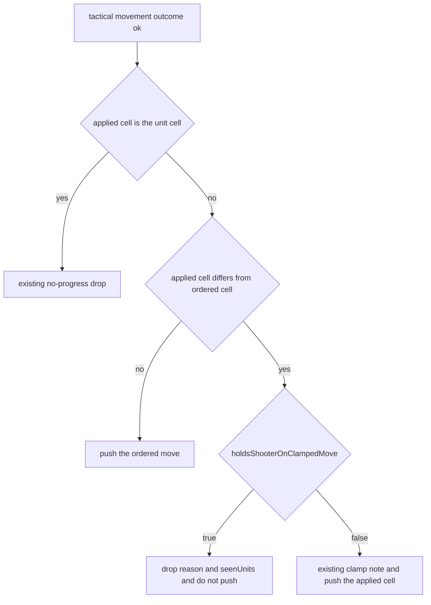

# Persistent Memory, Air-Strike Attention, and Shooter Hold

> **For agentic workers:** Implement the phases in order. Check a box only after that phase's verification command passes. Do not commit or push. Do not copy phase titles, the words "bug", or any plan identifier into product code, comments, configuration, tests, log messages, or `doc/`.

**Goal:** Three independent engine changes, each visible to the AI commander.

1. A new persistent memory key is stored when the five persistent slots are full, by deleting the oldest persistent note for that seat.
2. A strategic air unit with a Best Options air-strike row is Action needed, is not quiet, and is named on the armed-units bullet, including a strike on infrastructure and including a unit that already has a standing defend order.
3. A tactical AI `explicit_move` whose destination is shortened to the first reachable leg is dropped when that sub-unit can already shoot, unless that first leg enters an enemy cell. A move the sub-unit can finish this beat is still applied. Human Ready is unchanged.

**Architecture:** Memory eviction runs inside `write` in `src/main/tools/memory.ts`, after content and key validation, and only when the write would otherwise hit the persistent cap. Attention reuses the air-strike id set that Best Options row collection already builds, and threads that set into the existing Action-needed and armed-bullet functions. The shooter hold is a predicate in a new Guards module, called from the tactical branch of `applyParsedRequestOrders` only.

**Tech stack:** TypeScript, Electron main process, `node:test`, `better-sqlite3` for the memory tests.

**Spec:** This file is the spec. Do not copy it into `doc/`.

## Global constraints

- Do not commit or push.
- PowerShell does not accept `&&`. Run each command on its own line. If a command fails, stop that phase and fix it.
- After `npm run build:main`, run one test file with `node dist/main/<path>.test.js`. The `dist/main` path mirrors `src/main`.
- These phases do not change native addons. If a test fails to load `better-sqlite3`, run `npm run rebuild:native:node` once and retry. Do not run `npm run rebuild:native:electron` unless you launch the app.
- Orienting comments on every new or updated function: Purpose, When to use, Expected outcome, Exceptions. Interface comments state the contract. Implementation comments state the approach.
- A new or updated public main-process method logs at debug on entry. A function that only reads state logs at trace. A caught exception logs at error. Use `logDebug`, `logTrace`, and `logError` from `src/main/logger`. Do not check the log level before the call.
- Tests cover the happy path and the essential failures named in each phase. Do not add cases that only lock a private branch, a constructor, or a log string.
- Named parameters stay at or below six. A parameter object is the way through that limit.
- New files use camelCase. A role suffix, when present, is one of Handler, Helpers, Guards, Adapter, Pipeline, Core, Types. `Guards` is correct for the shooter predicate. Do not use Utils, Impl, Manager, Service, Processor, or Controller.
- Do not change `PERSISTENT_LIMIT` (5) or `STORED_LIMIT` (15).
- Do not change `EXPECTED_USER_VERSION`.
- Leave these behaviors alone: standing-order defend returns, production queue backfill, the tempo ferry sweep, human Ready, and the shared tactical march planner.
- Do not edit `.spec/completed/`. Those files record past work, including the old persistent-full error. Search quoted strings in `src/` and `doc/` only.
- Search for quoted strings. This plan names the text to find. Do not navigate by line number.

## Decisions already made

- When a persistent write would exceed five notes, delete the oldest persistent note for that same seat. Oldest means the smallest `created_turn`, then the ascending `key` when the turn ties. Log the deleted key. Do not demote it to stored. Do not ask the model to send a delete.
- The stored tier still returns an error at 15. Do not evict a stored note.
- Rewriting a key that is already persistent does not delete a different note, even when five persistent notes exist.
- A write that fails validation does not delete anything. Validation is empty content, content over 500 characters, and an illegal key. Those checks already return before the cap check.
- A clamped tactical AI move is dropped when `pickClosestEnemyTacticalRangedTargetForSubUnit` returns a target for that sub-unit at beat start, unless the applied cell holds a sub-unit whose `player` is not the shooter's `player`.
- A move whose applied cell equals the ordered cell is kept, even when the sub-unit can shoot.
- Do not exclude air or missiles in the predicate. A missile has no legal ranged target, so the resolver returns undefined and the move is not held. An air sub-unit that does have a legal target is held under the same rule.
- The motivating battle is evidence, not a fixture. Beat-1 sub-units whose first leg was an empty cell (`841f99dffffffff`) are the hold. Beat-1 sub-units whose first leg was the enemy cell (`841f991ffffffff`) are kept. Do not paste those indexes into a test. Build cells with the helpers in `src/main/tacticalBattle/tacticalRangedTargetResolve.test.ts`.

## Out of scope

- Previewing or skipping a strategic defend return that walks away from the enemy.
- Filling an empty production queue the model left empty.
- Changing which air units the tempo ferry sweep moves.
- Feeding drop reasons back to the model.
- Changing human Ready, `tacticalComputeMovementOrderOutcome`, or `tacticalMovementApply`.
- Editing `doc/devleopment-plan-v3.4.md`, `doc/poc-analysis.md`, or `doc/market-research.md`. The filename spelling `devleopment` is historical. Leave it.

## What is already true

`write` in `src/main/tools/memory.ts` returns the persistent-full error in two places: a new key when `counts.persistent >= PERSISTENT_LIMIT`, and an existing row whose current tier is not persistent when the persistent count is already at the limit. An existing persistent key updates in place and does not consult the limit. `UPDATE` assigns `created_turn = currentTurn`, so a rewritten note becomes the newest. Leave that assignment as it is. `applyParsedMemoryUpdates` counts a result as applied only when `status === 'ok'`. An extra field on that object is ignored. A `status: 'error'` becomes a drop reason.

`collectOrderlessMissionContext` already collects every Best Options row and `orderlessMissionSignalsFromActionRows` already fills `airStrikeUnitIds` for every unit on those rows, including units that have a standing order. The function then discards that set except as an input to defend suggestions. `OrderlessActionNeededSets` does not include it. Tests build that interface as an object literal, so do not add a required field to it.

`needsAction` returns true for `hasLegalAttackThisTurn`, which reads enemy-unit rows only. An air unit whose only Best Options row is an infrastructure strike stays Action needed no, and quiet, when it has a healthy defend order. `buildAttentionFlags` adds an id to the armed bullet only through `hasOrderableShotThisTurn`. `formatTacticalBriefing` calls `buildUnitStatusTable` and `buildAttentionFlags` without an orderless argument. `buildStrategicNarrative` calls `needsAction(a, true, true)` and must keep ignoring infrastructure strikes, or the critical-threat sentence will count them.

`applyParsedRequestOrders` calls `tacticalComputeMovementOrderOutcome` only in its tactical branch. When the outcome is ok and `appliedTo` is not the ordered cell, it records a clamp reason and still pushes `{ unitId, toH3Index: appliedTo }`. The same planner is called from `src/main/gameActions/humanTacticalDraftCommit.ts` and `src/main/tacticalBattle/tacticalMovementApply.ts`. A hold inside the planner would change human Ready.

The model-facing clamp sentence is built in `buildMovementBudgetRule` and repeated in `coachingTextTactical.ts`. Tests match the substring `clamped to the first reachable leg`. Append a sentence. Do not remove that substring.

## Files

- `src/main/tools/memory.ts` — evict, then insert or update.
- `src/main/openRouter/applyParsedMemoryUpdates.test.ts` — memory cases.
- `src/main/openRouter/promptSpec/coachingTextStrategic.ts` — persistent-note sentence.
- `src/main/openRouter/promptSpec/coachingText.test.ts` — the assertion that matches the old sentence.
- `src/main/briefing/briefingArmedUnits.ts` — moved bullet helpers. New file.
- `src/main/briefingFormatter.ts` — pass the air-strike set through.
- `src/main/tools/orderlessUnitSuggestions.ts` — return `airStrikeUnitIds` from the collector.
- `src/main/briefingAirStrikeAttention.test.ts` — attention cases. New file.
- `src/main/tacticalBattle/tacticalClampedMoveGuards.ts` — the predicate. New file.
- `src/main/tacticalBattle/tacticalClampedMoveGuards.test.ts` — predicate cases. New file.
- `src/main/openRouter/requestOrdersApplyParsed.ts` — call the predicate.
- `src/main/openRouter/promptSpec/gameRuleText.ts` and `coachingTextTactical.ts` — append the hold sentence.
- The `doc/` files named in phases 3, 6, and 8.

## Review focus

- Eviction runs only after validation, only for a persistent destination that is actually full, and only for the seat being written.
- A same-tier persistent update does not evict. A stored write at 15 still errors.
- The armed-units bullet is the surface for air strikes. Do not put this signal only on the orderless-mission bullet. A unit with a standing defend order never appears there.
- `buildStrategicNarrative` and every tactical caller keep an empty air-strike set.
- The predicate is not called from `tacticalComputeMovementOrderOutcome`, `humanTacticalDraftCommit`, or `tacticalMovementApply`.
- The hold branch adds the unit to `seenUnits` and does not also push the clamp reason or the order.
- `src/main/briefing/briefingArmedUnits.ts` does not import `briefingFormatter.ts`.





## Phase 1 — Baseline

**Produces:** A record, in your working notes, that the tests this plan touches already pass. No product edit.

- [x] Run `npm run build:main`.
- [x] Run these, one per command:

```text
node dist/main/openRouter/applyParsedMemoryUpdates.test.js
node dist/main/briefingOrderlessMission.test.js
node dist/main/briefingFormatter.test.js
node dist/main/briefingAttentionShot.test.js
node dist/main/tacticalBattle/tacticalRangedTargetResolve.test.js
node dist/main/openRouter/promptSpec/coachingText.test.js
node dist/main/openRouter/promptSpec/gameRuleText.test.js
```

- [x] Record pass or fail. A failure here is pre-existing. Stop and report it. Do not patch around it in a later phase.

## Phase 2 — Replace the oldest persistent note

**Produces:** A full persistent tier accepts one new key and forgets the oldest key. Stored overflow, invalid writes, and same-key updates do not delete a note.

Work in `write` in `src/main/tools/memory.ts`.

- [x] Add a private function `evictOldestPersistentMemory(playerId: string): string | null` next to `write`.
  - Select `key` from `ai_memory` where `player_id` is `playerId` and `tier` is `persistent`, `ORDER BY created_turn ASC, key ASC LIMIT 1`.
  - When the query returns nothing, return null.
  - Delete that row for that `player_id` and `key`.
  - `logDebug` with `playerId` and the deleted key. Do not log content.
  - Return the deleted key.
  - Do not call `saveDatabase` here. The existing save after insert or update persists the delete.
  - Orienting comment: this exists so a new persistent note can be stored when the tier is full; call it only from `write` after validation; it returns the deleted key, or null when that seat has no persistent row.
- [x] Widen the success object `write` already returns with an optional `replacedKey?: string`. Set it only when a row was deleted.
- [x] Declare `let replacedKey: string | undefined` after the existing validation and after `existing` and `counts` are loaded. Both success returns, the update return and the insert return, include `replacedKey` when it is set.
- [x] Call the helper only in the two persistent-full branches. Those branches are the `existing.tier !== tier` block when `tier === 'persistent'`, and the `else` block when `tier === 'persistent'`. Leave both stored-tier errors exactly as they are, including their error strings.
- [x] Shape of each persistent-full branch: call the helper, and when it returns null, return today's persistent-full error. When it returns a key, assign `replacedKey` and do not return. Execution must continue into the existing `UPDATE` or `INSERT`. Replacing the error return with a call that still returns will store nothing.
- [x] Run that delete before the `UPDATE`. A promotion is still tier `stored` at that moment, so the `SELECT` cannot pick the key being written.
- [x] Do not call the helper when `existing` is present and `existing.tier === tier`.
- [x] Do not move the helper above the empty-content, length, and key checks.
- [x] Log the deleted key from the helper, not from the entry `logDebug`, which runs before eviction.
- [x] Leave the `UPDATE` assignment `created_turn = currentTurn` unchanged. A rewritten note stays the newest. Do not preserve the previous `created_turn`.
- [x] Replace the Expected outcome on `write`. State that a valid persistent write at capacity deletes the oldest persistent note for that seat and then stores the write, and that a stored write at capacity still returns the stored-full error. The persistent-full error string stays in the source for the null-evict fallback. Do not delete it.

Tests in `src/main/openRouter/applyParsedMemoryUpdates.test.ts`. Add new `test()` functions. Do not append these cases to the existing test, which walks one probe key through several steps in one database. Each new test creates a temp directory, calls `createFreshGameDatabaseAt`, and calls `closeGameDatabaseForTests` in `finally`, the same way the existing test does. Read a key with `executeMemory` and `memory_read`, the same way `readProbe` does. Keys must match the key pattern already enforced by `write` (letters, digits, underscore, hyphen). Call `applyParsedMemoryUpdates` with `tactical: false`, `memoryEnabled: true`, and a distinct `turnNumber` per wave so `created_turn` differs. Do not use the file's `applyStrategic` helper for these cases, because it pins `turnNumber` to 1. Pass `AI_SEAT_IDS[1]` as `seatId` on the other-seat write and on that seat's read. The file-level `seatId` constant is seat 0.

- [x] Happy path. On turns 1 through 5, write five persistent keys `turn_one` through `turn_five`, each with non-empty content. On turn 6, write `turn_six` as persistent. Expect `appliedCount` 1 for that write, `dropReasons` empty, `turn_one` absent from `memory_read`, and `turn_six` present. The other four keys remain.
- [x] Same-turn tie. On turn 1, write persistent keys `aaaa` and `zzzz`. On turns 2, 3, and 4, write three more persistent keys. On turn 5, write a new persistent key. `aaaa` is absent. `zzzz` remains. This locks `ORDER BY created_turn ASC, key ASC`.
- [x] Same-key update. In a fresh database, write five persistent keys, then write `turn_five` again with new content on a later turn. All five keys remain. `turn_five` has the new content.
- [x] Invalid write. In a fresh database, write five persistent keys, then write a new key with empty content. The result is a drop reason containing `Content cannot be empty`. All five keys remain. A content-length failure takes the same early return, so this one case covers validation-before-delete.
- [x] Stored cap. Write 15 distinct stored keys. A 16th stored key is a drop reason and is not stored. All 15 remain.
- [x] Promotion. Write `turn_one` through `turn_five` on turns 1 through 5, and one stored key. Write that stored key again with tier persistent and non-empty content. `turn_one` is gone. The promoted key reads back as persistent. The other four persistent keys remain.
- [x] Other seat. Write five persistent keys for `AI_SEAT_IDS[0]` and one persistent key for `AI_SEAT_IDS[1]`. A sixth persistent key for seat 0 removes seat 0's oldest key. Seat 1's key still reads back for seat 1.

Verify:

```text
npm run build:main
node dist/main/openRouter/applyParsedMemoryUpdates.test.js
npm run lint
```

`memory.ts` may sit above 600 lines. Do not split the module in this work. Stay under 1000 lines.

## Phase 3 — Tell the model that a new key replaces the oldest note

**Produces:** The coaching line and the briefing slot line describe replacement. No new engine branch.

- [x] In `src/main/openRouter/promptSpec/coachingTextStrategic.ts`, replace the sentence that contains `when persistent slots are unused` with:

```text
Write a short persistent note naming this turn's objectives and the units assigned to them. Include that memoryUpdates write every strategic turn. When all 5 persistent slots are full, a new key replaces the oldest persistent note. Do not persist enemy positions or rosters, which the briefing already supplies fresh each turn.
```

Keep the surrounding bullet structure. Do not add a second memory bullet.

- [x] In `src/main/openRouter/promptSpec/coachingText.test.ts`, replace the assertion that matches `/persistent slots are unused/i` with an assertion that matches `/replaces the oldest persistent note/i`. The coaching source line is the bullet in `coachingTextStrategic.ts` that contains that old phrase. There is one such assertion.
- [x] In `getInjectionText` in `src/main/tools/memory.ts`, keep the existing `Persistent: N of 5` sentence. Push the next line after it, before the `memory_read` instruction: `A new persistent key replaces the oldest persistent note when all 5 persistent slots are full.` Use `PERSISTENT_LIMIT` in the template rather than a second hardcoded 5. The slot-count line already interpolates that constant. Show the sentence on every injection, including when slots remain. Update that function's Expected outcome to mention the sentence.
- [x] In `applyParsedMemoryUpdates.test.ts`, add one assertion that `getInjectionText(AI_SEAT_IDS[0], 1)` contains `replaces the oldest persistent note`. Open a temp database with `createFreshGameDatabaseAt` first. An empty note table is enough. This locks the briefing line, which the coaching test does not see.
- [x] Update the same claim wherever `doc/` states the old rule. Search `doc/` for `persistent slots are unused` and for `Persistent memory full`. Update each hit except the three historical files in Out of scope. The hits this plan already knows:
  - `doc/ai-commander-prompts/strategic-prompt.md` item 16, Persist intent.
  - `doc/ai-commander-prompts/example-strategic-prompt.md` at the coaching paragraph. Also add the replacement sentence on the line after `Persistent: 0 of 5 slots used. Stored: 0 of 15 slots used.` That example is a copy of `getInjectionText`, and the slot line is the only one in `doc/`.
  - `doc/ai-commander-prompts/information-decision-model.md` rows `MEMORY_LIMITS` and `MEMORY_WRITE_PATH`. Say that a new persistent key at capacity replaces the oldest persistent note for that seat, and that a stored write at capacity still fails.
  - `doc/ai-tools.md` Memory section. Envelope writes still drop an invalid row. A persistent write at capacity is stored, and the oldest persistent key for that seat is deleted. A stored write at 15 is still a drop.

Verify:

```text
npm run build:main
node dist/main/openRouter/promptSpec/coachingText.test.js
node dist/main/openRouter/applyParsedMemoryUpdates.test.js
```

Then search `src/` and `doc/` for `persistent slots are unused`. The only acceptable remaining hits are the three historical files. There should be none.

## Phase 4 — Move the armed-units bullet helpers

**Produces:** The same briefing text, with two functions living outside `briefingFormatter.ts`, so phase 5 has room under the 1000-line hard limit. `briefingFormatter.ts` is 943 lines today.

- [x] Create `src/main/briefing/briefingArmedUnits.ts`.
- [x] Move `isSameHexContactOnly` and `armedUnitsBulletText` into it, including their orienting comments. Export both. They read state and do not change it, so each logs `logTrace` on entry. Log counts, the mode, and the boolean result. Do not log the finished bullet string.
- [x] Do not move `formatUnitDisplayRef`. It stays in `briefingFormatter.ts`. The bullet receives ids the caller has already formatted.
- [x] Import `UnitAssessmentResult` from `../precomputation`. The type is exported there. The new file does not import `briefingFormatter.ts`.
- [x] `briefingFormatter.ts` imports the two functions and deletes the local copies. Call sites stay the same.
- [x] Do not change wording, caps, or conditions in this phase.

Verify:

```text
npm run build:main
node dist/main/briefingFormatter.test.js
node dist/main/briefingAttentionShot.test.js
node dist/main/briefingOrderlessMission.test.js
npm run check:circular
npm run lint
```

`check:circular` fails if the new file imports `briefingFormatter.ts`. Fix the import direction. Do not add a cycle waiver.

## Phase 5 — Count a Best Options air-strike row as a legal attack

**Produces:** Strategic Unit Status and Attention Flags treat that row as a shot. Tactical briefings and the strategic narrative do not.

The set is every unit id on a Best Options row whose action labels include `ACTION_AIR_STRIKES`. It is not limited to units without a standing order. `orderlessMissionSignalsFromActionRows` already builds it from the full row list.

- [x] In `collectOrderlessMissionContext`, include `airStrikeUnitIds: signals.airStrikeUnitIds` on the returned object. Widen the return type with an intersection. Do not add the field to `OrderlessActionNeededSets`.
- [x] Update the comment on `OrderlessMissionActionSignals.airStrikeUnitIds` so it names Attention Flags as a caller, in addition to the defend-suggestion input. Do not say the set is only for the debug log.
- [x] Add `collectBestOptionsAirStrikeUnitIds` in `src/main/tools/orderlessUnitSuggestions.ts`. It takes `state` and `latLngByH3`, calls `collectAggregatedPossibleActionRows` with `forThisTurnOptionsTable: true`, then `orderlessMissionSignalsFromActionRows`, and returns `signals.airStrikeUnitIds`. Log at debug with the turn number and the set size. This is the path for a strategic briefing whose standing-order section is empty. Do not parse the markdown table yourself.
- [x] In `formatBriefing`, after `orderlessAction` is chosen:

```text
airStrikeRowUnitIds = orderlessAction.airStrikeUnitIds when orderlessAction is defined,
otherwise collectBestOptionsAirStrikeUnitIds(state, latLngByH3)
```

Pass that set into `buildUnitStatusTable` and `buildAttentionFlags`. Do not call `collectBestOptionsAirStrikeUnitIds` when `orderlessAction` is already defined. Do not pass the set into `buildStrategicNarrative`.

- [x] Append an optional parameter `airStrikeRowUnitIds: ReadonlySet<string> = emptySet` as the last parameter of `buildUnitStatusTable` and of `buildAttentionFlags`. One module-level empty set is enough. Do not insert it ahead of `orderlessAction`. Existing callers pass that argument positionally, and a shift would bind an orderless set as the air-strike set. Do not edit `formatTacticalBriefing.ts`. Its calls already omit the new argument.
- [x] Append the same optional parameter as the last parameter of `needsAction` and of `isQuiet`. `buildStrategicNarrative`'s call `needsAction(a, true, true)` keeps the default. `buildUnitStatusTable` and `buildAttentionFlags` pass the set through. A default that the table forgets to pass fails the new test.
- [x] In `needsAction`, after the missile early return and next to the `hasLegalAttackThisTurn` check: when `assessment.result.unit?.type === 'air'` and the set contains `assessment.unitId`, return true. A missile stays false. An infantry id in the set stays on the old rule. Replace the purpose sentence that says idle air holding on defend is left off this flag. The new sentence: an air unit with a Best Options air-strike row is on the flag, including infrastructure and including a healthy defend order; an air unit with no strike row and no other reason stays off, and ferry coaching does not mark it. Update the Expected outcome the same way.
- [x] In `isQuiet`, when the unit type is air and the set contains the id, return false. Do this even when the standing order is healthy. Update the Expected outcome comment.
- [x] In the armed-id loop inside `buildAttentionFlags`, push the formatted id when `hasOrderableShotThisTurn` is true, or when the unit type is air and the set contains the id. Strategic infantry stays off the list.
- [x] Replace the `hasAirShooter` expression inside the `armedUnitRefs.length > 0` block. It currently requires `hasOrderableShotThisTurn`, which is false for an infrastructure-only strike, so the bullet would keep saying `ranged row`. It becomes true when any id in `armedUnitRefs` belongs to an assessment whose unit type is air. `armedUnitsBulletText` already says `ranged or air-strike` when that flag is true.
- [x] Leave the orderless-mission bullet as it is. An orderless air unit may appear in that count and also on the armed bullet. Both sentences are wanted: one assigns a standing order, the other copies the strike.
- [x] Do not invent an enemy unit id for an infrastructure strike.

Tests in a new file `src/main/briefingAirStrikeAttention.test.ts`. Follow the fixture style of `src/main/briefingOrderlessMission.test.ts` (`idleAssessment`, a status row, `buildUnitStatusTable`, `buildAttentionFlags`). Do not add lines to `src/main/briefingFormatter.test.ts`.

- [x] Copy `idleAssessment` locally or import nothing private from the other test. Pass a standing order `{ status: 'holding' }`. A null order makes `isQuiet` return false, so the empty-set row would not say quiet and the test would not lock the defend case. `holding` is not a warning status.
- [x] Air unit, that holding order, `canAttackThisTurn` empty, id present in the passed-in set. Pass no orderless argument. The status row contains `| yes |` and does not contain `quiet`. The attention text contains the unit id and `air-strike`. A bullet that only says `ranged row` fails this case.
- [x] The same assessment with an empty set. The status row contains `no (quiet)`. It does not contain `| no |`, because the quiet cell is `no (quiet)`. The attention text does not contain the unit id.
- [x] The same assessment passed to `buildAttentionFlags` with coordinate mode `tactical`, standing orders inactive, and the set omitted. The unit id is absent.
- [x] An infantry id placed in the set, with the same holding order and no orderless argument, keeps `no (quiet)` and does not appear in the attention text. With that unit alone, the attention text is `None.`

Verify:

```text
npm run build:main
node dist/main/briefingAirStrikeAttention.test.js
node dist/main/briefingOrderlessMission.test.js
node dist/main/briefingFormatter.test.js
node dist/main/briefingAttentionShot.test.js
node dist/main/openRouter/promptSpec/variantConformance.test.js
npm run lint
```

Callers that omit the new argument, including `variantConformance.test.ts` and the existing `buildAttentionFlags` cases, must keep their current text. A change there means the default set was not empty. Fix the default. Do not edit those assertions to expect an air-strike bullet. A `formatBriefing` assertion may change when that fixture's map really contains an air-strike row. Update only that assertion, and only to the contract in this phase.

## Phase 6 — Document the air-strike attention rule

**Produces:** The prompt spec matches phase 5. No further code change.

- [x] `doc/ai-commander-prompts/strategic-prompt.md`, the Attention Flags bullet that begins `The armed bullet names every non-infantry unit`. Add that a Best Options air-strike row counts, including a strike whose target is infrastructure, and including an air unit that already has a standing defend order. Keep the infantry exclusion, the twelve-id cap, and the five-bullet cap.
- [x] Same file, unit-status cell contract 4 (`Action needed`). Add that an air unit is yes, and is not quiet, when Best Options lists an air strike for it. Keep the existing sentence that an air unit holding on defend is not marked yes solely because coaching tells it to ferry.
- [x] `doc/ai-commander-prompts/source-inventory.md`, the Attention Flags paragraph. Same addition. Keep the battle sentence: in a battle the bullet includes only a ranged attack or an air strike already expressed as `canAttackThisTurn`.
- [x] Search `doc/ai-commander-prompts/` for `in-range attack` and update any other current description of this bullet. Leave the three historical files alone.

Verify by reading the edited paragraphs against phase 5. No test command is required beyond the phase 5 tests, which do not parse these markdown files.

## Phase 7 — Predicate for a shortened step that leaves a firing cell

**Produces:** A pure predicate and its tests. No apply-loop change yet.

Create `src/main/tacticalBattle/tacticalClampedMoveGuards.ts`.

- [x] Export `holdsShooterOnClampedMove` with one parameter object: `battle`, `subUnitId`, `orderedH3`, `appliedH3`.
- [x] `logTrace` on entry with those four fields and, before each return, the boolean result. This function does not change state.
- [x] Return false when `appliedH3 === orderedH3`.
- [x] Find `battle.subUnits` entry with `id === subUnitId`. When it is missing, return false. Do not throw.
- [x] Return false when any sub-unit has `h3Index === appliedH3` and `player !== shooter.player`. That is melee contact. A sub-unit of the shooter's own player on that cell is not melee contact.
- [x] Otherwise return `pickClosestEnemyTacticalRangedTargetForSubUnit(battle, subUnitId) !== undefined`.
- [x] Do not read `unitType`. Do not call `tacticalComputeMovementOrderOutcome`.

Tests in `src/main/tacticalBattle/tacticalClampedMoveGuards.test.ts`. Build the snapshot the way `pickClosestEnemyTacticalRangedTargetForSubUnit prefers nearer human over farther` does: `tacticalParentCell`, `tacticalUnderCorner`, `gridDisk`, same parent. Set every tactical terrain kind to `plains`, and both sub-units to infantry. Do not use `tacticalPentagonCrossingPair`. That pair is for a distance the grid function cannot measure. Import the fixture helpers from `./testSupport/tacticalHexFixtures`. The shooter's `player` is `AI_SEAT_IDS[0]` (`opponent`). The enemy's `player` is `HUMAN_SEAT_ID` (`human`).

- [x] In the positive fixture, assert `pickClosestEnemyTacticalRangedTargetForSubUnit` returns the enemy cell before asserting the predicate. If it returns undefined, the footprint or terrain is wrong. Fix the fixture. Do not change the predicate to return true without a target.
- [x] Positive. Ordered cell is a different footprint cell. Applied cell is a neighbor of the shooter that holds nobody. The predicate returns true.
- [x] Melee. Applied cell is the enemy cell, and it differs from the ordered cell. The predicate returns false.
- [x] Finished move. Applied cell equals the ordered cell. The predicate returns false even though the resolver returns a target.
- [x] No shot. The only enemy is farther than infantry range (tactical infantry range is 2). The resolver returns undefined. Applied cell holds nobody and differs from the ordered cell. The predicate returns false.
- [x] Friendly occupant. A second sub-unit of the shooter's player stands on the applied cell. An enemy remains in range on a different cell. The predicate returns true.
- [x] Unknown id. The predicate returns false and does not throw.

Verify:

```text
npm run build:main
node dist/main/tacticalBattle/tacticalClampedMoveGuards.test.js
node dist/main/tacticalBattle/tacticalRangedTargetResolve.test.js
npm run lint
npm run naming:check
```

## Phase 8 — Apply the hold on AI orders only, and say so

**Produces:** The tactical AI apply loop drops the shortened step. Human Ready still clamps. The prompt describes both.

In the tactical branch of `applyParsedRequestOrders` in `src/main/openRouter/requestOrdersApplyParsed.ts`, replace the body of the existing `if (appliedTo !== order.toH3Index)` so the hold continues before the clamp note. The push that follows that `if` stays where it is. The resulting shape is:

```ts
if (appliedTo !== order.toH3Index) {
  if (holdsShooterOnClampedMove({
    battle: tacticalBattle,
    subUnitId: order.unitId,
    orderedH3: order.toH3Index,
    appliedH3: appliedTo,
  })) {
    dropReasons.push(`Tactical march ${aiOrderUnitLabel(order.unitId)}: held on its firing cell`);
    seenUnits.add(order.unitId);
    continue;
  }
  dropReasons.push(
    `Tactical march ${aiOrderUnitLabel(order.unitId)}: clamped explicit_move destination to first leg this beat (${order.toH3Index} → ${appliedTo})`
  );
}
validated.push({ unitId: order.unitId, toH3Index: appliedTo });
seenUnits.add(order.unitId);
continue;
```

- [x] Use the beat-start `tacticalBattle` argument. Do not build or read a post-move snapshot. The `→` in the clamp sentence is the character already in that file. Keep it.
- [x] Do not call the predicate when `appliedTo === order.toH3Index` or when `appliedTo === unitRow.h3Index`. Those branches already exist above this `if`.
- [x] Do not add the call to `tacticalComputeMovementOrderOutcome`, `src/main/gameActions/humanTacticalDraftCommit.ts`, or `src/main/tacticalBattle/tacticalMovementApply.ts`.
- [x] `requestOrdersApplyParsed.ts` is 585 lines. This addition stays in that file and under 1000. Do not split it for this change.

Prompt text. Append this sentence. Do not delete `clamped to the first reachable leg`.

```text
When that shortened step is not the ordered cell and the sub-unit can already shoot an enemy from its current cell, the move is dropped and the sub-unit stays there, unless the shortened step enters a cell that holds an enemy.
```

- [x] Append it in `buildMovementBudgetRule` in `src/main/openRouter/promptSpec/gameRuleText.ts`, on the tactical return only. Leave the strategic paragraph unchanged.
- [x] Append it to `REACH_BULLET` in `src/main/openRouter/promptSpec/coachingTextTactical.ts`. Update that constant's Expected outcome so it also mentions the hold. The bullet still mentions the first reachable leg.
- [x] `doc/combat-rules-v3.md` at the sentence that says a destination beyond the beat budget is clamped. Add that the human Ready path still clamps, and that an AI commander order is dropped instead when the shortened step is not the ordered cell, the sub-unit can shoot from its current cell, and the shortened step does not enter an enemy cell.
- [x] `doc/ai-commander-prompts/tactical-prompt.md` at each sentence that states the unconditional clamp.
- [x] `doc/ai-commander-prompts/variants.md` at the clamp sentence. Do not change the five-bullet attention cap.
- [x] `doc/ai-commander-prompts/information-decision-model.md` row `FIRST_LEG_TRUNCATION`. Name `holdsShooterOnClampedMove` as the AI-consultation exception. The engine source for the clamp itself stays `tacticalMarchFirstStopAlongPath`.
- [x] `doc/ai-commander-prompts/example-tactical-prompt.md` at each copy of the unconditional clamp sentence.
- [x] Search `doc/` and `src/main/openRouter/promptSpec/` for `clamped to the first reachable leg` and update every current description. Leave the three historical files alone. A test that only matches the old substring must still pass.

Verify:

```text
npm run build:main
node dist/main/tacticalBattle/tacticalClampedMoveGuards.test.js
node dist/main/openRouter/promptSpec/gameRuleText.test.js
node dist/main/openRouter/promptSpec/coachingText.test.js
npm run lint
```

## Phase 9 — Full verification

**Produces:** The suite this repository uses for a main-process change.

- [ ] Run `npm test`. The runner stops at the first failing file. With this work stashed, the same five files still fail: `neutralTurn.test.ts` (a loaded ship on open water never reaches a coast), `sealift.test.ts` (an embark on open water is kept), `rendererStackPopoverContracts.test.ts` (stack-popup select controls), `computeTacticalBattleSnapshotDb.test.ts` (a contested hex has fewer than two fortifiable core cells), and `mercenaryTools.test.ts` (a raise on an empty home city returns `error`). Every other main-process test file passed with these changes compiled. `npm run notices:check` passed. `naming:check` passed in the `npm test` run that stopped on `neutralTurn.test.ts`.
- [x] Run `npm run naming:check` if `npm test` did not already run it. `npm test` does run it today. A second run is unnecessary when the first succeeded.
- [x] Search `src/` and `doc/` for `persistent slots are unused` and for the phase titles in this file. Product code, tests, log strings, and `doc/` must not contain them. This `.spec` file may. Do not search `.spec/completed/`.
- [x] Confirm `humanTacticalDraftCommit.ts` and `tacticalSnapshotGuards.ts` have no call to `holdsShooterOnClampedMove`.

## Done when

- A sixth distinct persistent key is stored, the oldest persistent key for that seat is gone, and a stored sixteenth key is still rejected.
- An air unit with only an infrastructure strike is Action needed yes, not quiet, and is named on the strategic armed-units bullet. The same unit with an empty set is unchanged. A tactical call that omits the set is unchanged.
- A shortened tactical AI step is omitted from `validated` when the predicate returns true, and is still pushed when the applied cell holds an enemy or when the unit can reach the ordered cell.
- `doc/` pages listed above match those three behaviors.
- `npm test` passes, aside from the five pre-existing failures named in Phase 9.
