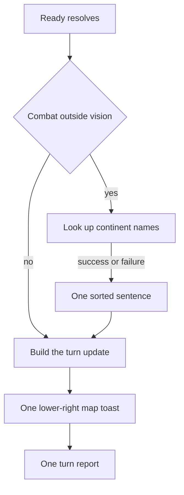

# Message and Updates Popup Implementation Plan

> **For agentic workers:** Follow the phases in order. Each phase is verifiable before the next one starts. Do not commit or push. Do not copy phase names, or this plan's title, into code, comments, product docs, or lint messages.

**Goal:** Put the map toast back at the lower right, include one sorted unknown-battle sentence in its Updates section, keep the opponent message popup one width with navy tab fills, and show Strategy in that popup and in Reports even while a human seat is playing.

**Architecture:** The map toast (`#map-toast`) and the message popup (`#ai-strategy-toast`) stay two elements. The map toast leaves the top band and anchors to the map. Unknown-battle continent names are formatted by one shared function and passed into the existing turn-update builder, so Ready shows one toast and files one turn report. Strategy is already on `CommanderDispatch`; the renderer stops dropping it when a human is playing.

**Tech stack:** TypeScript, Electron renderer DOM, CSS in `static/feedbackChrome.css`, Node tests under `dist/shared` and `dist/main`.

## Global Constraints

- Do not commit or push. Leave the worktree for review.
- New and updated fields and methods get orienting comments in the file's existing shape: Purpose, When to use, Expected outcome, Exceptions. Interface fields state the contract.
- Public main-process methods stay at debug. The two poll lines named in Phase 1 are the exception: they are trace because they run about once a second.
- A caught exception in the renderer uses `console.error`, the same way neighboring renderer catches do. Do not import the main-process logger into the renderer.
- Tests cover the happy path and the essential failure cases below. Do not add DOM tests, source-scan tests, or tests of constructors and accessors.
- Files under `src/` stay camelCase. Exported functions are camelCase. No `Utils` or `Impl`. No new dependency.
- Keep each changed source file under 1000 lines. The builder takes its existing args object; add a field, not a new parameter.
- Update the living docs named in each phase in that same phase. Leave [doc/devleopment-plan-v3.4.md](doc/devleopment-plan-v3.4.md), [doc/poc-analysis.md](doc/poc-analysis.md), [doc/market-research.md](doc/market-research.md), and everything under `.spec/completed/` as they are.
- The Updates heading stays `Updates`. Do not rename it to Other.
- Observe mode, fog, View as, and what the model is told stay as they are. This plan only changes what the player sees in the two popups and in Reports.



## Phase 1: Poll logs at trace

**Files:**
- Modify: [src/main/ipc/commanderPoolIpcHandler.ts](src/main/ipc/commanderPoolIpcHandler.ts) (the `read` handler, about line 62)
- Modify: [src/main/openRouter/commanderConsultLog.ts](src/main/openRouter/commanderConsultLog.ts) (`setCommanderConsultLogSender`, about line 69)

**Produces:** Those two messages emit at trace. `commanderPoolIpcHandler register`, `start`, and `stop` stay `logDebug`.

- [ ] Change the read log to trace. Add `logTrace` to the existing logger import.

```typescript
// About once a second while the pool is polled. Trace so a debug log is not filled by the poll.
logTrace('commanderPoolIpcHandler read', { drain });
```

- [ ] In `setCommanderConsultLogSender`, change `logDebug` to `logTrace`. The file already imports `logTrace`. Keep the same message and payload: `'commanderConsultLog setCommanderConsultLogSender', { listening: next !== null }`. Add the same one-line reason above the call. This function also runs from start and stop; those calls follow the function and become trace too. That is the same line the poll repeats.
- [ ] Leave `emitCommanderConsultLog` as it is. It is already trace.
- [ ] **Verify:** `npm run build:main` succeeds. Search the two files: the read handler and `setCommanderConsultLogSender` call `logTrace`; `register`, `start`, and `stop` still call `logDebug`. With `AGENT_WARS_LOG_LEVEL=debug`, a running match no longer prints those two lines every second. They appear when the level is `trace`.

## Phase 2: Sorted comma sentence

**Files:**
- Create: [src/shared/unknownBattleAnnouncement.ts](src/shared/unknownBattleAnnouncement.ts)
- Create: [src/shared/unknownBattleAnnouncement.test.ts](src/shared/unknownBattleAnnouncement.test.ts)
- Modify: [src/renderer/entryCallbacks.ts](src/renderer/entryCallbacks.ts) (delete the local function near line 645 and re-export the shared one)

**Produces:** `formatUnknownBattleAnnouncement(continentNames: readonly string[]): string`

The names are the continent names `collectUnknownBattleContinentNames` already returns. Do not change that collector or its first-occurrence order. Sort only in the formatter. After this phase the separate unknown-battle toast still exists; it uses the new sentence. Phase 3 removes that toast.

- [ ] **Write the failing test** in `unknownBattleAnnouncement.test.ts`, using `node:test` and `node:assert/strict`, matching [src/shared/unknownBattleContinentNames.test.ts](src/shared/unknownBattleContinentNames.test.ts).

```typescript
import assert from 'node:assert/strict';
import { test } from 'node:test';
import { formatUnknownBattleAnnouncement } from './unknownBattleAnnouncement';

test('formatUnknownBattleAnnouncement sorts unique trimmed names and joins them with commas', () => {
  assert.equal(formatUnknownBattleAnnouncement(['Europe']), 'Unknown battle observed in Europe.');
  assert.equal(
    formatUnknownBattleAnnouncement(['Europe', 'Africa']),
    'Unknown battle observed in Africa, Europe.'
  );
  assert.equal(
    formatUnknownBattleAnnouncement(['C', 'A', 'B']),
    'Unknown battle observed in A, B, C.'
  );
  assert.equal(
    formatUnknownBattleAnnouncement(['Asia', ' Europe ', 'Asia', '']),
    'Unknown battle observed in Asia, Europe.'
  );
});

test('formatUnknownBattleAnnouncement uses the unidentified continent sentence when no name remains', () => {
  assert.equal(
    formatUnknownBattleAnnouncement([]),
    'Unknown battle observed in an unidentified continent.'
  );
  assert.equal(
    formatUnknownBattleAnnouncement(['', '   ']),
    'Unknown battle observed in an unidentified continent.'
  );
});
```

- [ ] Run `npm run build:main`, then `node dist/shared/unknownBattleAnnouncement.test.js`. Expected: fail because the module does not exist yet.
- [ ] Implement the function. Copy the array before sorting. Do not mutate the caller's array. Dedupe after trim. Sort with `localeCompare(other, 'en')`. Do not fold case: `Asia` and `asia` would both remain if both were collected.

```typescript
export function formatUnknownBattleAnnouncement(continentNames: readonly string[]): string {
  const clean = [...new Set(continentNames.map((name) => name.trim()).filter((name) => name.length > 0))].sort(
    (left, right) => left.localeCompare(right, 'en')
  );
  if (clean.length === 0) return 'Unknown battle observed in an unidentified continent.';
  return `Unknown battle observed in ${clean.join(', ')}.`;
}
```

The orienting comment states: one sentence for the Updates section; call it with the collector's names; one name, a comma list, or the unidentified-continent sentence; it does not throw.

- [ ] Replace the function in `entryCallbacks.ts` with a re-export so [src/renderer/wiredEntryCallbacks.ts](src/renderer/wiredEntryCallbacks.ts) keeps its import:

```typescript
export { formatUnknownBattleAnnouncement } from '../shared/unknownBattleAnnouncement';
```

Delete the old function and its comment. The dep type in [src/renderer/gameplay/readyHandlerTypes.ts](src/renderer/gameplay/readyHandlerTypes.ts) stays `(continentNames: string[]) => string`.

- [ ] Run the test file again. Expected: both tests pass, exit code 0.

## Phase 3: One Updates line, one toast

**Files:**
- Modify: [src/shared/consolidatedTurnUpdateToast.ts](src/shared/consolidatedTurnUpdateToast.ts)
- Modify: [src/main/turnUpdateSummary.test.ts](src/main/turnUpdateSummary.test.ts)
- Modify: [src/renderer/gameplay/readyResolutionAnnouncements.ts](src/renderer/gameplay/readyResolutionAnnouncements.ts)
- Modify: [doc/ux/notifications-and-feedback.md](doc/ux/notifications-and-feedback.md), [doc/ux/reports-tab.md](doc/ux/reports-tab.md), [doc/ux/resolution-playback.md](doc/ux/resolution-playback.md), [doc/ux/modes-and-transitions.md](doc/ux/modes-and-transitions.md), [doc/how-to-play.md](doc/how-to-play.md)

**Consumes:** `formatUnknownBattleAnnouncement` from Phase 2.

**Produces:** `ConsolidatedTurnUpdateToastArgs.unknownBattleLine?: string | null`. When the trimmed line is non-empty, it is the last line of the Updates section.

- [ ] Add the field on `ConsolidatedTurnUpdateToastArgs`, after `turnReport`, with an orienting comment: optional sentence from `formatUnknownBattleAnnouncement`; pass it only when combat was outside vision; a blank or whitespace value is omitted; it does not replace loss sections or deployment lines.
- [ ] In `buildConsolidatedTurnUpdateToastMessage`, append the trimmed line after the combat-fallback substitution, so a turn that still needs those fallback lines keeps them and then the sentence:

```typescript
let otherLines = buildOtherTurnUpdatePrimaryLines(readyResult);
if (!hasLossSections && otherLines.length === 0) {
  otherLines = composeResolutionMapToastBullets([], combatFallbackBullets).map(stripLeadingBullet);
}
const unknownBattleLine = args.unknownBattleLine?.trim() ?? '';
if (unknownBattleLine.length > 0) otherLines = [...otherLines, unknownBattleLine];
```

Leave the `## Updates` header rule as it is. The renderer already draws each Updates line as a bullet. Do not put a bullet character in the sentence. The line has no unit flags.

- [ ] Extend `testSectionOrderAndEmptySuppression` in [src/main/turnUpdateSummary.test.ts](src/main/turnUpdateSummary.test.ts), called from the existing `run()`:
  - A deployment plus `unknownBattleLine: 'Unknown battle observed in Africa, Europe.'` puts `## Updates` after the hex sentence, the deployment line before the unknown sentence, and the unknown sentence last.
  - That sentence alone, with an empty ready result and `emptyTurnLossSummary()`, returns `` `## Updates\nUnknown battle observed in Africa, Europe.` ``.
  - `unknownBattleLine: '   '`, `null`, or omitted, with an otherwise empty toast, still returns `null`.
  - No losses, no deployments, `combatFallbackBullets: ['Casualty outcomes at 2 hexes.']`, and the same unknown sentence: the Updates section contains `Casualty outcomes at 2 hexes.` and the unknown sentence is last. That string is not a melee or ranged engagement counter, so `composeResolutionMapToastBullets` keeps it. Appending the unknown sentence before that substitution would drop the casualty line. The test exists to reject that order.
- [ ] Run `npm run build:main`, then `node dist/main/turnUpdateSummary.test.js`. Expected before the builder change: fail. After it: `turnUpdateSummary.test.ts passed`.
- [ ] In `announceResolutionTurnUpdate`, keep the loss summary, the fallback bullets, and the seat list exactly where they are. Before any `await`, save `const viewerSeatId = reportViewerSeatId()`. Then look up continent names. Then build the toast from those saved values. Do not read `S.gameState` or `S.viewAs` again after the lookup starts, so a slow name lookup cannot change who "you" is or which seats the loss sections name. Show the toast once. Delete the second `deps.showMapToast` call.

```typescript
let unknownBattleLine: string | undefined;
if (hasUnknownBattle) {
  try {
    const getContinentNames = window.gameApi?.getHexContinentNames;
    const unknownContinentNames = await collectUnknownBattleContinentNames(
      unknownCombatHexes,
      unknownCasualtyHexes,
      getContinentNames ? (h3Index) => getContinentNames({ h3Index }) : undefined
    );
    unknownBattleLine = deps.formatUnknownBattleAnnouncement(unknownContinentNames);
  } catch (err) {
    console.error('unknown battle continent names failed', err);
    unknownBattleLine = deps.formatUnknownBattleAnnouncement([]);
  }
}
const updateText = buildConsolidatedTurnUpdateToastMessage({
  readyResult: readySlice,
  turnLossSummary,
  combatFallbackBullets,
  turnReport: { viewerSeatId, seats, transitions: readySlice.controlTransitions ?? [] },
  unknownBattleLine,
});
```

Keep the single `showMapToast` with `report: { kind: 'turn', tag: reportTag }` and the single `appendOpenRouterLog` of `Update: ...`. A rejected lookup still shows the loss summary, with the unidentified-continent sentence. Do not rethrow. The standing-orders notice in [src/renderer/gameplay/readyHandler.ts](src/renderer/gameplay/readyHandler.ts) stays its own notice; this function may replace that toast on screen, which it already does.

Update the function's orienting comment: one update toast when there is text, including an unknown-battle sentence inside Updates; the Reports tab files that toast as one turn report; a name-lookup failure uses the unidentified-continent sentence and still shows the toast.

- [ ] Docs, in place:
  - [doc/ux/notifications-and-feedback.md](doc/ux/notifications-and-feedback.md): the map toast's uses no longer list a separate unknown-battle announcement. The Updates bullet says deployments, caps, hexes lost, and, when combat was outside vision, one last line from `formatUnknownBattleAnnouncement` in [src/shared/unknownBattleAnnouncement.ts](src/shared/unknownBattleAnnouncement.ts). The Reports invariant says that sentence is part of the turn report. There is no second Notice for it.
  - [doc/ux/reports-tab.md](doc/ux/reports-tab.md): the turn report's Updates section ends with that sentence when combat was outside vision. The standing-orders notice still takes the resolved turn's tag. Delete the words that call the unknown battle its own notice.
  - [doc/ux/resolution-playback.md](doc/ux/resolution-playback.md): the summary and the unknown-battle sentence are one turn report, tagged with the turn or beat Ready just resolved.
  - [doc/ux/modes-and-transitions.md](doc/ux/modes-and-transitions.md): combat outside vision is that Updates line, with continent names when the lookup returns them.
  - [doc/how-to-play.md](doc/how-to-play.md): the "Reading the turn report" bullet says the unknown-battle sentence is the last Updates line when combat was outside vision. Leave the screenshot files as they are.
- [ ] **Verify:** the two test commands from Phases 2 and 3 pass. Search `src/` for `formatUnknownBattleAnnouncement`: the only `showMapToast` of that sentence is gone. `readyResolutionAnnouncements.ts` still contains `buildConsolidatedTurnUpdateToastMessage({`, which [src/main/rendererProductionAirConsolidation.test.ts](src/main/rendererProductionAirConsolidation.test.ts) requires.

## Phase 4: Map toast at the lower right

**Files:**
- Modify: [static/index.html](static/index.html) (`#map-toast` inside `#canvas-container`, about line 283)
- Modify: [static/feedbackChrome.css](static/feedbackChrome.css)
- Modify: [doc/ux/notifications-and-feedback.md](doc/ux/notifications-and-feedback.md), [doc/ui-style-guide.md](doc/ui-style-guide.md), [doc/how-to-play.md](doc/how-to-play.md)

`#map-toast` is the only popup for errors, rejected orders, turn updates, the standing-orders notice, knockouts, and basemap failure. Moving the element moves all of those. The message popup stays in the top band.

- [ ] In [static/index.html](static/index.html), make `#map-toast` a sibling of `#map-toast-band`, still inside `#canvas-container`, immediately before the band. Keep its id, class, paragraph, and dismiss button. The band keeps only `#ai-strategy-toast`.
- [ ] Add a `#map-toast` rule. Do not put `position` on `.map-toast`, or the message popup will leave the band.

```css
#map-toast {
  position: absolute;
  right: 12px;
  bottom: 83px;
  left: auto;
  z-index: 7000;
  width: fit-content;
  max-width: calc(100% / 3);
}
```

`83px` is the map inset `12px`, plus the zoom stack `63px` (two `30px` buttons, the `1px` border between them, and the control's `1px` top and bottom borders), plus an `8px` gap. The toast then sits above the `+` / `−` row, the scale, and the attribution. A comment above the rule states that sum. `z-index: 7000` replaces the stacking the band used to give this element. Leave it at `7000`. The new-game panel is `z-index: 7002`, so a tall setup panel still receives the click when they overlap. The selection panel stays at the lower left, `z-index: 6200`. On a narrow map the toast can cover the panel's right side; leave the panel where it is. `layoutMapChrome` stays responsible for the band only. Do not add `#map-toast` to it.

- [ ] Docs: the map toast is at the map's lower right, `12px` from the right edge and `83px` from the bottom, only as wide as its text and no wider than one third of the map. The message toast stays in the top band. Update the opening status sentence and the palette row's placement words in [doc/ui-style-guide.md](doc/ui-style-guide.md), the placement bullet in [doc/ux/notifications-and-feedback.md](doc/ux/notifications-and-feedback.md), and the map-toast row plus the updates caption in [doc/how-to-play.md](doc/how-to-play.md). The message-popup caption stays top-right.
- [ ] **Verify by eye:** trigger a turn update and an error toast. Each appears at the lower right, above the zoom buttons, and dismisses and times out as before. The message popup, when a commander writes, stays at the top right. Collapsing the console keeps the map toast `12px` from the map's right edge. If the toast covers `+`, increase `bottom` until about `8px` of the map shows between the toast and the zoom row, and put the new sum in the comment and the docs.

## Phase 5: Message popup width

**Files:**
- Modify: [static/feedbackChrome.css](static/feedbackChrome.css) (`.map-toast-band` and `#ai-strategy-toast`)
- Modify: [src/renderer/map/mapChromeLayout.ts](src/renderer/map/mapChromeLayout.ts) (`layoutMapChrome`)
- Modify: [doc/ux/notifications-and-feedback.md](doc/ux/notifications-and-feedback.md)

Depends on Phase 4: `#map-toast` is not inside the band. Do not start this phase until that is true.

The band is `width: fit-content`, so the selected tab's text sets the width. Do not replace that with `width: 100%`. A percentage width is the whole map, and an absolute box that also has `left` and `right` set ignores one of those edges. The width has to be a pixel length computed from the map.

Leave `toastBandSpan` and [src/shared/mapChromePlacement.test.ts](src/shared/mapChromePlacement.test.ts) as they are. They still describe the gap. This phase only changes how the band uses that gap.

- [ ] In `layoutMapChrome`, after `toastBandSpan` returns, set the band from the gap. Update the function's orienting comment: the band's width is this pixel length, anchored on the right inset, and a longer tab does not change it.

```typescript
const available = mapBox.width - span.left - span.right;
const width = Math.max(0, Math.min(available, mapBox.width / 3));
band.style.left = 'auto';
band.style.right = `${span.right}px`;
band.style.width = `${width}px`;
```

`available` is the space between the left chrome and the right inset. The width is that space, or one third of the map, whichever is smaller. `left: auto` plus `right` and `width` pins the band to the right. When the third is smaller than the gap, the band's left edge stays to the right of the minimap, the legend, and the open setup panel.

- [ ] In `.map-toast-band`, delete `width: fit-content` and `margin-left: auto`. Set `margin-left: 0` and `margin-right: 0`. Keep `max-width: calc(100% / 3)`, `top: 12px`, `right: 12px`, and the flex column. Add `pointer-events: none`.
- [ ] `#ai-strategy-toast { width: 100%; box-sizing: border-box; pointer-events: auto; }`. The toast fills the band. Text wraps inside `.map-toast p`, which already has `overflow-wrap: break-word`. Switching tabs does not change the width. A longer message wraps; it does not widen the popup. A hidden toast is `display: none`, and the band does not take map clicks.
- [ ] Docs: `layoutMapChrome` sets the message popup's width from the map. It is the gap `toastBandSpan` leaves, and no wider than one third of the visible map. Switching opponent tabs does not change that width.
- [ ] **Verify by eye:** open a match with two AI opponents whose messages differ a lot in length. Switch tabs. The popup's left and right edges stay put, `12px` from the map's right edge, and clear of the minimap. A short message leaves empty navy inside the popup. Open the terrain legend beside the minimap and confirm the popup does not cover it. The map still receives clicks while the popup is hidden. Resize the window and confirm the popup stays at most one third of the map.

## Phase 6: Navy tab fills

**Files:**
- Modify: [static/feedbackChrome.css](static/feedbackChrome.css) (the `#ai-strategy-toast .ai-strategy-tab-bar button` rules)
- Modify: [doc/ui-style-guide.md](doc/ui-style-guide.md)

- [ ] Set `background` to `var(--chrome-bg)` on the tab button, its hover, the disabled button, the selected button, and the selected hover. `--chrome-bg` is `#1b2838`, the popup background. Leave the unselected border, the disabled color `var(--chrome-disabled)`, the selected `font-weight: 600`, and the selected `border-bottom-color: var(--chrome-accent-edge)`. The selected tab is told apart by the bold label and the teal underline.
- [ ] In the style guide's button sentence, add the message-popup tabs beside the map's `+` and `−` buttons: their face is `--chrome-bg`, with the selected tab still bold and underlined in `--chrome-accent-edge`.
- [ ] **Verify by eye:** an enabled tab, a disabled tab, the selected tab, and a hover all show the navy fill. The selected underline and bold label still show which tab is open.

## Phase 7: Strategy while a human is playing

**Files:**
- Modify: [src/shared/commanderMessageTabs.ts](src/shared/commanderMessageTabs.ts)
- Modify: [src/shared/commanderMessageTabs.test.ts](src/shared/commanderMessageTabs.test.ts)
- Modify: [src/renderer/openRouter/commanderMessageTabsUi.ts](src/renderer/openRouter/commanderMessageTabsUi.ts)
- Modify: [src/renderer/openRouter/commanderPoolClient.ts](src/renderer/openRouter/commanderPoolClient.ts)
- Modify: [src/renderer/chrome/consoleReports.ts](src/renderer/chrome/consoleReports.ts)
- Modify: [doc/ux/notifications-and-feedback.md](doc/ux/notifications-and-feedback.md), [doc/ux/reports-tab.md](doc/ux/reports-tab.md), [doc/how-to-play.md](doc/how-to-play.md)

**Produces:** `commanderDispatchHasProse(message: string | null | undefined, strategy: string | null | undefined): boolean`

Strategy text is already stored on the dispatch. Three renderer gates hide it while a human seat is playing. Remove those gates. Leave `isObservingRoster` in place for console chrome, the top bar, and fog.

- [ ] Add the failing tests to [src/shared/commanderMessageTabs.test.ts](src/shared/commanderMessageTabs.test.ts): message only is true; strategy only is true; both null, or whitespace only, is false.
- [ ] Run `npm run build:main`, then `node dist/shared/commanderMessageTabs.test.js`. Expected: fail until the function exists.
- [ ] Add `commanderDispatchHasProse` next to `proseOrNull`. True when either trimmed value is non-empty. The comment says callers use it to keep a consult that sent a message, a strategy, or both. The function does not read observe mode. Do not give it an observing argument.
- [ ] Update the `strategy` field comment on `CommanderMessageTab`: trimmed strategy, or null when that consult sent none. It is stored whether or not a human seat is playing.
- [ ] In `showCommanderMessageTabs`, delete the `observing` local and the `isObservingRoster` import. Pass `dispatch.strategy` through. Skip a dispatch when `commanderDispatchHasProse` is false. Update the function comment: the panel shows Message, then Strategy, whenever that consult sent them.
- [ ] In `messageLines`, keep a dispatch when `commanderDispatchHasProse(dispatch.message, dispatch.strategy)` is true. Delete `matchIsObserving` and the `isObservingRoster` import if nothing else in the file uses them. Update the function comment. Leave `readCommanderPoolAndApply`'s `showMessages` flag as it is: a stale consult is still filed and does not open the dialog. Leave the tab click handler as it is: choosing an enabled tab does not restart the timer.
- [ ] In `messageReportBody`, delete the observing check and the `isObservingRoster` import if it becomes unused. Trim the message and the strategy.
  - A non-empty message stays `Home "message"`.
  - A blank message with strategy shows the home name and no empty quotes.
  - A non-empty strategy adds the muted `Strategy:` line whether or not a human is playing.
  - Update the `strategyText` field comment and the function comment the same way.
- [ ] Docs: a tab enables for a message or a strategy. The selected panel shows Message, then Strategy, whenever that consult sent them, including while a human is playing. A strategy-only consult is filed and opens the popup. Reports shows the `Strategy:` line the same way. [doc/how-to-play.md](doc/how-to-play.md)'s AI strategy row says the same.
- [ ] **Verify:** `node dist/shared/commanderMessageTabs.test.js` passes. Search the three renderer files for `isObservingRoster`: it is gone from them. A human-versus-AI match shows Strategy under Message, and the Reports row shows `Strategy:` too. A strategy-only consult opens that opponent's tab and files a row with the home name and the strategy line.

## Phase 8: Whole-change check

- [ ] Read the doc sentences this plan changed and confirm they match the code: one lower-right map toast, unknown battles as the last Updates line, one turn report, a stable message-popup width, navy tab fills, Strategy visible while a human is playing. Leave [doc/ai-activity-log.md](doc/ai-activity-log.md) as it is: the activity log still gets one `Update:` line, and that line is the toast text, so the unknown-battle sentence is already inside it. Leave [doc/README.md](doc/README.md) as it is: its engine constants table does not list these symbols.
- [ ] Run `npm test`. Expected: exit code 0. That command builds, lints, checks names and renderer types, runs the main and shared tests, and checks third-party notices.
- [ ] Manual pass, if the app can be started: end a turn with a visible loss and a fogged battle, and confirm one lower-right toast whose Updates section ends with `Unknown battle observed in` plus a comma-separated sorted list. Switch message tabs and confirm the width stays put and the tabs are navy. Confirm Strategy in the popup and in Reports during a played match. Confirm the two poll lines are absent from `debug.log` at debug level.
- [ ] Do not commit.
