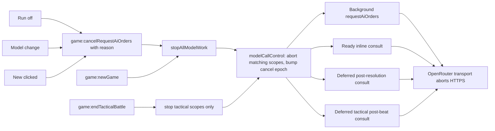

# Model Call Control: Execution Plan

Follow this document from the first section. The code blocks are sketches, not source to paste.

## Background

A model call that hangs (seen with xAI Grok 4.7 and StepFun Step 3.7 Flash) leaves the player stuck for minutes. In the captured `debug.log`, two 90-second timeouts happen back to back (`openRouter requestOrders: timeout`, attempts 1 and 2), and they show up only as debug lines. The activity log shows the line "AI request timed out. Please try again." twice, and that line doesn't say a retry is happening.

Root causes found in the code:

- `cancelRequestAiOrders` (in [src/main/gameIpcHandlers.ts](src/main/gameIpcHandlers.ts)) only aborts the background `game:requestAiOrders` controller (`requestAiOrdersControllerRef` in [src/main/main.ts](src/main/main.ts)). Three paths call the model with **no abort signal**:
  - the every-turn inline consult in `handleGameReady`;
  - the deferred post-resolution consult (`runEventDrivenAfterResolutionConsultation`);
  - the deferred tactical post-beat consult (`runEventDrivenAfterTacticalBeatConsultation`).
  
  Turning Run off while one of these runs leaves Ready locked, with the "AI:" timer counting until the consult ends (up to `AI_CONSULTATION_WAIT_TIMEOUT_MS`, 660 s). [doc/ux/right-panel-command-bar.md](doc/ux/right-panel-command-bar.md) documents this ("Turning Run off does not cancel a deferred consultation").
- `game:newGame` and `game:endTacticalBattle` clear the deferred-consult mutex but don't abort running model work. A late `afterResolution` can then call `setAiPendingOrders` against the next match. A late `handleNotifyResolutionPlaybackComplete` can also set `pendingPlaybackConsult = null`, wiping a newer pending record.
- In the renderer, `startBackgroundRequestIfAllowed` ([src/renderer/openRouter/openRouterRuntime.ts](src/renderer/openRouter/openRouterRuntime.ts)) has no request identity. A stale promise from a cancelled request can clear `S.backgroundRequestInFlight` or restart planning after teardown.
- `openNewGameOverlayFromModelTab` ([src/renderer/gameplay/newGame.ts](src/renderer/gameplay/newGame.ts)) returns early when `S.tacticalBattleSnapshot != null || S.resolutionMoveAnimation != null`.
- Changing the model doesn't affect a running call.

## Decisions (confirmed with the product owner)

- **Run off** stops every running or pending opponent model call, in both theaters: the background prefetch, the inline Ready consult, and both deferred consults. Turn resolution is never affected. A cancelled call just yields no opponent orders.
- **Model change** while a call is running cancels it. If Run is on and Ready is still waiting on a plan, planning restarts with the new model.
- **Exit Battle** during any tactical model call cancels it safely before the battle ends.
- **New** works at all times, in both theaters, including during resolution playback and tactical beat playback. Two modal dialogs are documented exceptions, because no model call runs while they are open: the melee "Tactical Battles" Fight/Ignore list and the tactical annihilation result.
- **Banner text** follows the selected new-game tab and updates live when the tab changes. The messages stay distinct:
  - Startup, Global: `Start the global game when ready.`
  - Startup, Regional: `Start the regional game when ready.`
  - New, Global: `Start a new global game when ready.`
  - New, Regional: `Start a new regional game when ready.`
  - Game over: unchanged (`You win!` / `You lose.`), and switching tabs does not change it.
- **Dev-only hang simulator:** environment variables that make the OpenRouter transport hang and time out quickly, so manual tests can reproduce timeouts, retries, and cancellation.
- Retry policy is unchanged: `AI_MODEL_REQUEST_TIMEOUT_MS` = 90 000 ms, `AI_MODEL_REQUEST_RETRY_COUNT` = 1, so 2 attempts.

## Target Architecture



Main-process pieces:

- `src/main/openRouter/modelCallControl.ts` (new): one registry of active scopes. Each scope is `strategic` or `tactical`, plus a monotonically increasing **cancel epoch**. Run off, a model change, New, and teardown abort every scope. Exit Battle aborts tactical scopes only.
- `src/main/matchGeneration.ts` (new): a counter bumped whenever opponent planning is stopped for a new game, including when the overlay opens, so an in-flight `game:ready` does not resolve the old turn.
- `src/main/ipc/modelWorkCancellation.ts` (new): `stopModelWork(reason, sendActivityLog)`. It is the single source of the player-facing cancel line, and it logs at most one line per call.

Renderer pieces:

- A background-request sequence number in `openRouterRuntime.ts`, so stale continuations do nothing.
- `src/renderer/core/matchEpoch.ts` (new): a counter bumped when New opens the overlay and when a match starts, so stale Ready, exit, and entry continuations do nothing.

## Outcomes That Must Not Change

These are easy to get wrong. Follow them even when an earlier sentence sounds broader.

- **Run off during the every-turn consult** (Events off, model call inside `game:ready`, before the turn resolves): abort the call, then still resolve the turn, with no model orders (`aiSkipped`). Do not retry that call. A retry would hold the turn open for another model attempt.
- **Run off, a model change, or New** aborts a post-resolution consult and a post-beat consult. **Exit Battle does not.** A strategic post-resolution consult can still be running after Fight has opened the battle. Leaving the battle must leave that consult running, and its result may still be stored and pushed. Today `game:endTacticalBattle` already drops a deferred consult that has not started; keep that. Do not add an abort of strategic scopes.
- **A cancelled consult must not call `clearAiPendingOrders`.** The failure branch in `afterResolution` clears stored opponent orders. Cancellation is not that branch. Return `{ consulted: false }` without storing and without clearing, so a plan stored by an earlier consult survives.
- **New, before Start,** bumps the match generation and aborts every scope. `handleGameReady` then returns `{ success: false }` without calling `deps.ready()`, so the old turn does not resolve behind the overlay. Run off and a model change do not bump the generation.
- **Opening New sets `S.readyRequestInFlight = false`** (the function already does this; keep it). A Ready handler that started before New must not clear that flag in `finally` if the renderer epoch changed, or it will unlock a Ready click that belongs to the new match. If it always cleared the flag, it would clear a newer Ready that started after Start.
- **One stop line per player action.** `game:endTacticalBattle` and the renderer teardown both run on Exit Battle. Log only when this call aborted at least one scope, or when New finds a deferred consult still pending. A second call that aborts nothing must not write another line.
- **Model-change restart has two shapes.** A background prefetch Ready is waiting on is restarted by the renderer after `setSelectedModel` resolves. A deferred consult that has already entered its runner retries once on main, reading `getSelectedModel()` again. A deferred consult that has not started (playback still running, Ready's label still "Ready") is skipped and is not re-armed; the next turn uses standing orders. Do not retry inside `game:ready`.
- **The repair call already receives `options.signal`** (`requestOrdersFlow.ts`, the `runParseRepairExchange` call). Do not add a second signal path. Do confirm the abort check at the top of the tool-loop round also runs before a repair that would otherwise start.
- **Code blocks in this document are behavior sketches.** Do not paste them. Every new function and field needs an orienting comment in the form required by `.cursor/rules/04-orienting-comments.mdc`. File names stay camelCase. Role suffixes are optional; do not invent a suffix to satisfy the naming contract, and do not use `Utils`, `Impl`, `Manager`, `Service`, `Processor`, or `Controller`.

## Rules for the Implementing Agent

- Follow every rule in `.cursor/rules/` and [AGENTS.md](AGENTS.md):
  - orienting comments on every new or changed function and field;
  - `logDebug` on public main-process entry points, `logError` in every `catch`, `logTrace` on getters;
  - `const` and `readonly` where possible;
  - camelCase file names;
  - no `Utils` / `Impl` suffixes.
- **Do not put phase numbers, step labels, or this document's name in code, comments, tests, or `doc/`.**
- Never commit or push.
- File-size limits: the desirable limit is 600 lines and the hard limit is 1000. [src/renderer/core/state.ts](src/renderer/core/state.ts) is at 969 lines and [src/renderer/entryCallbacks.ts](src/renderer/entryCallbacks.ts) is at 946, so **do not add fields or functions to either**. Use the new modules named below. [src/main/gameIpcHandlers.ts](src/main/gameIpcHandlers.ts) (776) and [src/renderer/gameplay/readyHandler.ts](src/renderer/gameplay/readyHandler.ts) (636) each get a mechanical extraction before you add code.
- Tests: only happy paths and essential failure cases, written with `node:test` and `assert`, in `src/main` or `src/shared`. Renderer code has no unit tests. Put testable renderer logic in small pure `src/shared` helpers.
- Verification commands, used throughout:
  - Fast loop: `npm run build:main`, then `node scripts/run-main-node-tests.cjs`, then `npm run lint`, then `npm run check:renderer-types`.
  - Full: `npm test` (it also runs naming and notices checks).
  - Run the app: `npm run build`, then `npm start`.
- Manual tests use the hang simulator from the transport phase. Put these lines in `.env` at the repo root (the app's working directory):

```
AGENT_WARS_LOG_LEVEL=debug
AGENT_WARS_SIMULATE_MODEL_HANG=all
AGENT_WARS_SIMULATE_MODEL_HANG_MS=20000
```

---

## Orientation and Baseline (No Code Changes)

1. Read [doc/README.md](doc/README.md), [doc/hybrid-ai.md](doc/hybrid-ai.md) (section "Consult loop bounds"), and [doc/ux-specification.md](doc/ux-specification.md). Then read these UX documents: [right-panel-model-tab.md](doc/ux/right-panel-model-tab.md), [right-panel-command-bar.md](doc/ux/right-panel-command-bar.md), [new-game-dialog.md](doc/ux/new-game-dialog.md), [modes-and-transitions.md](doc/ux/modes-and-transitions.md), [tactical-battle-controls.md](doc/ux/tactical-battle-controls.md), [ai-activity-log.md](doc/ux/ai-activity-log.md), and [control-tooltips.md](doc/ux/control-tooltips.md).
2. Run `npm test` and record that it passes. If it fails before any change, stop and report.

Done when: the baseline `npm test` passes.

---

## New-Game Banner Follows the Selected Tab

**Goal:** the banner strings listed under Decisions, updating live when the tab changes.

Steps:

1. Create `src/shared/newGameBannerText.ts`:

```ts
export type NewGameBannerKind = 'startup' | 'newGame';
export type NewGameMapTab = 'global' | 'regional';

export function newGameBannerText(kind: NewGameBannerKind, tab: NewGameMapTab): string {
  if (kind === 'startup') return `Start the ${tab} game when ready.`;
  return `Start a new ${tab} game when ready.`;
}
```

2. In [src/renderer/gameplay/newGameMapUi.ts](src/renderer/gameplay/newGameMapUi.ts), add an exported `selectedNewGameTab(): NewGameMapTab` that wraps the existing private `regionalTabSelected()`.
3. Create `src/renderer/gameplay/newGameBanner.ts`. Do **not** import `newGameMapUi.ts` from it, to avoid an import cycle. It holds a module-level `let bannerKind: NewGameBannerKind | null = null` and exports:
   - `showNewGameBanner(kind, tab)`: sets `bannerKind` and writes `#game-over-message` with `display: ''`.
   - `showGameOverBanner(text)`: sets `bannerKind = null` and writes the text.
   - `syncNewGameBannerToTab(tab)`: rewrites the message only when `bannerKind !== null`.
4. In `selectNewGameTab` (newGameMapUi.ts), call `syncNewGameBannerToTab(which)`.
5. In `updateGameOverUI` ([src/renderer/core/uiState.ts](src/renderer/core/uiState.ts)), replace the literal strings with `showGameOverBanner(...)` (win or loss) or `showNewGameBanner('startup', selectedNewGameTab())`.
6. In `openNewGameOverlayFromModelTab` (newGame.ts), replace the literal string with `showNewGameBanner('newGame', selectedNewGameTab())`.

Tests: add `src/shared/newGameBannerText.test.ts` with one test that asserts all four strings.

Docs:
- [doc/ux/new-game-dialog.md](doc/ux/new-game-dialog.md): update the message bullet in Information Displayed, say that the message follows the tab, and add `src/renderer/gameplay/newGameBanner.ts` and `src/shared/newGameBannerText.ts` to Code Entry Points.
- [doc/ux/modes-and-transitions.md](doc/ux/modes-and-transitions.md): update the message sentence in the New game paragraph.

Verify:
- Fast loop passes.
- Manual check: at startup, switching tabs flips global and regional in the startup message. Starting a game, then clicking New, shows the "new" variants and they flip with the tab. Game-over text does not change when the tab changes.

---

## Transport: Visible Retries, Abortable Waits, and the Hang Simulator

**Goal:** every timeout or retry produces one clear activity-log line. Cancellation during the retry wait is immediate. Developers can reproduce hangs.

Files:
- [src/main/openRouter/openRouterChatTransport.ts](src/main/openRouter/openRouterChatTransport.ts)
- new `src/main/openRouter/modelCallAttemptMessages.ts`
- new `src/main/openRouter/modelHangSimulation.ts`

Steps:

1. In `modelCallAttemptMessages.ts`, add `formatModelCallFailureLine(args)`. Its argument has these fields:
   - `cause: 'timeout' | 'httpStatus' | 'network' | 'streamStall'`
   - `attempt: number`
   - `maxAttempts: number`
   - `willRetry: boolean`
   - `timeoutMs?: number`
   - `status?: number`

   Exact output:
   - Timeout: `Model call timed out after 90s (attempt 1 of 2). Retrying...`, and on the last attempt `... (attempt 2 of 2). No retries left.` The seconds come from `Math.round(timeoutMs / 1000)`.
   - HTTP status: `Model call failed with HTTP 503 (attempt 1 of 2). Retrying...`
   - Network: `Model call network error (attempt 1 of 2). Retrying...` / `... No retries left.`
   - Stream stall: `Model response stream stalled (attempt 1 of 2). Not retried.`
2. In the transport, compute `maxAttempts = 1 + OPENROUTER_REQUEST_RETRY_COUNT` and `attempt = networkAttempt + 1`. The credit-clamp retry does not consume a network attempt, so do not use `sendOrdinal` here.
3. Replace each `payload.onLog(lastError, true)` in the timeout, stall, retryable-status, and network branches with one `payload.onLog(formatModelCallFailureLine(...), true)`, and keep the existing `logError` calls.
4. Set the returned `lastError` to short final strings, such as `Model call timed out after 2 attempts.` and `Model call network error after 2 attempts.`
5. Replace `delayMs(ms)` with `delayMs(ms, signal?: AbortSignal)`, which resolves early on abort. Right after each retry wait, add `if (parentSignal?.aborted) return { ok: false, error: 'Cancelled' };`.
6. In `modelHangSimulation.ts`, add:
   - `readModelHangSimulationMode(): 'off' | 'first' | 'all'`. It reads `AGENT_WARS_SIMULATE_MODEL_HANG` on every call; `first` and `all` are case-insensitive, and anything else means `off`.
   - `readModelHangSimulationTimeoutMs(): number`. It reads `AGENT_WARS_SIMULATE_MODEL_HANG_MS`, an integer clamped to the range 100 to `AI_MODEL_REQUEST_TIMEOUT_MS`, with a default of `15_000`.
   - `shouldSimulateModelHang(mode, networkAttemptIndex): boolean`. It returns true when the mode is `all`, or when the mode is `first` and the index is 0.
   - `waitForAbort(signal): Promise<never>`. It rejects with `new Error('AbortError')` when the signal aborts.
7. In the transport attempt loop, when `shouldSimulateModelHang(...)` is true:
   - use `attemptTimeoutMs = readModelHangSimulationTimeoutMs()` for the abort timer;
   - log `Simulating a hung model call (AGENT_WARS_SIMULATE_MODEL_HANG).` as an ordinary activity line;
   - `await waitForAbort(controller.signal)` instead of `postChatViaHttps`.

   The existing `catch` then takes the timeout path (or `Cancelled` if the parent signal aborted). Pass `attemptTimeoutMs` into the timeout message.

Tests (new `src/main/openRouter/openRouterChatTransport.test.ts`). Use `resolveOpenRouterChatTransport()`, make sure no override is set, and set `AGENT_WARS_SIMULATE_MODEL_HANG=all` and `AGENT_WARS_SIMULATE_MODEL_HANG_MS=100`. Restore the environment variables in `finally`.
- Two attempts, then failure: the result is `ok: false`, and `onLog` received exactly two failure lines containing `attempt 1 of 2` and `attempt 2 of 2`.
- Parent abort during the first hang: the result is `{ ok: false, error: 'Cancelled' }` within about 100 ms, with no `Retrying` line.
- `formatModelCallFailureLine`: one test for the timeout case with a retry left and one for the last attempt.

Docs:
- [doc/ux/ai-activity-log.md](doc/ux/ai-activity-log.md): add bullets for the failure and retry lines (they use error styling) and for the simulator line.
- [README.md](README.md): in "See the Prompts (and Everything Else)", document both variables as developer-only.
- [doc/hybrid-ai.md](doc/hybrid-ai.md): in the timeout bullet, say that each failed attempt writes an activity-log line.

Verify:
- Fast loop passes.
- Manual check with the simulator set to `all` and 20000 ms: turn Run on. The log shows the simulator line, `... (attempt 1 of 2). Retrying...`, then `... (attempt 2 of 2). No retries left.` After that comes the existing `Background planning failed: ...` line, and Ready unlocks.

---

## Main Process: One Cancellation Registry and a Cancel-All IPC

**Goal:** one main-side stop, used by the background path, `game:newGame`, and `game:endTacticalBattle`, with one player-facing line. Exit Battle stops tactical scopes only.

Steps:

1. Create `src/shared/ipc/modelCallCancelTypes.ts`:

```ts
export const MODEL_CALL_CANCEL_REASONS = ['run_off', 'model_changed', 'new_game', 'battle_exit', 'teardown'] as const;
export type ModelCallCancelReason = (typeof MODEL_CALL_CANCEL_REASONS)[number];
export function parseModelCallCancelReason(raw: unknown): ModelCallCancelReason; // unknown -> 'teardown'
export function modelCallCancelLogLine(reason: ModelCallCancelReason): string;
```

   The log lines are:
   - `run_off`: `Opponent planning stopped: Run was turned off.`
   - `model_changed`: `Opponent planning stopped: the model changed.`
   - `new_game`: `Opponent planning stopped for a new game.`
   - `battle_exit`: `Opponent planning stopped: you left the battle.`
   - `teardown`: `Opponent planning stopped.`
2. Create `src/main/openRouter/modelCallControl.ts`. Store the last cancel reason. `end()` is idempotent.

```ts
export type ModelCallTheater = 'strategic' | 'tactical';
export interface ModelCallScope { readonly signal: AbortSignal; readonly controller: AbortController; end(): void; }
export function beginModelCall(label: string, theater: ModelCallTheater): ModelCallScope;
export function cancelModelCalls(reason: ModelCallCancelReason, theater: ModelCallTheater | 'all'): number;
export function getLastModelCallCancelReason(): ModelCallCancelReason | null;
export function getModelCallCancelEpoch(): number;
export function hasModelCallCancelSince(epoch: number): boolean;
```

   `cancelModelCalls` always increments the epoch, aborts every matching scope, removes those scopes, and remembers `reason`. `theater: 'all'` aborts both theaters. `theater: 'tactical'` leaves strategic scopes untouched. `logDebug` the reason, theater, and aborted count.
3. Create `src/main/ipc/modelWorkCancellation.ts` with `stopModelWork(reason, sendActivityLog)`. In order:
   - Read whether a deferred consult is pending, and its tag (`strategic-ready`, `melee-resolve`, or `tactical-beat`).
   - If `reason === 'new_game'`, call `advanceMatchGeneration('new_game')` and `clearDeferredPlaybackConsultPending()`. Do this even when nothing is in flight. This is the only place that bumps the generation.
   - `const aborted = cancelModelCalls(reason, reason === 'battle_exit' ? 'tactical' : 'all')`.
   - Send the activity line only when `aborted > 0`, or when `reason === 'new_game'` and a deferred consult was pending. Do not log for `battle_exit` merely because a strategic consult is pending.
   - `logDebug` the reason, aborted count, and whether a deferred consult was pending.
4. In `handleRequestAiOrders`, open `beginModelCall('background requestAiOrders', activeTactical ? 'tactical' : 'strategic')` before `requestOrders`. Keep the existing supersede: abort `deps.controllerRef.current` when it is set, then point it at `scope.controller`. Do not `end()` the previous scope here; the previous request's `finally` does that. Pass `scope.signal`. Call `scope.end()` in `finally`.
5. In [src/main/main.ts](src/main/main.ts):
   - Add `sendActivityLog(line)` that sends on `IPC_OPENROUTER.log`.
   - `IPC_GAME.cancelRequestAiOrders`: accept `{ reason?: unknown }`, call `stopModelWork(parseModelCallCancelReason(payload?.reason), sendActivityLog)`, then the existing `cancelRequestAiOrders(requestAiOrdersControllerRef)`.
   - `IPC_GAME.newGame`: call `stopModelWork('new_game', ...)` first. Do not bump the generation again.
   - `IPC_GAME.endTacticalBattle`: call `stopModelWork('battle_exit', ...)` before the existing `clearDeferredPlaybackConsultPending()`.
6. Update [src/main/preload.ts](src/main/preload.ts) and [src/shared/ipc/gameApiTypes.ts](src/shared/ipc/gameApiTypes.ts) to `cancelRequestAiOrders: (payload?: { reason?: ModelCallCancelReason }) => Promise<void>`. The channel name stays `game:cancelRequestAiOrders`, because it is frozen.
7. In [src/main/openRouter/requestOrdersFlow.ts](src/main/openRouter/requestOrdersFlow.ts), remove the `onLog('Cancelled.')` activity line and keep a `logDebug` there instead, so the cancel line appears once.
8. In [src/main/openRouter/requestOrdersToolLoop.ts](src/main/openRouter/requestOrdersToolLoop.ts), add `if (signal?.aborted) return { kind: 'fail', error: 'Cancelled' };` at the top of each round.

Tests:
- New `src/main/openRouter/modelCallControl.test.ts`:
  - `cancelModelCalls(..., 'all')` aborts a strategic scope and a tactical scope, returns 2, and changes the epoch;
  - `cancelModelCalls(..., 'tactical')` aborts only the tactical scope;
  - a scope ended before the cancel is not counted.
- Update `src/main/gameIpcHandlers.test.ts`: the existing cancel test still passes, and add one case where stopping for `run_off` aborts the signal handed to `requestOrders`.

Docs: none yet. The behavior docs change together with the renderer phases.

Verify:
- Fast loop passes.
- Manual check with the simulator: turn Run on, then off within 5 s. The activity log shows `Opponent planning stopped: Run was turned off.` right away, with no timeout line afterward. `debug.log` shows `modelCallControl cancelAllModelCalls` with `abortedCount: 1`.

---

## Main Process: Every Consult Path Is Cancellable and Stale-Safe

**Goal:** the inline Ready consult and both deferred consults honor cancellation. A cancel issued before a deferred consult starts skips it. A late completion never writes into a newer match or over a newer pending record. Exit Battle does not abort a strategic consult. A model change retries a deferred consult that has already started, once.

Steps:

1. **Mechanical extraction (no behavior change).** Move `handleResolveMeleeIntercept` and `ResolveMeleeInterceptDeps` from `gameIpcHandlers.ts` into a new `src/main/ipc/meleeInterceptResolveIpc.ts`, and re-export both from `gameIpcHandlers.ts` so `main.ts` and the tests keep compiling. Run the fast loop before continuing.
2. Create `src/main/matchGeneration.ts` with `getMatchGeneration()` (`logTrace`) and `advanceMatchGeneration(reason: string)` (`logDebug`). Do not call it from `game:newGame`; `stopModelWork` already does when the reason is `new_game`.
3. `handleGameReady`:
   - Capture `const matchGenerationAtStart = getMatchGeneration()` at entry.
   - Wrap only the every-turn inline `deps.requestOrders` in `beginModelCall('ready inline consult', 'strategic')`, pass `signal`, and `end()` in `finally`. Add `signal?: AbortSignal` to the `ReadyDeps.requestOrders` options.
   - A `Cancelled` result takes the existing `aiSkipped` branch. Do not return early. The turn still resolves.
   - On the line immediately before `deps.ready()`, with no `await` between them: if `getMatchGeneration() !== matchGenerationAtStart`, return `{ success: false, reason: 'A new game started before this turn finished.' }` and do not call `deps.ready()`.
4. `afterResolution` and `afterTacticalBeatResolution` ([src/main/openRouter/afterResolution.ts](src/main/openRouter/afterResolution.ts)):
   - Add `signal?: AbortSignal` to both deps interfaces and their `requestOrders` option types, and pass `signal: deps.signal`.
   - Immediately after each `await deps.requestOrders(...)`: if `deps.signal?.aborted` or the result error is `Cancelled`, `logDebug` and return `{ consulted: false }` (tactical: also `attachTacticalOpponentPlanToIpc: false`). Do this before `setAiPendingOrders` and before the existing `clearAiPendingOrders` on the failure branch. A real failure still clears; a cancel does not.
5. In both runners in [src/main/ipc/readyIpcResolutionMapping.ts](src/main/ipc/readyIpcResolutionMapping.ts):
   - Theater is `strategic` for post-resolution and `tactical` for post-beat.
   - Read `getSelectedModel()` when the attempt starts and use it when it is non-empty, so a model saved before the attempt is the one consulted.
   - Open a scope, pass its signal, and `end()` it in `finally`.
   - The outer timeout aborts that scope's controller, then rejects. Keep the timer handle and `clearTimeout` it in `finally`. The timer leaks today.
   - After a finished attempt, if the signal aborted, `getLastModelCallCancelReason() === 'model_changed'`, and this was the first attempt, run one more attempt with a new scope. Any other reason, including `new_game` and `run_off`, does not retry. Two attempts is the cap.
   - Add `signal?` to the `requestOrders` option types on `DeferredStrategicResolutionConsultArgs` and `DeferredTacticalBeatConsultArgs`.
6. [src/main/ipc/deferredResolutionPlaybackConsult.ts](src/main/ipc/deferredResolutionPlaybackConsult.ts):
   - Add `cancelEpoch: number` to each pending variant. Set it inside the three `setPending*` functions from `getModelCallCancelEpoch()`. Do not change their callers.
   - After a payload matches and before the consult: if `hasModelCallCancelSince(pending.cancelEpoch)`, set `pendingPlaybackConsult = null`, push an empty result (`{ planningTurnNumber }` or `toTacticalPostBeatConsultFields(battleId, {})`), `logDebug` the skip, and return `{ ok: true }`. This covers Run off and New during playback, before the consult starts. It also covers a model change during playback: that consult is skipped, not restarted.
   - Capture `getMatchGeneration()` before the `await`. After it:
     - If the generation changed, do not push and do not clear a newer pending record. `logDebug` and return `{ ok: false, reason: 'Deferred consultation finished after a new game started.' }`.
     - If `pending.tag === 'tactical-beat'` and `pendingPlaybackConsult !== pending`, do not push. This is Exit Battle or a newer battle consult.
     - If `pendingPlaybackConsult !== null && pendingPlaybackConsult !== pending`, do not push and do not clear the newer record.
     - Otherwise set `pendingPlaybackConsult = null` and push. A strategic consult whose slot was cleared by Exit Battle still pushes when the generation matches, so the renderer latch clears and stored orders are reported. That is today's behavior; keep it.
7. Update the comment on `AI_CONSULTATION_WAIT_TIMEOUT_MS` in [src/shared/aiConsultationLimits.ts](src/shared/aiConsultationLimits.ts): the waiter now aborts the in-flight call when it gives up.

Tests:
- `deferredResolutionPlaybackConsult.test.ts`:
  - a cancel between `setPendingStrategicReadyConsult` and notify skips the consult (the `requestOrders` spy is never called), clears the pending record, and pushes `{ planningTurnNumber }`;
  - `clearDeferredPlaybackConsultPending()` during a slow consult leads to no push after it completes. Use a `requestOrders` that awaits a deferred promise, and make `useEventDrivenConsultation: true` reach the model in the fixture, or test at the runner level if the fixture makes that impractical.
- `gameIpcHandlers.test.ts`: generation advancing during the inline consult makes `handleGameReady` return `success: false` and the `ready` spy is never called. A `Cancelled` result with the generation unchanged still calls `ready`.
- `readyIpcResolutionMapping.test.ts`: the outer timeout aborts the signal handed to `requestOrders`. A first attempt aborted with reason `model_changed` runs a second attempt; reason `run_off` does not.
- One consult-level test, on `afterResolution` or the runner: a `Cancelled` result does not call `clearAiPendingOrders`.

Docs: [doc/hybrid-ai.md](doc/hybrid-ai.md). Add a bullet in "Consult loop bounds": Run off, a model change, and New abort every consultation; Exit Battle aborts tactical consultations only. A model change retries a deferred consult that has already started, once. The post-resolution waiter aborts the call when it times out. Run the check described after the engine constants table in [doc/README.md](doc/README.md). The constant values do not change.

Verify:
- Fast loop passes.
- Manual check: turn on Events (the default), turn Run on, press Ready during strategic planning, then turn Run off while the post-resolution consult runs (the "AI:" label is counting after playback). Ready unlocks within about a second, and the log shows the stop line.

---

## Renderer: Run Off and Model Change Always Work

**Goal:** Run off and a model change take effect immediately in both theaters, and stale background results are ignored.

Steps:

1. In [src/renderer/openRouter/openRouterRuntime.ts](src/renderer/openRouter/openRouterRuntime.ts):
   - add module-level `let backgroundRequestSequence = 0;`;
   - export `invalidateBackgroundAiRequest(): void`, which does `backgroundRequestSequence += 1; S.backgroundRequestInFlight = false;`.
   - In `startBackgroundRequestIfAllowed`, set `const requestSequence = ++backgroundRequestSequence;` at the point where `S.backgroundRequestInFlight = true` is set. Start **every** `.then`/`.catch` callback, including the outer key/model one, with `if (requestSequence !== backgroundRequestSequence) return;`.
   - Keep the race timer handle and clear it when the race settles.
2. In the same file, export `stopOpponentPlanning(reason: ModelCallCancelReason): Promise<void>`. It calls `invalidateBackgroundAiRequest()`, then `await window.gameApi?.cancelRequestAiOrders?.({ reason })`, catching and `console.error`-ing failures.
3. In the Run button handler, off branch ([src/renderer/openRouter/openRouterControls.ts](src/renderer/openRouter/openRouterControls.ts)), call `void stopOpponentPlanning('run_off')` instead of the bare IPC call.
4. Model `change` handler, same file:
   - `await api.setSelectedModel(modelSelect.value)` **first**, so main reads the new model before any restart.
   - Then, if `S.runButtonOn` and (`S.backgroundRequestInFlight` or `isDeferredResolutionPlaybackConsultPending()`), `await stopOpponentPlanning('model_changed')` and call `deps.startBackgroundRequestIfAllowed()`.
   - That restart covers a prefetch Ready is waiting on. It no-ops while a deferred latch is still set; the deferred runner on main retries that consult itself, once. Do not add a second renderer retry for it.
   - Keep the existing UI updates.
5. Pass a reason in every other `cancelRequestAiOrders` caller:
   - `handleEventDrivenModeTransition`: `teardown`, and call `invalidateBackgroundAiRequest()` first;
   - `syncOpenRouterRunToggleInteractable` in entryCallbacks.ts: `run_off`, as a one-argument edit only;
   - [src/renderer/tactical/tacticalAnnihilationDialog.ts](src/renderer/tactical/tacticalAnnihilationDialog.ts): `teardown`;
   - the non-abort `catch` in `startBackgroundRequestIfAllowed`: `teardown`.
6. In `cancelInFlightBackgroundAiRequestForRendererTeardown`, drop the `logLine` parameter and the two `OPEN_ROUTER_LOG_BACKGROUND_AI_CANCEL_*` constants. Main writes the only stop line. The body is `invalidateBackgroundAiRequest()`, then `void window.gameApi?.cancelRequestAiOrders?.({ reason: 'battle_exit' })`, then `unblockPrecomputedAiPlanningAfterBackgroundFailure()`, then `updateReadyButtonState`. Both callers in [src/renderer/tactical/tacticalUiOrchestration.ts](src/renderer/tactical/tacticalUiOrchestration.ts) use this. `battle_exit` aborts tactical scopes only, so a second call from Exit Battle (main already stopped them) aborts nothing and does not log again. The reconcile path still needs this IPC, because main has not stopped the tactical prefetch.

Tests: none, because this is renderer code. Run the fast loop, including `npm run check:renderer-types`.

Docs:
- [doc/ux/right-panel-model-tab.md](doc/ux/right-panel-model-tab.md): Run off stops every running or pending opponent model call, including deferred consultations, and the turn still resolves. A model change restarts a prefetch Ready is waiting on, and retries a deferred consult that has already started. A model change during playback, before that consult starts, skips it.
- [doc/ux/right-panel-command-bar.md](doc/ux/right-panel-command-bar.md): replace "Turning Run off does not cancel a deferred consultation, so its label keeps counting until that consultation ends."
- [doc/ux/ai-activity-log.md](doc/ux/ai-activity-log.md): add the stop lines.
- [doc/ux/control-tooltips.md](doc/ux/control-tooltips.md) and `runEnabledTooltipText` in [src/renderer/chrome/controlTooltipText.ts](src/renderer/chrome/controlTooltipText.ts): change the wording only if "off cancels a plan that is still running" is now inaccurate. It is still accurate, so leave it unless the tests require otherwise.

Verify (manual, simulator `all` with 20000 ms; record each result):
- Strategic prefetch: turn Run off during the hang. The stop line appears, the "AI:" label stops, and Ready unlocks.
- Strategic prefetch: change the model during the hang. The stop line appears, and a new `AI round 1` line follows for the new model, which `debug.log` shows in `postOrdersChatRequest`.
- Tactical: enter a battle with Run on, then repeat both checks during the tactical prefetch.
- Event-driven post-beat consult in tactical: commit a beat, and after playback turn Run off. Ready unlocks.
- Quickly toggling Run off, on, off, on leaves exactly one request in flight. `debug.log` shows one active `requestOrders` per toggle-on and no duplicate `AI round 1` lines in the same second.

---

## Tactical: Exit Battle During a Model Call

**Goal:** Exit Battle is clickable during any tactical model call, and the call is cancelled before the battle ends.

Steps:

1. Confirm by reading the code that Exit Battle stays enabled while a model call runs. `syncTacticalExitButtonElementVisibility` ([src/renderer/tactical/tacticalExitButtonDom.ts](src/renderer/tactical/tacticalExitButtonDom.ts)) disables it only for no battle, `!S.tacticalPhasePlanning`, playback, or annihilation. If you find any model-wait condition there, remove it.
2. `game:endTacticalBattle` stops tactical scopes only. It must not abort a strategic post-resolution consult that is still running after Fight. The renderer teardown invalidates the background sequence so a stale `Cancelled` continuation cannot restart tactical planning during the Ready that follows the exit.
3. In `tacticalPerformBattleExit` ([src/renderer/tactical/tacticalExitFlow.ts](src/renderer/tactical/tacticalExitFlow.ts)), call `invalidateBackgroundAiRequest()` **before** `await io.endTacticalBattle()`.

Tests:
- `modelCallControl.test.ts` already covers tactical-only cancel. Add one deferred-consult case: `clearDeferredPlaybackConsultPending()` during a slow tactical consult, then `setPendingStrategicReadyConsult`. The late tactical completion does not clear the new strategic record and does not push.
- A strategic scope left open across `cancelModelCalls(..., 'tactical')` is still not aborted. That test lives with the registry tests; do not duplicate it.

Docs: [doc/ux/tactical-battle-controls.md](doc/ux/tactical-battle-controls.md). Extend "Leaving the battle cancels in-flight opponent planning for that battle" to include the post-beat consultation. Say Exit Battle is never disabled by a running model call, and that a strategic consult still running from the world-map turn is not cancelled.

Verify (manual, simulator `all`):
- Click Exit Battle during the tactical prefetch. The battle ends, the stop line appears once, strategic Ready runs, and no tactical result is applied later.
- Click Exit Battle during a deferred post-beat consult. Same result, and the strategic Ready that follows is not blocked by "Resolution playback consultation is still in progress."

---

## New Works at All Times

**Goal:** clicking New opens the overlay in both theaters, including during playback and while any model call runs. It stops model work and playback immediately, and no stale continuation can disturb the overlay or the next match. The two modal dialogs (melee list and annihilation) remain exceptions.

Steps:

1. **Mechanical extraction (no behavior change).** Move the tactical-commit branch of `handleReadyButtonClick` (the `if (S.tacticalBattleSnapshot && S.tacticalPhasePlanning) { ... }` block) into `runTacticalReadyCommit(context)` in a new `src/renderer/gameplay/readyTacticalCommit.ts`. Pass a single context object with `deps`, `toolCountsBeforeReadyClick`, `cachedPrecomputedToolCountsAtReadyStart`, and `matchEpoch`. Run the fast loop and smoke-test a tactical beat before continuing.
2. Create `src/renderer/core/matchEpoch.ts`:

```ts
let matchEpoch = 0;
export function currentMatchEpoch(): number { return matchEpoch; }
export function advanceMatchEpoch(): number { matchEpoch += 1; return matchEpoch; }
export function isMatchEpochCurrent(epoch: number): boolean { return epoch === matchEpoch; }
```

3. Export `clearResolutionPlaybackAnimationState` from tacticalUiOrchestration.ts (it is file-private today). Add `isNewGameOverlayOpen(): boolean` to uiState.ts; it is true when `#game-over-overlay` lacks `hidden`.
4. Rewrite the guard section of `openNewGameOverlayFromModelTab` (newGame.ts):
   - `if (S.tacticalAnnihilationOutcomeDialog != null) return false;` This is the documented exception; the panel cannot be clicked then anyway.
   - Remove the `tacticalBattleSnapshot` and `resolutionMoveAnimation` early return.
   - `advanceMatchEpoch();`
   - `void stopOpponentPlanning('new_game');` This IPC bumps the main match generation and aborts every scope, so an in-flight `game:ready` does not resolve the old turn. Do not wait for Start to do that.
   - `clearResolutionPlaybackAnimationState();`
   - `if (S.tacticalBattleSnapshot && S.gameState) tacticalReleaseRendererSessionForNewStrategicMatch(S.gameState);` This releases the tactical map view and HUD so the preview frames correctly. Main keeps its session until Start, and `game:newGame` already ends it.
   - Keep the existing resets and the rest of the function.
5. In `registerNewGameButton` (Start click), call `advanceMatchEpoch()` at the start of the handler.
6. Add stale guards. Capture `const matchEpoch = currentMatchEpoch()` at entry. After every `await`, return before any renderer write when `!isMatchEpochCurrent(matchEpoch)`. The check has to be on the line before the write, not after it. `applyGameStateSnapshot` restores or tears down a battle and replaces `S.gameState`; calling it and then checking is already too late. In `handleReadyButtonClick` those writes are the three `deps.applyGameStateSnapshot` calls and the later `deps.updateGameOverUI(state)`. Cover the same pattern in `runTacticalReadyCommit`, in `tacticalPerformBattleExit`, and in `startTacticalBattleFromEntryHex` ([src/renderer/tactical/tacticalEntryFlow.ts](src/renderer/tactical/tacticalEntryFlow.ts)) after `prepareStrategicUiBeforeTacticalStart` and after the IPC. In the Ready `finally`, set `S.readyRequestInFlight = false` and refresh the button only when the epoch is still current. Opening New already clears that flag; a stale `finally` must not clear it again after a newer Ready has set it.
7. Make `startBackgroundRequestIfAllowed` return early when `isNewGameOverlayOpen()`.
8. In the deferred push listeners (`initDeferredResolutionPlaybackPushListeners` in openRouterControls.ts), when `isNewGameOverlayOpen()`, clear the matching latch and return. Do not show toasts or start requests.
9. Update the New tooltip in **both** `static/index.html` (`#openrouter-new-btn` `data-control-tooltip`) and `newButtonTooltipText` in controlTooltipText.ts: `Open the new-game screen. Opponent planning and any playback stop right away; the current match is replaced when you start the new one.` Update the orienting comments on `openNewGameOverlayFromModelTab` in newGame.ts and entryCallbacks.ts. In entryCallbacks.ts, change only the comment.

Tests: none, because this is renderer code. If a source-contract test under `src/main/*Contract*.test.ts` pins the old tooltip or the early-return text, update that assertion to the new contract.

Docs:
- [doc/ux/right-panel-model-tab.md](doc/ux/right-panel-model-tab.md): New works in every mode where the panel is reachable. Name the two modal exceptions.
- [doc/ux/new-game-dialog.md](doc/ux/new-game-dialog.md): update Availability and "Strategic and Tactical Differences", which currently says "The overlay is not used inside a battle".
- [doc/ux/modes-and-transitions.md](doc/ux/modes-and-transitions.md): add the transitions Tactical planning, Tactical resolution, and strategic Resolution to New game, in the transition list and in the mermaid diagram.
- [doc/ux/control-tooltips.md](doc/ux/control-tooltips.md): the New tip text, and Source Anchors if any path moved.
- Add `readyTacticalCommit.ts` to Code Entry Points wherever `readyHandler.ts` is listed. Search `doc/` for `readyHandler.ts`.

Verify (manual, simulator `all`):
- Strategic planning during the prefetch hang: click New. The overlay opens, `debug.log` shows the cancel, and no timeout line follows. Start game works.
- During strategic resolution playback: click New. Playback stops, the overlay opens, and Start game works.
- Tactical planning during the prefetch hang: click New. The tactical HUD hides, the preview frames the world or region correctly, and Start game works.
- During tactical beat playback: same as above.
- During a deferred post-beat consult: same as above. After Start, the new match's first Ready is not blocked.
- While the overlay is open, no `postOrdersChatRequest` appears in `debug.log`.
- Events off, Ready clicked, New clicked while the inline model call is still hanging: the overlay opens and the turn does not resolve. `debug.log` does not show a successful `handleGameReady` resolution after the cancel. Start game then works.

---

## Documentation Sweep and Final Verification

1. Search `doc/` for these old strings and fix any that are left:
   - `world map game when ready`
   - `does not cancel a deferred`
   - `During a battle or resolution playback the click does nothing`
   - `not used inside a battle`
   - `AI request timed out`
   - `Cancelled.`

   Leave the historical documents alone ([doc/devleopment-plan-v3.4.md](doc/devleopment-plan-v3.4.md), [doc/poc-analysis.md](doc/poc-analysis.md), [doc/market-research.md](doc/market-research.md)).
2. Confirm that README documents `AGENT_WARS_SIMULATE_MODEL_HANG` and `AGENT_WARS_SIMULATE_MODEL_HANG_MS` as developer-only.
3. Confirm that no identifiers from this document (phase or step names) appear in `src/`, `doc/`, or tests.
4. Run `npm test`. Then `npm run build` and `npm start`, and repeat one manual check from each phase with the simulator set to `first`: the first attempt hangs, the retry goes to OpenRouter for real, and the consult succeeds after a `Retrying...` line.
5. Remove the simulator lines from `.env`.
6. In the final summary, list the changed `doc/` files and any disagreement between the docs and the code that you could not resolve.

