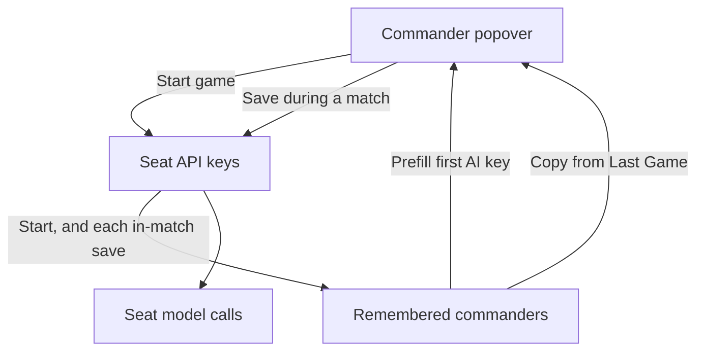

# OpenRouter key on opponent setup

Audience: a lower-quality coding agent. Implement one phase at a time. Stop after each phase and report files touched, test results, and any doc updated. Wait for the human before the next phase. If a phase fails, revert that phase. If a line in this plan disagrees with the code, trust the code, stop, and report the discrepancy.

## Goal

The API key is the first field in the commander popover, on the new-game screen and during a match. The Command tab has no key field and no model-list refresh button. Each AI opponent’s consultations use that opponent’s key. An empty key means that opponent does not call the model. The model-list refresh button sits to the right of the model selector inside the popover and uses the key in that popover.

The button that today says “Use for every opponent” is removed. On the new-game screen only:

- The first AI row’s button is “Copy from Last Game (Opponent 1)”, or “Copy from Last Game (Side 1)” while Observe is on. It copies the key, model, reasoning effort, and doctrine from the remembered first AI opponent. With no remembered match, the button is disabled and its label is “No previous game”.
- Each later AI row’s button copies from the AI row just above it: Opponent 2 copies Opponent 1, Opponent 3 copies Opponent 2, and the same with Side while Observe is on. The label is “Copy from ” plus that row’s existing name from `rowLabel`. The copy includes the key, model, reasoning effort, and doctrine currently on that previous row.

During a match the popover has no copy button and no apply-all button.

Every new game fills the first AI row’s password field with the remembered first opponent’s key (masked). Later AI rows start with an empty key. The remembered record is written when a match starts and updated when a commander is saved during that match, so a key changed during the match is what the next game pre-fills. Clearing the key on the new-game screen, then closing without starting, does not change that record. The next open fills the first AI row from the record again.

## Locked decisions

- One key per AI opponent, used as the `Authorization` bearer for that seat’s consultations and for a model-list refresh started from that popover.
- The key is a password field. The value is in the field, masked. It is never written to the activity log, a tooltip, a commander summary, `doc/`, or a log line.
- Persistence uses the existing `safeStorage` pattern in [`src/main/openRouter/openRouter.ts`](src/main/openRouter/openRouter.ts) (`saveKey` / `loadKey`). Encrypt when encryption is available. The fallback when it is not available matches `saveKey`. Do not add a seats-table column and do not change `EXPECTED_USER_VERSION`.
- Keys live in `game_config`, not on `SeatSnapshot` as a string. `SeatCommander` gains a boolean `hasApiKey` so Run can see that a key exists. The secret itself is returned only by the two IPCs named in Phase 2, and only so a password field can show it.
- A machine that already has `openrouter_api_key` and no remembered match yet still pre-fills opponent 1 from that stored key. “Copy from Last Game” stays disabled until a match has been snapshotted under this work.
- If the seat-key map has never been written, a consultation may use the legacy `openrouter_api_key` value. A stored empty string does not fall back. A new match that sends `seats` writes a row for every AI seat, including empty strings, so the fallback applies only to a match saved before this work. A new-game payload with no `seats` array leaves the map unwritten.
- `hasKey()` stays the global “some key exists” check used by Ready and post-resolution. It is true when the legacy key is non-empty or any seat flag is true. It does not choose which secret is sent. `requestOrders` sends `readSeatApiKey(seatId)`. The activity-log line `No API key set.` is emitted inside `requestOrders`, so a seat that has a model still reaches `requestOrders` when some key exists. Do not add an earlier return that skips that line.
- Auto-start AI looks at the new-game rows, not at the Run button. Planning starts when the box is checked and at least one AI row has a non-empty key and a model. During a match, Run is enabled when at least one active AI seat has `hasApiKey` and a model. Losing the last such pair turns Run off, as today.
- Changing the map tab or region still rebuilds the side rows. After that rebuild, opponent 1’s key is the remembered key again. Later rows have an empty key again. Adding or removing a side, editing a commander, and the copy button do not run that prefill.
- Observe labels use the names `rowLabel` already returns (`Side 1`, not a hard-coded “Opponent”).
- Do not commit or push. Do not put phase numbers or the words from this plan’s headings into code, comments, tests, or `doc/`.

## Working rules

- Shell is Windows PowerShell at `F:\Projects\Personal\agent-wars-public`. Run one command at a time. Do not chain with `&&`.
- Keep each file’s existing line endings. New files use CRLF.
- Orienting comments on every new or changed field and function: Purpose, When to use, Expected outcome, Exceptions. Match the file you are editing.
- `logDebug` on new or updated public main-process functions, `logError` on caught exceptions, `logTrace` on getters that do not change state. Log seat ids, booleans, and lengths. Never log `apiKey`, a transport payload’s `key`, or a config blob that contains a key.
- Tests cover the happy path and the essential failure. Fake keys are the literals `test-openrouter-key` and `test-openrouter-key-b`, and the test file says they are for testing.
- Desirable file size is 600 lines. [`src/main/openRouter/openRouter.ts`](src/main/openRouter/openRouter.ts) is already past that. Do not add functions to it. [`src/renderer/openRouter/commanderPopover.ts`](src/renderer/openRouter/commanderPopover.ts) is about 400 lines. If the popover edit would pass 600, put the field builders in a new `commanderPopoverFields.ts` beside it.
- `npm test` is the gate. It builds, lints, checks names, and runs `dist/**/*.test.js`. A new `*.test.ts` under `src/main` or `src/shared` is picked up automatically. Do not edit `package.json` to register a test. Do not refresh `scripts/circular-deps-baseline.json` or grow `scripts/renderer-typecheck-baseline.json`.
- When a phase edits `src/renderer` or `static/`, also run `npm run build:renderer`. Leave `static/renderer.js` changed.
- Argument lists stay at or below 6. Use `readonly` and `const` for values that are not reassigned.
- [`src/main/openRouter/commanderKeyMemory.ts`](src/main/openRouter/commanderKeyMemory.ts) must not import [`src/main/openRouter/openRouter.ts`](src/main/openRouter/openRouter.ts). `openRouter.ts` already imports the request flow. A reverse import cycles. The IPC handler passes `loadKey()` in.

## Data flow



Remembered JSON, in AI-number order (`aiSeatIdForIndex(1)` is index 0):

```ts
interface RememberedCommander {
  readonly modelId: string | null;
  readonly reasoningEffort: string | null;
  readonly doctrineChoice: DoctrineChoice;
  readonly apiKey: string;
}
```

`game_config` keys, spelled exactly:

- `openrouter_commander_memory` — encrypted JSON array of `RememberedCommander`
- `openrouter_seat_api_keys` — encrypted JSON object of seat id to key string
- `openrouter_seat_api_key_flags` — plain JSON object of seat id to boolean, written in the same function as the encrypted seat keys

`NewGameCommanderInput` in [`src/shared/ipc/ordersTypes.ts`](src/shared/ipc/ordersTypes.ts) gains an optional `apiKey?: string`. Missing means empty in the UI helpers. On match start, a missing `apiKey` stores the legacy key for that seat; a present string, including `''`, is stored as given after trim.

The nth AI entry in `payload.seats`, skipping human rows and keeping payload order, belongs to `aiSeatIdForIndex(n)` with n starting at 1. That is the order [`assignSeatIdentity`](src/main/gameDb/seatResolution.ts) already uses. Do not zip the payload with roster index 0. The human seat is first in the stored roster and has no key.

## Phase 1: Copy and prefill rules

**Goal.** Pure functions only. The app behaves as it does today.

**Create** [`src/shared/commanderSetupCopy.ts`](src/shared/commanderSetupCopy.ts):

- `commanderApiKey(commander: NewGameCommanderInput | null): string` — trimmed `apiKey`, or `''`.
- `prefillFirstAiApiKey(state: NewGameSidesState, apiKey: string): NewGameSidesState` — replaces the first AI row’s commander with a shallow copy whose `apiKey` is the trimmed key. Other rows are unchanged. Does not mutate the shared default commander object. A state with no AI row is returned as given.
- `previousAiRowIndex(state: NewGameSidesState, index: number): number | null` — the nearest earlier AI row, or null for the first AI row and for a bad index.
- `copyButtonState(state, index, hasPreviousMatch: boolean): { label: string; disabled: boolean; source: 'previous-match' | 'previous-opponent' } | null` — null when the row is not AI. First AI row with a previous match: enabled, label `Copy from Last Game (${rowLabel})`, source `previous-match`. First AI row without one: disabled, label `No previous game`, source `previous-match`. Later AI row: enabled, label `Copy from ${rowLabel(previous)}`, source `previous-opponent`.

**Create** [`src/shared/commanderSetupCopy.test.ts`](src/shared/commanderSetupCopy.test.ts). Use the homes and commander fixture style in [`src/shared/newGameSides.test.ts`](src/shared/newGameSides.test.ts).

- Prefill writes the key only onto the first AI row of a human-plus-two-AI state, and only onto Side 1 when Observe is on. A second AI row that shared the default object still has an empty key.
- Opponent 3’s source index is Opponent 2’s row, and the label is `Copy from Opponent 2`. Opponent 2’s label is `Copy from Opponent 1`.
- With Observe on, Side 2’s label is `Copy from Side 1`, and Side 1 with no previous match is disabled with `No previous game`.
- A missing `apiKey` reads as `''`.

**Verify:** `npm test`. No `doc/` edits.

## Phase 2: Encrypted memory and seat keys

**Goal.** The main process can store and read the snapshot and the per-seat keys. Consultations still use `loadKey()`. The screen is unchanged.

**Create** [`src/main/openRouter/secretConfig.ts`](src/main/openRouter/secretConfig.ts). Move the `game_config` encrypt and decrypt steps used by `saveKey` and `loadKey` into `readSecretString(configKey: string): string` and `writeSecretString(configKey: string, value: string): void`. `saveKey` and `loadKey` call those for the database value and keep the legacy file migration they already have. A round-trip through `saveKey` / `loadKey` still returns the same string. An empty `writeSecretString` deletes that config row, matching `saveKey('')`.

**Create** [`src/main/openRouter/commanderKeyMemory.ts`](src/main/openRouter/commanderKeyMemory.ts). It uses `secretConfig` and `dbRun` / `dbGetOne`. It does not import `openRouter.ts`.

**Create** [`src/main/gameDb/seatApiKeyFlags.ts`](src/main/gameDb/seatApiKeyFlags.ts) for the plain flag map. It does not import Electron or `openRouter`. `commanderKeyMemory` imports the config-key constant from this file so the string is written in one place. `gameDb.ts` must not import `openRouter`.

Public surface of `commanderKeyMemory`:

- `readCommanderKeyMemory(legacyKey: string): { hasPreviousMatch: boolean; prefillApiKey: string; previousMatch: readonly RememberedCommander[] }`
  - No snapshot: `hasPreviousMatch` false, `previousMatch` empty, `prefillApiKey` equal to `legacyKey`.
  - Snapshot present: `hasPreviousMatch` true, `prefillApiKey` equal to the first entry’s `apiKey` (may be empty), `previousMatch` the stored array. `legacyKey` is ignored.
- `writeCommanderKeyMemory(commanders: readonly RememberedCommander[]): void` — replaces the array. Trims each key. This is the match-start write.
- `updateRememberedCommander(aiNumber: number, commander: RememberedCommander): void` — `aiNumber` is 1-based (`aiIndexForSeatId`). Replaces that slot. If no snapshot exists yet, this write creates one, and `hasPreviousMatch` becomes true. If the array is shorter than `aiNumber`, appends empty commanders (`modelId` null, `reasoningEffort` null, `doctrineChoice` `'balanced'`, `apiKey` `''`) up to that slot. Call this only from the in-match save path in Phase 3.
- `readSeatApiKey(seatId: string, legacyKey: string): string` — when the seat map exists, the stored string for that seat, including `''`. A seat missing from an existing map returns `''`, not `legacyKey`. When the whole map is missing, `legacyKey`.
- `writeSeatApiKey(seatId: string, apiKey: string): void` — trims, merges that seat into the encrypted map, and merges its flag (`true` when the trimmed key is non-empty). Other seats stay.
- `writeSeatApiKeys(entries: readonly { seatId: string; apiKey: string }[]): void` — replaces the map and the flag object together.
- `storeNewMatchCommanderKeys(seats: readonly NewGameSeatInput[] | undefined, legacyKey: string): void` — when `seats` is missing, return without writing. Otherwise walk AI rows in payload order, pair the nth with `aiSeatIdForIndex(n)`, and write keys plus the remembered array. A missing `apiKey` uses `legacyKey`. A present string is trimmed and stored, including `''`.

`readSeatHasApiKey(seatId: string): boolean` lives in `seatApiKeyFlags.ts`. A missing flag is false. It does not decrypt.

**Create** [`src/main/openRouter/commanderKeyMemory.test.ts`](src/main/openRouter/commanderKeyMemory.test.ts). Install the Electron mock before `require`, the way the body of [`src/main/openRouter/requestOrdersSeats.test.ts`](src/main/openRouter/requestOrdersSeats.test.ts) does (`isEncryptionAvailable` false is enough). Do not import the new modules at the top of the test file.

- Round-trip two commanders. The first key is the prefill. `hasPreviousMatch` is true.
- No snapshot, and legacy key `test-openrouter-key`, yields that prefill and `hasPreviousMatch` false.
- A stored `''` for a seat is returned as `''` even when the legacy key is non-empty. A missing map returns the legacy key. A map that exists but omits the seat returns `''`.
- `writeSeatApiKey` for a second seat leaves the first seat’s key in place.
- `updateRememberedCommander(2, ...)` on a one-entry snapshot leaves index 0 unchanged and sets index 1.
- `storeNewMatchCommanderKeys(undefined, legacy)` does not create a map.
- A log line in the new modules does not contain the test key. Keep the key variable out of `logDebug`, `logError`, and `logTrace` calls.

**IPC**, wired in this phase but unused by the screen. Follow the existing `openRouter:getKey` path through [`src/main/ipc/openRouterIpcHandler.ts`](src/main/ipc/openRouterIpcHandler.ts), [`src/shared/ipc/channels.ts`](src/shared/ipc/channels.ts), [`src/main/preload.ts`](src/main/preload.ts), and [`src/shared/ipc/gameApiTypes.ts`](src/shared/ipc/gameApiTypes.ts).

- `openRouter:getCommanderKeyMemory` → `readCommanderKeyMemory(loadKey())`. The handler passes `loadKey()`. The memory module does not call it.
- `openRouter:getSeatApiKey` with a seat id string → `readSeatApiKey(seatId, loadKey())`. A non-string seat id returns `''` and logs an error.
- Do not log the return value.

**Doc.** Add the three new `game_config` key strings to the frozen-names table in [`doc/naming-conventions-contract-v1.md`](doc/naming-conventions-contract-v1.md), on the existing `game_config` keys row. That row already freezes `openrouter_selected_model` and its siblings.

**Verify:** `npm test`. No other `doc/` edits. No change to `requestOrdersFlow.ts` yet.

## Phase 3: Consultations use the seat key

**Goal.** A new match and an in-match commander save store seat keys and the remembered snapshot. `requestOrders` sends that seat’s key. The screen still saves no per-seat key, so an omitted `apiKey` keeps today’s single key working.

**Match start.** In the `game:newGame` handler in [`src/main/main.ts`](src/main/main.ts), after `resetGameForNewMatch`, call `storeNewMatchCommanderKeys(payload?.seats, loadKey())`. Do not add the key, or the seats array, to the existing `logDebug` of the new-game payload.

**In-match save.** Extend `game:setSeatCommander` so the commander object may include `apiKey`. When it is a string, `writeSeatApiKey` and `updateRememberedCommander` for `aiIndexForSeatId(seatId)`. When it is omitted, leave the stored seat key and the remembered key as they are. Keep the existing model and doctrine validation. Log `hasApiKey` as a boolean. Write the key before building the snapshot that is returned.

**Global key check.** Change `hasKey()` so it is true when `loadKey()` is non-empty or `readSeatHasApiKey` is true for any AI seat id in `AI_SEAT_IDS`. Log only booleans. Leave `AfterResolutionDeps.hasKey`, `commanderReadyGather`’s `hasKey` argument, and the call sites that pass `hasKey` as they are. Those gates mean “someone can call the model,” which is now true when a seat key exists and the legacy key does not.

**Snapshot flag.** Add `hasApiKey: boolean` to `SeatCommander` in [`src/shared/seatRoster.ts`](src/shared/seatRoster.ts). `toSeatSnapshot(seat, revealDoctrine, hasApiKey)` takes the boolean and copies it onto an AI commander. That argument is what the screen reads. Human commanders stay null. `seatFromRow` and `commanderForNewAiSeat` set `hasApiKey: false` on the stored record; the SQL row has no such column. Update the two production callers, [`src/main/gameDb/fogState.ts`](src/main/gameDb/fogState.ts) and the `setSeatCommander` return in `main.ts`, to pass `readSeatHasApiKey`. Update [`src/shared/seatRoster.test.ts`](src/shared/seatRoster.test.ts) to pass `false` except one assertion that `true` is copied through. Every other `SeatCommander` object literal that fails to compile gets `hasApiKey: false`.

**Calls.** In [`src/main/openRouter/requestOrdersFlow.ts`](src/main/openRouter/requestOrdersFlow.ts), replace `const key = loadKey()` with `readSeatApiKey(seatId, loadKey())`. Keep the current failure text `No API key set` and the existing `onLog('No API key set.', true)` when the result is empty. Do not log the key. Leave the `hasKey()` check in [`src/main/openRouter/commanderPoolConsult.ts`](src/main/openRouter/commanderPoolConsult.ts) in place so a seat with a model still reaches `requestOrders` whenever `hasKey()` is true. `listModels` stays on `loadKey()` until Phase 4.

**Tests.** Extend [`src/main/openRouter/requestOrdersSeats.test.ts`](src/main/openRouter/requestOrdersSeats.test.ts). The transport override receives `OpenRouterChatTransportPayload`, which has `key`. The current test does not read it. Assert `payload.key`. Do not log it.

- Two AI seats with two different stored keys send those keys on their own consultations. Use `test-openrouter-key` and `test-openrouter-key-b`.
- A seat whose stored key is `''` returns `success: false` and error `No API key set` even when `saveKey` holds a legacy key. The transport override is not called.
- The current `saveKey('test-key')` case keeps working through the missing-map fallback.

**Verify:** `npm test`. No `doc/` edits beyond the naming-contract row from Phase 2. The Command tab still has the key field.

## Phase 4: Popover, Command tab, and new-game copy

**Goal.** The player sees and uses the new key behavior. Do this phase as one change. Removing the Command-tab field and adding the popover field land together, so there is always one place to type a key.

**Command tab.** In [`static/index.html`](static/index.html), remove the API key label, `#openrouter-key`, and `#openrouter-refresh-models`. Keep the hidden `#openrouter-model` and `#openrouter-reasoning-effort` store. Update the Run button’s host tooltip so it no longer says the key is entered on this tab. Leave `.openrouter-key-row` in [`static/shellChrome.css`](static/shellChrome.css).

In [`src/renderer/openRouter/openRouterControls.ts`](src/renderer/openRouter/openRouterControls.ts), delete the `#openrouter-key` lookup, the saved-key placeholder state, and `persistApiKey`. Nothing on this tab calls `setKey`. Keep `setSelectedModel` and the hidden model select. `refreshModels` takes the key it should send. Startup calls `getCommanderKeyMemory` and, when `prefillApiKey` is non-empty, lists models with that key. It does not put the key into a field.

**Popover.** In [`src/renderer/openRouter/commanderPopover.ts`](src/renderer/openRouter/commanderPopover.ts):

- First control: label “API key”, `type="password"`, `autocomplete="off"`, value from `commander.apiKey` via `commanderApiKey`.
- Model row: the select, then the refresh button on its right, using the existing `.openrouter-refresh-btn` class. The select shrinks (`flex: 1; min-width: 0; width: auto`) so the button takes part of the select’s old 160px. Styles go in [`static/newGameChrome.css`](static/newGameChrome.css).
- Keep `saveAppWideModel` on a model change.
- Remove `applyAllLabel` and `onApplyAll`. Add `copyButton: { label: string; disabled: boolean; onCopy: () => void } | null`. Null draws no button. The new-game screen passes the button. The in-match screen passes null.
- Every `onChange` includes the key input’s current trimmed value. The key input also calls `onChange` on blur and on Enter, and only when the trimmed value changed. Model, reasoning, and doctrine changes include that same current value so a typed key is not dropped.
- Do not close or rebuild the popover from `onChange`. Keep the existing `reanchorCommanderPopover` calls in [`src/renderer/gameplay/newGameSidesUi.ts`](src/renderer/gameplay/newGameSidesUi.ts) and [`src/renderer/openRouter/commanderCardsUi.ts`](src/renderer/openRouter/commanderCardsUi.ts).
- Refresh reads the key input. An empty key writes `No API key set.` through the existing activity-log callback and does not call IPC. A non-empty key calls `onChange` and then `listModels` with that key. On the new-game screen, `onChange` only updates the row; the seat is stored at Start. During a match, `onChange` saves the seat. Success refreshes the hidden `#openrouter-model` options and the popover’s model select, using the existing catalog helpers in `openRouterControls.ts`. One model list is shared by every popover. Failure still goes to the activity log. Extract the shared “fill the model select from a listModels result” path rather than copying it.

**listModels.** Change `listModels` in `openRouter.ts`, the IPC handler, preload, and `gameApiTypes` to `listModels(key: string)`. The handler passes a string through and sends `''` when the argument is not a string. A blank key returns `{ error: 'No API key set' }` without a fetch. The only renderer caller today is `refreshModels` in `openRouterControls.ts`.

**New game.** [`src/renderer/gameplay/newGameSidesUi.ts`](src/renderer/gameplay/newGameSidesUi.ts):

- `defaultCommander()` sets `apiKey: ''`.
- At the end of `refreshNewGameSides`, and after Observe is toggled, call `prefillFirstAiApiKey` with the cached `prefillApiKey`. Do not call it from add, remove, `onChange`, or the copy button.
- Cache the memory read. Both openers must await it before the reset refresh: [`src/renderer/gameplay/newGame.ts`](src/renderer/gameplay/newGame.ts) (`openNewGameOverlayFromModelTab`) and [`src/renderer/core/uiState.ts`](src/renderer/core/uiState.ts). The renderer calls `getCommanderKeyMemory`. There is no `readCommanderKeyMemory` in the renderer.
- The copy button uses `copyButtonState`. Source `previous-match` copies `{ modelId, reasoningEffort, doctrineChoice, apiKey }` from `previousMatch[0]` onto that row through `setRowCommander`. Source `previous-opponent` copies a shallow copy of the previous AI row’s commander. If `previousMatch[0]` is missing, the click does nothing.
- `buildSeatsPayload` already copies `commander`. Once `apiKey` is on the object, it is sent. Do not strip it.
- Delete `setEveryAiCommander` and its assertion in [`src/shared/newGameSides.test.ts`](src/shared/newGameSides.test.ts). Phase 1 already tests the copy rules.

**In-match.** [`src/renderer/openRouter/commanderCardsUi.ts`](src/renderer/openRouter/commanderCardsUi.ts): on open, await `getSeatApiKey(seatId)` and pass it as `apiKey`. Pass `copyButton: null`. Do not call `onChange` until that fetch has settled. If the fetch fails, leave the field empty and do not send `apiKey: ''`, which would erase the stored key. `saveCommander` sends `apiKey` after the field is initialized. Delete `saveEveryCommander`. Do not put the key on the card summary.

**Run and Auto-start.**

- [`src/renderer/entryCallbacks.ts`](src/renderer/entryCallbacks.ts) `syncOpenRouterRunToggleInteractable`: enabled when some active AI seat has `commander.hasApiKey` and a non-empty `modelId`. Stop using `getKey` and `getSelectedModel` for this.
- [`src/renderer/gameplay/newGameAiStart.ts`](src/renderer/gameplay/newGameAiStart.ts): `runEnabled` is true when some AI row in the new-game state has a non-empty `commanderApiKey` and a model id. Export a reader from `newGameSidesUi.ts` so the start module does not reach into private state. `chooseStartMatchAi` stays as it is.

**Tooltips.** Update [`src/renderer/chrome/controlTooltipText.ts`](src/renderer/chrome/controlTooltipText.ts):

- API key: “Enter the OpenRouter key for this opponent. Click away or press Enter to keep it. Clear the field and leave it to forget this opponent’s key.”
- Refresh stays the sentence about the activity log. Attach it to the popover button.
- Run disabled: “Turn planning on or off for every commander. Give at least one commander an API key and a model first.”
- Commander button on a new-game row: “Change this side’s API key, model, reasoning, and doctrine.”
- Auto-start checkbox in `static/index.html`: planning starts when the box is checked and at least one AI opponent on this screen has an API key and a model.

[`doc/ux/input-map.md`](doc/ux/input-map.md) already ignores pan keys while a text field has focus. The password input is covered. Do not add a special case.

**Docs,** in this phase, because the screen changes here. Match each document’s voice. Search `doc/` for `openrouter-key`, `Use for every opponent`, and the API-key sentences.

- [`doc/ux/opponent-tab-commander.md`](doc/ux/opponent-tab-commander.md) — Command tab has Run, the sentence, the cards, tool groups, and the log. The key and the refresh are in the popover. In-match popover has no copy button. Run’s rule uses `hasApiKey`. The password field is the text field that already suppresses pan keys. Code entry points drop `#openrouter-key` and `#openrouter-refresh-models`.
- [`doc/ux/new-game-dialog.md`](doc/ux/new-game-dialog.md) — popover order, copy labels, prefill, Observe wording, Auto-start, and that a tab or region change rebuilds the rows and fills only the first AI key again.
- [`doc/ux/console.md`](doc/ux/console.md), [`doc/ux-specification.md`](doc/ux-specification.md), [`doc/hybrid-ai.md`](doc/hybrid-ai.md) — the Command-tab sentence that still lists the API key on that tab.
- [`doc/ux/control-tooltips.md`](doc/ux/control-tooltips.md) — the API key, refresh, Run, Auto-start, and commander-button tips.
- [`doc/ui-style-guide.md`](doc/ui-style-guide.md) — the refresh glyph sits on the popover’s model row.
- Leave [`doc/ux/ai-activity-log.md`](doc/ux/ai-activity-log.md) as it is. It already says the log does not show the key.

The file header in `openRouter.ts` currently says the key is never sent to the renderer. Update that sentence: the local renderer receives the key only to fill a password field, and the key is never logged.

**Verify:** `npm test`, then `npm run build:renderer`. Manual check is Phase 5. Do not mark Phase 4 done on the build alone if `npm test` fails.

## Phase 5: Manual check

The human runs `npm start`. Report what you prepared and wait.

1. Fresh overlay with a previously saved key: Opponent 1’s commander popover opens with that key masked. Opponent 2’s key is empty. The Command tab has no key field and no refresh button. Opponent 1’s button reads “Copy from Last Game (Opponent 1)” after a match has been started once, or “No previous game” before that.
2. Set a model on Opponent 1. On Opponent 2, “Copy from Opponent 1” copies the key, model, reasoning effort, and doctrine. Add Opponent 3 and confirm its button reads “Copy from Opponent 2” and copies Opponent 2, leaving Opponent 1 unchanged.
3. Check Observe. The first row is Side 1, the last-game label uses “Side 1”, and Side 2’s button reads “Copy from Side 1”.
4. Start with Auto-start checked, Opponent 1 having a key and a model, and Opponent 2 having a model and an empty key. Planning runs for Opponent 1 only. Opponent 2’s activity line says no API key is set, and the log does not contain the key.
5. During the match, open Opponent 1’s card. The popover shows the key and has no copy button. The refresh button is to the right of the model selector. Change the key, leave the field, and start another new game. Opponent 1’s field shows the key you just saved.
6. On a new-game screen, clear Opponent 1’s key and close without starting. Open a new game again. Opponent 1’s field shows the remembered key again.
7. During a match, clear Opponent 1’s key and leave the field. The next new game does not pre-fill a key. “Copy from Last Game” copies that same snapshot, including the empty key, together with the model, reasoning effort, and doctrine stored by that clear.

## Doc check

Phases 1 and 3 do not change player-visible behavior. Phase 2 adds the three `game_config` keys to the frozen-names table. Phase 4 edits the UX documents listed above. No engine-constant row in [`doc/README.md`](doc/README.md) changes. [`THIRD-PARTY-NOTICES.md`](THIRD-PARTY-NOTICES.md) does not change. [`doc/ux/input-map.md`](doc/ux/input-map.md) and [`doc/ux/ai-activity-log.md`](doc/ux/ai-activity-log.md) stay as they are.
