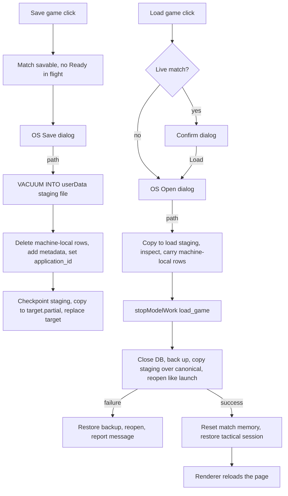

# Save and load games

Audience: a lower-quality coding agent. Implement one phase at a time. Stop after each phase and report files touched, test results, and any doc updated. Wait for the human before the next phase. If a phase fails, revert that phase. If a line in this plan disagrees with the code, trust the code, stop, and report the discrepancy. Do not guess.

## Goal

The player can save the match in progress to a file and load a saved match back. This works on the global map and on regional maps, during strategic planning and in the middle of a tactical battle. The app also writes rolling auto-saves at the start of each strategic turn and each tactical turn.

- **Save game…** in the game menu opens the operating system's Save dialog. The file has the extension `.agentwars`.
- **Load game…** in the game menu, and **Load game…** on the new-game bar, open the operating system's Open dialog. When a match is in progress, a confirm dialog comes first.
- After a load, the app is in the same state it would be in if the player had quit and relaunched with that match on disk. That is the whole contract for load. It keeps this work reliable, because the code already knows how to resume a match at launch, including a tactical battle in progress.

## Background

The whole match lives in one SQLite file under Electron `userData`, named by `GAME_DB_FILE_NAME` in [`src/main/gameDb.ts`](../src/main/gameDb.ts). The process-wide handle is in [`src/main/gameDb/dbConnection.ts`](../src/main/gameDb/dbConnection.ts) (`getDbHandle`, `setDbHandle`, `closeDbHandle`). The database uses `journal_mode = MEMORY` (`applyGameDbPragmas` in [`src/main/gameDb/databaseValidation.ts`](../src/main/gameDb/databaseValidation.ts)), so there are no `-wal` or `-shm` side files. `userData` is per app version (for example `%APPDATA%/Agent Wars v2.8.5`), set by `applyVersionedAppName` in `main.ts`.

A tactical battle in progress is stored in `game_config` (`tactical_battle_snapshot_json_v1`, `tactical_transport_baseline_json_v1`, `tactical_callback_stash_json_v1`). Launch restores it with `restorePersistedTacticalBattleSession` in [`src/main/tacticalBattle/tacticalBattleSession.ts`](../src/main/tacticalBattle/tacticalBattleSession.ts). A battle starts after Fight finishes the strategic turn, so `turn_state.phase` is `'planning'` for the whole battle, and the restore requires that. A copy of the database file is therefore a complete save. A save file is that copy with this machine's OpenRouter rows removed and two metadata rows added.

Launch does this in [`src/main/main.ts`](../src/main/main.ts): `await initDatabase()`, then `restorePersistedTacticalBattleSession()`, then the renderer page loads and asks for state. Load repeats those steps against a different file, then reloads the renderer page.

The `game:newGame` handler in `main.ts` resets the in-memory state that belongs to a match: `stopModelWork`, `resetCommanderPool(getSeatRoster())`, `clearDeferredPlaybackConsultPending()`, `clearStrategicPreviousHexMemory()`, and the tactical session. `resetGameForNewMatch` also calls `clearAttackMixOnNewGame()`. Load must reset the same things, plus a few more listed in Phase 4.

## Locked decisions

These came from the human. Do not reopen them.

- **Save model: operating system file dialogs.** No in-app save list. Electron `dialog.showSaveDialog` and `dialog.showOpenDialog`, parented to the main window, with one filter: name `Agent Wars save`, extensions `['agentwars']`. The Save dialog's own overwrite prompt is the overwrite confirmation.
- **Scope: manual save, manual load, auto-save, and saving during a tactical battle.** Turn replay is out of scope.
- **Older saves are refused, not migrated.** A save whose SQLite `user_version` differs from `EXPECTED_USER_VERSION` cannot be loaded. The player sees a message naming the app version that wrote it. There is no migration code. Bumping `EXPECTED_USER_VERSION` makes every earlier save unloadable, and the docs and the constant's comment say so.
- **Auto-saves go to a rolling folder.** `<userData>/autosaves` keeps the newest `AUTOSAVE_KEEP_COUNT` (5) files. The Open dialog starts in that folder when no directory has been remembered.
- **Saving while an AI commander is planning is allowed.** Background consultation work is not captured. After a load the commanders start fresh, as after a relaunch.
- **Load over a live match asks first.** When a match is loaded and not over, a confirm dialog appears before the Open dialog. That includes a match held under the new-game screen. With no live match there is no confirm.
- **Extension `.agentwars`.** The file is a SQLite database.
- **API keys never go into a save file.** The machine-local `game_config` rows listed in Phase 1 are removed from every save file. Because the save is built in a staging file under `userData` and scrubbed before it is copied to the player's folder, no copy that holds those rows is ever written outside `userData`. On load, this machine's current values of those rows are copied into the loaded match, so seat `ai1` keeps the key it has now. A seat with no key cannot consult until the player sets one in its commander popover. That is today's behavior for an empty key.
- **No special callback re-evaluation on load.** Saves are only written in the `planning` phase. After load the commanders behave as after a relaunch.
- **The load confirm and the existing start confirm share one helper.** The start confirm moves onto it in its own phase, with no change in behavior, before the load confirm uses it.
- **The UI smoke test is updated and must pass** (`npm run ui:smoke`) in the UI phase.

## Out of scope

Turn replay. An in-app save list or thumbnails. Keyboard shortcuts for save and load. Cloud or Steam saves. Migrating old saves. Saving during resolution. Saving from the game-over screen. Changing `EXPECTED_USER_VERSION` or the schema in [`src/main/gameDb/schema.ts`](../src/main/gameDb/schema.ts). Changing what `game:newGame` resets. Release notes.

## Working rules

- Read every `.mdc` file in `.cursor/rules/` and [`AGENTS.md`](../AGENTS.md) before the first phase, and follow them. The rules below restate the ones that matter most here. Where they differ, the rule files win.
- Shell is Windows PowerShell at `F:\Projects\Personal\agent-wars-public`. Run one command at a time. Do not chain with `&&`.
- Keep each file's existing line endings. New files use CRLF.
- Code blocks in this plan are the contract. They omit orienting comments and log calls. Add both, in the shape of the file you are editing.
- **Orienting comments** on every new or changed function, field, constant, module-level variable, interface, and interface member, exported or not: Purpose, When to use, Expected outcome, Exceptions. Interface members describe the contract. Implementations describe the approach. Copy the format of the file you are editing. Write sentences that say what the code does and why. Never write filler such as "Supports maintainability".
- **Logging:** `logDebug` at the start of each new or changed public main-process function, `logError` on every caught exception, and `logTrace` on getters that do not change state. Log paths, booleans, counts, turn numbers, and battle ids. Never log a value from a machine-local `game_config` row.
- **Errors:** every caught error either becomes a player-facing message in a result object or is logged and rethrown. Never swallow an error silently.
- **Player-facing text** is full sentences ending with a period. Each string is a named exported constant, or a named function for a string with values in it, in the module named for it. Tests and docs point at those names.
- **Immutability:** `const` for bindings that are not reassigned, `readonly` on interface members and array types that are not mutated, `ReadonlyMap` and `ReadonlySet` where callers must not mutate.
- **File size:** desirable 600 lines, hard limit 1000. [`src/main/main.ts`](../src/main/main.ts) (about 608 lines), [`src/main/gameDb.ts`](../src/main/gameDb.ts) (about 780), [`src/main/tacticalBattle/tacticalBattleSession.ts`](../src/main/tacticalBattle/tacticalBattleSession.ts) (about 716), [`src/main/openRouter/openRouter.ts`](../src/main/openRouter/openRouter.ts) (about 601), and [`src/renderer/renderer.ts`](../src/renderer/renderer.ts) (about 767) are already past 600. `main.ts` may grow by at most 10 lines in the whole plan. Phase 6 gives the layout that fits. Add no new functions to `gameDb.ts` except the extraction in Phase 3. Add nothing to `tacticalBattleSession.ts`, `openRouter.ts`, or `humanMarchPreviewResolve.ts` (about 967). `renderer.ts` gets only the two calls in Phase 8. New logic goes in new files.
- **Arguments:** at most 6 per function. Use an options or deps object above that, and for anything that touches Electron (`dialog`, `app`, `BrowserWindow`) so the logic runs in Node tests.
- **Imports:** no non-test module under `src/main/gameDb/` may import from `src/main/openRouter/` or `src/main/saveGame/`. `src/main/saveGame/` may import from `gameDb`, `tacticalBattle`, `openRouter`, and `ipc` modules. `src/shared/` imports nothing from `src/main/` or `src/renderer/`.
- **Naming:** follow [`doc/naming-conventions-contract-v1.md`](../doc/naming-conventions-contract-v1.md). The file names in this plan already comply. Do not add a role suffix that is not on its allowlist.
- **Tests:** test happy paths and essential failure contracts only, not implementation details. Do not test constants, pass-through IPC registration, or formatting that no contract depends on. `npm test` is the gate. It builds, lints, checks names, and runs `dist/**/*.test.js`. A new `*.test.ts` under `src/main` or `src/shared` is picked up automatically. Do not edit `package.json` to register a test.
- Tests that touch a database use the helpers in [`src/main/testSupport/`](../src/main/testSupport/) and temp directories from `fs.mkdtempSync(path.join(os.tmpdir(), ...))`, removed in `finally`. Never touch the real `userData` database in a test. A fake API key is the literal `test-openrouter-key`, with a comment saying it is for testing.
- When a phase adds a module, also run `npm run check:circular`. Do not refresh `scripts/circular-deps-baseline.json` or grow `scripts/renderer-typecheck-baseline.json`.
- When a phase edits `src/renderer` or `static/`, also run `npm run build:renderer`. Leave `static/renderer.js` changed.
- Never commit or push. Do not put phase numbers, or words from this plan's headings, into code, comments, tests, configuration, or `doc/`.

## Names and constants

Spell these exactly. Later phases refer to them.

| Name | Value | Lives in |
| --- | --- | --- |
| `SAVE_FILE_EXTENSION` | `'agentwars'` (no dot) | `src/main/saveGame/saveFileFormat.ts` |
| `SAVE_FILE_FILTER_NAME` | `'Agent Wars save'` | same |
| `SAVE_APPLICATION_ID` | `0x41575356` (ASCII `AWSV`, decimal 1096242006) | same |
| `SAVE_APP_VERSION_CONFIG_KEY` | `'save_app_version'` | same |
| `SAVE_WRITTEN_AT_CONFIG_KEY` | `'save_written_at'` | same |
| `AUTOSAVE_DIRECTORY_NAME` | `'autosaves'` | same |
| `AUTOSAVE_FILE_PREFIX` | `'autosave-'` | same |
| `AUTOSAVE_KEEP_COUNT` | `5` | same |
| `SAVE_GAME_SETTINGS_FILE_NAME` | `'save-game-settings.json'` | `src/main/saveGame/saveGamePaths.ts` |
| `SAVE_STAGING_FILE_NAME` | `'save-staging.agentwars'` | same |
| `LOAD_STAGING_FILE_NAME` | `'load-staging.agentwars'` | same |
| `BEFORE_LOAD_BACKUP_SUFFIX` | `'.before-load'` | `src/main/gameDb/databaseReplace.ts` |
| `MACHINE_LOCAL_CONFIG_KEYS` | the six keys in Phase 1 | `src/main/gameDb/machineLocalConfigKeys.ts` |
| IPC channel `saveGame` | `'game:saveGame'` | `IPC_GAME` in `src/shared/ipc/channels.ts` and its copy in `src/main/preload.ts` |
| IPC channel `loadGame` | `'game:loadGame'` | same |

## Result types

Create [`src/shared/ipc/saveGameTypes.ts`](../src/shared/ipc/saveGameTypes.ts) in Phase 5:

```ts
export type SaveGameResult =
  | { readonly status: 'saved'; readonly fileName: string }
  | { readonly status: 'canceled' }
  | { readonly status: 'failed'; readonly message: string };

export type LoadGameResult =
  | { readonly status: 'loaded'; readonly fileName: string }
  | { readonly status: 'canceled' }
  | { readonly status: 'failed'; readonly message: string };
```

`fileName` is the base name only (`path.basename`). A full path never leaves the main process.

## Flow



## Phase 1: One list of machine-local config keys

**Goal.** A refactor with no behavior change. The six `game_config` keys that belong to this machine, not to a match, are named in one module.

| Constant | Value | Where the literal lives today |
| --- | --- | --- |
| `OPENROUTER_API_KEY_CONFIG_KEY` | `'openrouter_api_key'` | `OPENROUTER_KEY_DB_CONFIG_KEY` in `src/main/openRouter/openRouter.ts` |
| `OPENROUTER_SELECTED_MODEL_CONFIG_KEY` | `'openrouter_selected_model'` | `OPENROUTER_SELECTED_MODEL_DB_CONFIG_KEY` in `openRouter.ts` |
| `OPENROUTER_SELECTED_REASONING_EFFORT_CONFIG_KEY` | `'openrouter_selected_reasoning_effort'` | `OPENROUTER_SELECTED_REASONING_EFFORT_DB_CONFIG_KEY` in `openRouter.ts` |
| `COMMANDER_MEMORY_CONFIG_KEY` | `'openrouter_commander_memory'` | `src/main/openRouter/commanderKeyMemory.ts` |
| `SEAT_API_KEYS_CONFIG_KEY` | `'openrouter_seat_api_keys'` | `commanderKeyMemory.ts` |
| `SEAT_API_KEY_FLAGS_CONFIG_KEY` | `'openrouter_seat_api_key_flags'` | `src/main/gameDb/seatApiKeyFlags.ts` (exported) |

Before editing, search `src/` for each value and confirm this table is complete. Then search every `game_config` writer for any other key that holds a secret or a per-machine preference (search for `safeStorage`, `apiKey`, `api_key`, `openrouter_`). If you find one that is not in the table, stop and report it.

**Create** [`src/main/gameDb/machineLocalConfigKeys.ts`](../src/main/gameDb/machineLocalConfigKeys.ts):

- Export the six constants.
- Export `MACHINE_LOCAL_CONFIG_KEYS: readonly string[]`, the six values in the table's order.
- The module comment says: these rows hold this machine's OpenRouter setup, including secrets, not the match; a save file never contains them; a load keeps this machine's values; a new row of this kind must be added here, or saves will carry it.

**Change** `openRouter.ts`, `commanderKeyMemory.ts`, and `seatApiKeyFlags.ts` to take their key names from the new module. In `openRouter.ts`, replace each local constant's string literal with the imported constant (`const OPENROUTER_KEY_DB_CONFIG_KEY = OPENROUTER_API_KEY_CONFIG_KEY;`), so the file does not grow. Keep `SEAT_API_KEY_FLAGS_CONFIG_KEY` exported from `seatApiKeyFlags.ts` as a re-export so existing imports keep working.

No new test. The existing tests for commander keys and seat flags cover this refactor.

**Verify:** `npm test`. `npm run check:circular`. Start the app with `npm start` and confirm that a commander's key and model still show in its commander popover. No `doc/` edits.

## Phase 2: Write and inspect save files

**Goal.** Main-process functions that write a save file from the open database and check whether a file is a loadable save. Nothing calls them yet.

**Create** [`src/main/saveGame/saveFileFormat.ts`](../src/main/saveGame/saveFileFormat.ts): the constants from the Names table that live there, and these messages. No logic except the one message function.

- `SAVE_NOT_A_SAVE_MESSAGE` = `This file is not an Agent Wars save.`
- `SAVE_NO_MATCH_MESSAGE` = `This save has no match in it.`
- `SAVE_UNKNOWN_MAP_MESSAGE` = `This save uses a map this version of Agent Wars does not have.`
- `saveWrongVersionMessage(savedBy: string | null, current: string): string` returns `This save was made by Agent Wars ${savedBy}. Agent Wars ${current} cannot load it.`, or, when `savedBy` is null, `This save was made by a different version of Agent Wars. Agent Wars ${current} cannot load it.`
- `SAVE_NOTHING_TO_SAVE_MESSAGE` = `There is no match to save.`
- `SAVE_GAME_OVER_MESSAGE` = `The match is over, so there is nothing to save.`
- `SAVE_BUSY_MESSAGE` = `The match can be saved once this turn finishes resolving.`

**Create** [`src/main/saveGame/saveFileWrite.ts`](../src/main/saveGame/saveFileWrite.ts):

```ts
export interface SaveFileWriteRequest {
  readonly targetPath: string;   // where the player's save goes
  readonly stagingPath: string;  // under userData; see saveGamePaths.ts
  readonly appVersion: string;   // app.getVersion() in production
  readonly writtenAtIso: string; // new Date().toISOString() in production
}
export function matchSaveBlocker(): string | null
export function writeSaveFileFromOpenDatabase(request: SaveFileWriteRequest): void
```

`matchSaveBlocker` returns, checking in this order:

1. `SAVE_NOTHING_TO_SAVE_MESSAGE` when `isDbReady()` is false. Return before any query. When the handle is open, the same message when `SELECT COUNT(*) FROM hexes` is 0 or `SELECT COUNT(*) FROM seats` is 0.
2. `SAVE_GAME_OVER_MESSAGE` when `SELECT value FROM game_config WHERE key = 'game_over'` returns `'1'`. That is the same test `fogState.ts` uses to set `gameOver` on the snapshot.
3. `SAVE_BUSY_MESSAGE` when `readTurnStateRow(dbGetOne)` (from [`src/main/gameDb/turnStateReads.ts`](../src/main/gameDb/turnStateReads.ts)) is missing or its `phase` is not `'planning'`.
4. Otherwise null.

`writeSaveFileFromOpenDatabase` does, in order:

1. Throws `new Error(blocker)` when `matchSaveBlocker()` is not null.
2. Gets the handle with `getDbHandle()`. Throws when it is null or when `handle.inTransaction` is true. `VACUUM` cannot run inside a transaction.
3. Creates the staging directory, and deletes `stagingPath` if it exists.
4. `handle.prepare('VACUUM INTO ?').run(stagingPath)`. This writes a consistent, compact copy without changing the open database. Binding the path as a parameter works in SQLite. Never build this SQL by string concatenation.
5. Opens `stagingPath` with `new Database(stagingPath)`. Set `journal_mode = DELETE` before the writes, so the scrub is in the main file. In a `try`/`finally` that always closes it:
   - `DELETE FROM game_config WHERE key IN (?, ?, ?, ?, ?, ?)` with `MACHINE_LOCAL_CONFIG_KEYS`. Build the placeholders from the array length.
   - `INSERT OR REPLACE` the two metadata rows.
   - `pragma(\`application_id = ${SAVE_APPLICATION_ID}\`)`. The value is a numeric constant, so interpolation is safe here. Say so in a comment.
6. After that connection is closed, if `stagingPath + '-wal'` or `stagingPath + '-shm'` still exists, delete `stagingPath` and throw an `Error` whose message is not one of the messages in `saveFileFormat.ts`. A copy of an uncheckpointed main file would keep the machine-local rows. Phase 5 maps that error to `SAVE_FAILED_MESSAGE`.
7. `partialPath = targetPath + '.partial'`. `fs.copyFileSync(stagingPath, partialPath)`. Copying first keeps a cross-drive save working. When `targetPath` does not exist, `fs.renameSync(partialPath, targetPath)`. When it exists, `fs.renameSync` does not replace it on Windows. Delete a leftover `targetPath + '.replacing'` if one is present, rename the target aside to that name, rename the partial onto `targetPath`, then delete the aside file. If the rename onto `targetPath` throws, rename the aside file back to `targetPath` and rethrow.
8. In `finally` for steps 3 to 7: delete `stagingPath` and, if it still exists, `partialPath`. Log a failed delete with `logError`. Rethrow the original error, if any. Leave a restored target in place. The success path has already deleted the aside file.

The staging file is the only file that ever holds machine-local rows, and it lives under `userData` beside the match database. Say so in the module comment.

**Create** [`src/main/saveGame/saveFileInspect.ts`](../src/main/saveGame/saveFileInspect.ts):

```ts
export type SaveFileInspection =
  | { readonly ok: true; readonly gameMapId: string; readonly turnNumber: number }
  | { readonly ok: false; readonly message: string };
export function inspectSaveFile(filePath: string, currentAppVersion: string): SaveFileInspection
```

Open with `new Database(filePath, { readonly: true, fileMustExist: true })`. Always close it in `finally`. Checks, in this order, each returning the message shown:

1. Opening throws, or reading `application_id` throws → `SAVE_NOT_A_SAVE_MESSAGE`. A text file opens without error and fails on the first read with "file is not a database". A missing file fails to open.
2. `application_id !== SAVE_APPLICATION_ID` → `SAVE_NOT_A_SAVE_MESSAGE`. This rejects the raw match database, an empty file, and any other SQLite file.
3. `user_version !== EXPECTED_USER_VERSION` → `saveWrongVersionMessage(savedBy, currentAppVersion)`, where `savedBy` is the `save_app_version` row read inside its own `try` (an older schema may not have it), or null.
4. `validateGameDatabaseOrThrow(db, EXPECTED_USER_VERSION)` from `databaseValidation.ts` throws → `SAVE_NOT_A_SAVE_MESSAGE`.
5. `hexes` or `seats` is empty, or `turn_state` row 1 is missing → `SAVE_NO_MATCH_MESSAGE`.
6. The map id is `game_config` `game_map_id`, or `'global'` when that row is missing (as `loadStoredGameMap` in `gameDb.ts` does when hexes exist). When it is not `'global'` and not a key of `REGIONAL_RULES_BY_ID` → `SAVE_UNKNOWN_MAP_MESSAGE`.

Log which check failed with `logDebug`. Never throw from `inspectSaveFile`.

**Tests.** [`src/main/saveGame/saveFileWrite.test.ts`](../src/main/saveGame/saveFileWrite.test.ts), inside `withSeatedTempGameDb` (copy the options from [`src/main/gameDb/newMatchSeats.test.ts`](../src/main/gameDb/newMatchSeats.test.ts)), with target and staging paths in their own temp directory:

- Insert all six machine-local rows with `dbRun` (value `test-openrouter-key`). Write a save. The save has none of the six rows, has both metadata rows, and has `application_id === SAVE_APPLICATION_ID`. The open database still has all six rows. No staging or `.partial` file remains.
- After `UPDATE turn_state SET phase = 'resolution' WHERE id = 1`, writing throws `SAVE_BUSY_MESSAGE` and leaves no target file.

[`src/main/saveGame/saveFileInspect.test.ts`](../src/main/saveGame/saveFileInspect.test.ts), using a save written the same way:

- A fresh save inspects `ok: true` with the match's map id and turn 1.
- A text file returns `SAVE_NOT_A_SAVE_MESSAGE`. A copy of the raw match database (no application id) returns `SAVE_NOT_A_SAVE_MESSAGE`.
- A save whose `user_version` was set to `EXPECTED_USER_VERSION - 1` returns the wrong-version message that names its `save_app_version`.
- A save with `game_map_id` set to `'no_such_map'` returns `SAVE_UNKNOWN_MAP_MESSAGE`.

**Verify:** `npm test`. `npm run check:circular`. No `doc/` edits.

## Phase 3: Replace the match database from a staged save

**Goal.** The main process can swap the open match database for a staged file and reopen it the way launch opens an existing file, with rollback on failure. Nothing calls it from IPC yet.

**Refactor in `gameDb.ts` first, alone.** Move the body of the existing-file branch of `initDatabase` into a new exported function, with no behavior change:

```ts
export interface OpenExistingGameDatabaseResult {
  readonly mapLoadError: string | null;
}
export function openExistingGameDatabaseAt(canonicalPath: string): OpenExistingGameDatabaseResult
```

It runs the steps `initDatabase` runs today for an existing file, in the same order: `new Database`, `applyGameDbPragmas`, `validateGameDatabaseOrThrow`, `setDbHandle`, `runInfrastructureStartupConsistencyPass({ includeReconciliation: false })`, `ensureTurnStateRow`, `repairStrandedStrategicResolutionPhaseOnDbBootstrap`, `seedGameSeedIfMissing`, then `loadStoredGameMap` inside its own `try`/`catch`. That catch records the message with `setGameMapLoadError` and the function returns it as `mapLoadError`. It does not throw for a map-load failure. When the map loaded, it runs `backfillInfrastructureStateFromMetadataIfMissing` and `reconcileStrategicInfrastructureCountsFromTacticalOverrides`. Last, it calls `refreshFogOfWarIntelFromCurrentState()`. `openExistingGameDatabaseAt` owns the temporary handle. When opening or validation fails, it closes that handle and throws. It does not run corrupt-file recovery.

`initDatabase` calls it for the existing-file branch and ignores `mapLoadError`. The missing-file branch is unchanged: it still creates a fresh database, tries `loadStoredGameMap`, and returns before `refreshFogOfWarIntelFromCurrentState`. The catch in `initDatabase` no longer has the temporary-handle local, because that close moved into `openExistingGameDatabaseAt`. The catch still logs, handles a native-load failure, and runs corrupt-file recovery. `refreshFogOfWarIntelFromCurrentState` runs once inside `openExistingGameDatabaseAt` when that function returns, and once at the end of `initDatabase` only when recovery ran.

Also export `getCanonicalDbPath` (today a private function). Rename nothing.

Also update the orienting comment on `EXPECTED_USER_VERSION`: bumping it also makes every saved game from an earlier version unloadable, and so does changing the shape of any JSON that a save carries in `game_config` without bumping it, because an older or newer app would misread it. Point at `doc/save-files.md`, which Phase 9 creates.

Run `npm test` now, before writing anything else in this phase. Existing tests ([`src/main/gameDb.test.ts`](../src/main/gameDb.test.ts), [`src/main/repairStrandedResolutionPhaseOnDbBootstrap.test.ts`](../src/main/repairStrandedResolutionPhaseOnDbBootstrap.test.ts), [`src/main/freshMatchLoad.test.ts`](../src/main/freshMatchLoad.test.ts)) must pass unchanged.

**Create** [`src/main/gameDb/databaseReplace.ts`](../src/main/gameDb/databaseReplace.ts). It imports from `../gameDb` and `./dbConnection` only. `gameDb.ts` must not import it.

```ts
export type GameDatabaseReplaceResult =
  | { readonly ok: true }
  | { readonly ok: false; readonly mapLoadError: string | null };
export function replaceGameDatabaseWithStagedFile(canonicalPath: string, stagedPath: string): GameDatabaseReplaceResult
```

The function is fully synchronous, and its comment says why: no other IPC handler can run while the handle is closed or half-replaced.

1. `backupPath = canonicalPath + BEFORE_LOAD_BACKUP_SUFFIX`.
2. `closeDbHandle()`.
3. When `canonicalPath` exists, `fs.copyFileSync(canonicalPath, backupPath)`. When this copy throws, reopen `canonicalPath` with `openExistingGameDatabaseAt`, log, and return `{ ok: false, mapLoadError: null }`. Nothing was replaced.
4. `fs.copyFileSync(stagedPath, canonicalPath)`.
5. `const opened = openExistingGameDatabaseAt(canonicalPath)`. When `opened.mapLoadError` is not null, roll back with that message.
6. When step 4 or 5 throws, roll back with `mapLoadError: null`.
7. Rollback: `closeDbHandle()`, copy `backupPath` back over `canonicalPath`, call `openExistingGameDatabaseAt(canonicalPath)`, and return `{ ok: false, mapLoadError }`. When the rollback itself throws, `logError` it and throw `new Error(DATABASE_REPLACE_ROLLBACK_FAILED_MESSAGE)`, exported with the text `The previous match could not be reopened. Restart Agent Wars.` Do not run the corrupt-file recovery dialog here.
8. On success, leave `backupPath` on disk and return `{ ok: true }`. It is a one-deep safety net that the next load overwrites. Say so in the comment.

In production the open database is always the file at `canonicalPath`. Say so in the comment. The replace test opens that same path with `openGameDatabaseAtPathForTests` and passes it in. A test that still has a different file open will close that file and then open `canonicalPath`.

A map-load failure does not leave the wrong pack loaded: `ensureGameMapLoaded` restores the previous pack when a switch fails, and the rollback reopen loads the previous match's pack again.

**Tests.** [`src/main/gameDb/databaseReplace.test.ts`](../src/main/gameDb/databaseReplace.test.ts). Everything in a temp directory. Open the "canonical" path with `openGameDatabaseAtPathForTests`, reset to a match, and write saves with `writeSaveFileFromOpenDatabase`:

- Round trip: match A, `UPDATE turn_state SET turn_number = 3`, save. Start match B with `resetGameForNewMatch` and a different `gameSeed`. Copy the save to a staging path and replace. Turn number is 3 and the unit ids equal A's.
- Failure: a staging file that is a copy of the save after `DROP TABLE units`. `units` is in `GAME_DB_REQUIRED_TABLES`, so `validateGameDatabaseOrThrow` throws and the result is `ok: false`. Afterwards the open database is B, with B's turn and units, and the `.before-load` file exists.
- Map switch: follow the setup and skip guard in [`src/main/maghrebPack.test.ts`](../src/main/maghrebPack.test.ts). Save a Maghreb match, reset to a global match, replace with the Maghreb save. `loadedGameMapId()` is `'maghreb'` and the hex count matches the Maghreb manifest. Clear map state in `finally` the way that test does. Note: `withRegionVsRegionTempGameDb` is a scenario on the global map, not a regional map, so it does not cover this.

Close the database at the end of each test with `closeGameDatabaseForTests`.

**Verify:** `npm test`. `npm run check:circular`. No `doc/` edits.

## Phase 4: Stage a save for loading and reset match memory

**Goal.** The remaining synchronous pieces of a load: preparing the staging file, and resetting the main process's in-memory match state after the swap. A test proves a save made mid-battle comes back mid-battle.

**Create** [`src/main/saveGame/loadStaging.ts`](../src/main/saveGame/loadStaging.ts):

```ts
export function stageSaveFileForLoad(
  sourcePath: string,
  stagingPath: string,
  currentAppVersion: string
): SaveFileInspection
```

1. Deletes `stagingPath` if it exists, then `fs.copyFileSync(sourcePath, stagingPath)`. When the copy throws, return `{ ok: false, message: SAVE_NOT_A_SAVE_MESSAGE }` and log the error.
2. `inspectSaveFile(stagingPath, currentAppVersion)`. When not ok, delete the staging file and return the inspection.
3. Reads every `MACHINE_LOCAL_CONFIG_KEYS` row from the open database with `dbGetAll`.
4. Opens the staging file read-write. Set `journal_mode = DELETE` before the writes, so the carried rows are in the main file. In `try`/`finally` that closes it before the function returns, inside one transaction: delete every machine-local row, delete both metadata rows, insert the rows read in step 3. Never log those values. If `stagingPath + '-wal'` or `stagingPath + '-shm'` still exists after the close, delete the staging file and return `{ ok: false, message: 'The saved game could not be loaded.' }`. That sentence is `LOAD_FAILED_MESSAGE` once Phase 5 exists; switch the return to that constant then.
5. Returns the inspection.

The open match database is not changed. The caller owns deleting the staging file after the load.

**Create** [`src/main/tacticalBattle/tacticalBattleMemoryRelease.ts`](../src/main/tacticalBattle/tacticalBattleMemoryRelease.ts) with `releaseTacticalBattleMemory(): void`. It clears only in-memory tactical state and never writes the database. `endTacticalBattleSession` is wrong here: it restores transport rows and deletes the tactical `game_config` rows, which would destroy the battle that was just loaded. The function calls:

- `setActiveTacticalBattleSnapshotRef(null)` from `activeTacticalBattleRef.ts`. Add this module to the "When to use" line of that function's comment.
- `clearTacticalCallbackSubscriptionStash()`: add it to [`src/main/openRouter/tacticalCallbackSubscriptionLifecycle.ts`](../src/main/openRouter/tacticalCallbackSubscriptionLifecycle.ts). It sets `stashedOpponentSubscriptions = null`. Change `resetTacticalCallbackSubscriptionStashForTests` to call it. This one matters: `restorePersistedTacticalBattleSession` only refills the stash when the loaded save has a battle, so without the clear a stash from the previous match survives.
- `clearTacticalMovementPlanningCache()`: add it to [`src/main/tacticalBattle/tacticalMovementPlanningCache.ts`](../src/main/tacticalBattle/tacticalMovementPlanningCache.ts) with the body of `resetTacticalMovementPlanningCacheForTests`, and make that test function call it. Battle ids can repeat between saves of the same match.
- `clearTacticalRendererOverrideCache()`: add it to [`src/main/gameDb/tacticalRendererOverrideCache.ts`](../src/main/gameDb/tacticalRendererOverrideCache.ts) the same way, from `clearTacticalRendererOverrideCacheForTests`.

**Create** [`src/main/saveGame/matchMemoryReset.ts`](../src/main/saveGame/matchMemoryReset.ts) with `resetMatchMemoryAfterDatabaseReplace(): void`, calling in this order:

1. `resetCommanderPool(getSeatRoster())`.
2. `clearDeferredPlaybackConsultPending()`.
3. `clearStrategicPreviousHexMemory()`.
4. `clearMeleeInterceptPendingSnapshot()` from `gameActions/meleeInterceptPendingState.ts`.
5. `clearAttackMixOnNewGame()` from `attackMixReset.ts`.
6. `releaseTacticalBattleMemory()`.
7. `restorePersistedTacticalBattleSession()`.

Its comment lists the module-level caches that it deliberately leaves alone, and why, so a future reader does not add them by reflex. These were checked. Leave them alone, and do not stop when you see them:

- The human march preview caches in `humanMarchPreviewResolve.ts`. `activeHoverPathfindingSessionByPlayer` is keyed by seat, and a session is reused only when the selection, position, and environment signatures match.
- The planning session cache in `tools/pathfindingSessionCache.ts`. `planningPhaseSessionByPerspective` is reused only when the key matches. That key includes the turn, the phase, the perspective, fog, the unit ids and positions, and the hex ids.
- The one-step destination cache in `oneStepMoveDestinations.ts`: a `WeakMap` keyed by snapshot object identity.
- Terrain, weather, region, map, hex-code, and ordered-hex caches: `ensureGameMapLoaded` replaces them when the map changes, including the caches registered with `registerActiveGameMapReset`.
- OpenRouter model capabilities and credit limits: per app session, not per match.
- Match generation and model-call epochs: `stopModelWork('load_game', ...)` advances them before the swap. A commander-pool write already queued on `writeTail` is dropped by `sameLaunch` after `resetCommanderPool` bumps the pool generation. That bump has to happen before the next microtask. Phase 5 keeps the load stretch synchronous for that reason.

If you find another module-level variable that holds per-match state, is not in this list, and is not keyed by the game state, stop and report it.

**Tests.**

- [`src/main/saveGame/loadStaging.test.ts`](../src/main/saveGame/loadStaging.test.ts): in a temp match with the six machine-local rows set, staging a save returns `ok: true`, and the staging file has this machine's six rows and no metadata rows. Staging a text file returns `SAVE_NOT_A_SAVE_MESSAGE` and leaves no staging file.
- [`src/main/saveGame/matchMemoryReset.test.ts`](../src/main/saveGame/matchMemoryReset.test.ts), the mid-battle round trip. Use `tacticalDbFixtureWithTempDbContestedPlanning` from [`src/main/tacticalBattle/testSupport/tacticalDbFixture.ts`](../src/main/tacticalBattle/testSupport/tacticalDbFixture.ts) and call `tacticalDbFixtureRegisterDefaultAfterEach()` as [`src/main/tacticalBattle/tacticalBattleSession.test.ts`](../src/main/tacticalBattle/tacticalBattleSession.test.ts) does. The fixture's `withTempGameDb` calls `resetGameForNewMatch()`, which seeds seats, so `matchSaveBlocker` does not reject the save for an empty roster. Assert inside the fixture callback. Its `finally` closes whatever handle is open and deletes the fixture directory, so the assertion has to finish before the callback returns. Inside it: `startTacticalBattleForEnclosingHex(targetStrategicH3)` must succeed. Record `battleId`, `tacticalTurnNumber`, and the sub-unit count. Write a save (paths in your own temp directory). Call `endTacticalBattleSession()`, so the battle is gone. Stage the save, replace onto a canonical path in that same temp directory, then `resetMatchMemoryAfterDatabaseReplace()`. `isTacticalBattleActive()` is true and the snapshot has the recorded `battleId`, `tacticalTurnNumber`, and sub-unit count. Everything here is synchronous, so it fits the fixture's synchronous callback. If `matchSaveBlocker` returns a message, stop and report it.

**Verify:** `npm test`. `npm run check:circular`. No `doc/` edits.

## Phase 5: Save and load from the main process

**Goal.** Two IPC channels that run the whole save and load in the main process, including dialogs. The renderer can call them from DevTools. No menu changes yet.

**Add a cancel reason.** In [`src/shared/ipc/modelCallCancelTypes.ts`](../src/shared/ipc/modelCallCancelTypes.ts), add `'load_game'` to `MODEL_CALL_CANCEL_REASONS`, and the log line `Opponent planning stopped to load a saved game.` to `modelCallCancelLogLine`. The switch is exhaustive, so the new case is required for the build. In [`src/main/ipc/modelWorkCancellation.ts`](../src/main/ipc/modelWorkCancellation.ts), treat `'load_game'` exactly like `'new_game'`: it advances the match generation, clears a pending deferred consult, and the activity line is sent when a deferred consult was waiting, using the same condition that today checks `reason === 'new_game'`. Update the comments on `stopModelWork` and on `advanceMatchGeneration` in [`src/main/matchGeneration.ts`](../src/main/matchGeneration.ts) so they name both reasons. Add one case to [`src/shared/ipc/modelCallCancelTypes.test.ts`](../src/shared/ipc/modelCallCancelTypes.test.ts) next to the `new_game` cases.

**Track Ready in flight in main.** Create [`src/main/ipc/readyInFlight.ts`](../src/main/ipc/readyInFlight.ts): a module-level counter, `runWithReadyInFlight<T>(work: () => Promise<T>): Promise<T>` (increment, then decrement in `finally`), and `isReadyInFlight(): boolean`. In `main.ts`, wrap the handler bodies of `IPC_GAME.ready` and `IPC_GAME.resolveMeleeIntercept` in it. Ready can wait for commanders before it resolves, and a load during that wait would swap the database under it. If a main-process flag for this already exists, use it instead and report that.

**Paths and the remembered directory.** Create [`src/main/saveGame/saveGamePaths.ts`](../src/main/saveGame/saveGamePaths.ts):

- `autosaveDirectory(userDataDir: string): string`, `saveStagingPath(userDataDir: string): string`, and `loadStagingPath(userDataDir: string): string`.
- `readRememberedSaveDirectory(userDataDir: string): string | null` and `writeRememberedSaveDirectory(userDataDir: string, directory: string): void`. They store `{ "lastDirectory": "..." }` in `SAVE_GAME_SETTINGS_FILE_NAME` under `userDataDir`. A missing, unreadable, or malformed file reads as null and logs at debug. A failed write logs `logError` and does not throw. Read the file with `fs.readFileSync` and `JSON.parse` inside that function's own `try`/`catch`. Do not use `readJsonFileOrThrow` in [`src/main/jsonFileHelpers.ts`](../src/main/jsonFileHelpers.ts): a missing settings file is normal, and that helper logs at error and rethrows.
- `suggestedSaveFileName(args: { readonly mapDisplayName: string; readonly turnNumber: number; readonly tacticalTurnNumber: number | null }): string` returns `${mapDisplayName} turn ${turnNumber}.agentwars`, or `${mapDisplayName} turn ${turnNumber} battle turn ${tacticalTurnNumber}.agentwars`. It replaces each of `<>:"/\|?*` and control characters with `-`, and trims trailing dots and spaces before the extension.
- `isInsideDirectory(filePath: string, directory: string): boolean`. Resolve both paths first, then use `path.relative`. The comparison is case-insensitive on Windows.

**Orchestration.** Create [`src/main/saveGame/saveLoadPipeline.ts`](../src/main/saveGame/saveLoadPipeline.ts). Everything Electron-specific comes in through a deps object:

```ts
export interface SaveLoadDeps {
  readonly userDataDir: string;
  readonly documentsDir: string;
  readonly appVersion: string;
  readonly canonicalDbPath: string;
  readonly showSaveDialog: (defaultPath: string) => Promise<string | null>; // null when canceled
  readonly showOpenDialog: (defaultDirectory: string) => Promise<string | null>;
  readonly stopModelWorkForLoad: () => void;
  readonly isReadyInFlight: () => boolean;
}
export async function runSaveGame(deps: SaveLoadDeps): Promise<SaveGameResult>
export async function runLoadGame(deps: SaveLoadDeps): Promise<LoadGameResult>
```

Exported messages:

- `SAVE_FAILED_MESSAGE` = `The game could not be saved.`
- `LOAD_BUSY_MESSAGE` = `A saved game can be loaded once this turn finishes resolving.`
- `LOAD_FAILED_MESSAGE` = `The saved game could not be loaded.`
- `SAVE_LOAD_IN_PROGRESS_MESSAGE` = `A save or load is already in progress.`

A module-level `operationInProgress` flag makes the two functions exclusive. While it is set, both return `failed` with `SAVE_LOAD_IN_PROGRESS_MESSAGE`. Set it at the start and clear it in `finally`. This covers a double click and a save started while a load's dialog is open. Export `isSaveOrLoadInProgress(): boolean`. Phase 6's auto-save returns immediately when it is true, because manual save and auto-save share `save-staging.agentwars`.

`runSaveGame`:

1. When `isReadyInFlight()` → `failed` with `SAVE_BUSY_MESSAGE`. When `matchSaveBlocker()` is not null → `failed` with it. Check before the dialog, so the player is not asked for a file that cannot be written.
2. Default directory: the remembered directory when it still exists on disk, else `documentsDir`. Default name: `suggestedSaveFileName` from `activeGameMap().displayName`, the turn number from `readTurnStateRow`, and the active tactical battle's `tacticalTurnNumber`, or null.
3. `showSaveDialog(path.join(directory, name))`. Null → `canceled`. When the chosen path's extension is missing, or is not `agentwars` ignoring case, append `.agentwars`. Do not append it when it is already there.
4. Check both blockers again. The dialog is asynchronous, and a Ready may have started while it was open.
5. `writeSaveFileFromOpenDatabase({ targetPath, stagingPath: saveStagingPath(userDataDir), appVersion, writtenAtIso: new Date().toISOString() })`. On error: when the message is one of the messages from `saveFileFormat.ts`, return `failed` with it; otherwise `logError` and return `failed` with `SAVE_FAILED_MESSAGE`.
6. When the chosen file is not inside the autosave directory, remember its directory. Return `saved` with the base name.

`runLoadGame`:

1. When `isReadyInFlight()` → `failed` with `LOAD_BUSY_MESSAGE`.
2. Default directory: the remembered directory when it still exists, else the autosave directory (create it with `mkdirSync({ recursive: true })`).
3. `showOpenDialog(directory)`. Null → `canceled`.
4. When `isReadyInFlight()` → `failed` with `LOAD_BUSY_MESSAGE`.
5. `stageSaveFileForLoad(chosen, loadStagingPath(userDataDir), appVersion)`. Not ok → `failed` with its message.
6. From here through `resetMatchMemoryAfterDatabaseReplace()`, and through the `rememberCurrentAutoSaveTurnKey()` call Phase 6 adds immediately after it, there is no `await`. Say so in a comment, and say why: the commander write queue runs on a microtask, and `sameLaunch` drops a queued write only after `resetCommanderPool` bumps the pool generation. An `await` in this stretch lets that write land on the loaded database first. No other IPC handler can run in this stretch either. `stopModelWorkForLoad()`.
7. `replaceGameDatabaseWithStagedFile(canonicalDbPath, staging)`. When the result is `ok: false`, the previous match is open again. Return `failed` with `mapLoadError` when it is not null, otherwise `failed` with `LOAD_FAILED_MESSAGE`. When the throw's message is `DATABASE_REPLACE_ROLLBACK_FAILED_MESSAGE`, return `failed` with that message. The previous match is not open in that case. Any other thrown error is logged and returned as `failed` with `LOAD_FAILED_MESSAGE`.
8. `resetMatchMemoryAfterDatabaseReplace()`.
9. When the chosen file is not inside the autosave directory, remember its directory.
10. Return `loaded` with the base name. In `finally`, delete the load staging file when it exists. Do not return from `finally`: a `failed` return from an earlier step has to survive it.

**IPC.** Create [`src/main/ipc/saveLoadIpcHandler.ts`](../src/main/ipc/saveLoadIpcHandler.ts) with `registerSaveLoadIpcHandler(ipcMain: IpcMain, getMainWindow: () => BrowserWindow | null, sendActivityLog: (line: string) => void): void`. Model it on [`src/main/ipc/endMatchIpcHandler.ts`](../src/main/ipc/endMatchIpcHandler.ts). It builds `SaveLoadDeps` from `app.getPath('userData')`, `app.getPath('documents')`, `app.getVersion()`, `getCanonicalDbPath()`, and `dialog.showSaveDialog` / `dialog.showOpenDialog` with the one filter and `properties: ['openFile']`. When `getMainWindow()` is null, return `failed` with `SAVE_FAILED_MESSAGE` or `LOAD_FAILED_MESSAGE` and do not open a dialog. Otherwise parent the dialog to that window, so the renderer cannot start another handler while the dialog is open. `stopModelWorkForLoad` is `() => stopModelWork('load_game', sendActivityLog)`. In `main.ts`, register it next to `registerEndMatchIpcHandler(ipcMain)`. Introduce one local activity-log callback in `registerIpcHandlers` and pass it here. Use that same callback for the inline senders in `game:newGame` and `game:endTacticalBattle`. Phase 6 adds the auto-save wrappers and counts the combined growth against the 10-line budget.

Add `saveGame` and `loadGame` to `IPC_GAME` in [`src/shared/ipc/channels.ts`](../src/shared/ipc/channels.ts), to the channel copy and the `gameApi` object in [`src/main/preload.ts`](../src/main/preload.ts), and to `GameApi` in [`src/shared/ipc/gameApiTypes.ts`](../src/shared/ipc/gameApiTypes.ts) as `saveGame: () => Promise<SaveGameResult>` and `loadGame: () => Promise<LoadGameResult>`. In `preload.ts`, match the comment shape of the neighboring `gameApi` methods. Read [`src/main/preloadIpcChannelParity.test.ts`](../src/main/preloadIpcChannelParity.test.ts) and [`src/main/preloadChannelParity.test.ts`](../src/main/preloadChannelParity.test.ts) to see what they expect. They must pass.

**Tests.** [`src/main/saveGame/saveLoadPipeline.test.ts`](../src/main/saveGame/saveLoadPipeline.test.ts), using `withSeatedTempGameDbAsync` from `withSeatedTempGameDb.ts`, fake dialogs that return fixed paths, and a temp `userDataDir` and `canonicalDbPath`:

- Save, start a new match with a different `gameSeed`, then load the save: `loaded`, the turn and unit ids match the saved match, and no staging file remains.
- While `isReadyInFlight` returns true, both functions return `failed` and neither dialog is called.
- Loading a text file returns `failed` with `SAVE_NOT_A_SAVE_MESSAGE`, and the open match is unchanged.

**Verify:** `npm test`. `npm run check:circular`. Then `npm start`, open DevTools (Alt shows the menu bar, then View → Toggle Developer Tools), and run `await window.gameApi.saveGame()` and `await window.gameApi.loadGame()` during a match. Report what each returned. The page is not reloaded yet, so the screen may be stale after a load. That is expected until Phase 8. Relaunch the app and confirm that the loaded match is what opens. No `doc/` edits.

## Phase 6: Auto-save

**Goal.** A save goes to the autosave folder at the start of each strategic turn and each tactical turn, and the folder keeps the newest five. Auto-save never fails a turn.

**Create** [`src/main/saveGame/autoSave.ts`](../src/main/saveGame/autoSave.ts):

- `turnStartKey(turnNumber: number, battleId: string | null, tacticalTurnNumber: number | null): string`, a pure function: `s12` for strategic, `s12-b<battleId>-t3` in a battle.
- `autoSaveFileName(now: Date, turnNumber: number, tacticalTurnNumber: number | null): string`, a pure function: `autosave-YYYYMMDD-HHMMSS-mmm-turn-12.agentwars`, or `autosave-YYYYMMDD-HHMMSS-mmm-turn-12-battle-turn-3.agentwars`, in local time with zero padding, so that names sort by time as text.
- `pruneAutoSaves(directory: string, keep: number): void` lists the files that start with `AUTOSAVE_FILE_PREFIX` and end with `.agentwars`, sorts the names in descending order, and deletes every file after the first `keep`. A failed delete is logged and the loop continues. Other files are never touched.
- `maybeWriteTurnStartAutoSave(deps: { readonly userDataDir: string; readonly appVersion: string; readonly now: () => Date }): void`:
  1. When `isSaveOrLoadInProgress()` is true, return without writing. Manual save and auto-save share `save-staging.agentwars`.
  2. When `matchSaveBlocker()` is not null, return (log at debug).
  3. Compute the current key from `readTurnStateRow` and the active tactical battle.
  4. When the key equals the remembered key, return.
  5. Create the autosave directory, write `autoSaveFileName(...)` there with `writeSaveFileFromOpenDatabase` (staging at `saveStagingPath(userDataDir)`), prune, then remember the key.
  6. Steps 3 to 5 run inside `try`/`catch`. On error, `logError` and return. Never throw.
- `rememberCurrentAutoSaveTurnKey(): void` sets the remembered key to the current key without writing, so a launch or a load does not write an auto-save that copies the match it just opened. When `readTurnStateRow` is missing, it does nothing and does not throw.
- `forgetAutoSaveTurnKey(): void` clears it, so turn 1 of a new match is saved.

**Call sites.** In `saveLoadIpcHandler.ts`, add `withAutoSaveAfter<T>(work: () => T | Promise<T>): Promise<T>`. It awaits `work()`, calls `maybeWriteTurnStartAutoSave` with the real deps, and returns the result. When `work` throws, it rethrows without saving. It is only ever called after the handler's own work has finished, never inside a database transaction or inside resolution code. Use it in `main.ts` for these handlers:

- `IPC_GAME.ready` and `IPC_GAME.resolveMeleeIntercept`, outside `runWithReadyInFlight`. Both advance the strategic turn in `meleeInterceptReadyFinalize.ts` before the handler returns. A melee pause returns from `ready` while `turn_state.phase` is still `'resolution'`, so `matchSaveBlocker` skips that call and the finalize handler writes the autosave. The renderer starts Fight's battle by calling `startTacticalBattle` after Ready returns, so the `startTacticalBattle` wrapper is the battle-turn save. Do not also autosave from `notifyResolutionPlaybackComplete`. `useEventDrivenConsultation` defaults to true, so the Ready handler returns at the start of the next planning turn, before the deferred consult writes orders.
- `IPC_GAME.commitHumanTacticalDraftOrders`. The tactical turn advances in `applyHumanTacticalDraftBeatInStrategicOrder`.
- `IPC_GAME.startTacticalBattle` (battle turn 1).
- `IPC_GAME.endTacticalBattle`. Going back to strategic planning in the same strategic turn changes the key from the battle key to the strategic key, so this writes one save. That is intended: it holds the state after the battle.
- `IPC_GAME.newGame`: call `forgetAutoSaveTurnKey()` after the reset, inside the handler, and wrap the handler in `withAutoSaveAfter`.

Also call `rememberCurrentAutoSaveTurnKey()` in two places: in `runLoadGame` immediately after `resetMatchMemoryAfterDatabaseReplace()`, still inside the stretch that does not `await`, and in `main.ts` after `restorePersistedTacticalBattleSession()` at launch.

**`main.ts` line budget.** The file may grow by at most 10 lines across this whole plan. Count before Phase 5's edit and after this phase. Use this layout, and do not reformat the handler bodies:

- The one activity-log callback Phase 5 already introduced. Replacing the two inline senders pays for the registration.
- One import for `withAutoSaveAfter`, `forgetAutoSaveTurnKey`, and `rememberCurrentAutoSaveTurnKey`, if Phase 5's import does not already cover them.
- `withAutoSaveAfter` wrapped around the existing handler bodies of `ready`, `resolveMeleeIntercept`, `commitHumanTacticalDraftOrders`, `startTacticalBattle`, `endTacticalBattle`, and `newGame`.
- `forgetAutoSaveTurnKey()` as one line inside the `newGame` handler, after the reset.
- `rememberCurrentAutoSaveTurnKey()` as one line in `app.whenReady`, after `restorePersistedTacticalBattleSession()`.

Count lines before Phase 5's edit and after this phase. If this layout still exceeds 10 lines, stop and report the count. Do not grow `main.ts` further.

**Tests.** [`src/main/saveGame/autoSave.test.ts`](../src/main/saveGame/autoSave.test.ts). The remembered key is module state, so each test calls `forgetAutoSaveTurnKey()` first.

- `pruneAutoSaves`, given seven prefixed files and one unrelated file, keeps the five newest prefixed files and the unrelated file.
- In a temp match: the first call writes one file; a second call in the same turn writes nothing; after `UPDATE turn_state SET turn_number = 2` it writes a second file; with the phase set to `'resolution'` it writes nothing; with the autosave directory path occupied by a plain file, so writing fails, it does not throw.
- After `rememberCurrentAutoSaveTurnKey()`, a call in the same turn writes nothing.

**Verify:** `npm test`. `npm run check:circular`. Then `npm start`, start a match, play two strategic turns, fight one tactical battle turn, and list `<userData>/autosaves`. Report the file names. Find `userData` from the paths in the app log, or under `%APPDATA%` in the folder named for the app version. No `doc/` edits.

## Phase 7: Shared confirm dialog

**Goal.** A refactor with no behavior change. The existing start confirm uses a reusable helper that the load confirm will use in Phase 8.

Read [`src/renderer/gameplay/startConfirmDialog.ts`](../src/renderer/gameplay/startConfirmDialog.ts) and its markup, `#start-confirm-dialog` in [`static/index.html`](../static/index.html), first.

**Create** [`src/renderer/chrome/confirmDialog.ts`](../src/renderer/chrome/confirmDialog.ts):

```ts
export interface ConfirmDialogIds {
  readonly dialogId: string;
  readonly confirmId: string;
  readonly cancelId: string;
  readonly initialFocus: 'confirm' | 'cancel';
}
export function createConfirmDialog(ids: ConfirmDialogIds): () => Promise<boolean>
```

The returned function behaves exactly as `confirmStartWithNoModels` behaves today: it resolves an already-open question as false before asking again, binds the buttons, the backdrop, and a capturing Escape listener once per dialog, shows the dialog, focuses the initial button, and resolves true for confirm. Cancel, Escape, a backdrop click, and a missing dialog (with `console.error`) resolve false. Escape does not reach the map or the game menu. Each dialog created this way has its own pending answer and its own bound flag, held in the closure.

**Change** `startConfirmDialog.ts` so that `confirmStartWithNoModels` is `createConfirmDialog({ dialogId: 'start-confirm-dialog', confirmId: 'start-confirm-yes', cancelId: 'start-confirm-no', initialFocus: 'confirm' })`, created once at module level, and delete the code that moved. The exported name and its callers stay the same.

**Verify:** `npm test`. `npm run build:renderer`. `npm run check:circular`. Then `npm start`, open the new-game screen, clear every AI row's model, and click Start game. Check each of: Yes starts the game; No, Escape, and a backdrop click each leave the screen open; Enter answers Yes; a second Start click while the question is open does not leave the first question hanging. Report each result. No `doc/` edits, because behavior did not change.

## Phase 8: Menu items, load confirm, and reload

**Goal.** The player can save and load from the UI.

**Availability rules** go in a pure, tested module, [`src/shared/saveLoadAvailability.ts`](../src/shared/saveLoadAvailability.ts). The tip strings live here, as exported constants, so the renderer and the test share them.

```ts
export interface SaveLoadUiState {
  readonly matchLoaded: boolean;       // S.gameState has hexes
  readonly gameOver: boolean;          // S.gameState.gameOver
  readonly readyInFlight: boolean;     // S.readyRequestInFlight
  readonly newGameScreenOpen: boolean; // newGameOverlayIsOpen(); true for game over too
}
export interface SaveLoadItemState {
  readonly disabled: boolean;
  readonly tooltip: string;
}
export function saveGameItemState(state: SaveLoadUiState): SaveLoadItemState
export function loadGameItemState(state: SaveLoadUiState): SaveLoadItemState
export function loadNeedsConfirm(state: SaveLoadUiState): boolean
```

Rules, checked top to bottom. The first row that matches wins.

| Item | Condition | Disabled | Tip |
| --- | --- | --- | --- |
| Save game | game over | yes | `The match is over, so there is nothing to save.` |
| Save game | no match loaded | yes | `There is no match to save.` |
| Save game | new-game screen open over a live match | yes | `Close the new-game screen to save the match under it.` |
| Save game | Ready in flight | yes | `Save game is available again once this turn or beat finishes resolving.` |
| Save game | otherwise | no | `Save this match to a file.` |
| Load game | Ready in flight | yes | `Load game is available again once this turn or beat finishes resolving.` |
| Load game | match live (loaded and not over) | no | `Open a saved game from a file. The match in progress is replaced.` |
| Load game | otherwise | no | `Open a saved game from a file.` |

`#game-over-overlay` is open for a fresh launch, for a new-game screen over a live match, and for game over (`updateGameOverUI` in [`src/renderer/core/uiState.ts`](../src/renderer/core/uiState.ts)). The first two Save rows have to win over the overlay, or a fresh launch would show the close-screen tip and game over would show it too. Read the overlay with `newGameOverlayIsOpen()` from [`src/renderer/gameplay/newGameDialogCollapse.ts`](../src/renderer/gameplay/newGameDialogCollapse.ts). Compact still counts as open.

`loadNeedsConfirm` is true when `matchLoaded && !gameOver`, whether or not the new-game screen is open.

The two "no match" and "game over" strings equal `SAVE_NOTHING_TO_SAVE_MESSAGE` and `SAVE_GAME_OVER_MESSAGE` in the main process. `src/shared` cannot import `src/main`, so move those two strings into `saveLoadAvailability.ts` and have `saveFileFormat.ts` import them from there and re-export them, so the Phase 2 imports keep working.

Test in [`src/shared/saveLoadAvailability.test.ts`](../src/shared/saveLoadAvailability.test.ts): one case per table row. Include the overlay open with no match (the nothing-to-save tip) and the overlay open during game over (the game-over tip). Also test `loadNeedsConfirm` for a live match, a live match under the new-game screen, a finished match, and no match.

**Markup** in [`static/index.html`](../static/index.html):

- Remove `disabled` from `#game-menu-save-btn`, `#game-menu-load-btn`, and `#topbar-load-btn`. Set each tip host's static `data-control-tooltip` to the enabled tip from the table. The sync function overwrites it.
- Add `#load-confirm-dialog`, copying the structure, classes, and ARIA attributes of `#start-confirm-dialog`, so it gets the same styles and stacking. Title `Load a saved game?`. Body `The match in progress will be replaced. Save it first if you want to keep it.` Buttons `#load-confirm-yes` with the text `Load…` and `#load-confirm-no` with the text `Cancel`.

**Renderer.**

- [`src/renderer/gameplay/loadConfirmDialog.ts`](../src/renderer/gameplay/loadConfirmDialog.ts): `confirmLoadOverMatch = createConfirmDialog({ dialogId: 'load-confirm-dialog', confirmId: 'load-confirm-yes', cancelId: 'load-confirm-no', initialFocus: 'cancel' })`. Cancel gets focus because this replaces the match.
- [`src/renderer/gameplay/saveLoadMenu.ts`](../src/renderer/gameplay/saveLoadMenu.ts):
  - `readSaveLoadUiState(): SaveLoadUiState` from `S` and `newGameOverlayIsOpen()`.
  - `syncSaveLoadItems(): void` sets `disabled` and the tip host's `data-control-tooltip` on all three buttons. Call it from `openGameMenu` in [`src/renderer/chrome/gameMenu.ts`](../src/renderer/chrome/gameMenu.ts), next to `syncGameMenuNewGameItem()`, and from `setMainUIControlsEnabled` in [`src/renderer/core/uiState.ts`](../src/renderer/core/uiState.ts), beside the existing `syncGameMenuNewGameItem()` call.
  - `wireSaveLoadMenu(): void`, called once from `init` in [`src/renderer/renderer.ts`](../src/renderer/renderer.ts), next to `wireGameMenu()`.
  - Save click: recompute the state. When it is disabled, return. `await window.gameApi.saveGame()`. On `saved`, `showMapToast(\`Saved ${fileName}.\`)`. On `failed`, `showMapToast(message)`. On `canceled`, nothing.
  - Load click (one handler for both buttons): recompute the state. When it is disabled, return. When `loadNeedsConfirm`, `await confirmLoadOverMatch()` and stop on false. `await window.gameApi.loadGame()`. On `failed`, `showMapToast(message)`. On `canceled`, nothing. On `loaded`, store the file name in `sessionStorage` under `agentWarsLoadedSaveFileName` inside `try`/`catch`, then call `window.location.reload()`.
  - `showLoadedSaveToastAfterReload(): void` reads and removes that `sessionStorage` key inside `try`/`catch`, and shows `Loaded ${fileName}.` with `showMapToast` when one was stored. Call it once at the end of `init` in `renderer.ts`.
- The game menu already closes after an enabled item's own click handler starts (see `wireGameMenu`). Do not add a second close.
- In [`src/renderer/chrome/frameTooltipText.ts`](../src/renderer/chrome/frameTooltipText.ts), delete `saveGameUnavailableTooltipText`, which nothing else uses. Keep `unavailableTooltipText`, which Settings, Help, How to play, and Replay still use.

**UI smoke test.** In [`scripts/ui-smoke/ui-smoke-checks.cjs`](../scripts/ui-smoke/ui-smoke-checks.cjs), remove `#game-menu-save-btn` and `#game-menu-load-btn` from the `placeholders-disabled` check. That check runs on the strategic scene and on the open menu, and removing the two buttons is the whole of that edit. In [`scripts/ui-smoke/ui-smoke-new-game-checks.cjs`](../scripts/ui-smoke/ui-smoke-new-game-checks.cjs), the new-game bar check currently returns an error when `#topbar-load-btn` is enabled (`Load game… is enabled`). Invert it so an enabled button passes and a disabled button returns `Load game… is disabled`, and update the comment above `NEW_GAME_BAR`. Add a check in the same style, in the scene where the game menu is open during a strategic match, that `#game-menu-save-btn` and `#game-menu-load-btn` are enabled. Do not add a check that opens a file dialog.

**Verify:** `npm test`. `npm run build:renderer`. `npm run check:circular`. `npm run ui:smoke` must pass. Then run these checks with `npm start` and report each result:

1. Fresh launch with no match: Save game is disabled with `There is no match to save.` Load game on the new-game bar opens the Open dialog in the autosave folder, with no confirm.
2. Start a global match and play two turns. Save game suggests `Global turn 3.agentwars` in Documents. Save it. A toast says `Saved Global turn 3.agentwars.`
3. Play one more turn. Load game from the menu shows the confirm. Cancel does nothing. Load… opens the dialog in the folder from step 2. Pick the save. The page reloads on turn 3 with the same units, and a toast says `Loaded Global turn 3.agentwars.`
4. Commanders still have their keys and models. With Run on, opponents plan.
5. Start a regional match, enter a tactical battle, play one battle turn, and save. Quit, relaunch, start a new global match, and load the regional save. The app shows the regional map, in the tactical battle, on the same battle turn.
6. Pick a non-save file, such as a `.txt` file renamed to `.agentwars`. A toast says `This file is not an Agent Wars save.` and the match is unchanged.
7. While a Ready is resolving, both menu items are disabled with the busy tips.
8. With the new-game screen open over a match, Save game is disabled with `Close the new-game screen to save the match under it.`, and Load game asks to confirm.
9. After several turns, the autosave folder holds five files.
10. The start confirm from Phase 7 still behaves as it did.

## Phase 9: Documentation

**Goal.** `doc/` describes what shipped. Follow [`AGENTS.md`](../AGENTS.md) "Keep `doc/` Current". Read each document before editing it, and match its voice, headings, and table layout. Take numbers and names from the code, and name the symbol. Keep this plan's phase names and numbers out of every document.

**Create** [`doc/ux/save-and-load.md`](../doc/ux/save-and-load.md), an element document with the fixed heading set from "Document Structure" in [`doc/ux-specification.md`](../doc/ux-specification.md). Cover: the three controls; when each is enabled, and its tips; the load confirm dialog and its focus and Escape behavior; the Save and Open dialogs and their default folders; the toasts; that a load reloads the window and resumes like a relaunch, including a tactical battle; auto-save timing and the five-file folder; that auto-saves live under the per-version `userData`, so a different app version does not show them by default; and what a save leaves out. A save omits the six `MACHINE_LOCAL_CONFIG_KEYS` rows: the legacy OpenRouter key, the legacy selected model, the legacy reasoning effort, commander memory, the seat keys, and the seat-key flags. Per-seat `model_id`, `reasoning_effort`, and doctrine in the `seats` table stay in the file, because they are part of the match. Code Entry Points lists the renderer and main modules from this work. Add its row to the routing table in `doc/ux-specification.md`. Add rows to that document's "Open Questions by Document" and "Known Deviations by Document" tables only if the new document has entries in those sections.

**Create** [`doc/save-files.md`](../doc/save-files.md), a short product and mechanics document. Cover: the file is the match SQLite database written with `VACUUM INTO` through a staging file under `userData`; `SAVE_APPLICATION_ID`; the two metadata rows; `MACHINE_LOCAL_CONFIG_KEYS`, removed on save and carried over from this machine on load; per-seat `model_id`, `reasoning_effort`, and doctrine in `seats`, which stay because they are part of the match; the version policy (a save loads only when its `user_version` equals `EXPECTED_USER_VERSION`, there is no migration, and bumping that constant makes every earlier save unloadable); the guidance for developers that changing the shape of any JSON a save carries in `game_config` needs a new versioned key or a bump of `EXPECTED_USER_VERSION`; the inspect checks and their messages; the `.before-load` backup; and the auto-save key and the handlers that trigger it. Register it in the index table in [`doc/README.md`](../doc/README.md), with a role and a status. Under the engine constants table in `doc/README.md`, add a short paragraph in the style of the consultation-deadline paragraph: when `EXPECTED_USER_VERSION` in `src/main/gameDb.ts` or `MACHINE_LOCAL_CONFIG_KEYS` changes, update `save-files.md` in the same change.

**Update in place:**

- [`doc/ux/game-menu.md`](../doc/ux/game-menu.md): Save game and Load game are no longer disabled. Update Information Displayed, Inputs and Responses, Invariants if needed, Related Documents, and Code Entry Points.
- [`doc/ux/top-bar.md`](../doc/ux/top-bar.md): Load game on the new-game bar is enabled.
- [`doc/ux/control-tooltips.md`](../doc/ux/control-tooltips.md): the new tips; remove Save game and Load game from the disabled-placeholder lists and from the line that quotes the old Save game tip; update Source Anchors.
- [`doc/ux/modes-and-transitions.md`](../doc/ux/modes-and-transitions.md): loading a game is a transition, from any mode where the menu or the new-game bar takes input, into the mode the save resumes in. Remove "Load game…" from the list of disabled new-game bar items.
- [`doc/ux/input-map.md`](../doc/ux/input-map.md): add one Escape row for the load confirm. It answers Cancel, and the key does not reach the map or the game menu. The document already lists dialog Escape handling. Do not add a row for the start confirm.
- [`doc/how-to-play.md`](../doc/how-to-play.md): replace the "No save slots yet" bullet with how to save, load, and find auto-saves.
- [`doc/ui-style-guide.md`](../doc/ui-style-guide.md): the implementation-status note; section 3.6, including the sentence that says Load game… on the new-game bar is disabled and the Save/Load bullet that says save/load is not shipped (OS file dialogs, overwrite confirmation by the Save dialog, the auto-save folder); and the unchecked "Save/load UI" item.
- [`doc/README.md`](../doc/README.md): the shipping-status paragraph that says save/load is not shipped. Say what shipped, and that turn replay is not built. Update the ui-style-guide row's status text, which names the save/load UI as unbuilt.
- [`doc/game-vision-v2.md`](../doc/game-vision-v2.md) and [`doc/combat-rules-v3.md`](../doc/combat-rules-v3.md): sentences that list player-facing save/load as unbuilt.
- [`README.md`](../README.md): the Progress line, in the same way.

**Leave alone:** [`doc/devleopment-plan-v3.4.md`](../doc/devleopment-plan-v3.4.md), [`doc/poc-analysis.md`](../doc/poc-analysis.md), [`doc/market-research.md`](../doc/market-research.md), and `doc/release-notes/`.

**Search** `doc/` and `README.md` for `not available in this version`, `Save game`, `Load game`, `save/load`, `save slots`, and `not shipped`, and fix every maintained document that is now wrong. Check [`doc/project-instructions.md`](../doc/project-instructions.md) and [`doc/coding-prompts-1.md`](../doc/coding-prompts-1.md) for any fact this work made wrong, and change only that fact.

**Verify:** `npm test`, to confirm the tree is still clean. Report every document you edited, and any disagreement between `doc/` and code that you could not settle.

## Risks to watch

- **Partial reset after load.** Something in the main process holds per-match state that `resetMatchMemoryAfterDatabaseReplace` misses. Symptoms: a stale commander status, a stale tactical march preview, or an AI plan from the previous match landing on the loaded one. The renderer reload clears renderer state, so look in main-process module variables. The mid-battle test in Phase 4 and manual checks 3 to 5 in Phase 8 are there to catch this.
- **Saving inside a transaction.** `VACUUM INTO` fails inside one. Auto-save runs only after IPC handlers return, and the writer checks `inTransaction`.
- **Windows file locks.** Replacing a save that another program holds open fails. When the new file cannot take the target's name, the aside file is renamed back. The player sees `The game could not be saved.` and the log has the cause.
- **Region packs.** A regional save loads only when that region's pack can be loaded. `loadStoredGameMap` extracts the pack as it does at launch. A failure rolls back to the previous match and shows the map error message.
- **Requests from the old page.** Between the load's IPC reply and the page reload, the old page can still send requests, for example a commander-pool poll. They act on the loaded match, which is the same thing that happens right after a relaunch. No player input is possible in that gap.
