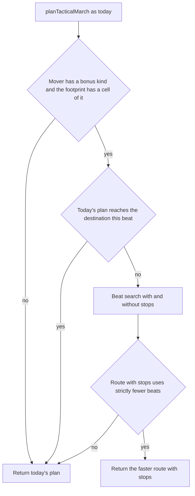

# Tactical Terrain-Bonus Movement

This plan describes how to implement the rule below in phases. Each phase is verified with its own tests and then with `npm test`.

## Rule

In a tactical battle, when the match terrain bonus is Low or High:

- Armor may enter one cell whose terrain kind matches its birth terrain kind, when that kind is not water and is otherwise blocked for armor. Today that means mountains, wetlands, and arctic. The code must derive this from the printed cost table, not from a list.
- Naval may do this only when both the birth kind and the cell kind are wetlands. A naval unit born on any other kind gains nothing.
- Infantry already enters every non-water kind, so infantry movement does not change. The same derivation gives infantry no bonus kind.
- That entry spends everything left in the beat, and the unit stops on that cell. It can enter only one such cell in a beat.
- In a later beat, the unit may leave by any normal step, or enter one more such cell.
- A step the current rules already price at a finite cost is unchanged. That includes road and rail, so an intact road through mountains or wetlands still allows several cells in one beat. It also includes urban armor entry, wetlands seaports, weather costs, the forest and urban budgets, and the one-cell floor for a step the budget cannot pay.
- Leaving a road onto an off-road birth-terrain cell is a stop. The road cells before it are not.
- A unit that starts its beat on such a cell is not stopped there. It may leave by normal steps.
- An order farther away may use these stops over several beats. Replace today's route only when the stops arrive in strictly fewer beats than every route that does not use them. Otherwise keep today's route, path, cost, and first stop.
- Low and High behave the same. The country origin bonus does not grant this, and a missing birth terrain grants nothing.
- Urban cells, rubble cells, and a naval step from one land seaport cell to another stay blocked.
- Spawn, dice, range, cover, line of sight, embark and debark, and strategic movement do not change.
- Embarked cargo moves as naval cargo and gets no bonus kind. A naval carrier uses its own birth kind.

## Current code facts

These facts were checked against the code. The implementing agent should not have to rediscover them.

- Printed tactical costs come from `tacticalEnterHexMovementCost` in [`src/shared/tacticalTerrainMovement.ts`](src/shared/tacticalTerrainMovement.ts). Armor is blocked on `mountains`, `wetlands`, `arctic`, and `water`. Naval is blocked everywhere except `water` and `coastal`. Infantry is blocked only on `water`.
- `landInfantryArmorEnterCost` in [`src/shared/tacticalLandMarchContinuity.ts`](src/shared/tacticalLandMarchContinuity.ts) gives an intact road or rail cell a finite cost from any neighbor, even on blocked terrain. `blockedHexLandTransitAllowsRelaxation` stops a route from passing through a blocked non-line cell in the middle of a path.
- [`src/shared/tacticalMovementPlanner.ts`](src/shared/tacticalMovementPlanner.ts) has 479 lines. `planTacticalMarch` reprices every step after its land search. The private `tacticalNavalEnterNeighborCost` prices naval steps.
- `TacticalMarchPlanResult.totalCostToDestination` is turned into beats only by `estimateTacticalTurnsRequired` in [`src/main/tools/tacticalMarchEstimate.ts`](src/main/tools/tacticalMarchEstimate.ts), as `ceil(total / budget)`. `plan_route` also reports `movementSpent` as `min(budget, total)`. The best-effort helper in [`src/main/tacticalBattle/tacticalSnapshotGuards.ts`](src/main/tacticalBattle/tacticalSnapshotGuards.ts) ranks neighbors by total.
- The hover preview in [`src/shared/tacticalMarchHoverPreview.ts`](src/shared/tacticalMarchHoverPreview.ts) splits the solid and dashed parts of the route at `firstStopWithinBudget` and `reachableThisTurn`. A correct plan result therefore draws correctly with no renderer change.
- Best Options this-beat destinations do not call the planner. They come from `collectInfantryArmorReachableWithinBudget` in [`src/shared/tacticalLandReachabilityWithinBudget.ts`](src/shared/tacticalLandReachabilityWithinBudget.ts) and `collectSimpleEnterCostReachableWithinBudget`, both reached through [`collectTacticalLegalMoveDestinationHexes`](src/shared/collectTacticalLegalMoveDestinationHexes.ts).
- [`computeTacticalBattleSnapshot`](src/main/tacticalBattle/computeTacticalBattleSnapshot.ts) reads match settings through `readPersistedOriginBonusSettings` and copies weather and tech onto the battle snapshot. It does not copy `terrainBonusEnabled`. Each sub-unit already carries `origin.birthTerrainKind`.
- "Cargo embarked at sea" in [`tacticalCombatInput.ts`](src/main/tacticalBattle/tacticalCombatInput.ts) means the carrier's cell is `water`. Cargo on a carrier stopped on wetlands therefore takes part in ranged combat, exactly as it does on coastal cells today. Tactical embark legality uses the enclosing strategic hex. Neither needs a change.
- `runPrecomputation` in [`src/main/precomputation.ts`](src/main/precomputation.ts) runs only for the strategic briefing. The battle briefing's movement precomputation is Best Options. [`buildLightweightTacticalUnitAssessments`](src/main/openRouter/tacticalBriefingAssessments.ts) uses grid hops and does not plan marches.
- The model's tools are the handlers in `src/main/tools`. In battle, `plan_route`, `check_distance`, and `assess_unit` plan marches. `assess_hex`, `estimate_combat`, and `query_orders` do not.
- [`buildOriginBonusRule`](src/main/openRouter/promptSpec/gameRuleText.ts) emits the tactical terrain-bonus dice sentence. `gameRuleText.ts` has 603 lines. Tactical coaching gates (`CoachingGates`) do not carry bonus settings.
- `static/renderer.js` is committed esbuild output. Regenerate it with `npm run build:renderer` and never edit it by hand. `npm test` builds main, lints, checks naming and renderer types, and runs every compiled test.

## Design

### Bonus kind

New file [`src/shared/terrainBonusMarch.ts`](src/shared/terrainBonusMarch.ts), with no I/O and no logging:

- `terrainBonusMarchCategoryFor({ enabled, unitType, birthTerrainKind })` returns the tactical movement category the unit may stop on, or `null`. Normalize the birth kind with `normalizeOriginTerrainKind` from [`originBonusRules.ts`](src/shared/originBonusRules.ts). Do not copy its alias table. Map the result with `normalizeDbTerrainKindToTacticalCategory(kind, 'land')`. Return `null` when the bonus is off, the birth kind is missing or unknown, or the category is `water`. Naval returns the category only when it is `wetlands`. Any other type returns it only when `tacticalEnterHexMovementCost(unitType, category)` is not finite. Infantry and air therefore always get `null`.
- `terrainBonusMarchCategoryForMover(battle, mover, moveType)` returns `null` unless `battle.terrainBonusEnabled === true` and `moveType === mover.unitType`. Otherwise it calls the function above with `mover.origin?.birthTerrainKind`. Embarked cargo moves as naval, so it gets `null`.
- `TERRAIN_BONUS_MOVEMENT_PROMPT_SENTENCE` is the prompt text (see Prompts and tools).

The planner receives only the resolved category, an optional `terrainBonusCategory`, and never the snapshot flag. `null` or omitted means today's behavior.

### Step classification

New file [`src/shared/tacticalMarchStepCost.ts`](src/shared/tacticalMarchStepCost.ts):

- Move `tacticalNavalEnterNeighborCost` here unchanged from `tacticalMovementPlanner.ts` and export it. The planner and `tacticalNavalHasMovableNeighborInFootprint` import it from here. This avoids a circular import.
- `classifyTacticalMarchStep(args)` takes one object: terrain resolver, `moveType`, `fromH3`, `prevH3`, `toH3`, `marchStartH3`, `marchGoalH3`, `tacticalSet`, footprint neighbors, the weather fields, and `terrainBonusCategory`. It returns `{ kind: 'normal', cost }`, `{ kind: 'terrainBonusStop' }`, or `{ kind: 'blocked' }`.
  - Land, which is infantry or armor: the normal cost is `landInfantryArmorEnterCost`, and it is treated as blocked when `blockedHexLandTransitAllowsRelaxation` is false.
  - Naval: the normal cost is `tacticalNavalEnterNeighborCost`.
  - A finite, positive normal cost is always `normal`.
  - Otherwise the step is `terrainBonusStop` only when the destination's normalized category equals `terrainBonusCategory`, the destination is not urban, not rubble, and, for naval, not a seaport cell. Everything else is `blocked`.

That order is what keeps roads and every other exception: the bonus is considered only after today's rules have already refused the step.

### Beat search

New file [`src/shared/tacticalMarchBeatSearch.ts`](src/shared/tacticalMarchBeatSearch.ts). It does not import `tacticalMovementPlanner.ts`.

- `searchTacticalMarchBeats(args)` runs one Dijkstra from `fromH3` to `toH3` inside `tacticalSet`. The budget is `movementPointBudget`, which must be at least 1. One flag, `allowTerrainBonusStops`, decides whether stops are allowed.
- The search state is the land key `(cell, previous cell)`, the same as today's land search. Naval uses the cell alone.
- Each state has the label `{ beat, spent }`. The start label is `{ beat: 1, spent: 0 }`. The heap priority is `beat * (budget + 1) + spent`, which orders beats first because `spent` never exceeds the budget.
- A normal step with cost `c`:
  - If `spent + c <= budget`, the new label is `{ beat, spent + c }`.
  - Else, if `spent === 0`, the new label is `{ beat, budget }`. This is the one-cell floor.
  - Else, start the next beat: `{ beat + 1, min(c, budget) }`.
- A stop step: if `spent < budget`, the new label is `{ beat, budget }`. Otherwise it is `{ beat + 1, budget }`. Because `spent` is then the full budget, the next step always starts a new beat.
- A blocked step is not relaxed.
- The result is `null` when the destination is not reached. Otherwise it is `{ path, beatByIndex, arrivalBeat, arrivalSpent, usesTerrainBonus }`.
- Every beat uses the same budget. Today's beat estimates make the same assumption. Each real beat replans from the unit's new cell.

`preferFasterTerrainBonusMarch({ plan, args })` lives in the same file and returns `plan` unchanged unless every condition below holds:

1. `terrainBonusCategory` is not null, and the budget is at least 1.
2. `plan.reachable` is true with `reachableThisTurn` false, or `plan.failureReason === 'no_path'`.
3. At least one cell in `tacticalSet` has that category.
4. `withStops = searchTacticalMarchBeats({ allowTerrainBonusStops: true })` is not null, and `withStops.usesTerrainBonus` is true.
5. `withoutStops = searchTacticalMarchBeats({ allowTerrainBonusStops: false })` is null, or `withStops.arrivalBeat < withoutStops.arrivalBeat`.

When every condition holds, return a new plan:

- `reachable: true`.
- `pathToDestination: withStops.path`.
- `totalCostToDestination: (arrivalBeat - 1) * budget + arrivalSpent`. With that total, `ceil(total / budget)` equals `arrivalBeat`, and `min(budget, total)` is the movement spent this beat.
- `reachableThisTurn: arrivalBeat === 1`.
- `firstStopWithinBudget`: `stopH3` is the last path cell whose beat is 1, and `consumedFullPath` is `arrivalBeat === 1`.
- `usesTerrainBonus: true`. This is a new optional field on `TacticalMarchPlanResult`. Today's plans omit it.

`planTacticalMarch` calls `preferFasterTerrainBonusMarch` once, at the end, with the plan it would return today. Today's land search, reprice loop, naval Dijkstra, and one-cell floor do not change.

### Best Options

After their existing search, both this-beat collectors add stop cells:

- Take every cell they reached, including the origin, with its lowest spent value.
- For each footprint neighbor not already listed, check it from that cell with `classifyTacticalMarchStep`.
- Add the neighbor when the step is `terrainBonusStop` and the reached cell's spent value is below the budget.
- Do not continue past an added cell.
- With a null category, the output must match today's output exactly.

## Call sites

Resolve the category with `terrainBonusMarchCategoryForMover` at each call site that has the battle and the moving sub-unit:

- `tacticalComputeMovementOrderOutcomeForPlayer` and `tacticalLandMarchBestEffortPlanTowardOrderedHex` in [`tacticalSnapshotGuards.ts`](src/main/tacticalBattle/tacticalSnapshotGuards.ts). Use `pathfindUnit`, which has independently debarking cargo already cleared. Every human and opponent commit, validation, and projection passes through here.
- `tacticalMarchFirstStopAlongPath` in [`tacticalRulesAdapter.ts`](src/main/tacticalBattle/tacticalRulesAdapter.ts), in both the cached call and the direct call.
- `planTacticalMarchWithSessionCache` in [`tacticalMovementPlanningCache.ts`](src/main/tacticalBattle/tacticalMovementPlanningCache.ts). Accept `terrainBonusCategory`. Append `|tb:<category or empty>` to the memo key `qk`. Pass it to the fresh call and to the error fallback call.
- `buildPreviewForSubUnit` in [`tacticalMarchHoverPreview.ts`](src/shared/tacticalMarchHoverPreview.ts). Add the category to `memoKey`. Draft and continuation previews call this function, so they follow.
- `collectTacticalLegalMoveDestinationHexes`. Add `terrainBonusEnabled` to its `Pick`, and pass the category to both collectors.
- `tacticalLegalMoveDestCacheKey` in [`possibleUnitActionsDestinations.ts`](src/main/openRouter/possibleUnitActionsDestinations.ts). Append the category.
- `estimateTacticalMarch`. Add `origin` to the mover `Pick` and resolve the category from it.
- `executeTacticalPlanRoute` in [`tacticalPathfinding.ts`](src/main/tools/tacticalPathfinding.ts). Resolve the category from `sub`, and pass it to both route attempts and to the best-effort call.
- `executeTacticalCheckDistance`. Pass `origin: occupant?.origin` from `checkDistanceTagSourceUnit`, so weather tags and birth kind come from one unit. With no occupant, there is no bonus.
- `marchBetween` in [`tacticalAssessUnit.ts`](src/main/tools/tacticalAssessUnit.ts). Pass full sub-units, so each side uses its own birth kind.
- `collectTacticalMarchTerrainImpact` in [`orderPreviewSlowTerrainTooltip.ts`](src/shared/orderPreviewSlowTerrainTooltip.ts). See Tooltip.

Snapshot: in `computeTacticalBattleSnapshot`, add `...(weatherSettings.terrainBonusEnabled === true ? { terrainBonusEnabled: true as const } : {})` beside the weather and tech copies. Add the optional field, with an orienting comment, to `TacticalBattleSnapshot` in [`tacticalBattleTypes.ts`](src/shared/tacticalBattleTypes.ts). Then search for every place `weatherBonusEnabled` is copied, defaulted, or stripped on a battle snapshot, and do the same for the new field. A battle that was already in progress before this change has no field, so it moves as if the bonus were off, the same way weather treats an older battle with a missing field.

## Tooltip

The march effects tooltip's label is `Slower:`. Its terrain words already render with the map-key swatch through `labelHtml` in [`orderPreviewEffectsTooltip.ts`](src/shared/orderPreviewEffectsTooltip.ts).

In `collectTacticalMarchTerrainImpact`, for each path step that `classifyTacticalMarchStep` reports as `terrainBonusStop`, push the cell's existing display name, for example Mountain or Wetlands, through the same `push`. The naval branch currently returns early with only weather. It must add Wetlands for a naval stop on the path and keep its weather label. Road and rail steps do not change. Do not add a heading, and do not change the generic hex tooltip.

## Prompts and tools

`TERRAIN_BONUS_MOVEMENT_PROMPT_SENTENCE` is appended inside the existing tactical terrain-bonus clause of `buildOriginBonusRule`, and only there. It must state:

- Armor may enter one cell of its birth terrain that it otherwise could not enter, when that terrain is not water. Naval may do the same only when born on wetlands.
- Entering spends the rest of the beat and stops the unit. A later beat may continue normally or make another such entry.
- The engine routes through these cells only when that arrives in fewer beats.
- Roads, rails, urban cells, rubble, and land seaport steps keep their rules. A road or rail through blocked terrain still allows several cells per beat.

Do not change `buildMovementBudgetRule`, `tacticalLandEnterCostRule`, `REACH_BULLET`, the tactical coaching bullets, `NAVAL_MOVEMENT_PROMPT_RULE`, or any strategic prompt text. With the bonus off, every prompt stays byte for byte the same. Low and High emit the same movement sentence. Only the dice amounts differ, as today. The rule is carried by the existing `ORIGIN_BONUS` item. Do not add a prompt item.

Tool behavior. Tool names and schemas stay the same.

- `plan_route`: `orderToHexCode`, `turnsRequired`, `movementSpent`, and `reachable` follow the plan `planTacticalMarch` returns.
- `check_distance`: today, a naval destination that naval cannot enter is moved to the nearest water or coastal cell. Skip that move when the destination is a non-seaport, non-urban, non-rubble wetlands cell and the occupant's bonus category is `wetlands`. Leave `isNavalTacticalCellNavigable` unchanged.
- `assess_unit`: `canEnterCellThisBeat`, `estimatedBeatsToReach`, and `estimatedBeatsToReachYou` follow `estimateTacticalMarch`.
- Best Options rows list a stop cell as a move target and never list a cell beyond it in the same beat.

Logging. The shared files do not log. Add `terrainBonusCategory` to the session-cache miss debug log. Add `usesTerrainBonus` to the `tacticalMarchPlan ok` log in `tacticalSnapshotGuards.ts` and to the `executeTacticalPlanRoute: ok` debug log. Do not log once per search step.

## Phases

A phase is done only when its tests pass under `npm run build:main` and the compiled test files run, and then under `npm test`. Do not copy phase names into code, comments, configuration, or `doc/`. Use orienting comments in the repository's Purpose, When to use, Expected outcome, Exceptions format. Pass one object instead of adding positional arguments.

### Phase 1: Bonus kind and step classification

Add `terrainBonusMarch.ts`. Add `tacticalMarchStepCost.ts`, moving the naval cost function into it. Nothing calls the new functions yet, except the moved naval cost.

Tests in `terrainBonusMarch.test.ts` and `tacticalMarchStepCost.test.ts`:

- Category: off, missing, and unknown birth kinds give `null`.
- Armor birth `mountain` and armor birth `mountains` both give `mountains`.
- Armor birth plains, any birth water, and every infantry birth give `null`.
- Naval birth wetlands gives `wetlands`. Naval birth plains or coastal gives `null`.
- The mover helper gives `null` for embarked cargo and when the snapshot flag is missing.
- Step: an armor road step onto a mountain is `normal` at the road cost, even with category `mountains`.
- An off-road mountain step is `terrainBonusStop` with category `mountains` and `blocked` with a null category.
- A rubble mountain is `blocked`. An urban mountain is `normal`.
- A naval step onto a wetlands seaport stays `normal`. A naval step onto a non-seaport wetlands cell is `terrainBonusStop`. A naval step onto urban wetlands is `blocked`.

Existing planner tests must pass unchanged after the move.

### Phase 2: Snapshot field and threading, no behavior change

Add the snapshot field and the optional `terrainBonusCategory`. Thread them through every call site listed under Call sites, including the cache keys. `planTacticalMarch` accepts the category but does not use it yet.

Tests:

- The snapshot field is set when the match bonus is on and absent when it is off.
- Every existing planner, estimate, pathfinding, legal-destination, hover, and tooltip test passes unchanged.

### Phase 3: Beat search and planner comparison

Add `tacticalMarchBeatSearch.ts`, and call `preferFasterTerrainBonusMarch` from `planTacticalMarch`.

Tests in `tacticalMarchBeatSearch.test.ts`, using the fixture helpers in the existing planner tests:

- Armor born in mountains, budget 4, ordered to an adjacent off-road mountain: reachable this beat, first stop on the mountain, total 4.
- With the bonus off, the same order is unreachable.
- Plains, then a mountain, then plains: the plan takes 2 beats, and the first stop is the mountain.
- Plains behind two off-road mountains in a row takes 3 beats.
- An intact road over three mountain cells keeps today's path and total. That road route arrives in one beat with no stop.
- When a detour through plains arrives in the same number of beats, or fewer, the plan matches the plan with the bonus off.
- When the detour is longer, the plan uses the stops, and `usesTerrainBonus` is true.
- Two armor units on one cell, one born in mountains and one born on plains: `planTacticalMarchWithSessionCache` returns different plans for the same order.
- Naval born in wetlands reaches one non-seaport wetlands cell and stops there. Naval born on plains cannot enter plains.
- Infantry born in wetlands keeps today's plan.
- Add `estimateTacticalMarch` to the two-beat case and check that `estimatedBeats` is 2 and `reachableThisBeat` is false.

### Phase 4: Best Options parity

Add the stop-cell pass to both collectors.

Tests:

- For mountain-born armor, the this-beat list includes the adjacent off-road mountain and excludes the plains behind it.
- With a null category, the list equals today's list.
- Wetlands-born naval includes one wetlands cell.
- For every stop cell the collector adds, `planTacticalMarch` reports `reachableThisTurn` true for that destination.

### Phase 5: Tools and tooltip

Make the `check_distance` naval destination change and the `collectTacticalMarchTerrainImpact` change.

Tests:

- `check_distance` for wetlands-born naval keeps a wetlands destination. Plains-born naval still moves that destination to water or coastal.
- A mountain stop lists Mountain in `slower`. A road through mountains does not.
- A naval wetlands stop lists Wetlands. Snow on the same march stays in the list.

Regenerate the renderer bundle with `npm run build:renderer`.

### Phase 6: Prompt and documents

Add the prompt sentence and update the documents below.

Tests:

- The tactical rule text includes the sentence when the terrain bonus is on, at both Low and High.
- With the bonus off, the tactical rule text is unchanged. The strategic text never includes the sentence.
- Update any prompt snapshot or conformance fixture (`variantConformance.test.ts`, `promptContracts.test.ts`) that captures a tactical prompt with the terrain bonus on.

## Documents

Update these in the same change, and do not edit historical documents:

- [`doc/combat-rules-v3.md`](doc/combat-rules-v3.md):
  - Under "Origin bonus and terrain bonus", add the movement rule.
  - Change the bullet that says the origin bonus does not change movement or enter costs. It must say that this battle movement rule is the one exception.
  - Add the rule to the short bonus summary bullet near the AI section.
  - After the §12.4 enter-cost table, add a note that the table still lists the printed costs.
  - Leave the strategic naval sentence and the §12.3 spawn sentence unchanged.
- [`doc/ai-tools.md`](doc/ai-tools.md): update the tactical march sentence and the battle `assess_unit` sentence, so beats and `canEnterCellThisBeat` include birth-terrain stops when the bonus is on.
- [`doc/ai-commander-prompts/tactical-prompt.md`](doc/ai-commander-prompts/tactical-prompt.md): wherever the terrain-bonus sentence of the combat paragraph is described.
- [`doc/ai-commander-prompts/variants.md`](doc/ai-commander-prompts/variants.md) section 8:
  - The system row gains the movement sentence.
  - The tools row says battle routing, distances, assessments, and Best Options follow it.
  - The sentence saying Low and High differ only in amounts should say they differ only in dice amounts.
- [`doc/ai-commander-prompts/information-decision-model.md`](doc/ai-commander-prompts/information-decision-model.md): add the movement rule to the `ORIGIN_BONUS` row, and `terrainBonusMarchCategoryFor` to its carriers.
- [`doc/ux/hex-tooltips.md`](doc/ux/hex-tooltips.md): the effects-tooltip bullet and the Effects tooltip table row say a battle march names the birth terrain it stops on, with its swatch, on the `Slower:` line. Add `tacticalMarchStepCost.ts` to Code Entry Points if that section lists the tooltip's terrain sources.
- [`doc/README.md`](doc/README.md): add an engine-constants row, "Tactical terrain-bonus movement", pointing to `terrainBonusMarchCategoryFor` in `src/shared/terrainBonusMarch.ts` and `preferFasterTerrainBonusMarch` in `src/shared/tacticalMarchBeatSearch.ts`. Follow the instructions next to that table.

Leave the strategic prompt, `TACTICAL_MP_RULES`, `NAVAL_MOVEMENT_DOMAIN`, and [`crosswalk.md`](doc/ai-commander-prompts/crosswalk.md) unchanged, unless a carrier symbol named there moves. Search `doc/` for `tacticalNavalEnterNeighborCost` and for the old location of any moved symbol.

## Regression guards

- With the bonus off, a missing origin, a water birth, any infantry birth, or a naval birth other than wetlands, `planTacticalMarch`, both collectors, every cache key's existing part, the tooltip, and the prompt return exactly what they return today. The category is null, and every new branch begins with that check.
- Today's planner code runs first and unchanged. A result is replaced only when the bonus route is strictly faster.
- The extra searches run only for an eligible mover, when the footprint has a cell of its category, and when today's plan does not already arrive this beat. Results are memoized like today's plans.
- Do not change printed enter costs, spawn and seaport navigability, dice, ranges, cover, line of sight, embark and debark rules, strategic movement, `runPrecomputation`, the lightweight tactical assessments, tool names, or tool schemas.
- File sizes: the three new shared files stay under 600 lines each. `tacticalMovementPlanner.ts` shrinks when the naval cost moves out. `gameRuleText.ts` gains only a call, and the sentence lives in the new module. `tacticalLandMarchContinuity.ts` is not edited.
- Tests cover the contracts above. Do not add tests for log text, prompt wording beyond whether the sentence is present, cache key strings, or every terrain alias.
