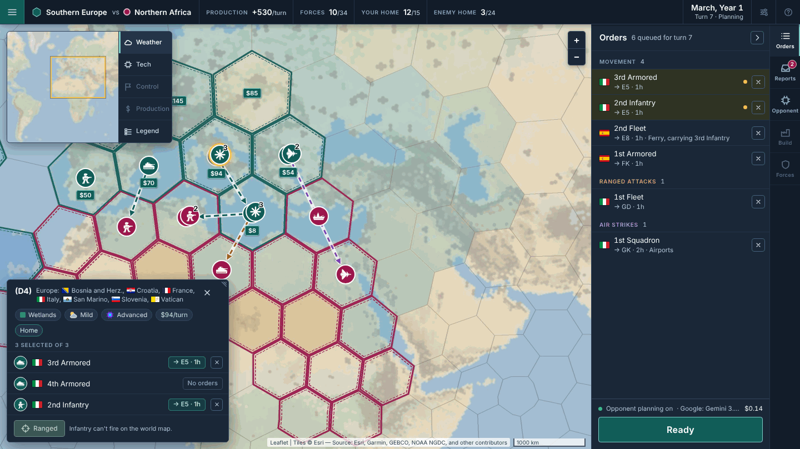
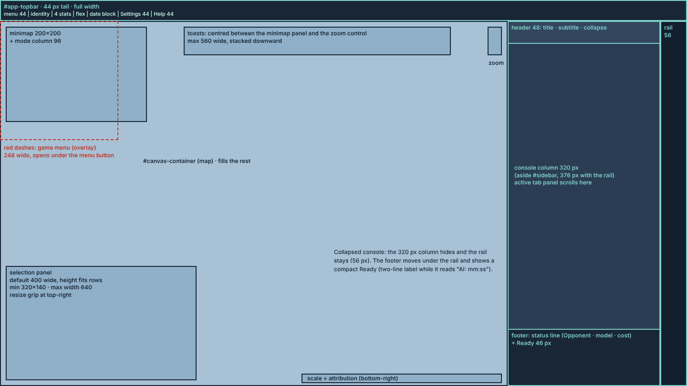

# UI Facelift: Layout Specification

This is the target layout for the UI facelift milestone. Each phase's execution plan cites it, and the plans hold the step-by-step work. The milestone changes where things are on screen and how they are reached. It does not change game rules, the opponent, saved data, or IPC.

Everything here was settled with the product owner in the layout review: layout C, the docked operations console, plus parts of layouts A and B.

## How to Read This Document

- **Text wins over pictures.** The screenshots are mockups rendered from a fixed scenario. They show arrangement, proportion, and wording. When a picture and a sentence disagree, follow the sentence.
- **The mockups use Inter as a stand-in font.** The app keeps its `system-ui, -apple-system, sans-serif` stack. The renderer's Content Security Policy (`font-src 'self' data:`) blocks web fonts, so do not add any. Numbers use `font-variant-numeric: tabular-nums`, not a monospace face.
- **The map in the mockups is an approximation.** Hex codes, names, counts, and captions come from game data for the scenario below. The basemap and hex drawing are a stand-in for Leaflet and the canvas overlay.
- **Phases.** Section [Phases](#phases) lists the phases. Each element section says which phase builds it. Phase numbers belong in `.spec` only. Never put them in code, comments, tests, `doc/`, or configuration (`.cursor/rules/12-no-plan-identifiers.mdc`).

Mockup scenario: Global map, Small game, bonuses Low, fog of war on, started in September. Southern Europe (human, 15 home hexes) against Northern Africa (opponent, 24 home hexes). Turn 7 is March, Year 1. The battle mockup is at hex E8 in April, Year 1.

## Screens

| File | Shows |
| --- | --- |
| [ui-facelift-strategic-orders.png](ui-facelift-strategic-orders.png) | Strategic planning, Orders tab, a three-unit stack selected |
| [ui-facelift-opponent-tab.png](ui-facelift-opponent-tab.png) | Opponent tab while the opponent plans; Ready reads "AI: 00:12"; a turn-update toast |
| [ui-facelift-reports-strike.png](ui-facelift-reports-strike.png) | Reports tab, aiming an air strike from the selection panel |
| [ui-facelift-collapsed-menu.png](ui-facelift-collapsed-menu.png) | Console collapsed to its rail, game menu open, terrain legend open |
| [ui-facelift-tactical.png](ui-facelift-tactical.png) | Tactical battle: battle header with the force bar |
| [ui-facelift-new-game-global.png](ui-facelift-new-game-global.png) | New game, Global tab |
| [ui-facelift-new-game-regional.png](ui-facelift-new-game-regional.png) | New game, Regional tab |
| [ui-facelift-frame-step.png](ui-facelift-frame-step.png) | End of Phase 2: the final frame, with today's panel contents moved in unchanged |
| [ui-facelift-regions.png](ui-facelift-regions.png) | Frame regions and sizes at a 1440 × 810 window |

## Decisions

These were confirmed with the product owner.

1. **Layout C.** The map takes the window. A 44 px top bar runs across the top, and an operations console docks on the right. There are no floating side panels, and no small icon clusters spread around the map.
2. **One milestone, no gameplay changes.** No rule, IPC, or saved-data change. Renderer-only display values, such as top-bar totals, are allowed when a pure function in `src/shared` computes them from the snapshot and has a unit test.
3. **Placeholders only at entry points.** A future feature gets a disabled control only where a player would look for it: a menu item, a tab, a top-bar button, a map mode, a button on a report. Each one is disabled and has the tip "<Name> is not available in this version." Content features with no entry point are deferred with no placeholder. See [Placeholders and Deferred Items](#placeholders-and-deferred-items).
4. **Selection ring on the map.** Each hex holding a selected unit gets a gold ring around its top marker.
5. **Ranged and Strike stay visible.** While units are selected they are greyed out with a one-line reason when they can't be used, instead of hiding.
6. **Destination codes in order rows.** Every queued-order row names its target hex code.
7. **The Opponent tab shows its tools and the activity log together**, with no Tools/Model sub-tabs.
8. **Force bar in tactical battles**, from layout B2, in the top bar.
9. **The minimap stays upper-left.** Map modes and the legend toggle sit beside it.
10. **Resizable selection panel**, from layout A1, at the bottom-left of the map.
11. **Order lines get arrowheads and outlines.** Ranged and air-strike lines get the movement arrowhead. Every order line (movement, ranged, strike; queued, previewed, and played back) gets a light outline under it. The outline is a pale casing that keeps the dashed line readable on any terrain.
12. **The API key stays on the Opponent tab.** There is no Settings dialog in this milestone. Settings is a placeholder.
13. **Tactical battles lives only in the game menu**, as "Offer tactical battles". It is not on the new-game screen.
14. **Electron's File/Edit/View menu bar auto-hides** (`autoHideMenuBar: true`). Alt still shows it, and its keyboard shortcuts keep working.
15. **Window size.** The minimum stays 800 × 600. Layouts are verified at 1280 × 720 and 1920 × 1080, and checked for overflow at 800 × 600.
16. **Verification includes a screenshot smoke run** (`npm run ui:smoke`), added in Phase 2 and extended by later phases.

## Compatibility Names

This milestone doesn't rename existing identifiers, so bindings by id and the source-reading contract tests keep working. These names stay even though the UI around them changes:

- `#sidebar` is the console root (`aside#sidebar.console`).
- `src/renderer/gameplay/sidebarSupport.ts`, `updateSidebar`, `updateGameStateSidebar`, and the `updateGameStateSidebarUi` option. `updateGameStateSidebar` now writes the top bar.
- `#sidebar-selected-unit`, `#sidebar-error`, `#pending-orders-list`, `#ranged-attacks-list`, and `#air-strikes-list`.
- Every `#openrouter-*` id, including `#openrouter-new-btn` and `#openrouter-tactical-battles` after they move into the game menu.
- `openNewGameOverlayFromModelTab`. Its orienting comment changes to say the game menu calls it.

A later cleanup can rename these with the naming tool (`npm run naming:apply`). That is outside this milestone.

## Frame

| Region | Element | Size and position |
| --- | --- | --- |
| Top bar | `header#app-topbar` | Full width, 44 px tall, at the top of the window |
| Map | `#canvas-container`, inside `#app-body` | Everything under the top bar and left of the console |
| Console | `aside#sidebar.console`, inside `#app-body` | Right edge, full height under the top bar. 376 px expanded (320 px content column and a 56 px tab rail on the outer edge); 56 px collapsed |
| Game menu | `#game-menu` | Fixed popup, 248 px wide, top-left corner at (0, 44) |

- `body` is a column: `#app-topbar`, then `#app-body`, a row holding the map and the console.
- While the new-game overlay is open (`#game-over-overlay` without `hidden`), the top bar, the console, and the game menu are not displayed, and the map fills the window. Phase 6 changes this for the top bar only.
- Overlays drawn on the map keep a 12 px inset from the map's edges. That covers the minimap panel, the selection panel, the zoom control, toasts, scale, and attribution.
- Fixed-position popups (build popup, stack callout, tooltips) already use viewport coordinates and need no change. Code that turns a pointer into a map position must subtract the map container's `getBoundingClientRect()`, as the existing code does. Phase 2 verifies this by hand near the top edge of the map.
- When the map container changes size (window resize, console collapse, overlay open or close), the canvas and Leaflet resize on the next animation frame. A `ResizeObserver` on `#canvas-container` triggers this. The tactical battles dialog, which already sized itself to the map, uses the same watcher.
- Control tips open below and to the right of the pointer, or above or to the left of it where they would leave the window. The console's rail and Ready sit at the window's edges, so their tips need this.

### Visibility by mode

| Mode | Top bar | Console | Map chrome |
| --- | --- | --- | --- |
| Strategic planning, resolution playback | Match status | Shown | Shown |
| Tactical planning and beat playback | Battle header (Phase 5) | Shown | Shown |
| Tactical battles list, annihilation dialog | Shown, no pointer input | Shown, no pointer input | Shown, no pointer input |
| New game, game over | Hidden (Phase 6: a "New game" bar) | Hidden | Hidden; the map shows the preview |

Pointer input is switched off by `setMainUIControlsEnabled(false)`. From Phase 2 it covers the top bar and closes the game menu.

## Top Bar

Built in Phase 2. The battle header replaces it in battles in Phase 5. See [ui-facelift-strategic-orders.png](ui-facelift-strategic-orders.png).

From left to right:

1. **Game menu button** (`#game-menu-btn`): 44 × 44, in the button teal. Opens the [game menu](#game-menu).
2. **Sides**: a teal dot and the human side's name, "vs", then a rose dot and the opponent's name. The names are `state.humanHomeRegion` and `state.aiHomeRegion`, with an em dash when missing. Long names end in an ellipsis: at most 220 px each, and 120 px below a 1100 px window.
3. **Four readouts**, each a caption and a value. Below a 1360 px window the captions hide and the values stay. Every readout keeps its tip.

   | Caption | Value | Source |
   | --- | --- | --- |
   | Production | `+530` with suffix `/turn` | Sum of `urbanHexCount` (truncated, at least 0) over `state.strategicInfrastructure` rows whose hex `state.strategicControl` lists as `human`, skipping neutral-border hexes (`isNeutralBorderHex`). This matches the per-turn credit in `src/main/gameActions/controlAndProduction.ts`. A city adds it only while it is building. |
   | Forces | `10` with suffix `/34` | Count of `state.units` with `player === 'human'`, out of the sum of `getMaxUnitsPerType(parseGameSize(state.gameSize))`. The tip lists each type, for example "infantry 3 of 12". |
   | Your home | `12` with suffix `/15` | `countControlledHexesInRegion(state.strategicControl, state.humanHomeRegionHexes, 'human')` |
   | Enemy home | `3` with suffix `/24` | `countControlledHexesInRegion(state.strategicControl, state.aiHomeRegionHexes, 'human')` |

   Numbers use `toLocaleString('en-US')`. With no match loaded, each value is an em dash and the suffix is empty.
4. **Spacer.**
5. **Date block**, right-aligned on two lines. The first line is the date (`state.currentDateLabel`). The second is "Turn 7 · Planning", using the title-cased strategic phase. During a battle the second line is "Beat 2 · Tactical planning" or "Beat 2 · Tactical resolution", and the first line ends with the weather icon and word (`formatWeatherIconHtml`) when the battle has weather. With no match loaded, both lines are an em dash.
6. **Settings** (`#topbar-settings-btn`) and **Help** (`#topbar-help-btn`): 44 × 44 icon buttons. Both are disabled placeholders.

The top bar replaces the "Game state" lines (`#sidebar-phase`, `#sidebar-turn`) and the "Selected hex" heading. `src/shared/sidebarPhaseLabel.ts` is replaced by `src/shared/topBarDateBlock.ts`.

## Game Menu

Built in Phase 2. See [ui-facelift-collapsed-menu.png](ui-facelift-collapsed-menu.png).

A disclosure popup (`#game-menu`, `role="group"`, toggled with the `hidden` attribute) under the menu button. The button carries `aria-expanded` and `aria-controls="game-menu"`.

| Item | Element | Behavior |
| --- | --- | --- |
| New game… | `#openrouter-new-btn`, moved from the Model tab | Today's New button. The click handler is unchanged. |
| Save game… | `#game-menu-save-btn` | Disabled placeholder |
| Load game… | `#game-menu-load-btn` | Disabled placeholder |
| Offer tactical battles | `#openrouter-tactical-battles`, moved from the Model tab, now inside its label | Today's checkbox. The label text changes from "Tactical battles". The persistence and tip are unchanged. |
| How to play | `#game-menu-how-to-play-btn` | Disabled placeholder |
| Quit | `#game-menu-quit-btn` | Calls `window.close()`. On Windows and Linux the app quits (`window-all-closed`). On macOS the window closes and the app stays in the dock, which is the platform convention. |

- Clicking the menu button opens or closes the menu.
- Clicking an enabled menu button closes the menu. Toggling the checkbox leaves it open.
- A pointer press anywhere outside the menu and its button closes it.
- Escape closes it and puts focus back on the menu button. The menu takes Escape first, so the map's Escape handling doesn't also run.
- Opening the new-game overlay, or switching pointer input off, closes it.
- The menu is not shown during the new-game overlay. In Phase 6, New game… is disabled there.

## Console

The frame and tabs are built in Phase 2. The contents are restyled in Phase 3.

- **Tab rail** (`#console-rail`, `role="tablist"`, vertical) on the outer right edge, 56 px wide, with 58 px tabs showing an icon and a label. In order:
  1. Orders (`#console-tab-orders`).
  2. Reports (`#console-tab-reports`, from Phase 3).
  3. Opponent (`#console-tab-opponent`).
  4. Build (`#console-tab-build`), a disabled placeholder.
  5. Forces (`#console-tab-forces`), a disabled placeholder.

  The selected tab has a 3 px accent bar on its outer edge. Badges appear on Orders (queued orders) and Reports (unread entries) in Phase 3.
- **Header**, 48 px: the active tab's title (`#console-title`) and a subtitle (Phase 3), then the collapse button (`#console-collapse-btn`).
- **Panels**: `#console-panel-orders`, `#console-panel-reports` (Phase 3), and `#console-panel-opponent`, switched with `selectTabPanel`. Only one is visible at a time, and the visible panel scrolls.
- **Footer** (`#console-footer`): Ready (`#ready-btn`), full width and 46 px tall, with its existing labels: "Ready", or "AI:" and the elapsed wait. From Phase 3 a status line sits above Ready.
- **Collapse**:
  - The collapse button or a click on the active tab collapses the console to the rail (`data-collapsed="true"`).
  - A click on any tab while collapsed expands it on that tab.
  - While collapsed, the footer moves under the rail and Ready shrinks to 44 × 44. The "AI:" label and its timer wrap onto two lines.
  - The collapsed state lasts for the app session only and is not saved.
- **Opening state**: expanded, on Orders.

### Orders tab

- **Phase 2**: today's top-panel contents, moved without changes. That is "Selected unit", the Ranged/Strike row, the three order lists, and `#sidebar-error`. Ready moves to the footer.
- **Phase 3**: three groups: Movement, Ranged attacks, Air strikes.
  - Each group has a header with a count. An empty group shows "None".
  - A row shows the unit's flag and name, then a sub-line: an arrow, the target hex code, and the distance. Air strikes add the target type, using the dropdown's option label. A ferry adds "Ferry". Examples: "→ E5 · 1h", "→ GK · 2h · Airports".
  - Each row keeps its cancel ×. Rows for selected units are highlighted.
  - Subtitle: "N queued for turn T", or "for beat B" in a battle.
  - The "Selected unit" line and the Ranged/Strike row move to the [selection panel](#selection-panel).

### Reports tab (Phase 3)

- A list of what the two map toasts showed during this match, newest first: the turn update (`#map-toast`) and the opponent's message and strategy (`#ai-strategy-toast`).
  - Each entry shows a tag (T7, or B2 in a battle), a kind (Turn report, Message, or Notice), and the text.
  - Turn reports carry a disabled Replay placeholder.
- An entry is unread until the Reports tab is shown. The Reports rail tab shows the unread count.
- The list clears when a new match starts, as the AI activity log does. It is not saved.
- Toasts keep their behavior. They move to the top centre of the map, between the minimap panel and the zoom control, at most 560 px wide.
- Two text fixes come with this phase, because these lines become permanent entries. In `consolidatedTurnUpdateToast.ts`, "1 hexes lost to opponent" and "1 infantry units deployed" become singular when the count is 1.

### Opponent tab

- **Phase 2**: today's lower-panel contents, moved without changes. That is the Tools/Model sub-tabs and the activity log. New and Tactical battles move to the game menu. Showing the tab scrolls the activity log to its newest line, because lines added while the tab is hidden cannot scroll it.
- **Phase 3**: four sections and no sub-tabs. See [ui-facelift-opponent-tab.png](ui-facelift-opponent-tab.png).
  1. **Status**: Run and one sentence saying whether opponent planning is on.
  2. **Commander**: API key with the match cost, model with refresh, and reasoning effort. Same controls and ids.
  3. **Tool groups**: the existing toggles and counts in two columns.
  4. **Activity log**: `#openrouter-log`, filling the rest.

  Turning Run on no longer switches tabs. Update Run's tip to match.

### Footer status line (Phase 3)

One line above Ready:

- A dot.
- "Opponent planning on", "Opponent planning off", or "Opponent planning…", from Run and the wait state Ready already uses.
- The selected model's name: the option text before " [".
- The match cost.

The line is read-only.

## Selection Panel

Built in Phase 3. See [ui-facelift-strategic-orders.png](ui-facelift-strategic-orders.png) and [ui-facelift-reports-strike.png](ui-facelift-reports-strike.png).

- **Placement**:
  - Bottom-left of the map, 12 px inset.
  - Shown while at least one of the player's units is selected, and hidden otherwise and during the new-game overlay.
  - Default width 400 px. The height fits the rows, up to half the map height; past that the unit rows scroll.
- **Resize**:
  - A grip at the top-right corner resizes the panel. Width runs from 320 to 640 px, height from 140 px to the map height minus 24 px.
  - The size is kept for the session only.
- **Header**:
  - The primary unit's hex code in parentheses and the hex caption, the same naming line the hex tooltip shows.
  - A close × that clears the selection, the same as the existing clear-selection action.
- **Chips**: terrain, weather (while the weather bonus is on), tech tier (while the tech bonus is on), production `$N/turn` (strategic hexes with urban cells), and Home or Enemy home.
- **Count**: "N selected of M", where M is the player's selectable units in that hex.
- **Unit rows**:
  - Each row shows a type token, the unit's flag, and its name.
  - The order chip uses the Orders-tab wording, with a cancel ×, or reads "No orders".
  - A selected unit in another hex shows that hex code after its name.
- **Action row**:
  - Ranged or Strike is always present while the panel shows. It is greyed out with a reason when it can't be used:
    - "Infantry can't fire on the world map." when a strategic selection includes infantry.
    - "Strike needs a selection of air units only." when air is mixed with other types.
  - The label is Strike when the selection has any air unit, and Ranged otherwise.
  - Aiming keeps today's behavior: Ranged turns into Cancel, and Strike turns into the target-type list and Cancel. Those controls (`#ranged-attack-btn`, `#air-strike-target-type`, `#air-strike-cancel-btn`) move here.
  - `#sidebar-error` moves here, above the action row.
- **Not added**: no "Clear orders" button. Orders are cancelled per row.

## Map Chrome

Built in Phase 4. See [ui-facelift-strategic-orders.png](ui-facelift-strategic-orders.png) and [ui-facelift-collapsed-menu.png](ui-facelift-collapsed-menu.png).

- **Minimap panel**, upper-left of the map at (12, 12):
  - Today's 200 × 200 minimap, unchanged, with a 96 px mode column to its right. The column has five 40 px buttons, each with an icon and a label:
    1. **Weather**, selected by default. Today's normal view.
    2. **Tech**, a latched version of what holding T shows. While Tech is latched, holding T changes nothing; under Weather, T works as today.
    3. **Control**, a disabled placeholder.
    4. **Production**, a disabled placeholder.
    5. **Legend**, a toggle.
  - The selected mode lasts for the session.
- **Legend popover**:
  - The Legend toggle shows `#terrain-legend`, with its style dropdown and rows unchanged, as a panel to the right of the minimap panel.
  - It is closed by default, and its open state lasts for the session.
  - It no longer sits permanently under the minimap.
- **Zoom control**: Leaflet's + and − at the map's top-right.
- **Scale and attribution**: bottom-right of the map.
- **Order lines**:
  - Movement, ranged, and air-strike lines — queued, hover previews, and the shot lines drawn during playback — all draw a light outline (casing) first, then the colored dashed line.
  - Each ends in an arrowhead using the movement arrow geometry (`drawLineArrow`, inset by the unit radius plus the arrow size).
  - Colors stay as they are: movement teal, ranged amber `#a06020`, strike purple `#7a3db5`.
- **Selection ring**: a 3 px `#f2c14e` ring around the top marker of every hex that holds a selected unit, in both theaters. Existing selection highlights stay.

## Tactical Battles

Built in Phase 5. See [ui-facelift-tactical.png](ui-facelift-tactical.png).

In a battle the top bar becomes a battle header:

- Menu button.
- "Battle at (E8)" and the hex caption.
- A line reading "Beat 2 · Tactical planning · April, Year 1" with the weather icon.
- A centred force bar: the player's sub-unit count, a two-colour bar in proportion, and the enemy's count, captioned "Sub-units in battle". Counts come from the battle snapshot. If the snapshot hides enemy sub-units, the count is what the player can see and its tip says so.
- Exit Battle (`#tactical-exit-btn`, moved from `#tactical-battle-hud`), with the same rules and tip.
- Settings and Help.

The console works as on the world map. Orders shows the beat's orders, and Ready commits the beat. The annihilation dialog is unchanged.

## New Game and Game Over

Built in Phase 6. See [ui-facelift-new-game-global.png](ui-facelift-new-game-global.png) and [ui-facelift-new-game-regional.png](ui-facelift-new-game-regional.png).

- **Top bar** while the overlay is open:
  - The menu button, the title "New game", Load game… (disabled placeholder), Settings, and Help.
  - The game menu works: New game… is disabled, Offer tactical battles and Quit work.
  - The console stays hidden.
- **Setup panel** docked at the left, 432 px wide, replacing today's centred dialog box. It keeps every control id and behavior. From top to bottom:
  1. **Header**: the overlay message (`#game-over-message`) and the hide-choices button (`#new-game-dialog-collapse`).
  2. **Map**: the Global and Regional tabs, then the region and sides with their randomize buttons. Add another opponent is a disabled placeholder.
  3. **Forces**: game size, the cap badges with prices, and the Advanced tech line.
  4. **Rules**: the four bonuses, the starting month with randomize, and Fog of war.
  5. **Footer**: Start game, or New game after a match ends, full width.
- **Map**: the preview fills the rest of the window. The preview frame centres on the area right of the panel. Hiding the choices leaves only the hide-choices button.
- **Not on this screen**: the opponent model, a matchup summary, Tactical battles (it lives in the game menu), and any way to cancel the overlay. The overlay still closes only when a start succeeds (`doc/ux/new-game-dialog.md`).

## Placeholders and Deferred Items

Disabled placeholders, each with the tip "<Name> is not available in this version.":

| Placeholder | Where | Phase |
| --- | --- | --- |
| Settings | Top bar | 2 |
| Help | Top bar | 2 |
| Save game…, Load game…, How to play | Game menu | 2 |
| Build, Forces | Console rail | 2 |
| Replay | Turn-report entries in Reports | 3 |
| Control, Production | Map-mode column | 4 |
| Load game… | New-game top bar | 6 |
| Add another opponent | New-game setup panel | 6 |

Save game… gets a longer tip: "Saving to a file is not available in this version. The match in progress is kept on disk between sessions."

Deferred with no placeholder:

- The alerts strip (idle production, units without orders).
- A "No orders" group in the Orders tab.
- The "woken by" detail and token counts on the Opponent tab.
- Report filters.
- The matchup summary on the new-game screen.
- Minimap zoom buttons.

## Element Migration

| Today | After | Phase |
| --- | --- | --- |
| `body` (row: map and `#sidebar`) | Column: `#app-topbar`, then `#app-body` (map and console) | 2 |
| `#sidebar` | Console root `aside#sidebar.console`, with a content column, a tab rail, and a footer | 2 |
| `<h2>Selected hex</h2>` | Removed | 2 |
| `#sidebar-phase`, `#sidebar-turn` | Removed; replaced by `#topbar-date` and `#topbar-turn-phase` | 2 |
| `#ready-btn` and its tip host | Console footer | 2 |
| `#sidebar-selected-unit` | Orders tab (2), then the selection panel header (3) | 2, 3 |
| `#ranged-attack-btn`, `#air-strike-target-type`, `#air-strike-cancel-btn` | Orders tab (2), then the selection panel action row (3) | 2, 3 |
| `#pending-orders-list`, `#ranged-attacks-list`, `#air-strikes-list` | Orders tab (2), restyled with destination codes (3) | 2, 3 |
| `#sidebar-error` | Orders tab (2), then the selection panel (3) | 2, 3 |
| `#sidebar-bottom` (Tools/Model sub-tabs, log) | Opponent tab (2), restructured into sections (3) | 2, 3 |
| `#openrouter-new-btn` | Game menu, "New game…" | 2 |
| `#openrouter-tactical-battles` | Game menu, "Offer tactical battles" | 2 |
| `#map-toast`, `#ai-strategy-toast` | Top centre of the map, and recorded in Reports | 3 |
| `#minimap` | Minimap panel with the mode column | 4 |
| `#terrain-legend` | Legend popover | 4 |
| Leaflet zoom and scale controls | Top-right and bottom-right | 4 |
| `#tactical-battle-hud`, `#tactical-exit-btn` | The button moves into the battle header; the HUD is removed | 5 |
| `#game-over-overlay` dialog box | Left setup panel | 6 |
| `#tactical-annihilation-overlay`, `#build-popup`, `#stack-callout`, all tooltips | Unchanged | — |

## Colors and Tokens

The existing tokens in `static/shellChrome.css` stay. Phase 2 adds these:

| Token | Value | Use |
| --- | --- | --- |
| `--chrome-bg-deep` | `#121b27` | Top bar and console footer |
| `--chrome-rail-bg` | `#141f2d` | Console tab rail |
| `--chrome-divider` | `#243246` | Dividers inside bars and the rail |
| `--player-human` | `#115e59` | Human side mark |
| `--player-opponent` | `#9d174d` | Opponent side mark |
| `--topbar-height` | `44px` | Top bar height |
| `--console-content-width` | `320px` | Console content column |
| `--console-rail-width` | `56px` | Console tab rail |

Phase 4 adds `#f2c14e` (selection ring) to `src/renderer/core/constants.ts`, next to the other map colors.

## New Control Tips

These sentences go in `src/renderer/chrome/frameTooltipText.ts`, beside `controlTooltipText.ts` (which is near the file-size limit), in the static markup, and in the Sentences list of `doc/ux/control-tooltips.md`.

- **Game menu button:** Open the game menu to start a new game, choose whether Ready offers tactical battles, or quit.
- **Production:** The production your cities can add each turn. A city adds its share only while it is building, and a city on the neutral border adds none.
- **Forces:** Units you have fielded, out of the most this game size allows: <breakdown>.
- **Your home:** Hexes of your home region that you hold, out of all its hexes.
- **Enemy home:** Hexes of the opponent's home region that you hold, out of all its hexes.
- **Orders tab:** Show the selected unit and the orders queued for this turn or beat.
- **Opponent tab:** Show the opponent's model, its tools, and the AI activity log.
- **Collapse the console:** Hide the console to widen the map. Click a tab to show it again.
- **Quit:** Close Agent Wars.
- **Model tab**, changed: Show the API key, model, reasoning effort, and the Run control for opponent planning.
- **Placeholders:** see [Placeholders and Deferred Items](#placeholders-and-deferred-items).

Phases 3 through 6 add their own tips in their plans.

## Phases

| Phase | Content | Done when |
| --- | --- | --- |
| 1 | This specification and its screens | The product owner accepts it |
| 2 | Frame: smoke harness, top bar with readouts, console shell with tabs, collapse and live resize, game menu, Electron menu auto-hide, docs | `npm test` passes; `npm run ui:smoke` shows no FAIL; the manual checklist passes; the screens match [ui-facelift-frame-step.png](ui-facelift-frame-step.png) |
| 3 | Console contents: Orders restyle with destination codes, Reports tab, Opponent tab sections, footer status line, selection panel, toast band, text fixes | The same gates, plus the Phase 3 smoke checks |
| 4 | Map chrome and drawing: minimap panel and modes, legend popover, Leaflet control positions, line casing and arrowheads, selection ring | The same gates |
| 5 | Battles: battle header, force bar, Exit Battle in the header | The same gates, plus a battle played to the end and an exit mid-battle |
| 6 | New game and game over: top bar on the overlay, docked setup panel | The same gates, plus a global and a regional start |
| 7 | Docs, screenshots, release: refresh `doc/media`; update the README's images, its OpenRouter setup steps (they still name the Model tab), and its test count; sweep `doc/` for "right panel" wording; regression pass | The product owner signs off |

Each phase gets its own execution plans in `.spec`. Phase 2 has five, run in order and committed one at a time; [ui-facelift-frame-execution-plan.md](ui-facelift-frame-execution-plan.md) lists them.

## Open Questions

- **macOS Quit.** `window.close()` leaves the app in the dock on macOS. That is normal for closing a window, but it isn't "Quit". A real quit would need an IPC channel, which this milestone avoids. The macOS build has not been opened yet (release notes, Known limits), so this stays as is until someone tests on a Mac.
- **Enemy count under fog in battles.** Phase 5 checks whether the battle snapshot lists unseen enemy sub-units, and words the force bar's tip to match.
