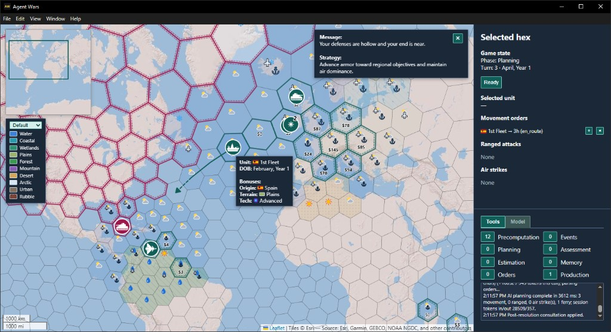

# Agent Wars

[](https://github.com/michael-kitchin/agent-wars/actions/workflows/ci.yml)
[](https://github.com/michael-kitchin/agent-wars/releases)
[](LICENSE)

A turn-based grand strategy game on a real-Earth hex map, where your opponent is a large language model you choose. Coding agents wrote the code and most of the documentation. One developer set the direction, wrote the prompts and the rules the agents follow, and reviewed the results. The story of building it is told in the Agent Wars series in *[Standing Orders](https://standingorders.substack.com)*.


*A tactical battle in central Mexico on turn 2, a rainy August. Teal human units face the rose opponent (in this case, Gemini Flash Lite), and their movement orders are queued in the right panel. The hex readout for Guerrero, Morelos, and México lists the road, the forest and urban terrain, the rain, and what those do to range, movement, and cover. At the upper right, the LLM's message reads "Your lines will shatter before you even realize the battle has begun."*

[Play it](#play-it) · [What's inside](#whats-inside) · [How it was built](#how-it-was-built) · [Architecture](#architecture) · [Build from source](#build-from-source) · [Status](#status) · [License](#license)

## Play it

Download a build for Windows (x64), macOS (Apple silicon), or Linux (x64) from [Releases](https://github.com/michael-kitchin/agent-wars/releases). The builds are unsigned side-load builds, so Windows and macOS warn before the first launch. Each release lists SHA-256 checksums in `SHA256SUMS.txt`.

- **Windows:** unzip, then run `Agent Wars v2.5.0.exe`. If SmartScreen stops it, choose **More info**, then **Run anyway**.
- **macOS:** unzip, then open `Agent Wars v2.5.0.app`. If macOS blocks it, open **System Settings > Privacy & Security** and choose **Open Anyway**.
- **Linux:** extract the archive, then run `./agent-wars`. That launcher handles Chromium's sandbox when the archive can't keep `chrome-sandbox` owned by root.

The opponent needs an [OpenRouter](https://openrouter.ai) API key of your own:

1. In the right-side panel, open the **Model** tab (the panel starts on it).
2. Paste your OpenRouter API key into the API key field (placeholder `Set key and blur to save`).
3. Click outside the field, or press Enter, to save. A saved key loads the model list.
4. Choose a model. **Refresh model list** reloads the list.
5. Click **Run** to start opponent planning.

The key is handled only in the Electron main process and stored locally in the Electron user-data directory, not in repository files. Without a key or a model the app still runs, **Run** stays disabled, and the opponent makes no model calls.

Starting a match, the controls, and where messages appear are covered in [doc/how-to-play.md](doc/how-to-play.md).



*Re-invading the New World, at the start of a global game. What could go wrong?*

## What's inside

- **A hybrid AI opponent.** The engine pre-computes a briefing (an ASCII hex map, Markdown tables of units and threats, and attention flags) before it consults the model. Standing orders carry the plan forward on turns the model isn't consulted, and event callbacks decide when it is. Any OpenRouter model can play; one without tool calls plays without the planning tools. See [doc/hybrid-ai.md](doc/hybrid-ai.md) and [doc/ai-tools.md](doc/ai-tools.md).
- **Prompts as code.** The prompts are assembled by builders in [`src/main/openRouter/promptSpec/`](src/main/openRouter/promptSpec/), documented in [doc/ai-commander-prompts/](doc/ai-commander-prompts/README.md), and held to that contract by tests such as `consultationContract.test.ts`, `envelopeJsonSchema.test.ts`, and `variantConformance.test.ts`.
- **A real-Earth hex grid at two scales.** Strategic play uses H3 resolution 1 on the global map, or 2 or 3 on one of the regional maps. Tactical battles sit three resolutions finer. Terrain, roads, place names, and climate come from public datasets through an offline Python pipeline (`scripts/terrain_pipeline/`).
- **Simultaneous turns.** Both sides plan, then the engine resolves air strikes, ranged fire, movement, ferry, and melee in a fixed phase order, with optional zoomed-in tactical battles. The rules are in [doc/combat-rules-v3.md](doc/combat-rules-v3.md).
- **Guardrails.** `npm test` builds the main process, then runs ESLint (with custom rules in [`eslint-rules/`](eslint-rules/)), a naming-convention check, a renderer type check, the main-process and tool tests (785 tests at 2.5.0), and a third-party-notices check. The renderer runs with context isolation, without Node integration, and under a Content-Security-Policy.


## How it was built

Every line of production code was written by coding agents, mostly in Cursor. The developer wrote the prompts that drove the agents and the rules they follow; the agents also wrote the plans and most of the documentation. All of it is in the repository:

- [AGENTS.md](AGENTS.md): what every agent reads first, including which document wins a disagreement and what to update in the same change.
- [`.cursor/rules/`](.cursor/rules/): fourteen always-on coding rules, from reliable code and testing standards to file-size limits and naming.
- [`.spec/completed/`](.spec/completed/): the execution plans, audits, and verification records behind each change.
- [doc/coding-prompts-1.md](doc/coding-prompts-1.md): the reusable prompt library. Its core cycle is four prompts: plan, audit the plan, implement, audit the implementation.
- [doc/](doc/README.md): the living product documentation, kept current with the code.

**A trail to follow:** the [unit origin and country flags plan](.spec/completed/unit-origin-and-country-flags-execution-plan.md) opens with ground rules for the executing agent, locked decisions, and verified facts. The code it produced is in [`src/main/unitOrigin/`](src/main/unitOrigin/), with tests beside it (`unitBirthOrigin.test.ts`, `unitBirthCellSelection.test.ts`, and others).

### Time and tokens

The developer logged hours in Toggl from 1 Jan to 14 Sep 2026. The charts' 169 hours leave out 2.9 hours of planning and 6.5 hours of promotion. Cursor tokens are usage attributed to Agent Wars sessions by the window between milestone tags. Both records stop in September, before the October work on milestone 2.5.


*Logged time and Cursor tokens by project stage, each as a share of its own total (169 hours and 5.9 billion tokens). Fixes, the work after the milestone 2.4 tag, took about a sixth of the time and a third of the tokens. The Fixes hours include some feature work.*


*The same totals by problem domain. Each milestone counts toward one domain, the subject of its execution plan. Game systems took the largest share of both, at 42% of the time and 40% of the tokens. Milestones 1.3 and 1.4 share one token window, split between geospatial and game systems by logged hours.*


*The same totals by milestone, from the core prototype (0.1 to 0.4) through tactical integration (2.4) and the fixes after it. Milestone 1.3 has no tag, so it shares a row with 1.4.*

## Architecture


*Event-driven consultation, as drawn for 2.4.0. In the drawing, the orange step is the one that calls the model, and it runs when a mandatory override or a callback the model subscribed to fires. The eight overrides along the bottom are still the ones the engine returns in 2.5.0, including the deadman consult after five turns. Every-turn mode consults during planning, and pre-computation no longer injects combat estimates.*

The override list is the return of `evaluateMandatoryOverrides`, and the five-turn deadman is `DEADMAN_TURNS`, both in `callbackEvaluation.ts`. What ships now is in [doc/hybrid-ai.md](doc/hybrid-ai.md).

## Build from source

Prerequisites: Node.js 24 or later (`.nvmrc` pins 24) and npm 10 or later. Python 3 is used to extract the generated data during the build.

```bash
npm install
npm run build
npm start
```

- **Build:** compiles the main process and preload with TypeScript (`dist/`) and bundles the renderer with esbuild (`static/renderer.js`). Generated terrain data is extracted as part of the build.
- **Start:** runs Electron; the window loads the renderer from `static/index.html`. Game state is stored in SQLite through **better-sqlite3** (a native module), in your Electron user-data directory.
- **Lint and test:** `npm run lint` runs ESLint on `src/`. `npm run test` runs the full check described under [What's inside](#whats-inside).
- **Package:** `npm run dist`, `dist:win`, `dist:linux`, or `dist:mac` builds with electron-builder (see [.spec/completed/packaging.md](.spec/completed/packaging.md)). Releases are made as described in [doc/releasing.md](doc/releasing.md).


### Terrain data

The generated terrain and region packs under `data/generated/` are tracked, so building and playing need no GIS tools. To regenerate them:

- `npm run terrain:generate` runs the metadata step, then the road/rail sides step. Related scripts: `terrain:generate:landmass`, `terrain:generate:road-rail:high-fidelity`, and `terrain:generate:road-rail-vectors`.
- `npm run terrain:test` runs the Python tests for the terrain scripts, and `npm run terrain:validate` checks the classification environment.

Setup, the Python CLIs, and troubleshooting are in [scripts/terrain_pipeline/README.md](scripts/terrain_pipeline/README.md). What the app loads at run time is in [doc/terrain-pipeline.md](doc/terrain-pipeline.md).

## Status

- **Version:** 2.5.0, distributed as side-load builds only (no store, signing, or notarization).
- **Progress:** Phase 0 (hybrid AI validation) and Phase 1 (global strategic game) are complete. Phase 2 is complete through milestone 2.5 (regional game and rules enhancements), including tactical battles (2.1 to 2.4) and playtester UI fixes (2.45). Milestone 2.6 (player-facing save/load and session management) is not shipped. See the [development plan (v3.4)](doc/devleopment-plan-v3.4.md); milestones 0.2 to 0.5 were a throwaway prototype that validated combat, tools, and the AI loop before the production baseline.
- **CI:** lint and tests run on every push that changes code (Linux). The three-platform packaging build runs on demand and drafts each release.
- **Contributions:** this is a personal R&D project, so it doesn't take issues or pull requests. To report a security problem, see [SECURITY.md](SECURITY.md).


## License

Source code written for Agent Wars is under the [MIT license](LICENSE). Reuse it, and keep the copyright notice and the license text with the copy.

Third-party software, vendored files, and the generated earth data under `data/generated/` keep the terms in [THIRD-PARTY-NOTICES.md](THIRD-PARTY-NOTICES.md). The terrain uses EarthEnv consensus land cover, which is CC BY-NC 4.0. The weather uses WorldClim, which allows academic and other non-commercial use and requires permission before redistribution or commercial use. Those terms prevent commercial use of the application as distributed.