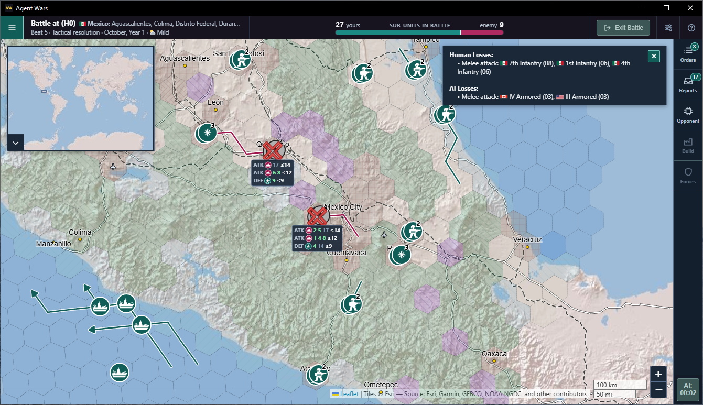
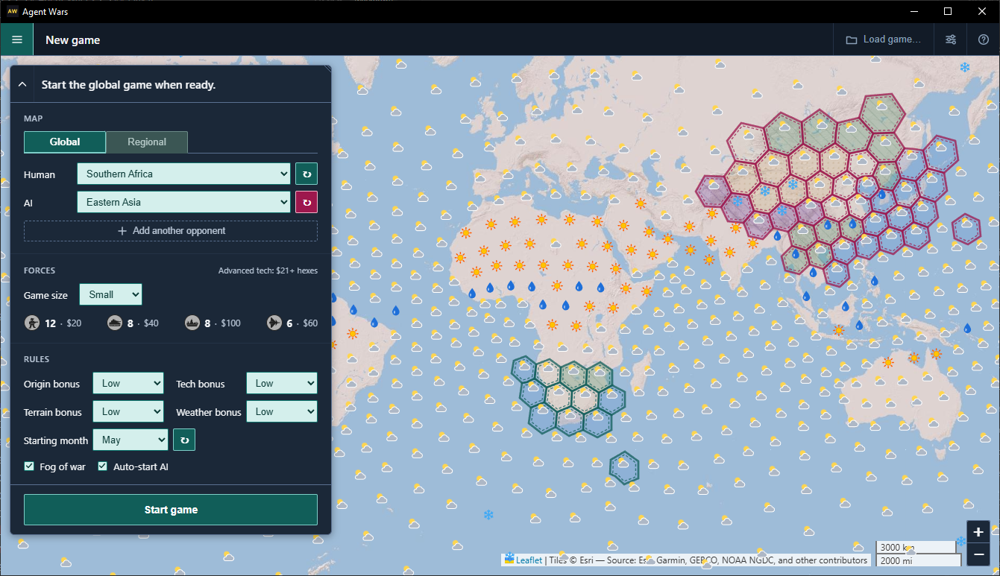
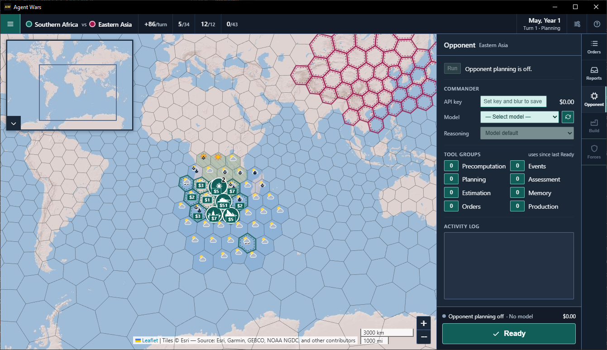
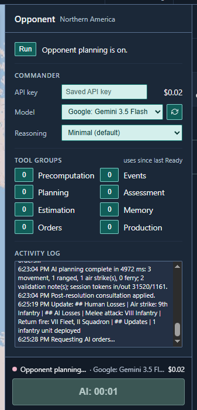
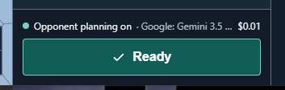
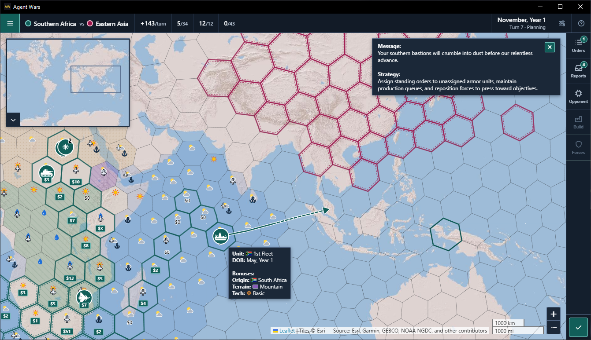
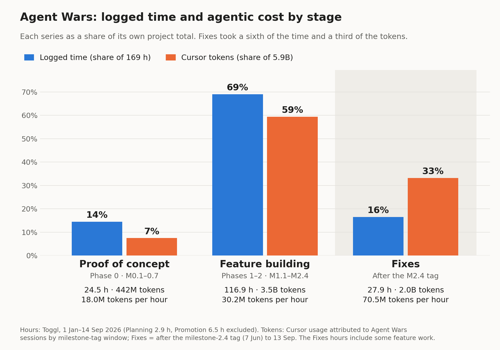
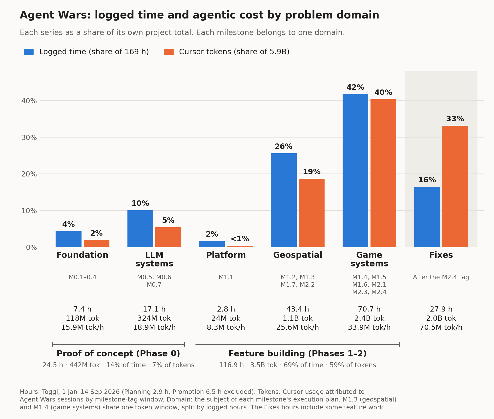
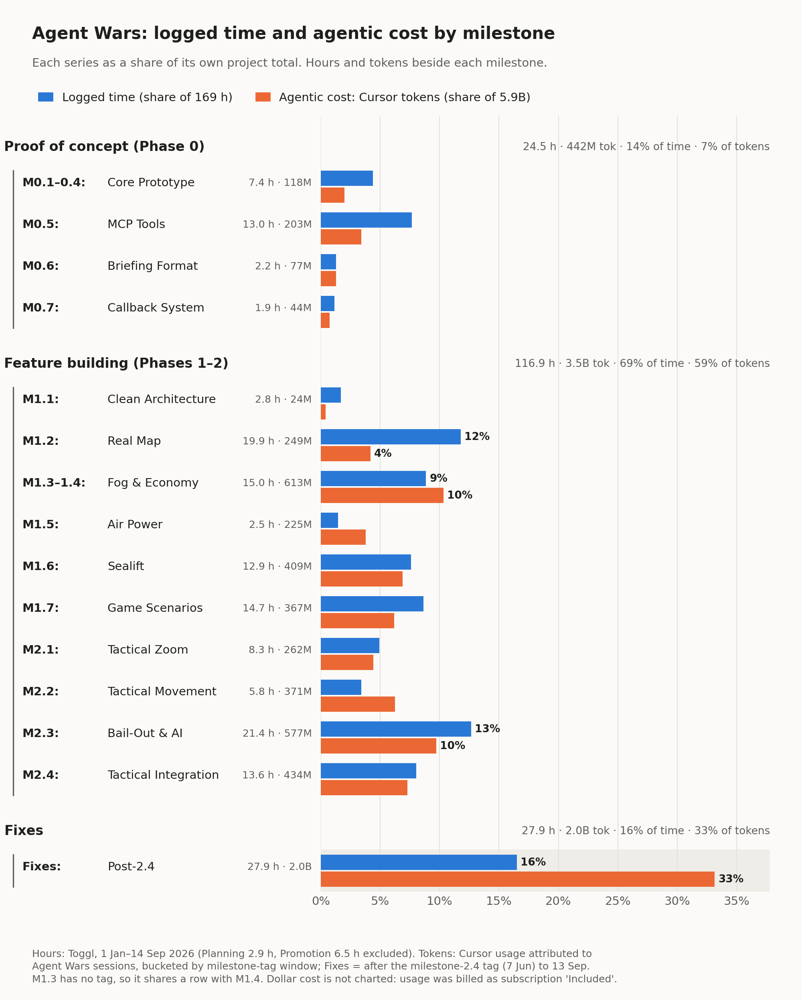
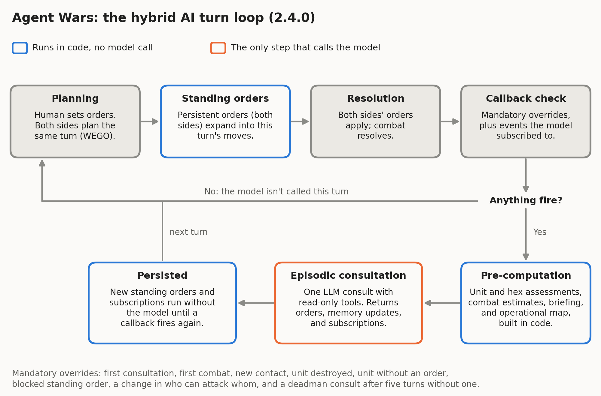

# Agent Wars

[](https://github.com/michael-kitchin/agent-wars/actions/workflows/ci.yml)
[](https://github.com/michael-kitchin/agent-wars/releases)
[](LICENSE)

A turn-based grand strategy game on a real-Earth hex map, where your opponent is a large language model you choose. Coding agents wrote the code and most of the documentation. I set the direction, wrote the prompts and coding rules, and reviewed the results.

Agent Wars is a WEGO game ("we go"), where neither player can see what the other is planning. For each turn, both sides create combat, movement, and production orders at the same time, based on partial, subjective views of the battlefield. Once players are ready, the game executes their orders and determines the outcomes (think: "Axis & Allies" meets "Diplomacy", with a software referee).

The game is intended to be simple to learn and quick to play, but with enough depth to make things interesting and believable.

**[Play It](#play-it) · [Why This Exists](#why-this-exists) · [Why I'm Sharing This](#why-im-sharing-this) · [What's Inside](#whats-inside) · [How It Was Built](#how-it-was-built) · [Architecture](#architecture) · [Build from Source](#build-from-source) · [Status](#status) · [License](#license)**



*Beat 3 of a tactical battle in central Mexico during combat resolution, showing animated hits, movement, and dice rolls. Human/teal units face an LLM/rose opponent (in this case, Gemini Flash Lite), with losses displayed in the corner.*

## Why This Exists

Before I started Agent Wars I'd been writing software by hand for a long time, but I knew very little about agentic development. This project was how I started learning about it.

I chose this approach because:

- I wanted a crash course in agentic development, on work I could afford to screw up. I especially wanted to learn what to expect as a codebase grows, from greenfield through features, bug fixes, and (eventual) replacement.
- It feels good to blow up commercial LLMs on imaginary battlefields, even if I'm paying their vendors for the privilege.
- For something new, I wanted LLMs to navigate real-world geography, planning combat, movement, and logistics on a hex map across many turns.
    - Example: ever played [Rogue](https://en.wikipedia.org/wiki/Rogue_(video_game)) or [NetHack](https://en.wikipedia.org/wiki/NetHack)? Turns out LLMs have too, and they can use ASCII maps for spatial reasoning (see [doc/ai-commander-prompts/strategic-prompt.md](doc/ai-commander-prompts/strategic-prompt.md) for more on this).
- For calibration, I built it on familiar ground (Electron and TypeScript, database development, and geospatial data), so I could catch bad agent output sooner.

I'm telling the story of how I built Agent Wars (and am still adding to it) in *[Standing Orders](https://standingorders.substack.com)*.

You can learn more about me on [LinkedIn](https://www.linkedin.com/in/mkitchin/).

## Why I'm Sharing This

To offer what I've learned, and to give others a chance to blow up their (not) favorite LLMs, too.

Also: I don't intend to charge money for Agent Wars, now or ever.

### Where We Go From Here

I currently plan to:

1. Throw features at this project (multiple human/LLM players, a diplomacy system, local LLM support, game save/load, etc.) until I've learned what I need to from this codebase.
2. Then regenerate Agent Wars in a different language, framework, etc. (thinking of C#/[Godot](https://godotengine.org/)) and figure out what's next from there.

## Play It

Download a build for Windows (x64), macOS (Apple silicon), or Linux (x64) from [Releases](https://github.com/michael-kitchin/agent-wars/releases). The builds are unsigned side-load builds, so Windows and macOS warn before the first launch. Each release lists SHA-256 checksums in `SHA256SUMS.txt`.

- **Windows:** unzip, then run `Agent Wars v2.6.0.exe`. If SmartScreen stops it, choose **More info**, then **Run anyway**.
- **macOS:** unzip, then open `Agent Wars v2.6.0.app`. If macOS blocks it, open **System Settings > Privacy & Security** and choose **Open Anyway**.
- **Linux:** extract the archive, then run `./agent-wars`. That launcher handles Chromium's sandbox when the archive can't keep `chrome-sandbox` owned by root. On Ubuntu 23.10 and later, where AppArmor blocks unprivileged user namespaces, it starts without the sandbox and says so.

The LLM opponent needs an [OpenRouter](https://openrouter.ai) API key to work:

1. When you first run Agent Wars, you'll see the start game screen. Explore the options, assign sides, and click the **Start game** button.



2. After a moment, the **Command** tab will automatically display on the right when planning did not start with the match.



3. Open a commander's card. The popover's first field is that opponent's **API key**. Paste the OpenRouter key, then click outside the field or press Enter. The key stays masked. Each opponent has its own key. A new game fills only the first opponent from the key you used last.
4. In that same popover, choose a model from Anthropic, Google, Meta, OpenAI, SpaceX, etc. The refresh button to the right of the model list reloads the list with the key in the popover. Each commander can use a different model, reasoning effort, and doctrine.
    - My go-to playtesting model is Google Gemini Flash Lite (version 3.5, currently). A fast, inexpensive, tool-using model that fights reasonably well. It can also finish a typical game for <$1.
    - Ollama/other local model support is on my radar (pun intended, I guess).
5. Click **Start**, at the top of the Command tab, to start planning. The button then reads **Stop**. It stays on Start until at least one commander has both a key and a model. A commander with a model and an empty key does not call the model.
    - You can change a commander's model at any time, or stop planning by clicking **Stop**.



6. Then click **Command** to close the tab. You can explore the map, plan movement, etc. while the commanders are planning.
7. When the AI is done planning, the **Ready** button turns green. Click it to execute planned orders and start the next turn.
    - You can play all you want with the AI disabled. This is a great way to get used to the controls, without burning tokens.



Each opponent's OpenRouter key is stored locally in the Electron user-data directory. The screen receives a key only to fill that opponent's password field, and the key is not written to the activity log. Without a key and a model on at least one commander the app still runs, **Start** stays disabled, and that opponent makes no model calls.

See [doc/how-to-play.md](doc/how-to-play.md) for how to play the game.


### See the Prompts (and Everything Else)

Formatted examples of one consultation are in the repo: [doc/ai-commander-prompts/example-strategic-prompt.md](doc/ai-commander-prompts/example-strategic-prompt.md) and [doc/ai-commander-prompts/example-tactical-prompt.md](doc/ai-commander-prompts/example-tactical-prompt.md). One captured strategic reply is in [doc/ai-commander-prompts/example-strategic-response.md](doc/ai-commander-prompts/example-strategic-response.md).

To see how Agent Wars prompts the LLM, create a text file called `.env` in the game's working directory with the following:

```
AGENT_WARS_LOG_FULL_PROMPTS=1
AGENT_WARS_LOG_FULL_RESPONSES=1
AGENT_WARS_LOG_LEVEL=debug
```

- `AGENT_WARS_LOG_FULL_PROMPTS` controls prompt logging. Set to `1`, `true`, `yes`, or `on` to enable, anything else to disable.
- `AGENT_WARS_LOG_FULL_RESPONSES` controls OpenRouter response logging. Follows the same rules as `AGENT_WARS_LOG_FULL_PROMPTS`.
- `AGENT_WARS_LOG_LEVEL` turns file-based logging on, at a specific level of detail. In addition to `debug`, there's also `trace`, `info`, and `error`. Logging may impact game performance, particularly at the `trace` or `debug` levels.

The game's "working directory" is:

- **Windows:**
  - When the game is started by double-clicking on the executable or a shortcut: wherever the executable is located.
  - When the game is started from PowerShell or the Command Line: wherever the executable is invoked from.
- **macOS:** Not verified, but opening the app from Finder probably won't pick up `.env`. I'll provide an update when I can.
- **Linux:** Wherever the executable is invoked from.

When the `.env` file is present at runtime, the game will create one set of these files per opponent in the same directory. The number is `aiIndexForSeatId` of the seat being consulted. Opponent 1 writes `debug-last-strategic-prompt-1.txt`.

```
debug-last-openrouter-response-body-1.txt
debug-last-strategic-prompt-1.txt
debug-last-tactical-prompt-1.txt
debug-last-user-prompt-1.txt
debug.log
```

- **debug-last-openrouter-response-body-N.txt**: That opponent's last response from OpenRouter, including tool calls. A formatted example of one strategic reply is [doc/ai-commander-prompts/example-strategic-response.md](doc/ai-commander-prompts/example-strategic-response.md).
- **debug-last-strategic-prompt-N.txt**: That opponent's last system prompt sent during a strategic game. This doesn't include tool calls or results. A formatted example is [doc/ai-commander-prompts/example-strategic-prompt.md](doc/ai-commander-prompts/example-strategic-prompt.md).
- **debug-last-tactical-prompt-N.txt**: That opponent's last system prompt sent during a tactical battle. This also doesn't include tool calls or results. A formatted example is [doc/ai-commander-prompts/example-tactical-prompt.md](doc/ai-commander-prompts/example-tactical-prompt.md).
- **debug-last-user-prompt-N.txt**: That opponent's stock prompt suffix, sent after the strategic/tactical prompts.
- **debug.log**: Complete log output at the specified level of detail, including truncated tool calls. This file is appended to with every run, so it should be deleted when no longer needed.

See [doc/hybrid-ai.md](doc/hybrid-ai.md) and [doc/ai-tools.md](doc/ai-tools.md) for what goes into these prompts and how they're assembled and used.

## What's Inside



*Invading east Asia from southern Africa at the start of a game, with "fog of war" enabled (can't see enemy units, until they're close to your own). What could go wrong?*

- **A hybrid AI opponent.** The engine pre-computes a briefing (an ASCII hex map, Markdown tables of units and threats, and attention flags) before it consults the model. Standing orders carry the plan forward on turns the model isn't consulted, and event callbacks decide when it is. Any OpenRouter model can play; one without tool calls plays without the [planning tools](#the-opponents-tools). See [doc/hybrid-ai.md](doc/hybrid-ai.md) and [doc/ai-tools.md](doc/ai-tools.md).
- **Prompts as code.** The prompts are assembled by builders in [src/main/openRouter/promptSpec/](src/main/openRouter/promptSpec/), documented in [doc/ai-commander-prompts/](doc/ai-commander-prompts/README.md), and held to that contract by tests such as `consultationContract.test.ts`, `envelopeJsonSchema.test.ts`, and `variantConformance.test.ts`.
- **A real-Earth hex grid at two scales.** Strategic play uses H3 resolution 1 on the global map, or 2 or 3 on one of the regional maps. Tactical battles sit three resolutions finer. Terrain, roads, place names, and climate come from public datasets through an offline Python pipeline (`scripts/terrain_pipeline/`). The cell sizes and sources are under [Hex Scales](#hex-scales) and [Where the Data Comes From](#where-the-data-comes-from).
- **Simultaneous turns.** Both sides plan, then the engine resolves air strikes, ranged fire, movement, ferry, and melee in a fixed phase order, with optional zoomed-in tactical battles. The rules are in [doc/combat-rules-v3.md](doc/combat-rules-v3.md).
- **Guardrails.** `npm test` builds the main process, then runs ESLint (with custom rules in [eslint-rules/](eslint-rules/)), a naming-convention check, a renderer type check, the main-process and tool tests (915 tests), and a third-party-notices check. The renderer runs with context isolation, without Node integration, and under a Content-Security-Policy.

### Hex Scales

Every map is a grid of [H3](https://h3geo.org) cells, Uber's hierarchical hexagon index. A battle zooms in three resolutions, so one strategic hex contains 343 tactical cells (286 under one of H3's twelve pentagons), plus three rings of neighboring cells.


| H3 resolution | Used for                         | Average hex | Edge   | About the size of |
| ------------- | -------------------------------- | ----------- | ------ | ----------------- |
| 1             | Global strategic map (842 hexes) | 609,800 km² | 483 km | Ukraine           |
| 2             | Strategic map for 6 regions      | 86,800 km²  | 183 km | Austria           |
| 3             | Strategic map for 17 regions     | 12,400 km²  | 69 km  | Montenegro        |
| 4             | Global battles                   | 1,770 km²   | 26 km  | Greater London    |
| 5             | Battles on resolution 2 maps     | 253 km²     | 9.9 km | Malta             |
| 6             | Battles on resolution 3 maps     | 36 km²      | 3.7 km | Macau             |

Each of the 23 regional maps holds 257 to 352 strategic hexes. Those are the footprint totals in [doc/region-summary-1.md](doc/region-summary-1.md): "South-Eastern Asia" is the smallest and "Southern Asia East" is the largest.

Cell areas and edge lengths are averages from the H3 library. The other counts come from the engine and the generated packs.

### Where the Data Comes From

The offline pipeline samples rasters with rasterio and vector layers with Shapely, indexes the cells with H3, and ships the results as zipped JSON. PostGIS is part of that pipeline.


| Layer               | What it drives                                                                                    | Source                                                                                                                        |
| ------------------- | ------------------------------------------------------------------------------------------------- | ----------------------------------------------------------------------------------------------------------------------------- |
| Land cover          | Forest, desert, arctic, and plains                                                                | [EarthEnv](https://www.earthenv.org/landcover) 1 km consensus land cover, 12 classes                                          |
| Topography          | Mountain cells. The 50 km grids where a hex edge is at least 100 km, and the 5 km grids otherwise. | [EarthEnv](https://www.earthenv.org/topography) ruggedness, slope, and elevation from GMTED2010                               |
| Climate             | Each hex's weather in each month                                                                  | [WorldClim 2.1](https://worldclim.org/data/worldclim21.html) monthly temperature and precipitation, 1970–2000, 10 arc-minutes |
| Water               | Water, coast, and shoreline wetlands                                                              | [Natural Earth](https://www.naturalearthdata.com) 1:10m ocean and lakes                                                       |
| Cities              | Urban cells, and so the economy                                                                   | Natural Earth urban areas, from 2002–2003 MODIS satellite data at 1 km                                                        |
| Ports and airfields | Where naval and air units are built and based                                                     | Natural Earth airports and ports                                                                                              |
| Roads and railroads | Infantry and armor enter a battle cell for half a point on a road and a third on a rail.          | Natural Earth roads and railroads                                                                                             |
| Names and borders   | Hex names, unit origins and flags, regional origin areas                                          | Natural Earth countries, states and provinces, populated places, and marine areas                                             |
| Landmasses          | Which land is connected, so land units march within a landmass.                                   | Natural Earth geography regions: continents, isthmuses, and islands of 2,000 km² or more                                      |


Strategic hexes are assigned a per-month weather from that hex's mean temperature and its monthly precipitation, checked in this order (`classifyWeatherMonth` in `weatherBonusRules.ts`): "snow" at 0 °C or below, "rain" at 120 mm or more, "heat" at 23 °C or more, and mild when none of those match. Rain at 23 °C or above still counts as heat.

Credits and license terms are in [THIRD-PARTY-NOTICES.md](THIRD-PARTY-NOTICES.md).

### How the Economy Works

Production is based on real-world urban land cover: the Natural Earth urban areas in the table above, mapped from MODIS. Each strategic hex earns one point per turn for every intact urban cell inside it. The global map has 4,643 of those cells, on 283 hexes, counting cells that meet an urban area of scalerank 5 or lower (`urbanOverlay` in `activeGameMap.ts`). A queued unit spawns once its hex has saved enough points. On the global map each air-strike hit destroys 9 urban cells for good (`strategicUrbanCellsDestroyedPerHit`), so bombing a city cuts its output for the rest of the match.


| Unit     | Cost | The hex also needs           |
| -------- | ---- | ---------------------------- |
| Infantry | 20   | 1 urban cell                 |
| Armor    | 40   | 2 urban cells                |
| Air      | 60   | 5 urban cells and an airport |
| Naval    | 100  | 10 urban cells and a seaport |


Each regional map rescales costs, minimums, and strike size from its own urban counts, keeping the price ratio of 1:2:5:3 for infantry, armor, naval, and air, and the global share of hexes that can build each type. Infantry costs 60 in Western Europe and 10 in South America ([doc/region-summary-1.md](doc/region-summary-1.md)).

### The Opponent's Tools

The opponent plans and manages its forces through six groups of MCP-style tools: engine services with JSON schemas that return the same result for the same game state, offered to the model through OpenRouter function calling. Each of these groups can be switched off from the **Opponent** tab.


| Group      | What the model gets                     | Tools                                 |
| ---------- | --------------------------------------- | ------------------------------------- |
| Planning   | Multi-turn routes and turn counts       | `plan_route`, `check_distance`        |
| Assessment | Threats, terrain, and occupants         | `assess_unit`, `assess_hex`           |
| Estimation | Analytic hit odds for a proposed attack | `estimate_combat`                     |
| Memory     | Notes it saved on earlier turns         | `memory_read`                         |
| Orders     | The standing orders it has assigned     | `query_orders`                        |
| Production | Income, build options, and queues       | `query_production`, `set_build_queue` |


Memory writes and standing-order changes travel in the model's JSON reply. The full catalog is in [doc/ai-tools.md](doc/ai-tools.md).

## How It Was Built

Every line of production code was written by coding agents, mostly in Cursor. I wrote the prompts that drove the agents and the rules they follow; the agents also wrote the plans and most of the documentation. All of it is in the repository:

- [AGENTS.md](AGENTS.md): what every agent reads first, including which document wins a disagreement and what to update in the same change.
- [.cursor/rules/](.cursor/rules/): fifteen always-on coding rules, from reliable code and testing standards to file-size limits, naming, and secrets.
- [.spec/completed/](.spec/completed/): the execution plans, audits, and verification records behind each change.
- [doc/coding-prompts-1.md](doc/coding-prompts-1.md): the reusable prompt library. Its core cycle is four prompts: plan, audit the plan, implement, audit the implementation.
- [doc/](doc/README.md): the living product documentation, kept current with the code.

**A trail to follow:** the [unit origin and country flags plan](.spec/completed/unit-origin-and-country-flags-execution-plan.md) opens with ground rules for the executing agent, locked decisions, and verified facts. The code it produced is in [src/main/unitOrigin/](src/main/unitOrigin/), with tests beside it (`unitBirthOrigin.test.ts`, `unitBirthCellSelection.test.ts`, and others).

### Time and Tokens

I logged hours in Toggl from 1 Jan to 14 Sep 2026. The charts' 169 hours leave out 2.9 hours of planning and 6.5 hours of promotion. Cursor tokens are usage attributed to Agent Wars sessions by the window between milestone tags. Both records stop in September, before the October work on milestone 2.5.



*Logged time and Cursor tokens by project stage, each as a share of its own total (169 hours and 5.9 billion tokens). Fixes, the work after the milestone 2.4 tag, took about a sixth of the time and a third of the tokens. The Fixes hours include some feature work.*



*The same totals by problem domain. Each milestone counts toward one domain, the subject of its execution plan. Game systems took the largest share of both, at 42% of the time and 40% of the tokens. Milestones 1.3 and 1.4 share one token window, split between geospatial and game systems by logged hours.*



*The same totals by milestone, from the core prototype (0.1 to 0.4) through tactical integration (2.4) and the fixes after it. Milestone 1.3 has no tag, so it shares a row with 1.4.*

## Architecture



*Event-driven consultation, as drawn for 2.4.0. In the drawing, the orange step is the one that calls the model, and it runs when a mandatory override or a callback the model subscribed to fires. The eight overrides along the bottom are still the ones the engine returns in 2.5.0, including the deadman consult after five turns. Every-turn mode consults during planning, and pre-computation no longer injects combat estimates.*

The override list is the return of `evaluateMandatoryOverrides`, and the five-turn deadman is `DEADMAN_TURNS`, both in `callbackEvaluation.ts`. What ships now is in [doc/hybrid-ai.md](doc/hybrid-ai.md).

## Build from Source

Prerequisites: Node.js 24 or later (`.nvmrc` pins 24) and npm 10 or later. Python 3 is used to extract the generated data during the build.

```bash
npm install
npm run build
npm start
```

- **Build:** compiles the main process and preload with TypeScript (`dist/`) and bundles the renderer with esbuild (`static/renderer.js`). Generated terrain data is extracted as part of the build.
- **Start:** runs Electron; the window loads the renderer from `static/index.html`. Game state is stored in SQLite through **better-sqlite3** (a native module), in your Electron user-data directory.
- **Lint and test:** `npm run lint` runs ESLint on `src/`. `npm run test` runs the full check described under [What's Inside](#whats-inside).
- **Package:** `npm run dist`, `dist:win`, `dist:linux`, or `dist:mac` builds with electron-builder (see [.spec/completed/packaging.md](.spec/completed/packaging.md)). Releases are made as described in [doc/releasing.md](doc/releasing.md).

### Terrain Data

The generated terrain and region packs under `data/generated/` are tracked, so building and playing need no GIS tools. To regenerate them:

- `npm run terrain:generate` runs the metadata step, then the road/rail sides step. Related scripts: `terrain:generate:landmass`, `terrain:generate:road-rail:high-fidelity`, and `terrain:generate:road-rail-vectors`.
- `npm run terrain:test` runs the Python tests for the terrain scripts, and `npm run terrain:validate` checks the classification environment.

Setup, the Python CLIs, and troubleshooting are in [scripts/terrain_pipeline/README.md](scripts/terrain_pipeline/README.md). What the app loads at run time is in [doc/terrain-pipeline.md](doc/terrain-pipeline.md).

## Status

- **Version:** 2.6.0, distributed as side-load builds only (no store, signing, or notarization).
- **Progress:** Phase 0 (hybrid AI validation) and Phase 1 (global strategic game) are complete. Phase 2 is complete through milestone 2.5 (regional game and rules enhancements), including tactical battles (2.1 to 2.4) and playtester UI fixes (2.45). Release 2.6.0 redesigns the layout: a top bar, a console docked on the right, a selection panel on the map, and a new-game panel docked at the left. Player-facing save/load and session management, the development plan's milestone 2.6, isn't shipped. See the [development plan (v3.4)](doc/devleopment-plan-v3.4.md); milestones 0.2 to 0.5 were a throwaway prototype that validated combat, tools, and the AI loop before the production baseline.
- **CI:** lint and tests run on every push that changes code, and on demand (Linux). The three-platform packaging build runs on demand and drafts each release.
- **Contributions:** this is mostly a personal R&D project, but feel free to report issues (responses will be best-effort) or create a PR (acceptance is up to me).
- **Security:** To report a vulnerability or other security problem, see [SECURITY.md](SECURITY.md).

## License

Source code written for Agent Wars is under the [MIT license](LICENSE). Reuse it, and keep the copyright notice and the license text with the copy.

Third-party software, vendored files, and the generated earth data under `data/generated/` keep the terms in [THIRD-PARTY-NOTICES.md](THIRD-PARTY-NOTICES.md). The terrain uses EarthEnv consensus land cover, which is CC BY-NC 4.0. The weather uses WorldClim, which allows academic and other non-commercial use and requires permission before redistribution or commercial use. Those terms prevent commercial use of the application as distributed.
