# How to play

> **Note:** Some of the screenshots are out of date, since the v2.6.0 facelift. I'll replace them as soon as I can.

This guide covers a match in the current build, from the new-game dialog to the end. Downloading the game and setting up each opponent's OpenRouter key are covered under [Play it](../README.md#play-it) in the README. The full rules are in [combat-rules-v3.md](combat-rules-v3.md).

Agent Wars is a WEGO game ("we go"), where neither player can see what the other is planning. For each turn, both sides create combat, movement, and production orders at the same time, based on partial, subjective views of the battlefield. Once players are ready, the game executes their orders and determines the outcomes (think: "Axis & Allies" meets "Diplomacy", with a software referee).

I'm a geographer by training, so Agent Wars focuses more on geospatial features than nationality. Players start with home regions made up of real-world countries, provinces, or states, but those are mostly labels. What really matters is on the ground: the size and placement of cities, and how terrain and coastlines shape what players can do. Unit origins, terrain familiarity, technology levels, and weather still matter, but not as much.

A side is knocked out when another side holds its home, when it holds no city hex anywhere, or when its own home has no cities left. On a global map, holding a home means every hex of that home. On a regional map, it means home hexes that hold at least 75% of that home's original urban cells. Bombing doesn't change the target. A home that started with no urban cells is taken by holding every hex. A knocked-out side's land and units become neutral.

The last side still in the match wins. When every side would be knocked out on the same turn, none of them is, and the side holding the most city hexes wins. Several sides with that same count leave no single winner. The result screen lists every side. When you played and one side won, the header says your place, such as "You placed 2nd of 4." When you were only watching, it names the winner. When several sides share first, the header says "No side won." and the result line names each of them in seat order. Two names read "{A} and {B} share first place with {n} city hexes each." Three or more read "{A}, {B}, and {C} share first place with {n} city hexes each." Deathmatch, the usual rule on either map, has no turn limit. Most city hexes at turn limit ends the match after the limit you picked, while sides remain, and that same count decides it. A side with no units left can still build until a knockout or that limit. If you are knocked out and the match goes on, a dialog says who knocked you out and your place. Watch the rest keeps the match going: you see every side, with no fog, and the next turn starts on its own once every commander is ready. You can turn that off, or look through one side's fog, from View as. A match you started with Observe only does not advance on its own until you check "Start the next turn when every commander is ready". End game opens the result screen. Details are in [region-vs-region.md](region-vs-region.md).

## Starting the game

The setup screen lists two to four sides. Each side needs its own home. Observe only lets an AI commander play every side. Either map offers Deathmatch, which has no turn limit, or Most city hexes at turn limit, which lasts 20, 30, 40, or 50 turns. The pictures below show an earlier two-side layout.

*New global game: Click the Global tab, then pick human and LLM home regions (in this case: Eastern Asia vs Southern Africa). Buttons to the right of the drop-down lists pick random choices.*

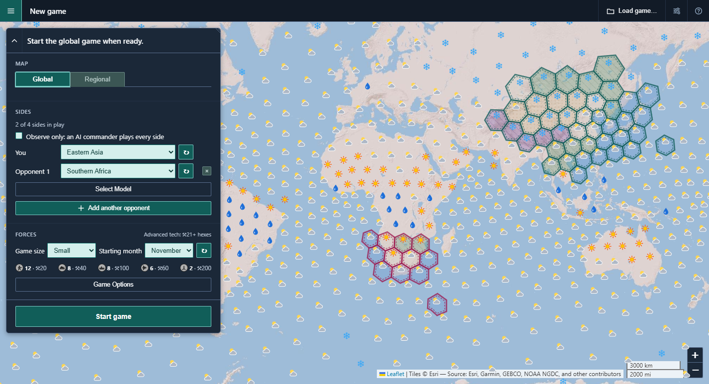

*New regional game: Click the Regional tab, then pick the region and player home sub-regions (in this case: Japan vs South & East China).*

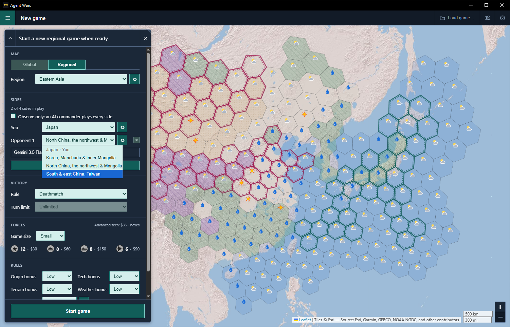

|                                         | Global game                                                    | Regional game                                                                                          |
| --------------------------------------- | -------------------------------------------------------------- | ------------------------------------------------------------------------------------------------------ |
| Map                                     | The whole world, 842 strategic hexes at H3 resolution 1        | One of 23 maps drawn from UN subregions, with 257 to 352 strategic hexes                               |
| Sides                                   | Two to four sides. Each picks a different UN subregion. Observe only gives every side to an AI commander. Deathmatch is the usual rule and has no turn limit. Most city hexes at turn limit lasts 20, 30, 40, or 50 turns, usually 30. | Two to four sides, up to the number of groups on that map. Each picks a different group of countries, provinces, or states, grouped by production capacity. Observe only gives every side to an AI commander. Deathmatch is the usual rule and ends when one side remains. Most city hexes at turn limit lasts 20, 30, 40, or 50 turns. |
| Unit scale                              | WW2-style field armies, air wings, and naval fleets            | WW2-style divisions, air groups, and naval task forces                                                 |
| Turn length                             | One month                                                      | One week                                                                                               |
| Weather changes                         | Every turn                                                     | Roughly every four turns                                                                               |
| Unit prices, build minimums, bomb damage | Prices and minimums in [Building units](#building-units). Bomb damage in [Air power](#air-power). | Each map sets its own.                                                              |
| Tech cutoff                             | 21 urban cells                                                 | Set by each map                                                                                        |
| Map edges                               | None                                                           | A few maps have neutral-border hexes at their edges. Those produce nothing and can't base air or naval units. |
| Winning by control                      | Hold every hex of the enemy home region.                       | Hold enemy-home hexes with at least 75% of that home's original urban cells. Bombing doesn't change the target. A home that started with none is won by holding every hex. |

The dialog shows the selected map's price beside each unit type, and its tech cutoff in the `Advanced tech: $N+ hexes` line.

## Playing a turn

### Selecting units

| *Click to select lone units or open the stack popup. In the stack popup, click + to select or +All to select all units.*              | *Shift-click to multi-select. In the stack popup, click +/- to select/deselect, or +All/-All to select/deselect all units.*
| ------------------------------------------------------------------------------------------- | ------------------------------------------------------------------------------ |
| 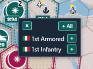 | 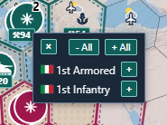 |

### Planning movement

| *Step 1: Plan movement orders by selecting units, then hovering over a destination hex. The game will automatically pick the fastest route.*              | *Step 2: Double-click to create movement orders, or right-click to stop. Orders are listed on the planning panel, on the right.*
| ------------------------------------------------------------------------------------------- | ------------------------------------------------------------------------------ |
| 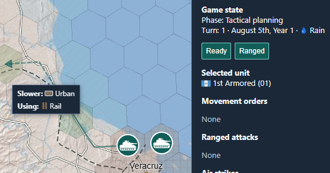 | 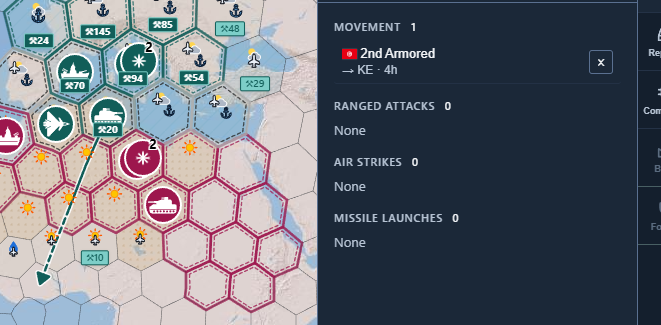 |

### Other operations

1. **Pan:** Drag with the left mouse button, or use WASD / arrow keys.
2. **Zoom:** Mouse wheel (zooms toward the cursor), or the + and − buttons at the map's bottom-right (half a level each). Zoomed in, contested strategic hexes show a marker that starts a tactical battle.
3. **Select units:** Click a teal (human) unit's icon. A lone unit is selected right away. A stack opens a list of its units, where you can pick one or use **+ All**. A gold ring replaces the white border of each token in a hex that holds a selected unit, including both tokens of a stack. The selection panel at the map's bottom-left opens as a bar that names the hex and the selection, with a hint for what a double-click does next; its **×** clears the selection. Click the chevron at the bar's left edge to show the hex's terrain and each selected unit's orders, and click it again to hide them. While they show, drag the panel's corner grip to resize it. The panel's state and size last until you close the app.
4. **Issue a move order:** With units selected, double-click a destination hex (land/water/terrain rules apply). The order appears in the Movement group of the Orders tab, with the destination's hex code and its distance, such as "→ E5 · 1h". Click a row to select that unit again. A destination beyond this turn's reach becomes a march that continues on later turns.
5. **Ranged attack (armor or naval on strategic; broader types on tactical):** With capable units selected, click the reticle in the selection panel, then double-click an enemy hex within range. With an all-air selection, the same reticle aims an air strike. When the selection cannot fire, the reticle is greyed out, and pointing at it says why. Attacks are submitted with Ready. See [Aiming ranged attacks and air strikes](#aiming-ranged-attacks-and-air-strikes).
6. **Ready:** Click **Ready** to submit orders and resolve the turn. That resolution can end the match (rules in [region-vs-region.md](region-vs-region.md)). The new-game dialog then returns for the next match.
7. You can issue multiple movement and ranged orders (one per unit each) before clicking Ready.

The full input map, including the exceptions, is in [ux/input-map.md](ux/input-map.md).

## How a turn resolves

- Both sides give orders for the same turn, and the engine resolves them together.
- You can plan your turn while the commanders plan theirs. Moving, aiming, and building all work while they think. Only Ready waits for their plans.
- The order is fixed: air strikes, then ranged fire, then movement, then melee.
- Strikes and ranged fire use positions from before anyone moves, so they land where you aimed.
- Melee happens wherever enemy units share a hex after movement.
- Each unit rolls one d20 and hits on a roll at or under its hit number. A roll of 18 to 20 always misses.
- A hit removes one unit. Units don't take partial damage.
- A side that's hit loses its lowest-defense units first, then infantry, armor, naval, and air, in that order.
- In melee, which side rolls attack and which rolls defense is random each turn. Moving in doesn't make you the attacker.
- Enemies still sharing a hex after melee fight again next turn.

## Aiming ranged attacks and air strikes

| *Step 1: Select a unit or stack, then click the **Ranged** button.*              | *Step 2: Double-click on a visible target to order the attack.*
| ------------------------------------------------------------------------------------------- | ------------------------------------------------------------------------------ |
| 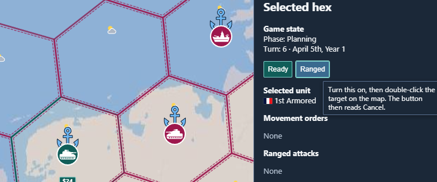 | 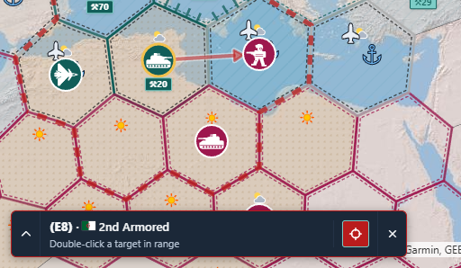 |

Select units, then click the reticle in the selection panel. It stays pressed while you aim.

|                                       | Ranged fire                            | Air strike                                       |
| ------------------------------------- | -------------------------------------- | ------------------------------------------------ |
| What to select                        | Units that can all fire                | Only air units                                   |
| Color of the reticle and panel border | Amber                                  | Purple                                           |
| Target type list                      | None                                   | A list to the reticle's left picks the target type. |
| Reach on the strategic map            | Infantry none, armor 1 hex, naval 2    | 3 hexes from the base airport                    |
| Reach in a battle                     | Each unit's range after terrain limits | The whole battlefield                            |

- **Greyed reticle:** mixing air with other types, or infantry with no air unit on the strategic map, greys out the reticle. Infantry can use ranged attacks in battles, however.
- **The outline:** a dashed outline, with no fill, around the combined reach of every selected unit. Its dashes drift slowly.
- **Hovering a valid target:** a dashed line in the attack's color runs from each selected unit to the target and ends in an arrowhead. A queued attack keeps that line.
- **Hovering an invalid target:** a teal X marks the hex. After a second, a tip says why.
- **Firing:** double-click the target. A single click does nothing. A failed double-click shows an error and keeps you aiming.
- **Stopping:** click the pressed reticle again, click the selection panel's **×**, or right-click the map. Escape doesn't end aiming.
- **What it doesn't show:** the outline ignores line of sight. In a battle, a mountain cell between the shooter and the target can still block armor and naval. The cell either unit stands on does not.
- **Moves:** there is no reach outline for movement. Hovering a destination draws a teal route, solid for this turn and dashed beyond, ending in an arrowhead. A queued move keeps that route through the movement animation, then drops it once the animation has finished and the unit is on the destination. Move routes and the attack lines above are drawn over a pale edge so they stay readable.

## Air power

*Select an air unit or stack, then click the **Strike** button and pick a type of air strike to order. Then double-click on a hex to order the attack.*

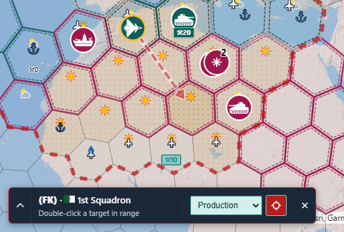

- **Bases:** air units sit at an airport and don't march. They strike from there and return in the same turn.
- **One action a turn:** strike or ferry, not both.
- **Odds:** a strike hits on 10 or less (50%), before cover and bonuses.
- **Target types:** the list beside the reticle offers four, and keeps your last choice.

| Target                                | A hit                                                                                                    | Counter-fire against the striker                                                                                      |
| ------------------------------------- | -------------------------------------------------------------------------------------------------------- | --------------------------------------------------------------------------------------------------------------------- |
| **Enemy Units**                       | Removes one unit.                                                                                        | Armor, naval, and air units based in the target hex shoot back, and any hit destroys the striker. Strategic infantry can't shoot back. |
| **Production** (a city's urban cells) | Destroys 9 urban cells, or that map's own number on a regional map. This permanently lowers the hex's production. | 15%                                                                                                         |
| **Airports**                          | Wrecks one airport cell and destroys every air unit based in that hex.                                   | 35%                                                                                                                   |
| **Seaports**                          | Wrecks one seaport cell. Ships are unaffected.                                                           | 15%                                                                                                                   |

A city, airport, or seaport shoots back at those odds whether or not the strike hits, and bonuses don't change them. Units shoot back with their own attack rolls, also whether or not the strike hits.

- **Several ports:** some hexes have more than one airport or seaport cell. They keep basing air units or building ships until every one is wrecked.
- **For good:** destroyed cities, airports, and seaports never rebuild. You can bomb your own.
- **Losing a base:** an air unit dies if an enemy ground unit takes its airport hex, or if a strike hits that hex's airport.
- **Ferrying:** with only air units selected, double-click one of your airports within 4 hexes. With the weather bonus on, a unit without the snow tag can ferry only 2 hexes into snow.
- **Vision:** each air unit sees 3 hexes around its base, even when it does nothing.

## Sealift

*Select a stack including naval and ground units within a seaport hex, then load/unload units using the stack popup. Ground units can be unloaded in any coastal hex.*

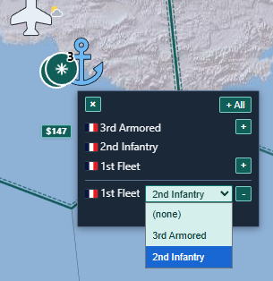

- **Capacity:** each naval unit carries one armor or two infantry.
- **Where to load:** a coastal hex or a land seaport, or a water seaport you control.
- **Loading:** put the land units and the ship in the same hex. Open the hex's stack list and pick units in the ship's slot lists.
- **At once:** slot changes take effect immediately. They aren't queued orders and don't wait for Ready.
- **Moving:** select the ship and double-click a destination. The cargo goes with it.
- **Unloading:** press the slot's **-** button, or set the slot to **(none)**. You can unload on a coastal, wetland, or land-seaport hex, or at a water seaport you control.
- **Cargo waits:** loaded units can't be selected or given orders until you unload them.
- **Combat:** cargo can melee on a coastal hex but can't fire. On open water it's only cargo.
- **Risk:** if the ship dies, its cargo dies with it.
- **Why it matters:** land units can't cross water on their own, so sealift is the way between landmasses.

## Building units

*Zoom in until the production capacity ($) becomes a button, then click to open the build popup. The choice of buildable units depends on the capacity of the hex and the presence of airports or seaports.*

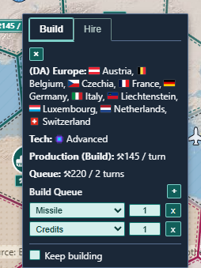

- **Income:** each strategic hex earns one production point per turn for each intact urban cell in it.
- **Idle hexes save nothing:** points build up only in hexes you control that have a queue or **Keep building** on.
- **Build markers:** zoom in one level, or two clicks of the + button, to see teal markers on the hexes that can produce. Click one to open its Build Queue.
- **Queueing:** use **+** to add a unit type, then set a count. **Keep building** repeats the queue's last unit type once the queue is done.
- **Several hexes:** Shift-click more markers to give them all one queue. A hex that can't build a type skips it.
- **Spawning:** points build up toward the next unit. It appears at that hex once the points cover its cost.

A hex needs the urban cells in this table, and anything named under **Also needs**, below. Costs and minimums are for the global map. Caps apply on every map.

| Unit type | Cost in points | Minimum urban cells | Also needs | Cap per side, Small game |
| --------- | -------------- | ------------------- | ---------- | ------------------------ |
| Infantry  | 20             | 1                   | Nothing else | 12                     |
| Armor     | 40             | 2                   | Nothing else | 8                      |
| Air       | 60             | 5                   | An airport | 6                        |
| Naval     | 100            | 10                  | A seaport  | 8                        |

- **Regional maps:** prices and minimums follow the map, as the new-game dialog shows.
- **Only legal choices:** the type list offers only what that hex can build.
- **Caps:** each side's per-type cap is set by game size. Medium doubles the Small caps, and Large triples them. See [game-size-unit-caps.md](game-size-unit-caps.md).
- **Bombing hurts:** destroyed urban cells lower income for the rest of the match.

## Battles

*Tactical battle dialog in southern Mexico, from a regional game. Click the **Fight** button to run the battle manually or **Ignore** to leave the outcome to chance.*

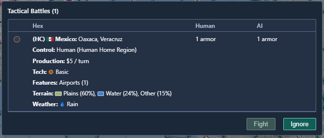

Tactical battles happen when human and LLM units end their turns in the same hex. When this happens, the **Tactical Battles** dialog is displayed, with a list of tactical battles players can fight manually. There may be more than one battle in this list, but players may only fight one at a time.

When players pick a battle and click **Fight**, their strategic units will be broken into sub-units, the map will zoom in, and the fight is on. When they click **Ignore**, all tactical battles will be resolved using dice rolls. 

Manually fought battles take place entirely within one strategic turn, with the following consequences:

1. Fighting a tactical battle means ignoring the strategic game for one turn (for both human and LLM players).
2. During that turn, strategic units will continue to follow existing orders and defend themselves.
3. When the battle is over, the strategic part of the game resumes in the next turn.

This forces players to choose where to focus their attention.

Players can win tactical battles by destroying their opponent's units, or they can abandon the battle at any time by clicking the **Exit Battle** button. Any strategic units with half or more of their sub-units remaining will be returned to the strategic map. There is no concept of battle damage, to keep things simple.

When battles are ignored or abandoned, it's possible for human and AI units to survive in the same hex for longer than one strategic turn. Battles like these are marked with magnifying glass icons (🔍) on the strategic map. Clicking this icon (re)joins a battle, as if it had been selected from the **Tactical Battles** dialog.

Tactical sub-units are at the scale of WW2-style regiments, squadrons, and naval task groups.

Complete rules are in [combat-rules-v3.md](combat-rules-v3.md) §12.

*Turn 5 of a tactical battle in central Mexico, during a mild December.*

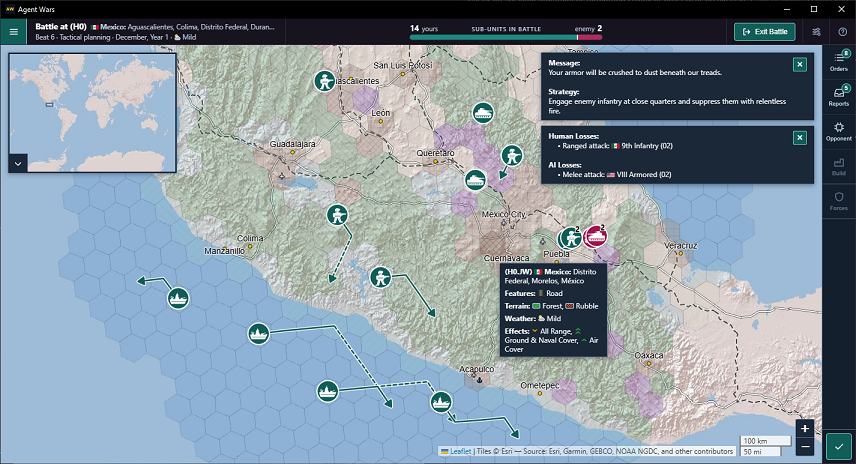

### How battles are different

*Ukrainian 1st Fleet moves through wetlands, thanks to their terrain bonus (built on a wetland hex, near the Black Sea).*

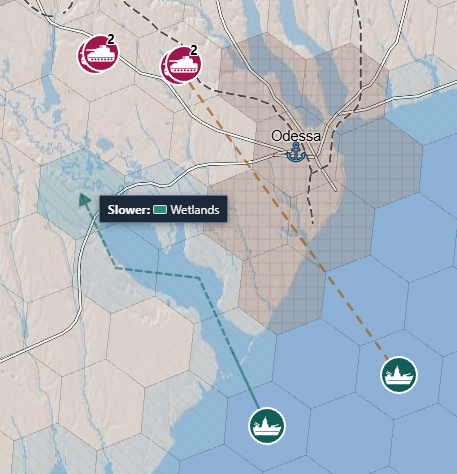

- **Scale:** the battlefield is the contested hex's cells, three H3 resolutions finer, plus three rings of neighboring cells.
- **Pause:** the rest of the map waits until the battle ends. The date and weather stay fixed.
- **Beats:** each Ready in a battle resolves one beat: air strikes, ranged fire, movement, then melee. The top bar becomes the battle header, which names the battle's hex and the beat, and compares each side's sub-units in a bar.
- **Deployment:** units start on the edge of the hex they entered from.
- **No fog:** both sides see everything in a battle.
- **No production:** nothing is built while a battle runs.

Each unit splits into sub-units that keep its attack and defense. Unit types also differ in reach and speed between the strategic map and battles.

|                            | Infantry     | Armor   | Naval    | Air                         |
| -------------------------- | ------------ | ------- | -------- | --------------------------- |
| Sub-units in a battle      | 8            | 4       | 4        | 3                           |
| Fire reach, strategic map  | None         | 1 hex   | 2 hexes  | 3 hexes from base           |
| Fire reach, battle         | 2 cells      | 5 cells | 10 cells | Anywhere on the battlefield |
| Movement, strategic map    | 1 hex        | 2 hexes | 2 hexes  | Doesn't march               |
| Movement points per beat   | 2            | 4       | 3        | Doesn't march               |
| Shoots back at air strikes | Battles only | Yes     | Yes      | Yes                         |

Armor that enters a rugged, arctic, or city hex stops there for the turn.

In a battle, these cell types also change how a unit moves and how far it can fire. An intact road or rail replaces the enter cost, including through forest and mountains. The next section gives those prices.

| Cell terrain       | Cost to enter                                         | Budget at the start of a beat      | Reach and line of sight                                                         |
| ------------------ | ----------------------------------------------------- | ---------------------------------- | ------------------------------------------------------------------------------- |
| Forest             | Infantry and armor pay 2 points.                      | Armor's budget is 2.               | Infantry or armor firing from it reaches 1 cell.                                |
| Urban or rubble    | Rubble costs 2 points off a road or rail.             | Infantry and armor have a budget of 1. | Infantry or armor firing from it reaches 1 cell.                             |
| Mountain           | Infantry pays 2 points. Armor can't enter.            | None                               | Armor and naval shots that cross it are blocked. Infantry shots and air strikes pass. |
| Wetlands or arctic | Armor can't enter.                                    | None                               | No change to reach or line of sight.                                            |

- **Terrain-bonus step:** with the terrain bonus on, armor born on mountains, wetlands, or arctic terrain can enter one such cell it's otherwise barred from. A naval unit born on wetlands can do the same into wetlands. It stops there for that beat.
- **Shooting infrastructure:** ranged fire can target a city, airport, seaport, road, or rail cell on the battle hex itself. A hit turns that cell to rubble for good.
- **Collateral damage:** a ranged kill on one of those cells rubbles it too.
- **Rubble counts:** rubbled urban cells lower the hex's production after the battle. A rubbled airport can take the air units based there with it.
- **Outer rings:** cells in the three neighboring rings slow movement and give cover. Shots there don't damage any hex's infrastructure.

## Roads and rail in battles

| *Shaanxi 1st Armored moving faster by road, then slower through urban hexes. Movement planning automatically picks the fastest route.*                                                                 | *A stack of Ukraine's armored units plans rapid movement by rail. Rail is faster than road, and movement planning will use both.*                                                |
| ------------------------------------------------------------------------------------------- | ------------------------------------------------------------------------------ |
| 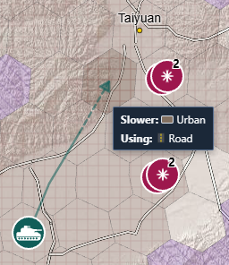 | 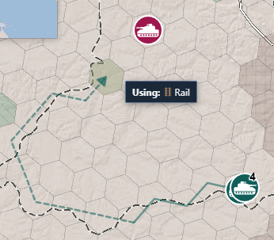 |

In a battle, infantry and armor move faster along intact road and rail cells.

|                                          | Road         | Rail               |
| ---------------------------------------- | ------------ | ------------------ |
| Cost to enter a cell                     | Half a point | A third of a point |
| Infantry cells per beat, at full budget  | 4            | 6                  |
| Armor cells per beat, at full budget     | 8            | 12                 |

- **Battles only:** strategic movement ignores roads and rail.
- **Any terrain:** the price holds through forest and mountains, so armor can cross mountains along a road.
- **Getting off:** a unit can leave a line only onto terrain it could enter anyway, or onto more line.
- **Weather:** snow and rain raise infantry's cost to enter open ground (plains, desert, wetlands, arctic, or coastal), but not road or rail costs.
- **Rubble:** a rubbled road cell costs 1 point and no longer carries armor through terrain it can't enter.
- **Deployment:** roads and rail can let units start on cells they couldn't otherwise enter.
- **Naval units** ignore roads and rail.

## Unit bonuses

Hovering a unit's flag, in the stack list or anywhere else it appears, or the token of a one-unit hex, shows the bonuses that unit was born with. On the left, a stack near Mexico City is open, and the tooltip belongs to an armor unit born in the Mexican mountains in rain, with advanced tech. On the right, a lone unit near Colorado Springs was born on Saskatchewan plains in snow, with basic tech.

| *Bonuses for the Mexican 5th Armored, near Mexico City.*                                                                 | *Bonuses for the Saskatchewan 7th Infantry, near Colorado Springs.*                                                |
| ------------------------------------------------------------------------------------------- | ------------------------------------------------------------------------------ |
| 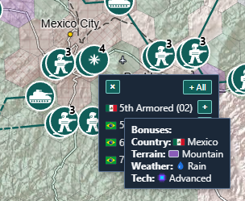 | 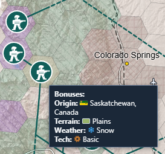 |

Each bonus is Off, Low, or High in the new-game dialog, and starts at Low.

| Bonus   | Low          | High                     | When it counts                                                                                                                          |
| ------- | ------------ | ------------------------ | --------------------------------------------------------------------------------------------------------------------------------------- |
| Origin  | +2 to rolls  | +4 to rolls              | Rolls in the unit's birth country, on the strategic map and in battles. On a regional map, its birth province or other origin area.     |
| Terrain | +2 to rolls  | +4 to rolls              | Battle rolls on the unit's birth terrain. Also the terrain-bonus step under [How battles differ](#how-battles-differ).                  |
| Tech    | +2 to attack | +2 to attack and defense | Rolls by an Advanced unit. The birth hex must meet the map's tech cutoff: 21 urban cells on the global map, or the cutoff shown in the new-game dialog for a regional map. |

- **No stacking:** a unit that qualifies for origin and terrain adds only the larger amount.
- **Tech is fixed:** the tier comes from the birth hex's original city size. It doesn't change when the unit moves or the city is bombed.
- **Where you build matters:** with tech on, big cities build better units, so the place matters as well as the points.

Each hex has a fixed monthly climate of mild, rain, snow, or heat, and icons on the map show the current month's weather. A unit gets up to two weather tags, for the conditions its birth hex has at least 3 months a year. Mild is never a tag. Only a unit without the matching tag pays these penalties. An attack cut is the Low amount, with the High amount in parentheses. A slow that says "at High" applies only at High.

| Unit type | Rain                                        | Snow                                              | Heat                                                      |
| --------- | ------------------------------------------- | ------------------------------------------------- | --------------------------------------------------------- |
| Infantry  | In a battle, open ground costs 2 to enter.  | In a battle, open ground costs 2 to enter.        | None                                                      |
| Armor     | Slowed                                      | Slowed, and -3 ranged attack (-5 at High)         | -3 ranged attack (-5 at High), and slowed at High         |
| Naval     | Slowed at High                              | Slowed                                            | None                                                      |
| Air       | -3 to a strike (-5 at High)                 | -3 to a strike (-5 at High)                       | -3 to a strike (-5 at High)                               |

Open ground is plains, desert, wetlands, arctic, or coastal. A slowed unit moves 1 hex on the strategic map. In a battle its budget is 2 points at Low and 1 at High, and no higher than the budget for the cell it starts on. An air strike takes its penalty once, when the base or the target has weather the unit isn't tagged for.

The flag tooltip lists a unit's bonuses. A hex tooltip shows that hex's weather and terrain effects. Click the toggle on the minimap's lower-left corner to show the map-mode buttons under it, then turn on **Tech**, or hold T, to see each hex's tech tier. **Weather** turns the weather icons on the map off and on. **Control** starts on and draws who holds each hex; turn it off to leave the plain grid. **Production** starts off; turn it on to label production on every hex.

The full bonus rules are in [combat-rules-v3.md](combat-rules-v3.md) §4.9.

## Things that may surprise you

- **You pay for the opponent:** each model call bills your OpenRouter account. The model list shows each model's price per million tokens. Each commander has its own key, entered in that commander's popover. A commander with a model and an empty key does not call the model.
- **Reasoning costs more:** a higher reasoning level on a commander's card makes that consult slower and dearer.
- **Waiting on the AI:** while a commander plans, Ready shows **AI:**, a timer, and `(xN)`, where N is how many commanders are still planning. The line above it reads **Commanders planning**. You can keep giving orders during the wait. Turn **Run** off to stop that plan. If the turn has not resolved yet, Ready can resolve it without those orders. If the turn already played back, Ready unlocks and the next turn does not use that plan. Changing the model stops the current plan. If Run is still on and Ready is still waiting, planning starts again with the new model.
- **Not every turn:** with **Events** on (the default) in the Commanders tab's Tool groups, the model is called when an event it's watching or a mandatory trigger fires, and at least every five turns. Otherwise its standing orders run.
- **Every turn, if you like:** turn **Events** off to consult the model every turn, at more cost.
- **The opponent nearly always shoots:** unless the model told it to hold fire, each enemy unit that can fire picks a legal target on its own when the model gives it none.
- **Your units wait for orders:** they fire only when you aim them. There are no player defend or hold-fire orders.
- **Return fire is automatic:** a unit that's shot at fires back when it could have aimed at the shooter's hex.
- **Fog fades:** an enemy you lose sight of stays at its last known spot for 2 turns, then disappears. While you watch a seat, those markers are that seat's enemies. All sides shows none.
- **Your home stays visible:** both home outlines show through fog, and your own home hexes are always visible.
- **Playback blocks orders:** while a turn plays back, you can pan, zoom, and read tooltips, but not give orders.
- **Reading the turn report:** after Ready, the map toast and the Reports tab list each side that lost a unit, then say who took hexes. **Your Losses** is your side. Each other side follows in seat order, under its full home name, and **Neutral Losses** is last. A cause label says how. A named unit is the unit name, without the short side prefix, and keeps its origin flag. The same unit name on two sides still has each side's flag. A type with more than three losses on that line becomes a count such as "4x Infantry", with one icon in the losing side's color. The commander's prompt is unchanged. An opponent's name in a loss header, and an opponent's short name in a hex sentence, has a numbered flag. Your Losses and Neutral Losses do not. While no human side is still playing, every side uses its full name. Hex sentences are the first lines under **Updates**. Deployments and hexes lost to an opponent stay there too. When a battle was outside your vision, **Updates** ends with one sentence naming those continents in alphabetical order, separated by commas, such as "Unknown battle observed in Africa, Europe." If no continent can be named, it reads "Unknown battle observed in an unidentified continent."
- **No save slots yet:** the app keeps the match in progress and reopens it, but there's no load list. Opening **New game** from the menu leaves that match running. Close the screen to come back, or start a match to replace it.

## Where messages appear

| *LLM taunts (in this case, from Claude Opus) and strategy messages appear at the top/right of the map.*                                                                 | *End-of-turn updates appear at the lower right of the map.*                                                |
| ------------------------------------------------------------------------------------------- | ------------------------------------------------------------------------------ |
| 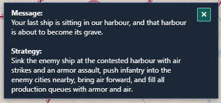 | 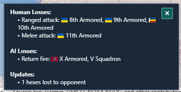 |

| Message area      | Where                                                                                     | What it shows                                                                                                    | How long it stays                                                                                                         |
| ----------------- | ----------------------------------------------------------------------------------------- | ---------------------------------------------------------------------------------------------------------------- | ------------------------------------------------------------------------------------------------------------------------- |
| Map toast         | Lower right of the map, 12 px from the right edge and above the zoom buttons, whether the console is open or collapsed | Errors, rejected orders, and turn reports. A battle outside vision is the last Updates line | Until you click its ×, a fixed interval passes, or a newer message replaces it. Also listed in the Reports tab. |
| AI strategy toast | Top/right of the map. Its width stays put when you switch opponent tabs | One tab per AI opponent, alphabetical by full home name, each with that opponent's number flag. A tab starts off and turns on when that opponent sends a message or a strategy. Message, then Strategy, show whenever that opponent sent them, including while you are playing | It dismisses and times out like the map toast. Selecting a unit, opening build, arming an attack, or entering a battle hides it too. A click on an enabled tab restarts the 24 second timer. Each new message restarts the timer and selects its tab. Each commander is its own Reports entry. |
| Activity log      | Console, Commanders tab, at the bottom                                                      | AI interaction lines and errors, including a retry, a line when opponent planning stops, and a one-line copy of each turn update | Until you start a new match                                                                       |
