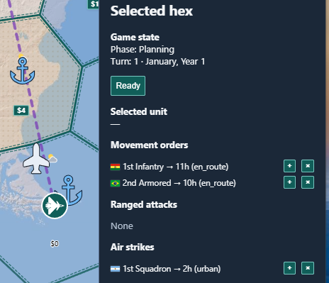
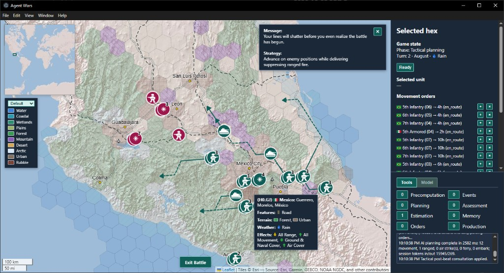

# How to play

This guide covers a match in the current build, from the new-game dialog to the end. Downloading the game and setting up the OpenRouter key for the opponent are covered under [Play it](../README.md#play-it) in the README. The full rules are in [combat-rules-v3.md](combat-rules-v3.md).

Numbers here are the global map's unless a line says otherwise. The combat rules name the engine symbol behind each one.

I'll add screenshots of specific functions as I can.

## Starting a match

Each match starts on the new-game dialog, with a Global tab and a Regional tab. This regional setup puts South Central against Great Lakes & Ontario in Northern America, at Small size with fog of war, a March start, and every bonus at Low. The open list shows the region's other side groups. The badges over each unit type are the per-side caps for the chosen game size, and the prices follow the selected region.

## Global and regional maps

*Global new-game preview, with human and LLM sides selected (Eastern Asia vs Southern Africa).*

*Regional new-game preview for Eastern Asia, with human and LLM sides selected (Japan vs South & East China).*

- **Global:** the whole world, 842 strategic hexes at H3 resolution 1. Each side picks a home region, and both may pick the same one.
- **Regional:** one of 23 maps drawn from UN subregions, at strategic resolution 2 or 3. Each side picks a different side group of provinces.
- **Turn length:** a global turn is one month. A regional turn is one week, so the weather changes about every four turns.
- **Economy:** each regional map sets its own unit prices, build minimums, and bomb damage. The dialog shows that map's price beside each unit type.
- **Tech cutoff:** the dialog's `Advanced tech: $N+ hexes` line shows the selected map's cutoff.
- **Map edges:** a few regional maps have neutral-border hexes at their edges. Those produce nothing and can't base air or naval units.
- **Winning by control:** on the global map, hold every hex of the enemy home. On a regional map, hold enemy-home hexes with at least 75% of its original urban cells.
- **Other ways to win:** destroy every urban cell in the enemy home while yours keeps one, or destroy every enemy unit. Details are in [region-vs-region.md](region-vs-region.md).

## Playing a turn

*Planning panel showing the Ready button and movement/strike orders.*

| *Stack selection in normal/single-unit mode.*              | *Stack selection in multi-unit mode (holding down shift key).*
| ------------------------------------------------------------------------------------------- | ------------------------------------------------------------------------------ |
|  |  |

1. **Pan:** Drag with the left mouse button, or use WASD / arrow keys.
2. **Zoom:** Mouse wheel (zooms toward the cursor). Zoomed in, contested strategic hexes show a marker that starts a tactical battle.
3. **Select units:** Click a teal (human) unit's icon. A lone unit is selected right away. A stack opens a list of its units, where you can pick one or use **+ All**.
4. **Issue a move order:** With units selected, double-click a destination hex (land/water/terrain rules apply). The order appears under "Movement orders." A destination beyond this turn's reach becomes a march that continues on later turns.
5. **Ranged attack (armor or naval on strategic; broader types on tactical):** With capable units selected, click **Ranged**, then double-click an enemy hex within range. An all-air selection shows **Strike** instead. Attacks are submitted with Ready. See [Aiming ranged attacks and air strikes](#aiming-ranged-attacks-and-air-strikes).
6. **Ready:** Click **Ready** to submit orders and resolve the turn. A side wins by controlling the enemy home or wiping out its urban cells (rules in [region-vs-region.md](region-vs-region.md)), or by destroying every enemy unit. The new-game dialog then returns for the next match.
7. You can issue multiple movement and ranged orders (one per unit each) before clicking Ready.

## How a turn resolves

- Both sides give orders for the same turn, and the engine resolves them together.
- The order is fixed: air strikes, then ranged fire, then movement, then melee.
- Strikes and ranged fire use positions from before anyone moves, so they land where you aimed.
- Melee happens wherever enemy units share a hex after movement.
- Each unit rolls one d20 and hits on a roll at or under its hit number. A roll of 18 to 20 always misses.
- A hit removes one unit. Units don't take partial damage.
- A side that's hit loses its lowest-defense units first, then infantry, armor, naval, and air, in that order.
- In melee, which side rolls attack and which rolls defense is random each turn. Moving in doesn't make you the attacker.
- Enemies still sharing a hex after melee fight again next turn.

## Aiming ranged attacks and air strikes

| *French 1st Armored plans a ranged attack (part 1).*              | *French 1st Armored plans a ranged attack (part 2).*
| ------------------------------------------------------------------------------------------- | ------------------------------------------------------------------------------ |
|  |  |

- **Ranged:** select units that can all fire, then click **Ranged**. The button reads **Cancel** while you aim.
- **Strike:** select only air units, then click **Strike**. Pick a target type from the list that takes the button's place.
- **Hidden button:** mixing air with other types, or selecting any unit that can't fire, hides the button. On the strategic map that includes infantry.
- **The outline:** a dashed outline, with no fill, around the combined reach of every selected unit. Its dashes drift slowly.
- **Colors:** amber for ranged fire, purple for air strikes.
- **Reach on the strategic map:** armor 1 hex, naval 2, and air 3 from its base airport.
- **Reach in a battle:** the ranged outline uses each unit's range after terrain limits. The strike outline covers the whole battlefield.
- **Hovering a valid target:** a dashed line in the same color runs from each selected unit to the target.
- **Hovering an invalid target:** a teal X marks the hex. After a second, a tip says why.
- **Firing:** double-click the target. A single click does nothing. A failed double-click shows an error and keeps you aiming.
- **Stopping:** click **Cancel** or right-click the map. Escape doesn't end aiming.
- **What it doesn't show:** the outline ignores line of sight. In a battle, a mountain can still block a shot inside it.
- **Moves:** there is no reach outline for movement. Hovering a destination draws a teal route, solid for this turn and dashed beyond.

## Air power

*French 1st Squadron plans a production atttack.*

- **Bases:** air units sit at an airport and don't march. They strike from there and return in the same turn.
- **One action a turn:** strike or ferry, not both.
- **Target types:** **Enemy Units**, **Production** (a city's urban cells), **Airports**, and **Seaports**. The list keeps your last choice.
- **Odds:** a strike hits on 10 or less (50%), before cover and bonuses.
- **Striking units:** a hit removes one unit. Armor, naval, and air units based in the target hex shoot back, and any hit destroys the striker. Strategic infantry can't shoot back.
- **Striking a city:** a hit destroys 9 urban cells, which permanently lowers the hex's production. The striker faces a 15% counter-fire roll.
- **Striking an airport:** a hit wrecks one airport cell and destroys every air unit based in that hex. Counter-fire is 35%.
- **Striking a seaport:** a hit wrecks one seaport cell. Ships at sea are unaffected. Counter-fire is 15%.
- **Several ports:** some hexes have more than one airport or seaport cell. They keep basing air units or building ships until every one is wrecked.
- **For good:** destroyed cities, airports, and seaports never rebuild. You can bomb your own.
- **Losing a base:** an air unit dies if an enemy ground unit takes its airport hex, or if a strike hits that hex's airport.
- **Ferrying:** with only air units selected and Strike off, double-click one of your airports within 4 hexes. With the weather bonus on, a unit without the snow tag can ferry only 2 hexes into snow.
- **Vision:** each air unit sees 3 hexes around its base, even when it does nothing.
- **Regional maps:** a city hit destroys that map's own number of urban cells.

## Sealift

*French 2nd Infantry embarks at a seaport hex.*

- **Capacity:** each naval unit carries one armor or two infantry.
- **Where to load:** a coastal hex or a land seaport, or a water seaport you control.
- **Loading:** put the land units and the ship in the same hex. Open the hex's stack list and pick units in the ship's slot lists.
- **At once:** slot changes take effect immediately. They aren't queued orders and don't wait for Ready.
- **Moving:** select the ship and double-click a destination. The cargo goes with it.
- **Unloading:** press the slot's **-** button, or set the slot to **(none)**. You can unload on a coastal, wetland, or land-seaport hex, or at a water seaport you control.
- **Cargo waits:** loaded units can't be selected or given orders until you unload them.
- **Combat:** cargo can melee on a coastal hex but can't fire. On open water it's only cargo.
- **Risk:** if the ship dies, its cargo dies with it.
- **Why it matters:** land units can't cross water on their own, so sealift is the way between landmasses.

## Building units

*Planning unit construction in southern France, on a high-production hex with an airport and seaport.*

- **Income:** each strategic hex earns one production point per turn for each intact urban cell in it.
- **Idle hexes save nothing:** points build up only in hexes you control that have a queue or **Keep building** on.
- **Build markers:** zoom in one level, or two clicks of the + button, to see teal markers on the hexes that can produce. Click one to open its Build Queue.
- **Queueing:** use **+** to add a unit type, then set a count. **Keep building** repeats the queue's last unit type once the queue is done.
- **Several hexes:** Shift-click more markers to give them all one queue. A hex that can't build a type skips it.
- **Spawning:** points build up toward the next unit. It appears at that hex once the points cover its cost.
- **Prerequisites:**
  - Infantry: 20 points and 1 urban cell.
  - Armor: 40 points and 2 urban cells.
  - Air: 60 points, 5 urban cells, and an airport.
  - Naval: 100 points, 10 urban cells, and a seaport.
- **Regional maps:** prices and minimums follow the map, as the new-game dialog shows.
- **Only legal choices:** the type list offers only what that hex can build.
- **Caps:** each side has a per-type cap set by game size. Small allows 12 infantry, 8 armor, 8 naval, and 6 air. See [game-size-unit-caps.md](game-size-unit-caps.md).
- **Bombing hurts:** destroyed urban cells lower income for the rest of the match.

## Battles

*Tactical battle in central Mexico.*

A battle zooms in on one contested hex and fights it out on a finer grid. The rules are in [combat-rules-v3.md](combat-rules-v3.md) §12.

### Starting a battle

- **From planning:** zoom in one level, or two clicks of the + button. A 🔍 marker appears on each explored hex where your units and enemy units meet. Click it to fight there. The strategic turn waits for the battle.
- **During resolution:** when melee is about to happen, a **Tactical Battles** list can open. Pick a hex and click **Fight**, or click **Ignore** to roll that melee on the strategic map.
- **After Fight:** the current turn finishes first, and the battle opens as the next turn begins.
- **Who decides:** only you choose whether to fight a battle. The opponent never does.
- **Turning battles off:** uncheck **Tactical battles** on the Model tab. Every melee then resolves as if you chose Ignore.

### How battles differ

- **Scale:** the battlefield is the contested hex's cells, three H3 resolutions finer, plus three rings of neighboring cells.
- **Pause:** the rest of the map waits until the battle ends. The date and weather stay fixed.
- **Beats:** each Ready in a battle resolves one beat: air strikes, ranged fire, movement, then melee.
- **Sub-units:** each unit splits into sub-units with its attack and defense: infantry 8, armor 4, naval 4, and air 3.
- **Deployment:** units start on the edge of the hex they entered from.
- **No fog:** both sides see everything in a battle.
- **No production:** nothing is built while a battle runs.

|               | Strategic map                    | Battle                                        |
| ------------- | -------------------------------- | --------------------------------------------- |
| Infantry fire | None                             | 2 cells                                       |
| Armor fire    | 1 hex                            | 5 cells                                       |
| Naval fire    | 2 hexes                          | 10 cells                                      |
| Air strikes   | 3 hexes from base                | Anywhere on the battlefield                   |
| Movement      | Infantry 1 hex, armor 2, naval 2 | Points per beat: infantry 2, armor 4, naval 3 |

- **Infantry fires in battles.** It can also shoot back at air strikes, which it can't do on the strategic map.
- **Cover limits reach:** infantry or armor firing from a forest, urban, or rubble cell reaches only 1 cell.
- **Mountains block fire:** a mountain in the path blocks armor and naval shots. Infantry and air fire past it.
- **Terrain costs:** forest costs 2 points to enter, and mountains cost infantry 2. Armor can't enter mountain, wetland, or arctic cells.
- **Armor on the strategic map:** armor that enters a rugged, arctic, or city hex stops there for the turn.
- **Cities slow units:** infantry or armor that starts a beat on an urban or rubble cell gets 1 point. Armor that starts in forest gets 2.
- **Terrain-bonus step:** with the terrain bonus on, armor born on mountains, wetlands, or arctic terrain can enter one such cell it's otherwise barred from. A naval unit born on wetlands can do the same into wetlands. It stops there for that beat.
- **Shooting infrastructure:** ranged fire can target a city, airport, seaport, road, or rail cell on the battle hex itself. A hit turns that cell to rubble for good.
- **Collateral damage:** a ranged kill on one of those cells rubbles it too.
- **Rubble counts:** rubbled urban cells lower the hex's production after the battle. A rubbled airport can take the air units based there with it.
- **Outer rings:** cells in the three neighboring rings slow movement and give cover. Shots there don't damage any hex's infrastructure.

### Ending a battle

- **Annihilation:** when one side has no sub-units left, a dialog shows the result. Press its **Exit Battle** to return.
- **Exit Battle:** you can leave between beats. A unit that kept fewer than half its sub-units is destroyed. Exactly half survives.
- **Back to the map:** your strategic orders return, minus units that died, and Ready runs at once.
- **Plan first:** before you click a 🔍 marker, queue the turn's strategic orders, because leaving the battle resolves the turn.
- **After Fight, no planning:** a battle from Fight opens before you can plan that turn. Leaving it resolves the turn with only your standing marches.

## Roads and rail in battles

- **Battles only:** strategic movement ignores roads and rail.
- **Cheaper steps:** infantry and armor pay half a point to enter an intact road cell, and a third of a point for rail.
- **Any terrain:** the price holds through forest and mountains, so armor can cross mountains along a road.
- **How far:** with a full budget, infantry covers 4 road cells a beat and armor 8. On rail, that's 6 and 12.
- **Getting off:** a unit can leave a line only onto terrain it could enter anyway, or onto more line.
- **Weather:** snow and rain raise open-ground costs, but not road or rail costs.
- **Rubble:** a rubbled road cell costs 1 point and no longer carries armor through terrain it can't enter.
- **Deployment:** roads and rail can let units start on cells they couldn't otherwise enter.
- **Naval units** ignore roads and rail.

## Unit bonuses

Hovering a unit's flag, in the stack list or anywhere else it appears, or the token of a one-unit hex, shows the bonuses that unit was born with. On the left, a stack near Mexico City is open, and the tooltip belongs to an armor unit born in the Mexican mountains in rain, with advanced tech. On the right, a lone unit near Colorado Springs was born on Saskatchewan plains in snow, with basic tech.

| *Stack list near Mexico City*                                                                 | *Lone unit near Colorado Springs*                                                |
| ------------------------------------------------------------------------------------------- | ------------------------------------------------------------------------------ |
|  |  |

Each bonus is Off, Low, or High in the new-game dialog, and starts at Low.

- **Origin:** a unit adds 2 (Low) or 4 (High) to its rolls in the country where it was built, on the strategic map and in battles. On a regional map, that's its home province or other origin area.
- **Terrain:** in battles only, a unit adds the same 2 or 4 on cells of the terrain it was born on. It also allows the terrain-bonus step under [How battles differ](#how-battles-differ).
- **No stacking:** a unit that qualifies for origin and terrain adds only the larger amount.
- **Weather:** each hex has a fixed monthly climate of mild, rain, snow, or heat. Icons on the map show the current month's weather.
- **Weather tags:** a unit gets up to two tags, for conditions its birth hex has at least 3 months a year. Only units without the matching tag pay the penalties below.
  - Armor slows in snow and rain, and at High also in heat. Naval slows in snow, and at High also in rain.
  - A slowed unit moves 1 hex on the strategic map, and has fewer points in a battle.
  - Armor firing in snow or heat loses 3 to its attack (High: 5).
  - An air strike loses 3 (High: 5) when the base or the target has weather the unit isn't tagged for.
  - In a battle, snow or rain makes open ground cost infantry 2 points.
- **Tech:** a unit built in a hex with at least 21 urban cells is Advanced. Low adds 2 to its attack, and High adds 2 to attack and defense.
- **Tech is fixed:** the tier comes from the birth hex's original city size. It doesn't change when the unit moves or the city is bombed.
- **Where you build matters:** with tech on, big cities build better units, so the place matters as well as the points.
- **Seeing them:** the flag tooltip lists a unit's bonuses. A hex tooltip shows that hex's weather and terrain effects. Hold T to see each hex's tech tier.

The full bonus rules are in [combat-rules-v3.md](combat-rules-v3.md) §4.9.

## Things that may surprise you

- **You pay for the opponent:** each model call bills your OpenRouter account. The model list shows each model's price per million tokens.
- **Reasoning costs more:** a higher reasoning level on the Model tab makes each consult slower and dearer.
- **Waiting on the AI:** while the model plans, Ready shows **AI:** and a timer, and the turn can't resolve until the plan arrives.
- **Not every turn:** with **Events** on (the default) on the Tools tab, the model is called when an event it's watching or a mandatory trigger fires, and at least every five turns. Otherwise its standing orders run.
- **Every turn, if you like:** turn **Events** off to consult the model every turn, at more cost.
- **The opponent nearly always shoots:** unless the model told it to hold fire, each enemy unit that can fire picks a legal target on its own when the model gives it none.
- **Your units wait for orders:** they fire only when you aim them. There are no player defend or hold-fire orders.
- **Return fire is automatic:** a unit that's shot at fires back when it could have aimed at the shooter's hex.
- **Fog fades:** an enemy you lose sight of stays at its last known spot for 2 turns, then disappears.
- **Your home stays visible:** both home outlines show through fog, and your own home hexes are always visible.
- **Playback blocks orders:** while a turn plays back, you can pan, zoom, and read tooltips, but not give orders.
- **No save slots yet:** the app keeps the match in progress and reopens it, but there's no load list. Starting a new game replaces it.

## Where messages appear

- **Lower right of the map (map toast):** Errors, rejected orders, turn-loss summaries, and unknown-battle announcements. Use the × to dismiss; it also hides after a fixed interval, and a newer message replaces it.
- **Upper right of the map (AI strategy toast):** The opponent's Message and Strategy after a consultation. It dismisses and times out the same way.
- **Right panel, below the Tools and Model tabs (AI activity log):** AI interaction lines and errors, including a one-line copy of each turn update. Starting a new match clears it.

## UI controls summary

- Pan: drag with left mouse, or WASD / arrows.
- Zoom in/out: mouse wheel, or the map's + and − buttons. Double-click never zooms.
- Select units: click a unit icon; a stack opens its unit list.
- Add or remove a lone unit from the selection: Shift-click its icon.
- Select several units in a stack: Shift-click rows in its unit list to add or remove units. A plain click selects only that unit.
- **+ All** selects all your units in the hex, except loaded cargo. With Shift held, **+ All** adds them and **- All** removes them.
- There is no drag-box selection. Dragging pans, and Shift-drag zooms to the box you draw.
- Clear the selection: right-click the map. Queued orders stay.
- Add move order: select units, then double-click the destination.
- Ranged attack: select capable units, click "Ranged", then double-click an enemy hex in range.
- Air strike: select only air units, click **Strike**, choose a target type, then double-click a hex inside the purple outline.
- Ferry: select only air units, then double-click one of your airports within 4 hexes.
- Build: zoom in, click a build marker, and add units to its queue. Shift-click more markers to build in several hexes.
- Sealift: open a coastal or seaport hex's stack list and set the ship's slots.
- Start a battle: zoom in one level and click the 🔍 marker on a contested hex.
- Leave a battle: **Exit Battle**, between beats.
- Resolve turn: Ready button.
- See under the terrain: hold T. Terrain fill hides while the key is down, and on the strategic map hex codes and, where they apply, tech icons show. Weather icons hide while T is down. In a battle, only the terrain fill hides.
- Read a hex: rest the pointer on it for a second. Hold Shift while aiming to pause aiming and see the hex tooltip.
- Close a popup or the unit list: Escape. On the battles list, Escape means Ignore. Escape doesn't exit a battle or end aiming.
- The minimap only shows where you are. Clicking it does nothing.
- New game: **New** on the Model tab during strategic planning, or the dialog that opens at game over.

The full input map, including the exceptions, is in [ux/input-map.md](ux/input-map.md).