# How to Play

This guide covers a match, from the new-game screen to the end. Downloading the game and setting up each opponent's OpenRouter key are under [Play It](../README.md#play-it) in the README. The full rules are in [combat-rules-v3.md](combat-rules-v3.md).

**Start:** [What This Is](#what-this-is) · [Setting Up a Match](#setting-up-a-match) · [The Screen](#the-screen) · [Your First Turn](#your-first-turn)

**Play:** [Moving](#moving) · [Attacking](#attacking) · [Building and Paying](#building-and-paying) · [Battles](#battles) · [Talking to Commanders](#talking-to-commanders) · [Managing Commanders](#managing-commanders) · [Reading the Game](#reading-the-game) · [Agent-Only Games](#agent-only-games) · [Saving and Loading](#saving-and-loading)

**Reference:** [Units at a Glance](#units-at-a-glance) · [How a Turn Resolves](#how-a-turn-resolves) · [Winning and Losing](#winning-and-losing) · [Bonuses and Weather](#bonuses-and-weather) · [Battle Terrain and Roads](#battle-terrain-and-roads) · [Controls and Shortcuts](#controls-and-shortcuts) · [Things That May Surprise You](#things-that-may-surprise-you)

## What This Is

Agent Wars is a WEGO game ("we go"), where neither player can see what the other is planning. For each turn, every side gives combat, movement, and production orders at the same time, based on partial, subjective views of the battlefield. Once everyone is ready, the game carries out those orders together and works out what happened (think: "Axis & Allies" meets "Diplomacy", with a software referee). Your opponents are AI commanders, each played by an LLM you choose (and pay for).

You win by being the last side standing. A side is knocked out when other sides and Neutral together hold its home, when it holds no city anywhere, or when its home has no cities left. There's an optional turn limit, and the details are in [Winning and Losing](#winning-and-losing).

I'm a geographer by training, so Agent Wars focuses more on geospatial features than nationality. Players start with home regions made up of real-world countries, provinces, or states, but those are mostly labels. What really matters is on the ground: the size and placement of cities, and how terrain and coastlines shape what players can do. Unit origins, terrain familiarity, technology levels, and weather still matter, but not as much.

## Setting Up a Match

The new-game screen opens when you start Agent Wars. It has three sections, Map, Sides, and Forces, and a Game Options button under them.

### Map

*New global game: In the Map section, click the Global tab, then pick each side's home region (in this case: South America vs Eastern Asia). The buttons to the right of the lists pick random choices.*

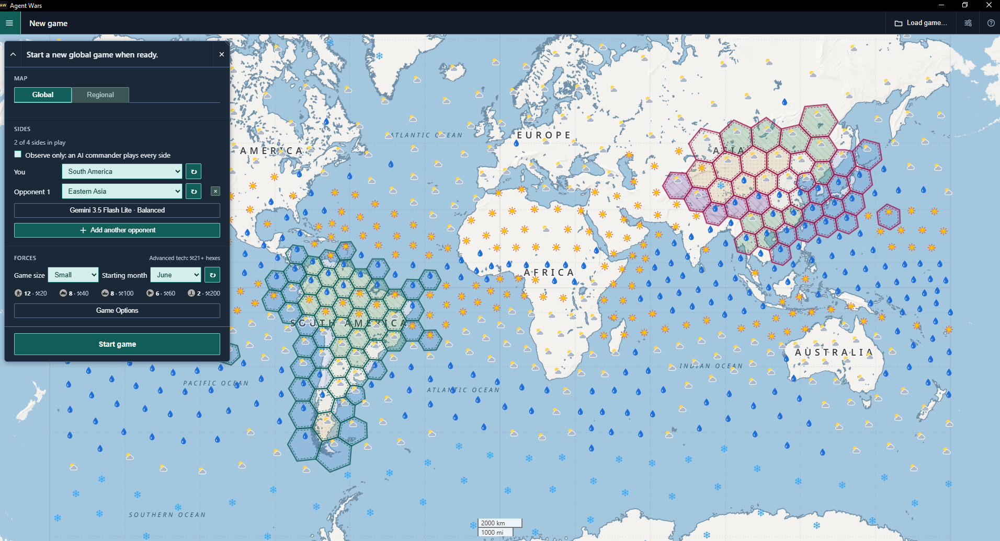

*New regional game: Click the Regional tab, then pick the region and each side's home (in this case: Western Europe, with Southern France vs Northern Germany).*

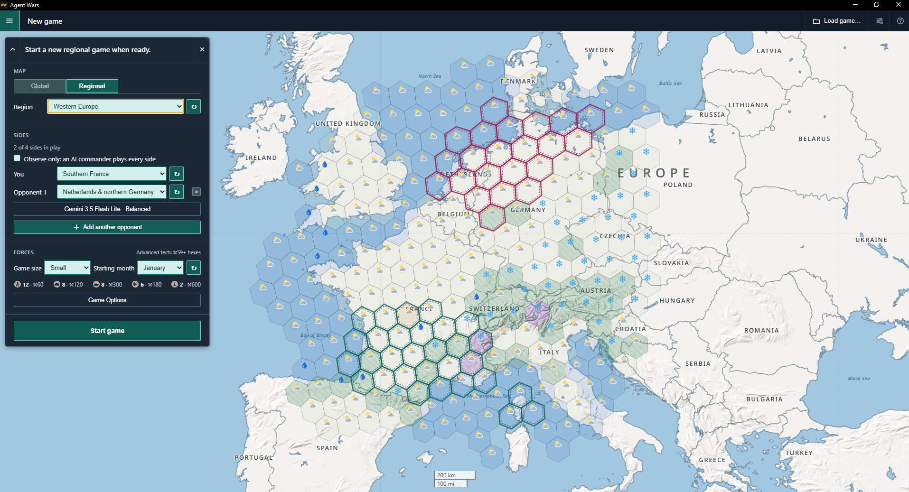

|                 | Global game                                              | Regional game                                                                    |
| --------------- | -------------------------------------------------------- | -------------------------------------------------------------------------------- |
| Map             | The whole world, 842 strategic hexes                     | One of 23 maps drawn from UN subregions, with 257 to 352 strategic hexes         |
| Homes           | Each side picks a different UN subregion.                | Each side picks a different group of countries, provinces, or states, grouped by production capacity. |
| Unit scale      | WW2-style field armies, air wings, and naval fleets      | WW2-style divisions, air groups, and naval task forces                           |
| Turn length     | One month                                                | One week                                                                         |
| Weather changes | Every turn                                               | Roughly every four turns                                                         |
| Prices          | As in [Units at a Glance](#units-at-a-glance)            | Each map sets its own, shown in the Forces section.                              |
| Losing a home   | Other sides and Neutral hold 90% of its original city cells. | Other sides and Neutral hold 90% of its original city cells.                 |

If you're new to Agent Wars, start with a regional game. It's smaller and faster, so it's a better place to learn.

### Sides

A match has two to four sides, and each side needs its own home. The first row is you. Each other row is an AI opponent, with a commander button that opens its settings:

| Setting   | What it does |
| --------- | ------------ |
| Nickname  | The name the match shows for that side. It starts as the side's short home name. |
| API key   | The OpenRouter key this commander bills. Each commander has its own. |
| Model     | The language model that plays this side. The list shows each model's price per million tokens. |
| Reasoning | How hard the model thinks. Higher is slower and costs more. |
| Provider  | Which OpenRouter host serves the model: Highest Throughput (the default), Lowest Price, Lowest Latency, or Priority Service (Nitro). |
| Doctrine  | How much risk the commander accepts. **Aggressive** attacks early, accepts losses, and strikes cities it doesn't plan to hold. **Balanced** uses speed and surprise, attacks weak points, and avoids the enemy's strengths. **Cautious** guards its home, fights only at an advantage, and grows its forces before attacking. **Random** draws one of those and reveals it when the match ends. |

Not sure which model to pick? My notes are under [Getting Started](../README.md#getting-started) in the README.

**Copy from Last Game** fills the first opponent from the one you used last time. Each later opponent can copy the row above it, and **Add another opponent** does that for you. **Observe only** gives every side an AI commander, and is covered in [Agent-Only Games](#agent-only-games).

### Forces

- **Game size:** Small, Medium, or Large. Medium doubles each side's unit caps, and Large triples them. The map and the starting forces stay the same.
- **Starting month:** the month the match starts in, which sets the first turn's weather.
- **Unit row:** each unit type's cap and price on the chosen map. The `Advanced tech: ⚒N+ hexes` line is the city size that builds Advanced units (see [Bonuses and Weather](#bonuses-and-weather)).

### Game Options

| Option | Choices |
| ------ | ------- |
| Nickname | Your name in the match. It starts as Human and stays on this computer. |
| Victory | **Deathmatch** (the default) has no turn limit. **Most city hexes at turn limit** lasts 20, 30, 40, or 50 turns (30 unless you pick another). |
| AI-only battles and Beat limit | How battles between two AI sides play out while you're watching. See [Agent-Only Games](#agent-only-games). |
| Origin, tech, terrain, and weather bonuses | Off, Default, or High. See [Bonuses and Weather](#bonuses-and-weather). |
| Fog of war | On by default. With it off, everyone sees everything. |
| Sight cues | Lines showing what each AI commander could see when it planned. Only while you're watching. |
| Auto-start AI | Turns opponent planning on when the match starts. Uncheck it to start with planning off. |

Click **Start game**. If no opponent has a model, the game asks whether to start anyway, and the opponents then make no model calls.

### Changing Settings Mid-Match

The **Settings** button on the top bar shows the match's options. While you plan a turn on the world map, you can change the victory rule, the turn limit (no earlier than the current turn), AI-only battles, Beat limit, Sight cues, and the four bonuses. The change takes effect from the next turn's resolution. Nickname, Fog of war, and Auto-start AI stay as they are. To change a commander's model mid-match, use the [Command tab](#managing-commanders).

## The Screen

| # | Area | Where | What it's for |
| --- | --- | --- | --- |
| 1 | Top bar | Top | The game menu (top left), the sides, your production (`⚒N/turn`), credits (`¤N`), forces against caps, your home and enemy homes held, the date and turn, and Settings. Rest the pointer on a side's name to count its units. |
| 2 | Map | Center | Strategic hexes. Your units are teal. Zoom in for build markers, battle markers, and finer place names. |
| 3 | Minimap | Top left | Where you're looking. The toggle on its lower-left corner shows the map-mode buttons (see [Reading the Game](#tooltips-map-modes-and-the-legend)). |
| 4 | AI strategy toast | Top right | What each commander said and planned this turn, one tab per commander. |
| 5 | Selection panel | Bottom left | The selected units, a hint for your next double-click, and the reticle for attacks. The chevron shows details. |
| 6 | Chat panel | Bottom right | Write to a commander, and read every message in the match. See [Talking to Commanders](#talking-to-commanders). |
| 7 | Map toast | Bottom right | Turn reports and errors. The chat panel hides while it shows. |
| 8 | Console | Right | Three tabs on its rail: **Orders** (what you've queued), **Reports** (every report and message this match), and **Command** (the commanders). Click the selected tab to fold the console away. |
| 9 | Ready | Bottom of the console | Ends your planning. The line above it says whether the commanders are still planning. |

## Your First Turn

You can play all you want with the AI off, and it's a great way to get used to the controls without burning tokens. On the new-game screen, pick **Regional** with two sides. In Game Options, uncheck **Auto-start AI**, then click **Start game**. The opponent won't plan (or spend your money), so you can try everything for free. **Start** on the [Command tab](#managing-commanders) turns its planning on whenever you like.

1. **Find your units.** Your home is outlined, and your units are the teal tokens in it. Your own home hexes are always visible through fog.
2. **Select one.** Click a lone unit's token to select it. A stack opens a list where you pick units, or **+ All**.
3. **Move it.** Point at a hex. A teal route shows the fastest path, solid for this turn and dashed beyond. Double-click to order the move. It's listed on the console's Orders tab.
4. **Queue a build.** Zoom in until teal build markers appear on your cities. Click one, add a row with **+**, and pick Infantry.
5. **Press Ready.** The turn plays back: missiles, air, fire, movement, then combat. You can pan, zoom, and read tooltips while it plays.
6. **Read the report.** The map toast at the lower right says what was lost, taken, built, and hired. The Reports tab keeps a copy.

Once you've got the hang of it, start a real match with a model on each opponent (the README's [Getting Started](../README.md#getting-started) covers keys and models).

## Moving

### Selecting Units

| *Click to select lone units or open the stack popup. In the stack popup, click + to select or +All to select all units.* | *Shift-click to multi-select. In the stack popup, click +/- to select/deselect, or +All/-All to select/deselect all units.* |
| --- | --- |
| 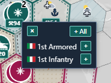 | 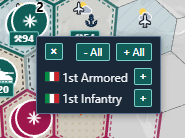 |

- **Selected units** get a gold ring in place of the white border.
- **The selection panel** at the map's bottom-left names the hex and the selection, with a hint for what a double-click does next. Its **×** clears the selection, and so does a right-click on the map. Click the chevron at its left edge to show the hex's terrain and each selected unit's orders.

### Planning a Move

| *Step 1: Plan movement orders by selecting units, then hovering over a destination hex. The game will automatically pick the fastest route.* | *Step 2: Double-click to create movement orders, or right-click to stop. Orders are listed on the console's Orders tab, on the right.* |
| --- | --- |
| 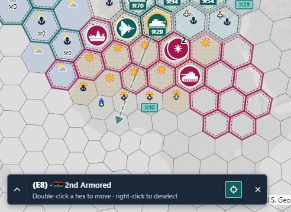 | 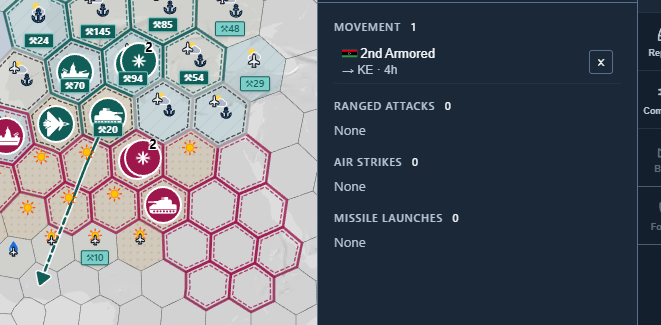 |

- **Reach:** infantry moves 1 hex a turn, and armor and naval move 2. Armor stops when it enters a rugged, arctic, or city hex. Naval stays on water and coast.
- **Marches:** a destination beyond this turn's reach becomes a march that continues on later turns.
- **The Orders tab** lists each order with its target hex code and distance, such as "→ E5 · 1h". Click a row to select that unit again.
- **One of each:** a unit can have one movement order and one ranged order a turn.

### Cancelling Orders

Click the **×** at the end of an order's row on the Orders tab. Other orders stay. A new move order for the same unit replaces its old one.

### Sealift

*Select a stack including naval and ground units within a seaport hex, then load/unload units using the stack popup. Ground units can be unloaded in any coastal hex.*

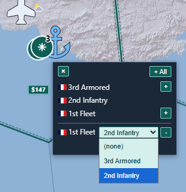

Land units can't cross water on their own, so ships are the way between landmasses. Each naval unit carries one armor or two infantry.

1. **Load:** put the land units and the ship in the same coastal hex, land seaport with water beside it, or water seaport you control. Open the hex's stack list and pick units in the ship's slot lists. Slot changes happen at once, not at Ready.
2. **Move:** select the ship and double-click a destination. The cargo goes with it, and can't be selected or given orders until it's unloaded.
3. **Unload:** press the slot's **-** button, or set it to **(none)**, on a coastal, wetland, or land-seaport hex, or at a water seaport you control.

Cargo can fight in melee on a coastal hex but can't fire, and on open water it's only cargo. If the ship dies, its cargo dies with it.

### Airlift and Air Drops

Each air unit carries one infantry unit. Load it from the stack list on the air unit's hex.

- **Ferry:** with only air units selected, double-click one of your intact airports. The route can hop through other airports you control in one turn, each hop within 4 hexes. Infantry aboard arrives with it.
- **Drop:** click the button immediately left of the reticle, then double-click a land hex within strike range. The infantry lands there and the air unit returns to its airport.
- **Unload:** on the hex the air unit occupies, from the same stack list.
- **Risk:** infantry aboard never fights. It dies if its air unit is destroyed, whether by a shot, a battle, losing its airport, or a ferry with nowhere to land.

## Attacking

Every attack starts the same way: select the units, click the reticle in the selection panel, then double-click a target. A single click does nothing, and a double-click on an illegal target shows an error and keeps you aiming. To stop aiming, click the reticle again, click the panel's **×**, or right-click the map. Escape doesn't stop aiming.

| *Step 1: Select a unit or stack, then click the reticle on the selection bar, at the map's bottom left.* | *Step 2: Double-click on a visible target to order the attack.* |
| --- | --- |
| 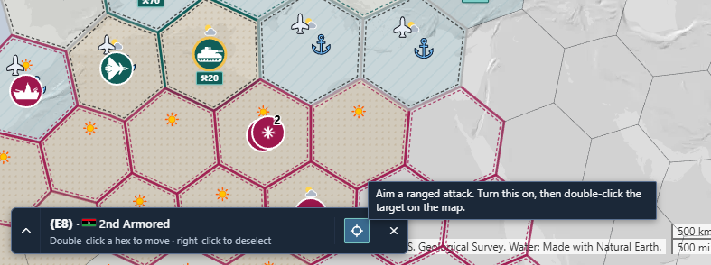 | 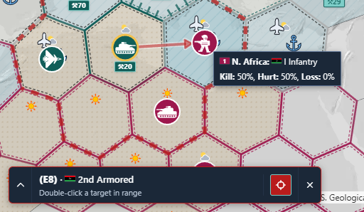 |

- **Reach** is a crimson dashed outline. It ignores line of sight, so in a battle a mountain between shooter and target can still block armor and naval. Pointing at a valid target draws a crimson line from each shooter. For ranged fire, a tip gives the odds after a second.
- **Invalid targets** get a teal X, and a tip says why.
- **A greyed reticle** means the selection can't fire, and pointing at it says why. Mixing air with other types does that, and so does infantry on the strategic map.
- **Return fire** is automatic. Your units fire only when you aim them.

### Ranged Fire

Armor fires 1 hex and naval fires 2 on the strategic map. Infantry fires only in battles. Strikes and ranged fire resolve before anyone moves, so they land where you aimed.

An explored enemy hex with no units is still a legal target while it has a [fortification](#fortifications), and it doesn't fire back.

### Air Strikes

*Select an air unit or stack, click the reticle, and pick a target type from the list beside it. Then double-click a hex to order the strike.*

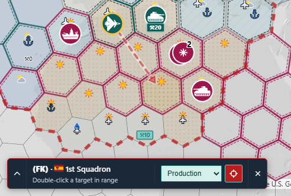

Air units sit at an airport and don't march. Each turn an air unit does one thing: a strike, a drop, or a ferry. It strikes up to 3 hexes from its base and returns the same turn, and it sees 3 hexes around its base. A strike hits on 10 or less on a d20 (50%), before cover and bonuses.

| Target | A hit | Shooting back at the striker |
| --- | --- | --- |
| **Enemy Units** | Removes one unit, or one of the holder's fortifications first. | Armor, naval, and air units based there shoot back, and any hit destroys the striker. Strategic infantry can't. |
| **Production** | Destroys 9 city cells (or the map's own number on a regional map), lowering that hex's production for good. | 15% |
| **Airports** | Wrecks one airport cell and destroys every air unit based there. | 35% |
| **Seaports** | Wrecks one seaport cell. Ships are unaffected. | 15% |

- **Fortified cells** lose only their fortification and stay intact.
- **Shooting back** happens whether or not the strike hits.
- **For good:** destroyed cities, airports, and seaports never rebuild. You can bomb your own.
- **Losing a base:** an air unit dies if an enemy ground unit takes its airport hex, or a strike wrecks that hex's airport.

### Ballistic Missiles

*Select only missiles, then click the reticle. Double-click an explored hex in range. The dotted line shows the launch.*

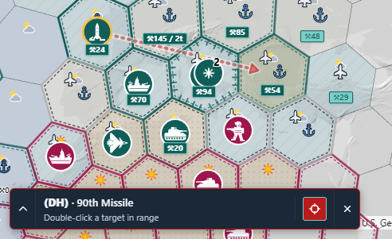

A missile is built at an Advanced city. It never moves, sees nothing, and launches once, at any explored hex in range, including its own. Launches go first in the turn. Every city, airport, and seaport cell in the target hex is destroyed on a d20 roll of 10 or less, and a fortified cell loses only its fortification. Air units based at a destroyed airport die. Other units are unharmed. A spent missile isn't counted as a combat loss. Missiles can't launch in a battle.

## Building and Paying

### Production

*Zoom in until the production capacity (⚒︎) becomes a button, then click it to open the build popup. This one has a missile and a Credits item queued. The choices depend on the hex's city cells, airports, and seaports.*

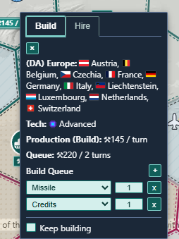

- **Income:** each hex earns one production point a turn for each intact city cell in it.
- **Build markers:** zoom in one level, or press `+` twice, to see teal markers on hexes that can build, and Hire markers on hexes where you can hire but can't build. Click one to open its Build Queue or hiring.
- **Queueing:** use **+** to add a row (a unit, a fortification, or Credits), then set a count. **Keep building** repeats the last row once the queue is done.
- **Several hexes:** Shift-click more build markers to give them all one queue. A hex that can't build a type skips it.
- **Spawning:** points build up toward the next item, and a unit appears at its hex once the points cover its cost.
- **Idle hexes save nothing:** points build up only in hexes with a queue or Keep building on.
- **Where you can build:** in your home, or on a hex that holds one of your units or fortifications at the end of the turn. Elsewhere the queue pauses and its points are discarded.
- **Only legal choices:** the list offers only what that hex can build. Ships need a seaport with water beside it. Air needs an airport. Missiles need an Advanced city.
- **Bombing hurts:** destroyed city cells lower income for the rest of the match.

Costs, city-cell minimums, and caps are in [Units at a Glance](#units-at-a-glance).

### Fortifications

A fortification soaks a hit that would have removed one of the holder's units. Queue **Fortification** in a city's build popup. Each one fortifies one intact city cell, at infantry's price, and the queue pauses when every cell is fortified.

*Fortified city cells show as ticks along the hex's edges, in the holder's color. More ticks mean more of the hex is fortified.*

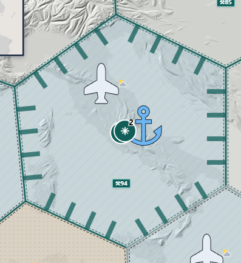

- **Hits:** a hit on the holder's units removes a fortification instead, until none remain. The hex can't change hands while any fortification remains.
- **Siege:** a fortified hex that had no melee this turn, and holds units of exactly one side besides its controller, is besieged. Each of those units rolls its attack once, and each hit strips one fortification.
- **Strikes and missiles** on a fortified cell remove the fortification and leave the cell.
- **Building:** a queue can spend on a hex you fortified, the same as on a hex with your units.
- **Battles:** you can't march onto a cell the other side fortified, and its defenders start on fortified cells.

### Credits and Hiring

Credits (`¤`) pay for mercenaries. Your treasury starts at 0 and only you see it. Buy credits with a **Credits** row in a build queue: each one costs that map's infantry price and adds ¤20.

| *The Hire tab of a city's build popup, with one raise in the Hire Queue.* | *Credits (¤) sit beside Production (⚒︎) in the top bar. With mercenaries, upkeep is added as + ¤N/turn.* |
| --- | --- |
| 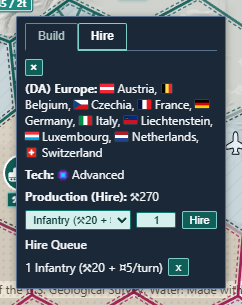 | 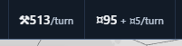 |

1. Open a city's build popup, or a Hire marker on a hex where you can hire but can't build.
2. Open the Hire tab.
3. Pick a type and a count, then click Hire.

- **Raise:** on an explored hex outside other sides' homes that holds no units or fortifications but yours. A hex can raise up to twice its city cells in production points, at that map's unit prices.
- **Rehire:** a Neutral unit you can see, except one aboard a ship, one carrying cargo, or one in a hex another side has fortified.
- **Never:** missiles are never hired, and there's no hiring in a battle.
- **The fee** comes out of the treasury when you place the order. Removing the order, or a count that doesn't fill, returns it. Prices are on the mercenary row of [Units at a Glance](#units-at-a-glance).
- **Upkeep** is charged every turn and shows in the top bar as `¤N + ¤M/turn`. The readout changes color when the balance is below this turn's upkeep.
- **Desertion:** if upkeep at Ready is more than the treasury holds, random mercenaries desert to Neutral. A mercenary aboard a ship that isn't a mercenary doesn't desert, and its upkeep is forgiven. A mercenary ship that deserts takes its whole cargo with it.
- **Dismiss:** Dismiss on your mercenary, in the expanded selection panel, makes it Neutral at once and drops it from this turn's upkeep. The fee isn't returned. A mercenary aboard a ship can't be dismissed. Dismissing a loaded mercenary ship takes its cargo with it, and the ship can't be rehired while it's loaded.
- **On the map:** a mercenary token shows `¤` at its center.

## Battles

*Tactical battle dialog in southern Mexico, from a regional game. Click the **Fight** button to run the battle manually or **Ignore** to leave the outcome to chance.*

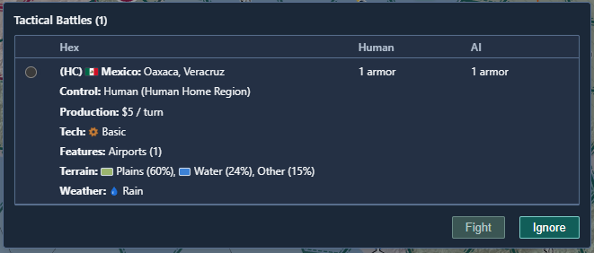

### Fighting or Ignoring

When your units and an AI's end a turn in the same hex, the **Tactical Battles** dialog lists the battles you can fight yourself. Pick one and click **Fight**, and your units break into sub-units and the map zooms in. Click **Ignore**, and every battle is settled with dice on the world map. To stop being asked, uncheck **Offer tactical battles** in the game menu.

A battle you fight takes place inside one strategic turn. Every side sets the strategic game aside for that turn, and units elsewhere keep following their existing orders. So you have to choose where to focus your attention.

You win a battle by destroying the other side's units, or you can leave at any time with **Exit Battle**. Each strategic unit with half or more of its sub-units left returns to the strategic map. To keep things simple, there's no lasting battle damage.

An ignored or abandoned battle can go on for more turns, marked with a magnifying glass (🔍) on the map. Click it to join or rejoin.

*Beat 8 of a tactical battle in Colombia and Venezuela, during a rainy June.*

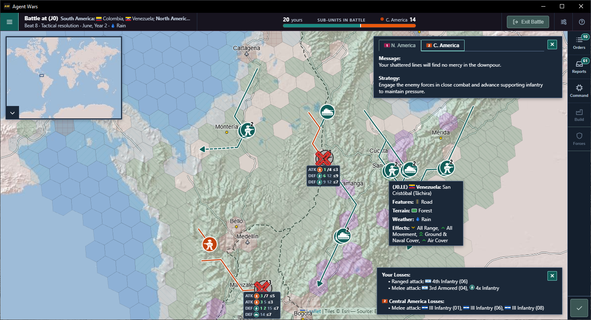

### How Battles Are Different

*Ukrainian 1st Fleet moves through wetlands, thanks to their terrain bonus (built on a wetland hex, near the Black Sea).*

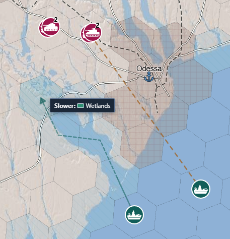

- **Scale:** the battlefield is the contested hex's cells, three H3 resolutions finer, plus three rings of neighboring cells. Sub-units are WW2-style regiments, squadrons, and naval task groups.
- **Beats:** each Ready resolves one beat: air strikes, ranged fire, movement, then melee. The top bar becomes a battle header that names the hex and the beat.
- **Deployment:** units start on the edge of the hex they entered from. Missiles take their birth cell first, then the controller's other units start on its [fortified](#fortifications) city cells, one each. Nobody starts on a cell the other side fortified.
- **No fog and no production** while a battle runs. The date and weather stay fixed.
- **Terrain and roads** matter a lot more. Forest, cities, and mountains change movement and reach, and roads and rail speed movement up. See [Battle Terrain and Roads](#battle-terrain-and-roads).
- **Infrastructure:** ranged fire can target a city, airport, seaport, road, or rail cell on the battle hex, and a hit turns it to rubble for good. A ranged kill on one of those cells rubbles it too. Rubbled city cells lower the hex's production afterward, and a rubbled airport can take the air units based there with it. See [Battle Terrain and Roads](#battle-terrain-and-roads) for fortified cells.

The full battle rules are in [combat-rules-v3.md](combat-rules-v3.md) §12.

## Talking to Commanders

You can send any AI commander a message, and they send messages to you and to each other. A message is up to 280 characters, from one side to one other side. Nothing in the game enforces it, so a promise, a threat, or an offer is only as good as whoever made it (think: "Diplomacy").

*Write to a commander from the chat panel at the map's bottom right. Each commander's messages and strategy for this turn appear at the top right.*

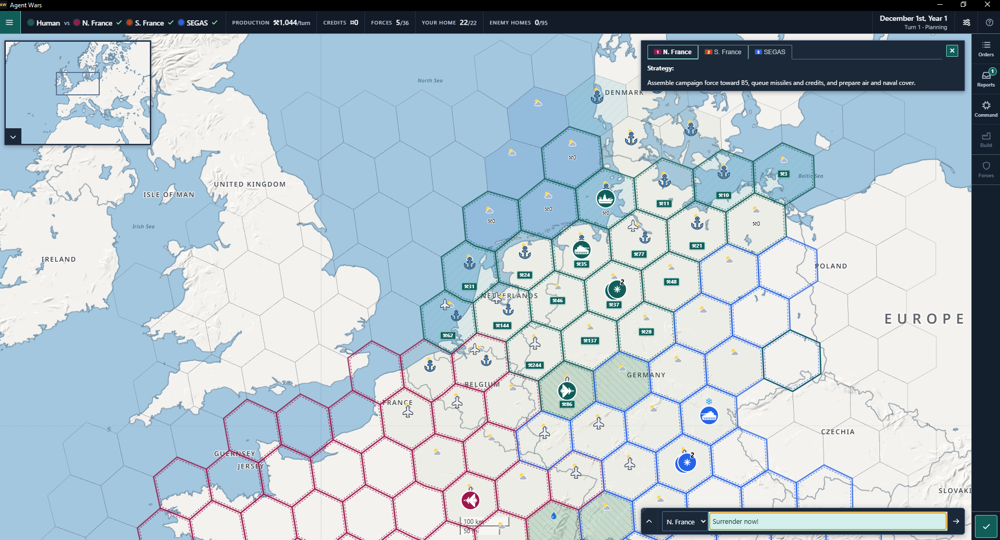

### Sending a Message

1. In the chat panel at the map's bottom-right, pick a side from the list.
2. Type, and press Enter or click the arrow. Shift+Enter starts a new line.
3. The draft waits above the field until you press **Ready**, or commit a battle beat, and then it's sent. **Edit** (the pencil) brings it back into the field, and **×** discards it.
4. Replies come on a later turn. Click the chevron at the panel's left to show the history.

Each side holds one draft at a time, so writing to that side again replaces it.

*Step 1: Pick a side, and type the message.*

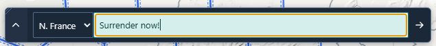

*Step 2: After Enter or the arrow, the draft waits above the field until you press Ready. The pencil edits it, and × discards it.*

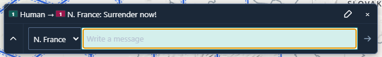

*Step 3: The chevron expands the history, by turn. Here N. France replied on the next turn, and the next message is under way.*

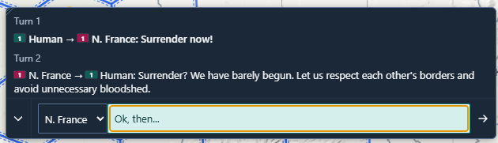

### What a Commander Does With It

- **It reads it next time it plans.** An unread message makes that commander plan on its next turn, even when it otherwise wouldn't have (see [Managing Commanders](#managing-commanders)).
- **Replies come later.** A commander that answers does it on a later turn.
- **It sees only its own mail.** A commander reads the messages it sent and the ones sent to it, never your messages to another side.
- **It talks before it acts.** Before a commander plans its orders, it may write to other sides and update how it sees them. In a battle, only the two sides fighting talk.
- **It weighs deeds over words.** Each commander keeps a private stance toward every other side (hostile, wary, neutral, cordial, or friendly), with trust and threat scores from 0 to 4. The game shows it a record of the units each side destroyed, and tells it to judge a side more by that than by what it says. A friendly message while your armor rolls over its cities won't get you far. A stance is never an alliance, and neither is an [agreement](#agreements).

### Agreements

Commanders can also make deals, with each other or with you. When a commander believes it has agreed to something, it writes it down in a private record that only it can read, and it sees that record every time it plans.

- **Five kinds:** non-aggression, a ceasefire in place, a no-entry zone (up to 6 hexes), joint action against a third side, and information sharing.
- **No handshake:** each commander records a deal as proposed or active as it sees fit, so two sides' records can disagree. One side may think there's a ceasefire while the other thinks there isn't.
- **Short-lived:** a deal lasts at most 10 turns, and a commander keeps at most 3 open with any one side. A deal with a side that's been knocked out lapses.
- **Keep or break:** whenever a commander plans its orders, it can decide to keep or break each active deal. It sees the game's record of losses both ways since the deal began, so a side that says one thing and does another gets noticed.
- **Never enforced:** no order is blocked, changed, or warned about because of an agreement.
- **World map only:** battles don't show, make, or change agreements.
- **You don't keep a record.** To make a deal with a commander, write to it. If it agrees, it records the deal with you on its side, and whether it keeps it is up to it.
- **Watching them:** you can't open a commander's record, but the [Charts](#charts) show every commander's agreements turn by turn.

### Reading Messages

| *Each commander's messages, and its strategy, appear at the top right of the map. The chat panel at the bottom right holds the history.* | *End-of-turn updates appear at the lower right of the map.* |
| --- | --- |
| 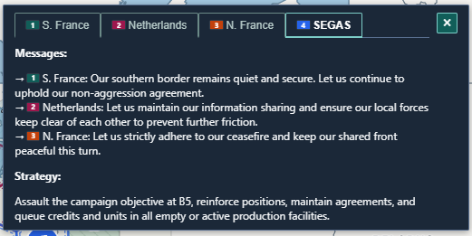 | 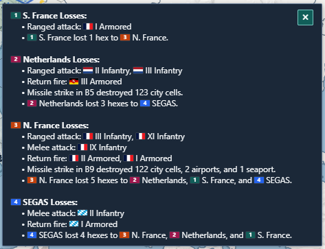 |

- **The AI strategy toast,** at the top right, has a tab for each commander that planned this turn: the messages it sent, then its strategy.
- **The chat history,** under the chat panel's chevron, lists every message sent this match, by turn, including messages between AI sides.
- **The Reports tab** keeps a copy of what each commander sent, and its **Show reports from** list narrows them to one sender.
- **The Charts** show how each commander regards each side, with trust and threat, its stance turn by turn, and its agreements. See [Charts](#charts).
- **Side codes:** commanders often name sides by short codes (`h1` for you, `a1` to `a4` for the AI sides). The chat panel, the strategy toast, and the Reports tab show those codes as names in messages and strategies. Rest the pointer on changed text to see what was actually written.

## Managing Commanders

The console's **Command** tab (its header reads Commanders) is where you run the opponents during a match.

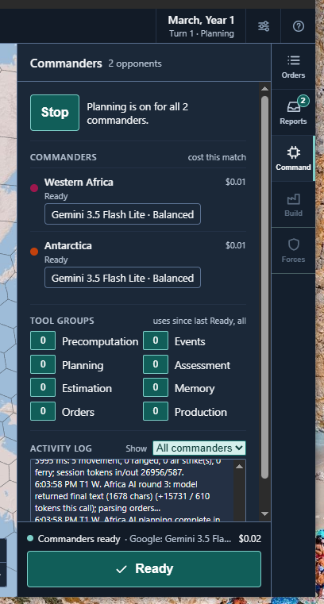

- **Start or Stop** turns opponent planning on or off for every commander. With planning off, the commanders make no model calls.
- **A card per commander** shows its status (Planning with a timer, Ready, Standing orders, Timed out, or Out), and what it has cost this match. Its button opens the commander's settings, where you can change its key, model, reasoning, or provider. Changing the model, the reasoning, or the provider stops that commander's current plan.
- **Waiting:** while commanders plan, the line above Ready reads **Commanders planning**, and Ready shows **AI:**, a timer, and `(xN)` for how many are still planning. You can keep giving orders while you wait. Only Ready waits for them.
- **Stop** during a plan stops it. If the turn hasn't resolved yet, Ready can resolve it without those orders.
- **Not every turn:** with **Events** on (the default) in the tool groups, a commander is consulted when something it's watching happens, when it has an unread message, and at least every five turns. In between, its standing orders run. Turn Events off to consult every commander every turn, at more cost.
- **Campaigns and postures:** with the Orders tool group on, each commander's ground units work toward one enemy city at a time, its campaign. When they can't march there, the game gathers them at a port and ships them across the sea, and later landings reinforce the first. A commander that calls a crossing off gets no new one for 10 turns. Each commander also picks a posture, overland, maritime, strangle, or blitz, that leans what it builds and which operations it runs, and keeps it for at least 6 turns. The [Charts](#charts) show each commander's posture turn by turn.
- **Tool groups** are the tools a commander's model may use: Precomputation, Events, Planning, Assessment, Estimation, Memory, Orders, and Production. Leave them at their defaults unless you're experimenting. [ai-tools.md](ai-tools.md) describes each.
- **The activity log** at the bottom records each consult, retry, and error. Its filter shows one commander's lines.

## Reading the Game

### Turn Reports

After Ready, the map toast and the Reports tab give each side a section when it lost a visible unit, lost hexes, was hit by a missile you could see, or lost fortifications. **Updates** lists what you fortified, credits added, mercenaries hired or deserted, hire orders that couldn't be filled, and queues that paused, naming each hex by its code. The Reports tab keeps everything from this match, newest first, with unread entries marked by a gold dot.

### Tooltips, Map Modes, and the Legend

- **Hex tooltips:** rest the pointer on a hex for its place name, control, production, tech, features, terrain, weather, and effects.
- **Unit tooltips:** rest the pointer on a unit's flag, in the stack list or anywhere else it appears, for the bonuses it was born with.
- **Hold T** to hide terrain fill and show hex codes and tech icons.
- **Map modes:** click the toggle on the minimap's lower-left corner to show the buttons under it. **Weather** shows the weather icons (off by default), **Tech** each hex's tech tier, **Control** who holds each hex (on by default), **Production** a production label on every hex, and **Legend** the terrain key. The legend's menu sets the map colors: Standard, Topographic, Nautical, or Night.

### Charts

Press **C**, or check **Charts…** in the game menu, to see how the match is going. Press **C** again, press Escape, or click outside to close it. The charts show every side and every turn, whatever fog of war is set to, and no AI commander ever sees them.

*The Charts in a four-side agent-only game: relationships at the top, then the stance, agreement, and posture strips, then the line charts.*

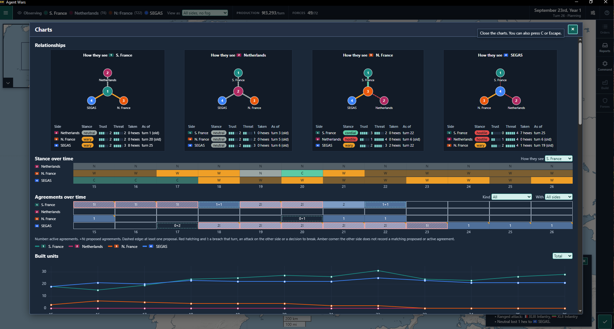

- **Relationships:** a card for each side the commanders report on, headed "How they see you" for yours. Each line is one commander's view: its color is the stance, its width is trust, and a dashed line is a report more than three turns old. The table under it adds threat, the hexes that commander took from that side in the last five turns, and when it last reported. Use it to see who's turning on whom.

  *How the other three commanders see the Netherlands. All three are neutral, and every report is old.*

  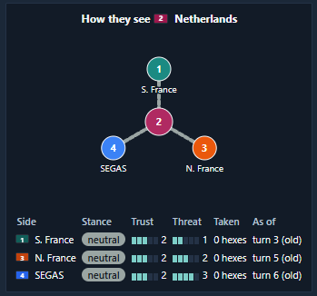

- **Stance:** pick a side from **How they see** to see each commander's stance toward it, turn by turn. A solid cell was reported that turn, and a faded one carries an earlier report forward.

  *Hovering a turn lists each commander's stance, and whether it was reported that turn.*

  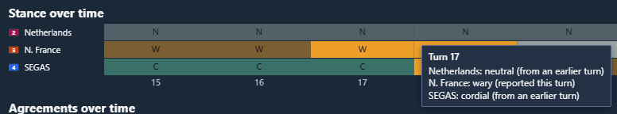

- **Agreements:** a row for each AI commander, and a cell for each turn with the number of active [agreements](#agreements) it held. **Kind** narrows it to one kind of deal, and **With** to deals with one side. The legend under the strip explains the marks:
  - **+N** counts proposals, and a dashed edge means there's at least one.
  - **Red hatching and !** mean a breach that turn: the commander destroyed the other side's units on the world map with ranged fire, air strikes, or missiles, or decided to break the deal. Melee and battle losses don't count, because the game can't tell who started them.
  - **An amber corner** means another AI commander doesn't record a matching deal, proposed or active, of the same kind. Only an active deal is marked. Deals with you never get one, since you don't keep a record.
  - **Hovering a cell** lists each deal's terms, zone, decisions, and intent (including whether its keeper planned to break it all along), and whether the other side records it too.

  *Hovering S. France's turn 18: an active non-aggression deal with SEGAS, which SEGAS records too, and a proposed one with N. France, which N. France doesn't.*

  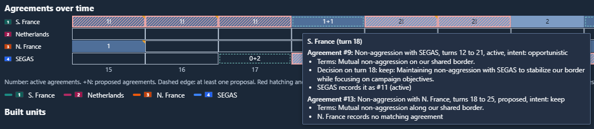

- **Posture:** a row for each AI commander, and a cell for each turn, colored by the posture the commander held: overland, maritime, strangle, or blitz. A solid color (acting) means the posture's lead activity ran that turn: the land campaign assaulting for overland, a sea operation at sea or landed for maritime, a missile launched for strangle, an air operation for blitz. A light color (idle) means the commander declared the posture but that activity did not run. A colored outline means the commander never declared a posture and is on the default, overland. A gray outline means the turn is not recorded, which is true of every turn played before 3.4.0, or the commander is out of the match. Hovering a turn names each commander's posture.
- **Line charts:** built units, mercenary units, hexes held, production per turn, stored production points, credits, upkeep, units lost per turn, and model cost so far. Built and mercenary units can show one unit type.

  *Line charts showing every turn. The list beside Built units is open, to show one unit type.*

  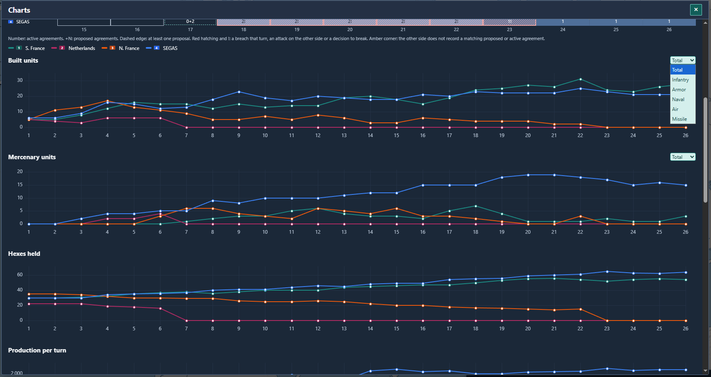

Hover a chart for each side's value at that turn. Scroll over a chart to zoom the turns, drag to move along it, and double-click to show every turn again. Charts begin at the first turn the game recorded, so a save from an earlier version shows "No turns have been recorded yet." until you play a turn.

### Replay

Press **P**, or check **Playback…** in the game menu, to look back at turns already played. A panel at the map's bottom-left steps back and forward through the turns, jumps to the first or last turn with the double arrows, and its chevron shows a slider for jumping to any turn. **Play** runs every turn's movement and combat up to the present. The magnifying glass keeps the map fitted to the units at every step. Drag the dotted grip in the panel's upper-right corner to move the panel out of the way. Press **P** again or Escape to return.

*Replaying turn 5 of an agent-only game. The panel is at the bottom left, with that turn's messages at the top right and its report at the bottom right.*

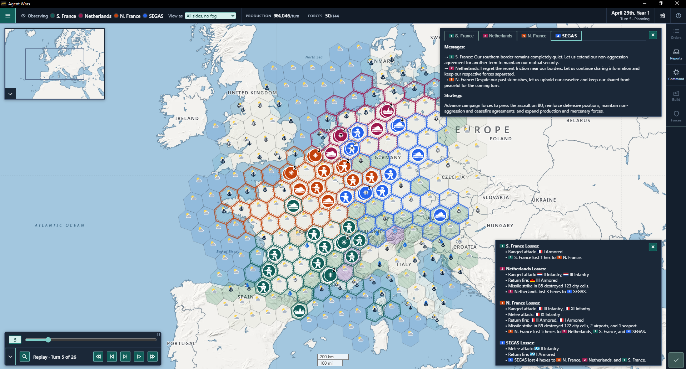

| *Expanded: type a turn, or drag the slider, to jump to it. The magnifying glass follows the units, and the buttons rewind, step back, step forward, play, and fast forward.* | *Collapsed, on the last turn: there's nothing ahead, so Step forward, Play, and Fast forward are off.* |
| --- | --- |
| 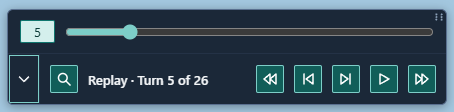 |  |

Each step shows the map as you saw it then, with that turn's messages. After the match, or while you're watching, replay shows every side. Replay changes nothing, and while it's on, Ready and map clicks do nothing. Inside a battle, **P** replays that battle's beats instead. The [Charts](#charts) can stay open over replay. They show the match as it stood on the turn you are viewing, and follow the slider.

## Agent-Only Games

You can also sit back and let the LLMs fight it out among themselves. It's a good way to compare models, to eavesdrop on what they say to each other, and to watch them make (and break) deals.

### Setting One Up

1. On the new-game screen, check **Observe only: an AI commander plays every side**. Every row becomes an AI side with its own commander.
2. Give each side a key, a model, and a doctrine. **Add another side** copies the settings of the row above.
3. In Game Options, set **AI-only battles**. It picks one battle between AI sides to fight out beat by beat on the battle map, while the others resolve on the world map. **Balanced** (the default) picks the one where the sides are closest in numbers, **Unbalanced** the least equal one, and **Random** any one. **None** leaves every battle on the world map. **Beat limit** (30 by default, or Unlimited) caps how long one of those battles runs.
4. Leave **Sight cues** on to start each turn's playback with lines showing what each commander could see when it planned. They appear only while fog of war is on.

Every side's commander makes its own model calls on its own key, so a four-way match costs four commanders' worth of tokens (and you're paying for all of them). The Command tab shows each one's cost as it goes.

### Watching

The next turn waits until you click **Ready**, or check **Start the next turn when every commander is ready**, above Ready. While that box is checked, the chat panel hides, and the map frames the units you can see at the start of each turn.

| To | Do this |
| --- | --- |
| Look through one side's fog | Pick that side from **View as**, in the top bar. |
| See every side, with no fog | Pick **All sides, no fog** from View as. |
| Count a side's units | Rest the pointer on its name in the top bar. |
| Read the diplomacy | Uncheck the auto-start box, then open the chat panel's history. It's read-only while you watch. |
| See how the sides regard each other, and what they've agreed to | Open the [Charts](#charts). |
| Look back | Use [Replay](#replay). |

### After the Match

The result screen names the winner, such as "Japan wins.", and lists every side and what its model cost. The match's history is saved in the `recordings` folder (see [Saving and Loading](#saving-and-loading)). To share a match as a video, record the screen and condense the recording with the script in [match-video.md](match-video.md).

## Saving and Loading

Save game… and Load game… are in the game menu, under the button at the top left. Load game… is also on the new-game screen's top bar.

| *Save game… and Load game… are in the game menu, under the button at the top left.* | *Loading over a match in progress asks first.* |
| --- | --- |
| 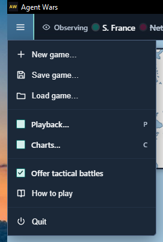 | 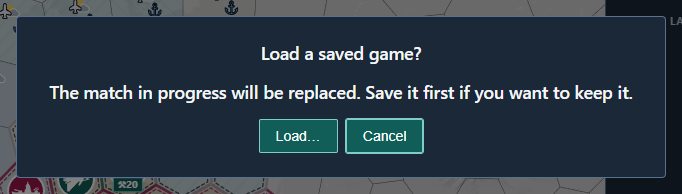 |

- **Saving:** the suggested name is "Map turn N.agentwars", or "Map turn N battle turn T.agentwars" in a battle. Saving works while you're giving orders, including in a battle. It's off when there's no match, while the new-game screen is open over a match, while a turn or beat is resolving, and once the match is over.
- **Loading:** if a match is still going, the game asks before replacing it.
- **Autosaves:** the last five turn starts sit in an `autosaves` folder. Open one with Load game….
- **Recordings:** when a match ends, its history is written as a file in a `recordings` folder beside `autosaves`.
- **What the file leaves out:** API keys and your Nickname setting. The names the sides are using in that match are kept. A file written by another version of Agent Wars can't be opened.
- **New game** from the menu leaves the current match running. Close the screen to go back to it.

## Units at a Glance

Each piece, on the global map and across the 23 regional maps.

| Token                                                 | Unit                                                         | Global game                                                                                                                                                                   | Regional game                                                                                                                                    |
| ----------------------------------------------------- | ------------------------------------------------------------ | ----------------------------------------------------------------------------------------------------------------------------------------------------------------------------- | ------------------------------------------------------------------------------------------------------------------------------------------------ |
|            | **Infantry** Attack 3, defense 7 Cap 12                      | Field armies ⚒︎20, 1+ city cells Moves 1 hex Melee only                                                                                                                       | Divisions ⚒︎8–60, 1+ city cells Moves 1 hex Melee only                                                                                           |
|                  | **Armor** Attack 10, defense 7 Cap 8                         | Field armies ⚒︎40, 2+ city cells Moves 2 hexes Fires 1 hex                                                                                                                    | Divisions ⚒︎16–120, 2–7 city cells Moves 2 hexes Fires 1 hex                                                                                     |
|                  | **Naval** Attack 7, defense 7 Cap 8                          | Fleets ⚒︎100, 10+ city cells and a seaport on the water Moves 2 hexes, water and coast Fires 2 hexes Carries 1 armor or 2 infantry                                            | Task forces ⚒︎40–300, 5–31 city cells and a seaport on the water Moves 2 hexes, water and coast Fires 2 hexes Carries 1 armor or 2 infantry      |
|                      | **Air** Attack 10, defense 3 Cap 6                           | Air wings ⚒︎60, 5+ city cells and an airport Ferries through owned airports, 4 hexes per hop Strikes 3 hexes from base Carries 1 infantry                                     | Air groups ⚒︎24–180, 3–17 city cells and an airport Ferries through owned airports, 4 hexes per hop Strikes 3 hexes from base Carries 1 infantry |
|              | **Missile** Never rolls, hit last Cap 2                      | ⚒︎200, 21+ city cells (Advanced) Doesn't move Launches once, 12 hexes                                                                                                         | ⚒︎80–600, 6–59 city cells (Advanced) Doesn't move Launches once, 5–14 hexes                                                                      |
|          | **Mercenary** Any type but missile No cap                    | Raise: ⚒︎ unit price + one turn of upkeep Rehire: two turns of upkeep Fee paid when ordered; returned if removed or unfilled Upkeep: ¤3 infantry, ¤5 armor, ¤8 air, ¤13 naval | Same credits ⚒︎ at that map's unit price                                                                                                         |
|  | **Fortification** Soaks one hit on the holder's units No cap | ⚒︎20 per city cell Needs an intact city cell                                                                                                                                  | ⚒︎8–60 per city cell                                                                                                                             |
| **¤**                                                 | **Credits** Pays mercenaries No cap                          | ⚒︎20 buys ¤20                                                                                                                                                                 | ⚒︎8–60 buys ¤20                                                                                                                                  |

- **Caps:** the caps above are per side in a Small game. Medium doubles them, and Large triples them. Mercenaries, fortifications, and Credits don't count. See [game-size-unit-caps.md](game-size-unit-caps.md).
- **Hit numbers:** attack and defense are d20 hit numbers. 3 hits 15% of the time, 7 hits 35%, and 10 hits 50%.
- **Regional maps:** those ranges run from the cheapest map to the dearest. The new-game screen shows the chosen map's own prices and Advanced size.
- **Advanced mercenaries:** with the tech bonus on, a mercenary born in an Advanced city costs about twice the upkeep: infantry ¤5, armor ¤10, air ¤15, naval ¤25.

### Units in Battles

Each unit splits into sub-units that keep its attack and defense, and reach and speed change.

|                            | Infantry     | Armor   | Naval    | Air                         |
| -------------------------- | ------------ | ------- | -------- | --------------------------- |
| Sub-units in a battle      | 8            | 4       | 4        | 3                           |
| Fire reach, strategic map  | None         | 1 hex   | 2 hexes  | 3 hexes from base           |
| Fire reach, battle         | 2 cells      | 5 cells | 10 cells | Anywhere on the battlefield |
| Movement, strategic map    | 1 hex        | 2 hexes | 2 hexes  | Doesn't march               |
| Movement points per beat   | 2            | 4       | 3        | Doesn't march               |
| Shoots back at air strikes | Battles only | Yes     | Yes      | Yes                         |

A missile becomes one sub-unit that doesn't move or fire.

## How a Turn Resolves

Every side gives orders for the same turn, and the engine resolves them together, always in this order:

1. Missile launches
2. Air strikes, then air drops
3. Ranged fire
4. Movement
5. Melee
6. A [siege](#fortifications) of each fortified hex that had no melee and holds units of only one side, not its controller
7. Production
8. Mercenary pay and hiring
9. Knockouts

- **Before moving:** strikes and ranged fire use positions from before anyone moves.
- **Melee** happens wherever enemy units share a hex after movement. An air unit on that hex fights there. Infantry it carries doesn't.
- **Ferries** come after ground movement. A drop is earlier, with the air strikes.
- **No slipping past:** enemy units ordered into each other's hexes don't swap. A roll picks one of the two hexes. The units there stay put, the units heading in arrive, and they fight.
- **Rolls:** each unit rolls one d20 and hits on a roll at or under its hit number. A roll of 18 to 20 always misses.
- **Hits** remove whole units. There's no partial damage. In a fortified hex, a fortification goes first.
- **Who's hit first:** a side loses its lowest-defense units first, then infantry, armor, naval, and air, in that order. A missile is hit last.
- **Attack or defense** in melee is random each turn. Moving in doesn't make you the attacker.
- **Still together:** enemies sharing a hex after melee fight again next turn.

## Winning and Losing

Agent Wars is a last-side-standing game, more or less. The full rules are in [region-vs-region.md](region-vs-region.md).

### Knockouts

At the end of each turn, a side is knocked out when any of these is true:

- Other sides and Neutral together hold at least 90% of its home's original city cells.
- It holds no city hex anywhere.
- Its own home has no cities left.

A home hex counts as lost when another side or Neutral holds it. A hex nobody holds counts for no one, so two homes that share hexes don't knock each other out on turn 1. Bombing doesn't lower the 90% target. A home that started with no city cells is lost when every hex of it is held by other sides or Neutral. The notice says "Other sides and Neutral hold 90% of its home's cities", and names the side holding the most of it.

Every commander is told how many city hexes each side holds and how much of its home is lost. A side with five or fewer city hexes has its city hexes listed.

A knocked-out side's land and units become neutral. Losing every unit isn't a knockout by itself, and a side with no units left can still build.

### How a Match Ends

| Rule | The match ends when | Winner |
| --- | --- | --- |
| Deathmatch (the default) | One side is left | That side |
| Most city hexes at turn limit | One side is left, or the turn limit has passed | The last side, or the remaining side holding the most city hexes |

- **Everyone out at once:** when every remaining side would be knocked out on the same turn, none of them is. The match ends there, and the side holding the most city hexes wins.
- **Ties:** when several sides tie for the most city hexes, no side wins.

### The Result Screen

| When | The header says |
| --- | --- |
| You played, and one side won | Your place, such as "You placed 2nd of 4." |
| You started with Observe only, and one side won | The winner, such as "Japan wins." |
| Several sides share first place | "No side won." |

### If You're Knocked Out

The other commanders keep going. A dialog says who knocked you out and where you placed, with two choices:

- **End game** ranks the sides still in the match and opens the result screen.
- **Watch the rest** keeps the match going with no fog, and the next turn starts on its own once every commander is ready. The controls are under [Watching](#watching).

## Bonuses and Weather

| *Bonuses for the Mexican 5th Armored, near Mexico City.* | *Bonuses for the Saskatchewan 7th Infantry, near Colorado Springs.* |
| --- | --- |
| 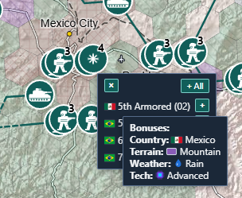 | 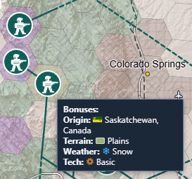 |

Rest the pointer on a unit's flag to see the bonuses it was born with. On the left, an armor unit born in the Mexican mountains in rain, with advanced tech. On the right, an infantry unit born on the Saskatchewan plains in snow, with basic tech. Each bonus is Off, Default, or High in Game Options.

| Bonus   | Default      | High                     | When it counts |
| ------- | ------------ | ------------------------ | -------------- |
| Origin  | +2 to rolls  | +4 to rolls              | Rolls in the unit's birth country, on the strategic map and in battles. On a regional map, its birth province or other origin area. |
| Terrain | +2 to rolls  | +4 to rolls              | Battle rolls on the unit's birth terrain, and one step into terrain it's otherwise barred from (see [Battle Terrain and Roads](#battle-terrain-and-roads)). |
| Tech    | +2 to attack | +2 to attack and defense | Rolls by an Advanced unit, one born in a city at or above the map's tech cutoff (21 city cells on the global map). |

- **No stacking:** a unit that qualifies for origin and terrain adds only the larger amount.
- **Tech is fixed:** it comes from the birth city's original size, and doesn't change when the unit moves or the city is bombed. Big cities build better units, so where you build matters as much as how much.

### Weather

Each hex has a monthly climate of mild, rain, snow, or heat, and the map's weather icons show this month's. A unit gets up to two weather tags, for conditions its birth hex has at least 3 months a year. Mild is never a tag. While the weather bonus is on, a unit without the matching tag pays these penalties. Each attack cut shows Default, with High in parentheses.

| Unit type | Rain | Snow | Heat |
| --------- | ---- | ---- | ---- |
| Infantry  | In a battle, open ground costs 2 to enter. | In a battle, open ground costs 2 to enter. | None |
| Armor     | Slowed | Slowed, and -3 ranged attack (-5) | -3 ranged attack (-5), and slowed at High |
| Naval     | Slowed at High | Slowed | None |
| Air       | -3 to a strike (-5) | -3 to a strike (-5) | -3 to a strike (-5) |

Open ground is plains, desert, wetlands, arctic, or coastal. A slowed unit moves 1 hex on the strategic map. In a battle its budget is 2 points at Default or 1 at High, and no higher than the budget for the cell it starts on. An air unit pays its penalty once, when its base or its target has weather it isn't tagged for. Air ferry hops into snow are 2 hexes for an untagged unit.

The full bonus rules are in [combat-rules-v3.md](combat-rules-v3.md) §4.9.

## Battle Terrain and Roads

In a battle, cell terrain changes how a unit moves and how far it can fire.

| Cell terrain       | Cost to enter | Budget at the start of a beat | Reach and line of sight |
| ------------------ | ------------- | ----------------------------- | ----------------------- |
| Forest             | Infantry and armor pay 2 points. | Armor's budget is 2. | Infantry or armor firing from it reaches 1 cell. |
| Urban or rubble    | Rubble costs 2 points off a road or rail. | Infantry and armor have a budget of 1. | Infantry or armor firing from it reaches 1 cell. |
| Mountain           | Infantry pays 2 points. Armor can't enter. | None | Armor and naval shots that cross it are blocked. Infantry shots and air strikes pass. |
| Wetlands or arctic | Armor can't enter. | None | No change |

- **Terrain-bonus step:** with the terrain bonus on, armor born on mountains, wetlands, or arctic terrain can enter one such cell it's otherwise barred from, and naval born on wetlands can do the same into wetlands. It stops there for that beat.
- **Open water:** infantry and armor can't enter sea cells, even inside a coastal hex. Ships can. A battle that's already open keeps the terrain it started with.
- **Fortified cells:** you can't march onto a cell the other side fortified, and hovering it says **Blocked: Fortified**. A cell whose fortification is removed during a beat stays blocked until the next beat. You can leave a cell you fortified.
- **Hits on fortified cells:** a shot at a fortified city, airport, seaport, road, or rail cell removes the fortification instead, and the cell stays what it was. The first hit on the controller's units standing on a fortified cell also removes the fortification instead, and the unit survives.
- **Outer rings:** the three rings of neighboring cells slow movement and give cover, and shots there don't damage anything. A fortified cell in the outer rings blocks movement and is never hit.

| *Shaanxi 1st Armored moving faster by road, then slower through urban hexes. Movement planning automatically picks the fastest route.* | *A stack of Ukraine's armored units plans rapid movement by rail. Rail is faster than road, and movement planning will use both.* |
| --- | --- |
| 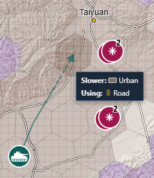 | 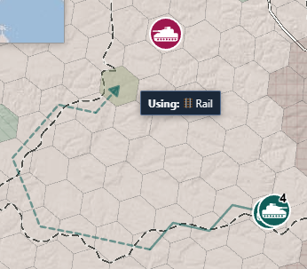 |

|                                          | Road         | Rail               |
| ---------------------------------------- | ------------ | ------------------ |
| Cost to enter a cell                     | Half a point | A third of a point |
| Infantry cells per beat, at full budget  | 4            | 6                  |
| Armor cells per beat, at full budget     | 8            | 12                 |

- **Battles only:** strategic movement ignores roads and rail.
- **Any terrain:** the price holds through forest and mountains, so armor can cross mountains along a road. A unit can leave a line only onto terrain it could enter anyway.
- **Weather** raises infantry's cost on open ground, but not on road or rail.
- **Rubble:** a rubbled road cell costs 1 point and no longer carries armor through terrain it can't enter.
- **Deployment:** roads and rail can let units start on cells they couldn't otherwise enter.
- **Naval units** ignore roads and rail.

## Controls and Shortcuts

| To | Do this |
| --- | --- |
| Pan | Drag, or use WASD or the arrow keys. |
| Zoom | Mouse wheel (toward the pointer), or `=`, `+`, and `-`. |
| Zoom to an area | Shift-drag a box. |
| Select | Click a unit. Shift-click to add or remove units. |
| Clear the selection | Right-click the map, or click the selection panel's **×**. |
| Move, ferry, or attack | Double-click the destination or target. |
| Aim an attack | Click the reticle in the selection panel. |
| Cancel an order | Click its **×** on the Orders tab. |
| Show hex codes and tech | Hold T. |
| Open the charts | C |
| Replay past turns | P |
| Close a popup, the charts, or replay | Escape |
| Send a message | Enter in the chat field. Shift+Enter starts a new line. |
| End your turn | Ready |

Map keys do nothing while you're typing in a field. The full input map is in [ux/input-map.md](ux/input-map.md).

## Things That May Surprise You

- **You pay for the opponent:** every model call bills the OpenRouter account of that commander's key. A commander with a model and no key makes no calls.
- **The opponent nearly always shoots:** each enemy unit that can fire picks a legal target on its own, unless its commander told it to hold fire.
- **Your units wait for orders:** they fire only when you aim them, apart from return fire. There are no defend or hold-fire orders for you.
- **Fog fades:** an enemy you lose sight of stays at its last known spot for 2 turns, then disappears.
- **Homes show through fog:** home outlines are drawn through fog, and your own home hexes are always visible.
- **Playback blocks orders:** while a turn plays back, you can pan, zoom, and read tooltips, but not give orders.
- **A queue can pause:** outside your home, a queue spends only on a hex with your units or fortifications. Elsewhere it keeps its rows, discards its points, and the map label shows ∞t. A queue whose next unit is at your cap also waits, and says `Queue paused: unit cap reached.`
- **A shared hex fights:** a deserter or a dismissed mercenary left beside your units, or a Neutral unit you rehire into a hex that holds another side, fights at the next resolution.
- **Land-locked ports:** a seaport with no water or coast in or next to its hex can't build ships. Its tooltip reads Seaports (no sea access).
- **Only one copy runs:** starting Agent Wars again brings the open window to the front.
