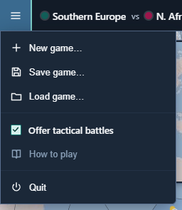
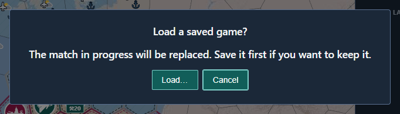
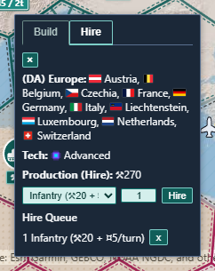
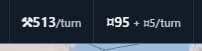
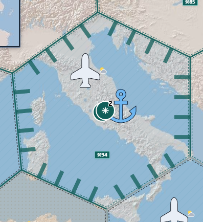
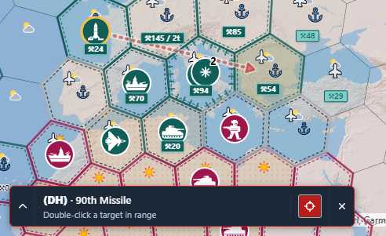
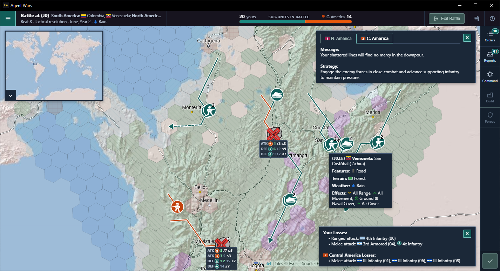

# How to Play

This guide covers a match in the current build, from the new-game dialog to the end. Downloading the game and setting up each opponent's OpenRouter key are covered under [Play it](../README.md#play-it) in the README. The full rules are in [combat-rules-v3.md](combat-rules-v3.md).

Agent Wars is a WEGO game ("we go"), where neither player can see what the other is planning. For each turn, both sides create combat, movement, and production orders at the same time, based on partial, subjective views of the battlefield. Once players are ready, the game executes their orders and determines the outcomes (think: "Axis & Allies" meets "Diplomacy", with a software referee).

I'm a geographer by training, so Agent Wars focuses more on geospatial features than nationality. Players start with home regions made up of real-world countries, provinces, or states, but those are mostly labels. What really matters is on the ground: the size and placement of cities, and how terrain and coastlines shape what players can do. Unit origins, terrain familiarity, technology levels, and weather still matter, but not as much.

## Winning and Losing

Agent Wars is a last-side-standing game, more-or-less. There's an optional turn limit, and a couple of edge cases where a city count decides the match (or nobody wins at all). This is the player's version of the rules, and the full version is in [region-vs-region.md](region-vs-region.md).

### Knockouts

At the end of each turn, a side is knocked out when any of these is true:

- Another side holds its home.
- It holds no city hex anywhere.
- Its own home has no cities left.

What counts as holding a home depends on the map:

| Map | Holding a home means |
| --- | --- |
| Global | Holding every hex of it |
| Regional | Holding home hexes with at least 75% of that home's original urban cells. Bombing doesn't lower that target. |
| Regional, for a home that started with no urban cells | Holding every hex of it |

A knocked-out side's land and units become neutral. Losing every unit isn't a knockout by itself, though, and a side with no units left can still build.

### How a Match Ends

| Rule | The match ends when | Winner |
| --- | --- | --- |
| Deathmatch (the default, on either map) | One side is left | That side |
| Most city hexes at turn limit | One side is left, or the turn limit you picked (20, 30, 40, or 50) has passed | The last side, or the remaining side holding the most city hexes |

Two edge cases apply under either rule:

- **Everyone out at once:** when every remaining side would be knocked out on the same turn, none of them is. The match ends there, and the side holding the most city hexes wins.
- **Ties:** when several sides tie for the most city hexes, no side wins.

### The Result Screen

The result screen lists every side, and its header depends on how the match went:

| When | The header says |
| --- | --- |
| You played, and one side won | Your place, such as "You placed 2nd of 4." |
| You started with Observe only, and one side won | The winner, such as "Japan wins." |
| Several sides share first place | "No side won." |

### If You're Knocked Out

Getting knocked out doesn't stop the other commanders. When the match goes on without you, a dialog says who knocked you out and where you placed, and gives you two choices:

- **End game** ranks the sides still in the match and opens the result screen.
- **Watch the rest** keeps the match going. You see every side with no fog, and the next turn starts on its own once every commander is ready.

While you watch, these controls change what you see and when turns start:

| To | Do this |
| --- | --- |
| Look through one side's fog | Pick that side from View as, in the top bar. |
| See every side again, with no fog | Pick "All sides, no fog" from View as. |
| Start each turn yourself | Clear "Start the next turn when every commander is ready", above Ready. |

A match you start with Observe only works the same way, except that the checkbox starts cleared (so the next turn waits until you check it, or click Ready yourself).

## Starting a Game

The setup screen lists two to four sides, and each side needs its own home. Observe only lets an AI commander play every side. Either map offers two rules: Deathmatch, the default, which has no turn limit, and Most city hexes at turn limit, which lasts 20, 30, 40, or 50 turns (30 unless you pick another).

*New global game: In the Map section, click the Global tab, then pick each side's home region (in this case: Eastern Asia vs Southern Africa). The buttons to the right of the lists pick random choices.*

*New regional game: Click the Regional tab, then pick the region and each side's home (in this case: Eastern Asia, with Japan vs South & east China, Taiwan (SECT)).*

|                                         | Global game                                                    | Regional game                                                                                          |
| --------------------------------------- | -------------------------------------------------------------- | ------------------------------------------------------------------------------------------------------ |
| Map                                     | The whole world, 842 strategic hexes at H3 resolution 1        | One of 23 maps drawn from UN subregions, with 257 to 352 strategic hexes                               |
| Sides                                   | Two to four. Each picks a different UN subregion.              | Two to four, up to the number of groups on that map. Each picks a different group of countries, provinces, or states, grouped by production capacity. |
| Unit scale                              | WW2-style field armies, air wings, and naval fleets            | WW2-style divisions, air groups, and naval task forces                                                 |
| Turn length                             | One month                                                      | One week                                                                                               |
| Weather changes                         | Every turn                                                     | Roughly every four turns                                                                               |
| Unit prices, build minimums, bomb damage | Prices and minimums in [Units at a Glance](#units-at-a-glance). Bomb damage in [Air Power](#air-power). | Each map sets its own.                                                              |
| Tech cutoff                             | 21 urban cells                                                 | Set by each map                                                                                        |
| Map edges                               | None                                                           | A few maps have neutral-border hexes at their edges. Those produce nothing and can't base air or naval units. |
| Taking an enemy home                    | Hold every hex of it.                                          | Hold its hexes with at least 75% of its original urban cells. See [Winning and Losing](#winning-and-losing). |

The dialog shows the selected map's price beside each unit type, and its tech cutoff in the `Advanced tech: ⚒N+ hexes` line.

## Saving and Loading

Save game… and Load game… are in the game menu, under the button at the top left. Load game… is also on the New game bar.

| *Save game… and Load game… are in the game menu, under the button at the top left.* | *Loading over a match in progress asks first.* |
| --- | --- |
|  |  |

1. Open the game menu.
2. Click Save game…. The suggested name is "Map turn N.agentwars", or "Map turn N battle turn T.agentwars" during a battle. The file ends in `.agentwars`.
3. Click Load game… and pick a file. If a match is still going, the game asks before it replaces that match, then reloads.

- **When Save is off:** Save is disabled when there's no match, the match is over, the new-game screen is open over a live match, or a turn or beat is still resolving. It works while you are giving orders, including during a battle.
- **Automatic saves:** The last five turn starts sit in an `autosaves` folder. Open one with Load game….
- **What the file leaves out:** This computer's API keys aren't in the file. A file written by another version of Agent Wars can't be opened.
- **New game:** Opening New game from the menu leaves that match running. Close the screen to come back, or start a match to replace it.

## Playing a Turn

### Selecting Units

| *Click to select lone units or open the stack popup. In the stack popup, click + to select or +All to select all units.*              | *Shift-click to multi-select. In the stack popup, click +/- to select/deselect, or +All/-All to select/deselect all units.*
| ------------------------------------------------------------------------------------------- | ------------------------------------------------------------------------------ |
|  |  |

### Planning Movement

| *Step 1: Plan movement orders by selecting units, then hovering over a destination hex. The game will automatically pick the fastest route.*              | *Step 2: Double-click to create movement orders, or right-click to stop. Orders are listed on the console's Orders tab, on the right.*
| ------------------------------------------------------------------------------------------- | ------------------------------------------------------------------------------ |
|  |  |

### Other Operations

1. **Pan:** Drag with the left mouse button, or use WASD / arrow keys.
2. **Zoom:** Mouse wheel (zooms toward the cursor), or the + and − buttons at the map's bottom-right (half a level each). While the update toast is open, it covers those buttons. The wheel still zooms, and it scrolls the toast when the message is taller than the box. Zoomed in, contested strategic hexes show a marker that starts a tactical battle.
3. **Select units:** Click a teal (human) unit's icon. A lone unit is selected right away. A stack opens a list of its units, where you can pick one or use **+ All**. Each token in a hex that holds a selected unit, including both tokens of a stack, gets a gold ring in place of its white border.
4. **Selection panel:** The panel at the map's bottom-left opens as a bar that names the hex and the selection, with a hint for what a double-click does next. Its **×** clears the selection. Click the chevron at the bar's left edge to show or hide the hex's terrain and each selected unit's orders. While they show, drag the panel's corner grip to resize it. The panel keeps its state and size until you close the app.
5. **Issue a move order:** With units selected, double-click a destination hex (land/water/terrain rules apply). The order appears in the Movement group of the Orders tab, with the destination's hex code and its distance, such as "→ E5 · 1h". Click a row to select that unit again. A destination beyond this turn's reach becomes a march that continues on later turns.
6. **Ranged attack (armor or naval on strategic; broader types on tactical):** With capable units selected, click the reticle in the selection panel, then double-click an enemy hex within range. With an all-air selection, the same reticle aims an air strike. With a selection of only missiles, outside a battle, it aims a launch. When the selection can't fire, the reticle is greyed out, and pointing at it says why. See [Ranged Attacks and Air Strikes](#ranged-attacks-and-air-strikes) and [Ballistic Missiles](#ballistic-missiles).
7. **Ready:** Each unit can have one movement order and one ranged order. Click **Ready** to submit them all and resolve the turn. If that ends the match, the result screen opens, and you can start the next match from there (see [Winning and Losing](#winning-and-losing)).

The full input map, including the exceptions, is in [ux/input-map.md](ux/input-map.md).

## How a Turn Resolves

Every side gives orders for the same turn, and the engine resolves them together, always in this order:

1. Missile launches
2. Air strikes
3. Ranged fire
4. Movement
5. Melee
6. A [siege](#fortifications) of each fortified hex that had no melee and holds units of only one side, not its controller
7. Production
8. Mercenary pay and hiring
9. Knockouts

- You can plan your turn while the commanders plan theirs. Moving, aiming, and building all work while they think. Only Ready waits for their plans.
- Strikes and ranged fire use positions from before anyone moves, so they land where you aimed.
- Melee happens wherever enemy units share a hex after movement.
- Each unit rolls one d20 and hits on a roll at or under its hit number. A roll of 18 to 20 always misses.
- A hit removes one unit. Units don't take partial damage. In a fortified hex, a hit that would remove one of the controller's units removes one [fortification](#fortifications) instead, until none remain. The hex does not change hands while any fortification is left.
- A side that's hit loses its lowest-defense units first, then infantry, armor, naval, and air, in that order. A missile is hit last, and a missile never rolls.
- In melee, which side rolls attack and which rolls defense is random each turn. Moving in doesn't make you the attacker.
- Enemies still sharing a hex after melee fight again next turn.

## Units at a Glance

Each piece, on the global map and across the 23 regional maps.

| Token | Unit | Global game | Regional game |
| --- | --- | --- | --- |
|  | **Infantry** Attack 3, defense 7 Cap 12 | Field armies ⚒︎20, 1+ city cells Moves 1 hex Melee only | Divisions ⚒︎8–60, 1+ city cells Moves 1 hex Melee only |
|  | **Armor** Attack 10, defense 7 Cap 8 | Field armies ⚒︎40, 2+ city cells Moves 2 hexes Fires 1 hex | Divisions ⚒︎16–120, 2–7 city cells Moves 2 hexes Fires 1 hex |
|  | **Naval** Attack 7, defense 7 Cap 8 | Fleets ⚒︎100, 10+ city cells and a seaport Moves 2 hexes, water and coast Fires 2 hexes Carries 1 armor or 2 infantry | Task forces ⚒︎40–300, 5–31 city cells and a seaport Moves 2 hexes, water and coast Fires 2 hexes Carries 1 armor or 2 infantry |
|  | **Air** Attack 10, defense 3 Cap 6 | Air wings ⚒︎60, 5+ city cells and an airport Ferries 4 hexes Strikes 3 hexes from base | Air groups ⚒︎24–180, 3–17 city cells and an airport Ferries 4 hexes Strikes 3 hexes from base |
|  | **Missile** Never rolls, hit last Cap 2 | ⚒︎200, 21+ city cells (Advanced) Doesn't move Launches once, 12 hexes | ⚒︎80–600, 6–59 city cells (Advanced) Doesn't move Launches once, 5–14 hexes |
|  | **Mercenary** Any type but missile No cap | Raise: ⚒︎ unit price + one turn of upkeep Rehire: two turns of upkeep Fee paid when ordered; returned if removed or unfilled Upkeep: ¤3 infantry, ¤5 armor, ¤8 air, ¤13 naval | Same credits ⚒︎ at that map's unit price |
|  | **Fortification** Soaks one hit on the holder's units No cap | ⚒︎20 per city cell Needs an intact city cell | ⚒︎8–60 per city cell |
| **¤** | **Credits** Pays mercenaries No cap | ⚒︎20 buys ¤20 | ⚒︎8–60 buys ¤20 |

- **Caps:** The caps above are per side in a Small game. Medium doubles them, and Large triples them. Mercenaries, fortifications, and Credits don't count. See [game-size-unit-caps.md](game-size-unit-caps.md).
- **Hit numbers:** Attack and defense are d20 hit numbers. 3 hits 15% of the time, 7 hits 35%, and 10 hits 50%.
- **Regional maps:** Those ranges run from the cheapest map to the dearest. The new-game dialog shows the chosen map's own prices and Advanced count.
- **Advanced mercenaries:** With the tech bonus on, a mercenary born in an Advanced city costs about twice the upkeep: infantry ¤5, armor ¤10, air ¤15, naval ¤25. The formula is `Math.ceil(reference cost × 2 / 8)` in `mercenaryUpkeepFor`.
- **Armor:** Armor stops when it enters a rugged, arctic, or city hex.

<!-- Sources: GLOBAL_GAME_MAP.rules in src/shared/activeGameMap.ts; Table 2 of doc/region-summary-1.md; ATTACK and DEFENSE in src/main/combatConstants.ts; MAX_UNITS_PER_TYPE in src/shared/productionConfig.ts; doc/combat-rules-v3.md §2.1. -->

## Building Units

*Zoom in until the production capacity (⚒︎) becomes a button, then click it to open the build popup. This one has a missile and a Credits item queued. The choices depend on the hex's city cells, airports, and seaports.*

- **Income:** each strategic hex earns one production point per turn for each intact urban cell in it.
- **Idle hexes save nothing:** points build up only in hexes you control that have a queue or **Keep building** on.
- **Where you can build:** a queue spends in your home region, or on a hex that holds one of your units or one of your [fortifications](#fortifications) at the end of the turn. A unit aboard a ship counts. Elsewhere the queue pauses. Points stay banked, and the queue and **Keep building** stay.
- **Build markers:** zoom in one level, or two clicks of the + button, to see teal markers on the hexes that can produce, and Hire markers on hexes where you can hire and cannot build. Click a build marker to open its Build Queue. Click a Hire marker to open hiring.
- **Queueing:** use **+** to add a row, then set a count. The row can be a unit, a fortification, or Credits. **Keep building** repeats the queue's last row once the queue is done.
- **Several hexes:** Shift-click more build markers to give them all one queue. Shift-clicking a Hire marker, or a build marker while a Hire popup is open, acts as a plain click. A hex that can't build a type skips it. A hex with no intact city cell skips a fortification. A hex with no urban production skips Credits. The several-hex popup is build only.
- **Spawning:** points build up toward the next unit. It appears at that hex once the points cover its cost.
- **Only legal choices:** the type list offers only what that hex can build. Fortification stays in that list while the hex has an intact city cell, even after every one of those cells is fortified. See [Fortifications](#fortifications).
- **Bombing hurts:** destroyed urban cells lower income for the rest of the match.

Costs, city-cell minimums, and caps are in [Units at a Glance](#units-at-a-glance).

## Credits and Hiring

Each side has a treasury of credits that starts at 0 and never goes below 0. Only you see yours, and Neutral has none.

The top bar is the only place credits show, and the Hire tab has no credits line of its own. Credits read `¤N`, beside production's `⚒︎N/turn`. When you owe upkeep, the readout becomes `¤N + ¤M/turn`, where M is the upkeep, and it changes color when the balance is below this turn's upkeep.

| *The Hire tab of a city's build popup, with one raise in the Hire Queue.* | *Credits (¤) sit beside Production (⚒︎) in the top bar. With mercenaries, upkeep is added as + ¤N/turn.* |
| --- | --- |
|  |  |

1. Open a city's build popup, or a Hire marker on a hex where you can hire and cannot build.
2. Open the Hire tab.
3. Pick a type and a count, then click Hire.

- **The row:** The type list, count, and Hire button appear only when one unit fits both the production still left and the treasury. When none does, the panel shows exactly one of "All credits allocated.", "All production capacity allocated.", or "All credits and production capacity allocated.", and those controls stay hidden. A count that doesn't fit isn't added. That click shows exactly one of "Not enough credits.", "Not enough production capacity.", or "Not enough credits or production capacity." Changing the type or the count clears that sentence.
- **The fee:** The fee comes out of the treasury when you place the order, and a hire you can't pay for is refused. Removing the order returns the fee. Orders fill at the end of the turn, and any count that doesn't fill is refunded. Prices are on the mercenary row of [Units at a Glance](#units-at-a-glance).
- **Where:** You can raise on an explored hex outside other sides' home regions when the hex holds no units but yours and no fortifications but yours. Capacity is twice the hex's city cells, in production points, measured against that map's unit prices. You can rehire a Neutral unit you can see, except one aboard a ship, one carrying cargo, or one in a hex another side has fortified. Missiles are never hired. There's no hiring in a battle.
- **On the map:** A mercenary token shows `¤` at its center.
- **Dismiss:** Dismiss on your mercenary in the expanded selection panel asks you to confirm, then makes it Neutral immediately. This turn's upkeep no longer includes that unit. The hire fee is not returned. Hiring it back uses rehire and waits until the turn ends. A loaded ship takes its cargo and can't be rehired while loaded. A mercenary aboard a ship can't be dismissed.
- **Desertion:** If upkeep at Ready is more than the treasury holds, random mercenaries desert to Neutral. A mercenary aboard a ship that isn't a mercenary doesn't desert, and its upkeep is forgiven. A mercenary ship that deserts takes its whole cargo with it.
- **Buying credits:** A Credits queue item costs that map's infantry price and adds ¤20 on every map.

## Fortifications

A fortification soaks a hit that would have removed one of the holder's units. You buy it like a unit, one intact city cell at a time, at the same production cost as infantry on that map.

*Fortified city cells show as ticks along the hex's edges, in the holder's color. More ticks mean more of the hex is fortified.*

1. Zoom in and open the city's build popup.
2. Queue Fortification. One item fortifies one intact city cell that isn't fortified yet.
3. When every such cell is fortified, that queue pauses. **Keep building** can still be on.

- **Hits:** A hit on the holder's units removes a fortification instead, until none remain. The hex can't change hands while any fortification remains.
- **Siege:** After melee, a fortified hex is besieged when it had no melee this turn and holds units of exactly one side other than its controller. Each of those units rolls its attack once, and each hit strips one fortification. When two or more other sides share the hex, there's no siege.
- **Strikes and missiles:** A hit by an air strike, or a missile roll of 10 or less, on a fortified city, airport, or seaport cell removes the fortification and leaves the cell. An explored enemy hex with no units is a legal ranged target when it still has a fortification. There's no return fire.
- **Spending:** A queue can spend on a hex you fortified, the same as on a hex that holds one of your units.
- **Battles:** The controller's other units start on fortified city cells, one each, and nobody starts on a cell the other side fortified. You can't march onto a cell the other side fortified. Hovering it says **Blocked: Fortified**.
- **On the map:** Ticks run along the hex's edges, one to four per edge, by the fortified share. The Fortified row of the legend draws the full pattern. See [ux/terrain-legend.md](ux/terrain-legend.md#information-displayed).

## Ranged Attacks and Air Strikes

| *Step 1: Select a unit or stack, then click the reticle on the selection bar, at the map's bottom left.*              | *Step 2: Double-click on a visible target to order the attack.*
| ------------------------------------------------------------------------------------------- | ------------------------------------------------------------------------------ |
|  |  |

Select units, then click the reticle in the selection panel. It stays pressed while you aim.

|                                       | Ranged fire                            | Air strike                                       |
| ------------------------------------- | -------------------------------------- | ------------------------------------------------ |
| What to select                        | Units that can all fire                | Only air units                                   |
| Color of the reticle and panel border | Crimson                                | Crimson                                          |
| Target type list                      | None                                   | A list to the reticle's left picks the target type. |
| Reach on the strategic map            | Infantry none, armor 1 hex, naval 2    | 3 hexes from the base airport                    |
| Reach in a battle                     | Each unit's range after terrain limits | The whole battlefield                            |

- **Greyed reticle:** a selection that mixes air with other types greys out the reticle. So does infantry on the strategic map, though infantry can fire in battles.
- **The outline:** a crimson dashed outline, with no fill, around the combined reach of every selected unit. Its dashes drift slowly. Ranged fire and air strikes use the same outline.
- **Hovering a valid target:** a crimson arrow runs from each selected unit to the target. A ranged arrow is solid, and an air-strike arrow is dashed. Both are partly transparent, the same as a valid movement preview. A queued attack keeps that line.
- **Hovering an invalid target:** a teal X marks the hex. After a second, a tip says why.
- **Firing:** double-click the target. A single click does nothing. A failed double-click shows an error and keeps you aiming. An explored enemy hex with no units is a legal ranged target while it still has a [fortification](#fortifications), and it doesn't fire back.
- **Stopping:** click the pressed reticle again, click the selection panel's **×**, or right-click the map. Escape doesn't end aiming.
- **What it doesn't show:** the outline ignores line of sight. In a battle, a mountain cell between the shooter and the target can still block armor and naval. The cell either unit stands on does not.
- **Moves:** there is no reach outline for movement. Hovering a destination draws a teal route, solid for this turn and dashed beyond, ending in an arrowhead. A queued move keeps that route through the movement animation, then drops it once the animation has finished and the unit is on the destination. Move routes and the attack lines above are drawn over a pale edge so they stay readable.

## Air Power

*Select an air unit or stack, click the reticle, and pick a target type from the list beside it. Then double-click a hex to order the strike.*

- **Bases:** air units sit at an airport and don't march. They strike from there and return in the same turn.
- **One action a turn:** strike or ferry, not both.
- **Odds:** a strike hits on 10 or less (50%), before cover and bonuses.
- **Target types:** the list beside the reticle offers four, and keeps your last choice. The picture shows Production, with the dashed strike line on an enemy city.

| Target                                | A hit                                                                                                    | Counter-fire against the striker                                                                                      |
| ------------------------------------- | -------------------------------------------------------------------------------------------------------- | --------------------------------------------------------------------------------------------------------------------- |
| **Enemy Units**                       | Removes one unit. A [fortification](#fortifications) of that hex's controller is removed instead, until none remain.        | Armor, naval, and air units based in the target hex shoot back, and any hit destroys the striker. Strategic infantry can't shoot back. |
| **Production** (a city's urban cells) | Destroys 9 urban cells, or that map's own number on a regional map. This permanently lowers the hex's production. A fortified cell loses only the fortification and stays a city. | 15%                                                                                                         |
| **Airports**                          | Wrecks one airport cell and destroys every air unit based in that hex. A fortified airport cell loses only the fortification. | 35%                                                                                                                   |
| **Seaports**                          | Wrecks one seaport cell. Ships are unaffected. A fortified seaport cell loses only the fortification.    | 15%                                                                                                                   |

A city, airport, or seaport shoots back at those odds whether or not the strike hits, and bonuses don't change them. Units shoot back with their own attack rolls, also whether or not the strike hits.

- **Several ports:** some hexes have more than one airport or seaport cell. They keep basing air units or building ships until every one is wrecked.
- **For good:** destroyed cities, airports, and seaports never rebuild. You can bomb your own.
- **Losing a base:** an air unit dies if an enemy ground unit takes its airport hex, or if a strike hits that hex's airport.
- **Ferrying:** with only air units selected, double-click one of your airports within 4 hexes. With the weather bonus on, a unit without the snow tag can ferry only 2 hexes into snow.
- **Vision:** each air unit sees 3 hexes around its base, even when it does nothing.

## Ballistic Missiles

A missile is built at an Advanced city. On the world map it launches once, at any explored hex in range, and then it is gone.

*Select only missiles, then click the reticle. Double-click an explored hex in range. The dotted line shows the launch.*

1. Select only missiles.
2. Click the reticle. There's no target-type list and no reach outline.
3. Double-click any explored hex in range, including the missile's own hex.

- **When it fires:** Launches go first in the turn. A spent missile isn't counted as a combat loss. A queued or hover line is crimson, dotted, and partly transparent, the same as a valid movement preview. During playback the flight uses that side's map color and doesn't return.
- **What a hit does:** Every city, airport, and seaport cell rolls a d20 and is destroyed on a roll of 10 or less, the same chance as an air strike before cover and bonuses. A higher roll leaves the cell. A fortified cell rolls once and, on a roll of 10 or less, loses only its fortification. Based air dies when an airport cell is destroyed. Other units are unharmed.
- **What it can't do:** It has no launch in a battle, never moves, sees nothing, is hit last, and never rolls. The reticle is greyed out in a battle, with "Missiles cannot fire or launch during a battle." A selection that mixes missiles with other types is greyed out, with "A launch needs a selection of missiles only." Range is in [Units at a Glance](#units-at-a-glance).

## Sealift

*Select a stack including naval and ground units within a seaport hex, then load/unload units using the stack popup. Ground units can be unloaded in any coastal hex.*

- **Capacity:** each naval unit carries one armor or two infantry.
- **Where to load:** a coastal hex or a land seaport, or a water seaport you control.
- **Loading:** put the land units and the ship in the same hex. Open the hex's stack list and pick units in the ship's slot lists.
- **At once:** slot changes take effect immediately. They aren't queued orders and don't wait for Ready.
- **Moving:** select the ship and double-click a destination. The cargo goes with it.
- **Unloading:** press the slot's **-** button, or set the slot to **(none)**. You can unload on a coastal, wetland, or land-seaport hex, or at a water seaport you control.
- **Cargo waits:** loaded units can't be selected or given orders until you unload them.
- **Combat:** cargo can melee on a coastal hex but can't fire. On open water it's only cargo.
- **Risk:** if the ship dies, its cargo dies with it.
- **Why it matters:** land units can't cross water on their own, so sealift is the way between landmasses.

## Battles

*Tactical battle dialog in southern Mexico, from a regional game. Click the **Fight** button to run the battle manually or **Ignore** to leave the outcome to chance.*

Tactical battles happen when human and LLM units end their turns in the same hex. The **Tactical Battles** dialog then lists the battles you can fight yourself. There may be more than one, but you fight one at a time.

When you pick a battle and click **Fight**, your strategic units break into sub-units, the map zooms in, and the fight is on. When you click **Ignore**, every tactical battle is resolved with dice rolls.

A battle you fight yourself takes place entirely within one strategic turn, which means:

1. Every side, human or LLM, sets the strategic game aside for one turn.
2. During that turn, strategic units keep following their existing orders and defend themselves.
3. When the battle is over, the strategic game resumes on the next turn.

So you have to choose where to focus your attention.

You win a tactical battle by destroying your opponent's units, or you can abandon it at any time with the **Exit Battle** button. Each strategic unit with half or more of its sub-units left returns to the strategic map. To keep things simple, there's no battle damage.

When battles are ignored or abandoned, human and AI units can share a hex for more than one strategic turn. A magnifying glass icon (🔍) marks each of those battles on the strategic map. Click it to join or rejoin the battle, as if you'd picked it from the **Tactical Battles** dialog.

Tactical sub-units are at the scale of WW2-style regiments, squadrons, and naval task groups.

Complete rules are in [combat-rules-v3.md](combat-rules-v3.md) §12.

*Beat 8 of a tactical battle in Colombia and Venezuela, during a rainy June.*

### How Battles Are Different

*Ukrainian 1st Fleet moves through wetlands, thanks to their terrain bonus (built on a wetland hex, near the Black Sea).*

- **Scale:** the battlefield is the contested hex's cells, three H3 resolutions finer, plus three rings of neighboring cells.
- **Pause:** the rest of the map waits until the battle ends. The date and weather stay fixed.
- **Beats:** each Ready in a battle resolves one beat: air strikes, ranged fire, movement, then melee. The top bar becomes the battle header, which names the battle's hex and the beat, and compares each side's sub-units in a bar.
- **Deployment:** units start on the edge of the hex they entered from. Missiles still take their birth cell first. The controller's other units then start on [fortified](#fortifications) city cells, one each, and nobody starts on a cell the other side fortified.
- **No fog:** both sides see everything in a battle.
- **No production:** nothing is built while a battle runs.

Each unit splits into sub-units that keep its attack and defense. Unit types also differ in reach and speed between the strategic map and battles.

|                            | Infantry     | Armor   | Naval    | Air                         |
| -------------------------- | ------------ | ------- | -------- | --------------------------- |
| Sub-units in a battle      | 8            | 4       | 4        | 3                           |
| Fire reach, strategic map  | None         | 1 hex   | 2 hexes  | 3 hexes from base           |
| Fire reach, battle         | 2 cells      | 5 cells | 10 cells | Anywhere on the battlefield |
| Movement, strategic map    | 1 hex        | 2 hexes | 2 hexes  | Doesn't march               |
| Movement points per beat   | 2            | 4       | 3        | Doesn't march               |
| Shoots back at air strikes | Battles only | Yes     | Yes      | Yes                         |

A missile becomes one sub-unit. It does not move or fire. On the strategic map its launch range is 12 hexes on the global map, and that map's own range on a regional map. It launches once and is gone. It is hit last, and it never rolls.

On the strategic map, armor that enters a rugged, arctic, or city hex stops there for the turn.

In a battle, cell terrain changes how a unit moves and how far it can fire. An intact road or rail cell replaces the cost to enter, even through forest and mountains. [Roads and Rail in Battles](#roads-and-rail-in-battles) gives those costs.

| Cell terrain       | Cost to enter                                         | Budget at the start of a beat      | Reach and line of sight                                                         |
| ------------------ | ----------------------------------------------------- | ---------------------------------- | ------------------------------------------------------------------------------- |
| Forest             | Infantry and armor pay 2 points.                      | Armor's budget is 2.               | Infantry or armor firing from it reaches 1 cell.                                |
| Urban or rubble    | Rubble costs 2 points off a road or rail.             | Infantry and armor have a budget of 1. | Infantry or armor firing from it reaches 1 cell.                             |
| Mountain           | Infantry pays 2 points. Armor can't enter.            | None                               | Armor and naval shots that cross it are blocked. Infantry shots and air strikes pass. |
| Wetlands or arctic | Armor can't enter.                                    | None                               | No change to reach or line of sight.                                            |

- **Terrain-bonus step:** with the terrain bonus on, armor born on mountains, wetlands, or arctic terrain can enter one such cell it's otherwise barred from. A naval unit born on wetlands can do the same into wetlands. It stops there for that beat.
- **Shooting infrastructure:** ranged fire can target a city, airport, seaport, road, or rail cell on the battle hex itself. A hit turns that cell to rubble for good. A fortified cell loses the fortification instead and stays what it was. The first hit on the controller's units standing on a fortified cell also removes the fortification instead, and the unit survives.
- **Open water:** sea stays water, including inside a coastal hex. Infantry and armor can't enter it. Ships can. A battle that is already open keeps the terrain it started with.
- **Blocked cells:** you can't march onto a cell the other side [fortified](#fortifications). Hovering it says **Blocked: Fortified**. A cell whose fortification is removed during a beat stays blocked until the next beat. You can leave a cell you fortified. A fortified cell in the outer rings blocks movement and is never hit.
- **Collateral damage:** a ranged kill on one of those cells rubbles it too.
- **Rubble counts:** rubbled urban cells lower the hex's production after the battle. A rubbled airport can take the air units based there with it.
- **Outer rings:** cells in the three neighboring rings slow movement and give cover. Shots there don't damage any hex's infrastructure.

### Roads and Rail in Battles

| *Shaanxi 1st Armored moving faster by road, then slower through urban hexes. Movement planning automatically picks the fastest route.*                                                                 | *A stack of Ukraine's armored units plans rapid movement by rail. Rail is faster than road, and movement planning will use both.*                                                |
| ------------------------------------------------------------------------------------------- | ------------------------------------------------------------------------------ |
|  |  |

In a battle, infantry and armor move faster along intact road and rail cells.

|                                          | Road         | Rail               |
| ---------------------------------------- | ------------ | ------------------ |
| Cost to enter a cell                     | Half a point | A third of a point |
| Infantry cells per beat, at full budget  | 4            | 6                  |
| Armor cells per beat, at full budget     | 8            | 12                 |

- **Battles only:** strategic movement ignores roads and rail.
- **Any terrain:** the price holds through forest and mountains, so armor can cross mountains along a road.
- **Getting off:** a unit can leave a line only onto terrain it could enter anyway, or onto more line.
- **Weather:** snow and rain raise infantry's cost to enter open ground (plains, desert, wetlands, arctic, or coastal), but not road or rail costs.
- **Rubble:** a rubbled road cell costs 1 point and no longer carries armor through terrain it can't enter.
- **Deployment:** roads and rail can let units start on cells they couldn't otherwise enter.
- **Naval units** ignore roads and rail.

## Unit Bonuses

Hovering a unit's flag, in the stack list or anywhere else it appears, or the token of a one-unit hex, shows the bonuses that unit was born with. On the left, a stack near Mexico City is open, and the tooltip belongs to an armor unit born in the Mexican mountains in rain, with advanced tech. On the right, a lone unit near Colorado Springs was born on Saskatchewan plains in snow, with basic tech.

| *Bonuses for the Mexican 5th Armored, near Mexico City.*                                                                 | *Bonuses for the Saskatchewan 7th Infantry, near Colorado Springs.*                                                |
| ------------------------------------------------------------------------------------------- | ------------------------------------------------------------------------------ |
|  |  |

Each bonus is Off, Default, or High in the new-game dialog, and starts at Default.

| Bonus   | Default      | High                     | When it counts                                                                                                                          |
| ------- | ------------ | ------------------------ | --------------------------------------------------------------------------------------------------------------------------------------- |
| Origin  | +2 to rolls  | +4 to rolls              | Rolls in the unit's birth country, on the strategic map and in battles. On a regional map, its birth province or other origin area.     |
| Terrain | +2 to rolls  | +4 to rolls              | Battle rolls on the unit's birth terrain. Also the terrain-bonus step under [How Battles Are Different](#how-battles-are-different).     |
| Tech    | +2 to attack | +2 to attack and defense | Rolls by an Advanced unit. The birth hex must meet the map's tech cutoff: 21 urban cells on the global map, or the cutoff shown in the new-game dialog for a regional map. |

- **No stacking:** a unit that qualifies for origin and terrain adds only the larger amount.
- **Tech is fixed:** the tier comes from the birth hex's original city size. It doesn't change when the unit moves or the city is bombed.
- **Where you build matters:** with tech on, big cities build better units, so the place matters as well as the points.

Each hex has a fixed monthly climate of mild, rain, snow, or heat, and icons on the map show the current month's weather. A unit gets up to two weather tags, for the conditions its birth hex has at least 3 months a year. Mild is never a tag.

Only a unit without the matching tag pays the penalties below. Each attack cut shows the Default amount, with the High amount in parentheses. A slow marked "at High" applies only at High.

| Unit type | Rain                                        | Snow                                              | Heat                                                      |
| --------- | ------------------------------------------- | ------------------------------------------------- | --------------------------------------------------------- |
| Infantry  | In a battle, open ground costs 2 to enter.  | In a battle, open ground costs 2 to enter.        | None                                                      |
| Armor     | Slowed                                      | Slowed, and -3 ranged attack (-5 at High)         | -3 ranged attack (-5 at High), and slowed at High         |
| Naval     | Slowed at High                              | Slowed                                            | None                                                      |
| Air       | -3 to a strike (-5 at High)                 | -3 to a strike (-5 at High)                       | -3 to a strike (-5 at High)                               |

Open ground is plains, desert, wetlands, arctic, or coastal. A slowed unit moves 1 hex on the strategic map. In a battle its budget is 2 points at Default and 1 at High, and no higher than the budget for the cell it starts on. An air strike takes its penalty once, when the base or the target has weather the unit isn't tagged for.

The flag tooltip lists a unit's bonuses. A hex tooltip shows that hex's weather and terrain effects. Click the toggle on the minimap's lower-left corner to show the map-mode buttons under it, then turn on **Tech**, or hold T, to see each hex's tech tier. **Weather** turns the weather icons on the map off and on. **Control** starts on and draws who holds each hex; turn it off to leave the plain grid. **Production** starts off; turn it on to label production on every hex.

The full bonus rules are in [combat-rules-v3.md](combat-rules-v3.md) §4.9.

## Things That May Surprise You

- **You pay for the opponent:** each model call bills your OpenRouter account. The model list shows each model's price per million tokens. Each commander has its own key, entered in that commander's popover. A commander with a model and an empty key does not call the model.
- **Reasoning costs more:** a higher reasoning level on a commander's card makes that consult slower and dearer.
- **Waiting on the AI:** while a commander plans, the line above Ready reads **Commanders planning**, and Ready shows **AI:**, a timer, and `(xN)`, where N is how many commanders are still planning. You can keep giving orders during the wait.
- **Stopping a plan:** click **Stop** to stop it. If the turn hasn't resolved yet, Ready can resolve it without those orders. If the turn already played back, Ready unlocks and the next turn doesn't use that plan. Changing the model also stops the current plan, and if **Stop** is still showing and Ready is still waiting, planning starts again with the new model.
- **Not every turn:** with **Events** on (the default) in the Commanders tab's Tool groups, the model is called when an event it's watching or a mandatory trigger fires, and at least every five turns. Otherwise its standing orders run.
- **Every turn, if you like:** turn **Events** off to consult the model every turn, at more cost.
- **The opponent nearly always shoots:** unless the model told it to hold fire, each enemy unit that can fire picks a legal target on its own when the model gives it none.
- **Your units wait for orders:** they fire only when you aim them. There are no player defend or hold-fire orders.
- **Return fire is automatic:** a unit that's shot at fires back when it could have aimed at the shooter's hex.
- **Fog fades:** an enemy you lose sight of stays at its last known spot for 2 turns, then disappears. While you watch a seat, those markers are that seat's enemies. All sides shows none.
- **Your home stays visible:** both home outlines show through fog, and your own home hexes are always visible.
- **Playback blocks orders:** while a turn plays back, you can pan, zoom, and read tooltips, but not give orders.
- **A queue can pause:** outside your home, a queue spends only on a hex that holds one of your units or fortifications. Elsewhere it keeps its points and its rows, and the map label shows ∞t.
- **Unpaid mercenaries desert:** if the treasury cannot cover upkeep, some mercenaries become Neutral. An order the hex cannot fill returns any fee that was reserved for it.
- **A shared hex fights:** a deserter or a mercenary you dismiss left beside your units, or a Neutral unit you rehire into a hex that already holds another side, fights at the next resolution.
- **Reading the turn report:** After Ready, the map toast and the Reports tab give each side a section when that side lost a visible unit, lost hexes, controlled a hex hit by a missile launch you can see, or owned a hex whose fortifications fell. **Updates** lists city cells you fortified, credits added, mercenaries hired, units that deserted, hire orders that were not filled ("1 hire order could not be filled, so it was not charged."), and hexes where building paused. A named unit is the unit name, without the short side prefix, and keeps its origin flag. The layout of those lines is in [ux/reports-tab.md](ux/reports-tab.md) and [ux/notifications-and-feedback.md](ux/notifications-and-feedback.md).

## Where Messages Appear

| *LLM taunts (in this case, from Claude Opus) and strategy messages appear at the top/right of the map.*                                                                 | *End-of-turn updates appear at the lower right of the map.*                                                |
| ------------------------------------------------------------------------------------------- | ------------------------------------------------------------------------------ |
|  |  |

| Message area      | Where                                                                                     | What it shows                                                                                                    | How long it stays                                                                                                         |
| ----------------- | ----------------------------------------------------------------------------------------- | ---------------------------------------------------------------------------------------------------------------- | ------------------------------------------------------------------------------------------------------------------------- |
| Map toast         | Lower right of the map, covering the + and − buttons, whether the console is open or collapsed. | Errors, rejected orders, and turn reports. Updates can include credits added, mercenaries hired, units that deserted, and hire orders that were not filled. | Until you click its ×, a timer passes, or a newer message replaces it. The same lines are listed in the Reports tab. |
| AI strategy toast | Top right of the map. One tab per AI opponent, in opponent-number order. | The short side name, that opponent's message, then its strategy, when it sent them. A commander that is still planning stays off. | It dismisses like the map toast. Selecting a unit, opening build, arming an attack, or entering a battle hides it. Details are in [ux/notifications-and-feedback.md](ux/notifications-and-feedback.md). |
| Activity log      | Console, Commanders tab, at the bottom                                                      | AI interaction lines and errors, including a retry, a line when opponent planning stops, and a one-line copy of each turn update | Until you start a new match                                                                       |
