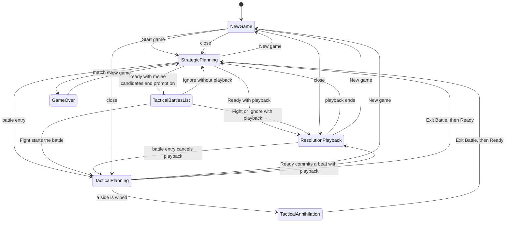

# Modes and Transitions

The desktop UI is in one primary mode at a time. A few conditions, such as waiting on the AI opponent, change a control inside a mode without replacing the mode.

## Purpose

Name the modes a player can be in, what starts and ends each one, and what planning state survives the change. Later documents use these names only.

## Mode List

### New game

The player sees the new-game overlay. The message is "Start the global game when ready." or "Start the regional game when ready." when no match is loaded, and "Start a new global game when ready." or "Start a new regional game when ready." when the player opened the overlay from the game menu during a match. The sentence follows the selected tab. A win or loss does not. The button reads "Start game". The body has three sections: Map, Forces, and Rules. Map holds the Global and Regional tabs. Global chooses a home region for each side. Regional chooses one region and a different side group for each side. Forces holds the Advanced tech line, game size, and each unit type's cap and price. Rules holds a level (Off, Low, or High) for each of the origin bonus, tech bonus, terrain bonus, and weather bonus, a starting month, fog of war, and Auto-start AI. The console and the selection panel are not on screen. The top bar is the new-game bar: the game menu button, the title "New game", Load game…, Settings, and Help, and the game menu works with New game… disabled. The setup panel floats 12 px in from the map's top-left corner, and the map fills the window under the top bar. Drag and the wheel pan and zoom the preview, and the + and − buttons zoom it, with the choices showing or hidden, and a click, double-click, or right-click on the map itself does not select, order, or change the selection. A successful Start turns opponent planning on when Auto-start AI was checked and Run was enabled, and otherwise releases Run and opens the Opponent tab. A failed start leaves Run and the console unchanged. Hiding the choices leaves only the header bar, where Start game takes the place of the message. Ready is disabled. The map shows that tab's preview, as in [new-game-dialog.md](new-game-dialog.md). The minimap panel and the terrain legend are hidden. This mode ends when Start game succeeds and a match is loaded. While it was opened over a live match, Close ends it and returns to the mode the player left, with that match as it was.

### Strategic planning

The player sees the top bar, the strategic world map, and the console. The top bar's date block shows the date and "Turn N · Planning". The player can pan and zoom, select units, draft orders, open build and stack popups, and press Ready when it is enabled. Strategic planning is blocked while the new-game overlay, the game-over overlay, or the tactical annihilation dialog is open, and it is replaced while a tactical battle is active or the tactical battles list is open.

While the Run control is pressed and the opponent's precomputed orders are not ready yet, Ready is disabled and its label becomes "AI:" plus an elapsed time. The footer status line reads "Opponent planning…" for that same wait. See [console.md](console.md). That wait is every-turn prefetch, and the first event-driven consult after a new game, after Run is turned on, or after Events is turned on. The map stays usable. Pressing Ready in that condition shows a map toast that planning is still running and does not end the turn. Turning Run off stops the wait, and Ready can end the turn without a precomputed plan. After a failed AI planning request, Ready becomes usable again with an empty opponent plan. Drafting, changing, or cancelling orders during that wait does not cancel or restart opponent planning.

Once that first event-driven consult has finished, later strategic turns do not wait on a new precomputed plan. The next turn's orders come from the deferred consultation after resolution, or from standing orders when that consultation does not call the model. Ready stays disabled until that consultation finishes, including after the player turns Run off. Its label is "Ready" during playback, then "AI:" plus an elapsed time while the consultation runs and Run stays on. The footer status line stays "Opponent planning on" during that playback and reads "Opponent planning…" while the consultation runs. Turning Run off stops that consultation, returns the label to "Ready", and the footer status line reads "Opponent planning off". See [Resolution playback](#resolution-playback).

While a Ready request is in flight, Ready stays disabled and keeps the label "Ready". A failed Ready request shows the reason on the map toast and returns the player to strategic planning.

### Tactical battles list

The player sees a dialog titled "Tactical Battles (N)", where N is the number of candidate hexes. Each row offers a choice, the hex information, a human unit summary, and an AI unit summary. Fight stays disabled until a row is chosen. Ignore is always available. A dimmed backdrop covers the window, and the dialog is centered on the visible map area rather than on the map plus the console. The map, the top bar, the console, and the selection panel stay as they were when Ready paused, and they do not receive pointer input. This dialog opens after Ready when the match reports melee candidates and Offer tactical battles is checked in the game menu. When it is unchecked, the dialog does not open and the turn continues as if the player chose Ignore.

Choosing Fight or Ignore closes the dialog. Escape and a click on the dimmed backdrop choose Ignore. Fight then starts a tactical battle on the chosen hex after the strategic turn finishes resolving. Ignore resolves melee without entering a tactical battle.

### Resolution playback

The player sees units and combat results animate on the current map, with dice chips showing the dice rolled in each combat phase. A map toast may summarize losses the player can see. Combat the player cannot see is announced as an unknown battle, with continent names when those names are available. Playback runs after Ready, or after a tactical Ready commit, when the resolved turn has movement or combat to show. It ends when the animation finishes.

Playback does not replace the underlying match. On the world map, the top bar's date block can already show the next planning turn while the animation is still running. In a battle, that date block stays hidden and the battle header's status line reads "Tactical resolution" and already names the next beat, until the animation ends. Until the animation ends, map gestures that change orders or the selection are ignored. Pan, zoom, hex tooltips, and right-click still work, the selection panel's close control still clears the selection, and the console keeps its own rules. Details are in [resolution-playback.md](resolution-playback.md). Starting a tactical battle cancels a strategic playback that is still running. Leaving a tactical battle also cancels playback.

Ready stays disabled while a deferred opponent consultation is still outstanding after playback was scheduled. The label stays "Ready" until the animation ends, and the footer status line stays "Opponent planning on". Ready then shows "AI:" plus an elapsed time until the consultation's result arrives, and the status line reads "Opponent planning…". Log lines, including error lines, do not stop that timer.

### Tactical planning

The player sees the battle map for one contested hex, the top bar as the battle header with Exit Battle, and the same console. The battle header names the battle and shows the beat. The player drafts tactical orders and presses Ready to commit a beat. Exit Battle is enabled while the player drafts. It is disabled from the tactical Ready commit until that beat's playback ends, and hidden while the annihilation dialog is open. The header's status line reads "Beat N · Tactical planning" while drafting. While a beat resolves it reads "Beat N · Tactical resolution", and N is already the next beat.

Clicks outside the battle area show an error toast and do not issue an order. The console stays usable. Strategic drafts are hidden for the duration of the battle and restored when it ends, except drafts whose units no longer exist.

Tactical planning ends when the player exits, when the battle is reconciled away because the strategic turn no longer matches, or when annihilation opens.

While Run is pressed, opponent sub-units remain, and no opponent plan is buffered yet, Ready is disabled with the same "AI:" elapsed-time label used in strategic planning, and the footer status line reads "Opponent planning…". As in strategic planning, editing the tactical draft during that wait does not cancel or restart opponent planning. Turning Run off, or leaving the battle, stops that wait. Entering from Fight holds that request while the strategic post-resolution consult is still running. The battle request starts when that consult's result is applied, and when the push is discarded because the turn no longer matches. Ready keeps the AI wait label until the battle plan is buffered or the player stops that planning.

### Tactical annihilation

The player sees an overlay with "You win!", "You lose.", or "All units destroyed.", and an Exit Battle button. The map, the top bar, the console, and the selection panel do not accept input. The in-battle Exit Battle control is hidden, and Ready is disabled. Any in-flight AI planning request is cancelled. This mode ends when the player presses Exit Battle, which leaves the battle, returns to strategic planning, and then runs Ready.

### Game over

The player sees the same overlay as New game. The message is "You win!" or "You lose." The button reads "New game". The console and the selection panel are not on screen, and the top bar is the same new-game bar. The map follows the same show and hide rules as New game, and Ready is disabled. The map shows the same preview as New game. The setup panel, its expand control, and the hidden minimap panel and legend match New game. The panel can still be collapsed to the header bar, where New game takes the place of the win or loss message. There is no close control. Starting a new match leaves this mode for strategic planning.

## Transitions

- App start with no loaded match -> New game.
- App start with a loaded match that is not over -> that match, with the console expanded on Opponent. Game over at launch still opens the dialog.
- New game -> Strategic planning: Start game succeeds.
- Strategic planning -> New game: New game in the game menu. The match keeps running under the screen. It is replaced when Start succeeds. New game is unavailable while a Ready is resolving.
- New game -> Strategic planning: Close, while the screen was opened from strategic planning. The match, its orders, its selection, and its camera are as the player left them.
- Resolution playback -> New game: New game in the game menu, in either theater. Playback continues under the screen.
- New game -> Resolution playback: Close, while playback was running. Playback has finished or continues.
- Tactical planning -> New game: New game in the game menu. The battle keeps running under the screen. The annihilation dialog and the tactical battles list do not accept New game; the game menu closes and stays closed while either is open.
- New game -> Tactical planning: Close, while the screen was opened from a battle. The battle view, its zoom limits, and its pan limit are back.
- Strategic planning -> Tactical battles list: Ready reports melee candidates and Offer tactical battles is checked in the game menu.
- Strategic planning -> Resolution playback: Ready succeeds and the turn has movement or combat to animate. If Offer tactical battles is unchecked, melee is ignored without the list.
- Strategic planning -> Tactical planning: the player uses a tactical entry marker, or Fight auto-starts the chosen battle.
- Strategic planning -> Game over: the loaded match is over.
- Tactical battles list -> Strategic planning, Resolution playback, or Tactical planning: Ignore or Fight, as above. Fight can both play back the strategic turn and then enter the battle, which cancels leftover playback.
- Resolution playback -> Strategic planning: the animation finishes.
- Resolution playback -> Tactical planning: battle entry cancels playback.
- Tactical planning -> Resolution playback: Ready commits a beat that has movement or combat to animate.
- Tactical planning -> Tactical annihilation: the beat leaves at least one side with no units.
- Tactical planning -> Strategic planning: Exit Battle succeeds, then Ready runs. A failed exit shows an error toast and stays in tactical planning.
- Tactical annihilation -> Strategic planning: Exit Battle, then Ready runs.
- Game over -> Strategic planning: New game succeeds.
- A loaded tactical session that the strategic turn no longer matches -> Strategic planning: the battle view closes without the exit button.

## State Carried Across Transitions

- New game and Game over into Strategic planning: selection, hex selection, draft orders, the strategic-order stash, hover preview, the running AI cost, and the AI activity log are cleared. The cost resets in both the Commander readout and the footer status line. The top bar and the console are on screen, and the map view frames the new match beside the console, as in [map-surface.md](map-surface.md).
- Strategic planning into Tactical planning: strategic draft orders are stashed and the order groups empty. Ranged and Strike targeting turn off. The build popup closes. Selection is reconciled to units that exist in the battle, which is usually empty. The map view changes to the battle area.
- Tactical planning or Tactical annihilation into Strategic planning: tactical draft orders are cleared. Stashed strategic drafts return, minus drafts whose units are gone. The map view leaves the battle area. A failed exit does not clear the battle. Leaving the battle stops the battle's opponent planning, including a post-beat consult. A strategic consult still running from the world-map turn keeps running and can still hold Ready. A successful exit then runs Ready, using the same rules as pressing Ready in Strategic planning. That can submit the restored drafts, open the tactical battles list, or start resolution playback. It does nothing while a deferred consultation is outstanding, and it shows the AI-wait toast while opponent orders are not ready.
- Ready, in either theater: a successful commit clears the drafts that were just submitted. Grouped march and ferry commits also clear the selection. Hover preview is cleared after strategic Ready. Tactical march continuations can reappear as pending movement after a tactical commit.
- Resolution playback: it does not by itself clear the stash or restore drafts. Cancelling playback to enter a battle flushes a deferred consultation notice if one was waiting on the animation.
- Starting a new match from the new-game screen discards the stash instead of restoring it. Closing the screen returns to the match with its stash as it was.

## Strategic and Tactical Theaters

Strategic means no tactical battle is active: the world map, strategic turns, and strategic orders. Tactical means a battle is active: the battle map, tactical turns, and tactical orders. Game over, New game, and the tactical battles list are strategic-side interruptions. Tactical annihilation is a tactical-side interruption. Resolution playback uses whichever map is current.

On the map, tactical play limits orders to the battle area and shows the battle turn. The top bar and the console stay visible in both theaters. In a battle the top bar shows the battle header, and the console's order groups follow the active theater. Build markers are hidden when a battle starts. Tactical entry markers are a strategic-planning affordance. Exit Battle and the annihilation dialog exist only in a battle. Details live in [map-surface.md](map-surface.md), [console.md](console.md), [tactical-entry-markers.md](tactical-entry-markers.md), and [tactical-battle-controls.md](tactical-battle-controls.md).

## Invariants

- The new-game overlay and the game-over overlay are the same surface. Only the message and the button label change. The three entry texts stay distinct so the player can tell startup, New game, and game over apart.
- AI wait is a condition on Ready inside Strategic planning and Tactical planning, not a mode. It never locks the map or the console.
- Ready never ends the turn while the match is over, while a Ready request is in flight, while the annihilation dialog is open, or while a deferred post-resolution consultation is outstanding.
- Unchecking Offer tactical battles never opens the tactical battles list. Melee resolves as Ignore.
- Strategic draft orders are not discarded merely by entering a tactical battle. They return when the battle ends, except for units that no longer exist. A successful exit then runs Ready.
- A click outside the battle area during tactical planning never issues a strategic order.

## Open Questions

None.

## Code Entry Points

- `static/index.html` (`#game-over-overlay`, `#tactical-annihilation-overlay`, `#tactical-exit-btn`, `#ready-btn`)
- `src/renderer/map/initCore.ts` (`wireInitCore`, which opens the loaded match and, when that match has hexes and is not over, the Opponent tab)
- `src/shared/consoleTabState.ts` (`consoleTabIdForLiveMatchLaunch`)
- `src/renderer/core/uiState.ts`
- `src/renderer/gameplay/newGame.ts`
- `src/renderer/gameplay/newGameReturn.ts`
- `src/renderer/gameplay/newGameBanner.ts`
- `src/renderer/gameplay/readyHandler.ts`
- `src/renderer/gameplay/readyTacticalCommit.ts`
- `src/renderer/gameplay/meleeInterceptModal.ts`
- `src/renderer/gameplay/tacticalBattlePromptPreference.ts`
- `src/renderer/openRouter/aiPlanningState.ts`
- `src/renderer/openRouter/openRouterUiHelpers.ts`
- `src/renderer/openRouter/resolutionPlaybackDeferral.ts`
- `src/renderer/rendering/resolutionPlayback.ts`
- `src/renderer/tactical/tacticalAnnihilationDialog.ts`
- `src/renderer/tactical/tacticalEntryFlow.ts`
- `src/renderer/tactical/tacticalExitFlow.ts`
- `src/renderer/tactical/tacticalIpcHandlers.ts`
- `src/renderer/tactical/tacticalStrategicOrderUiStash.ts`
- `src/renderer/tactical/tacticalUiGuards.ts`
- `src/renderer/tactical/tacticalUiOrchestration.ts`
- `src/renderer/tactical/tacticalExitButtonDom.ts`
